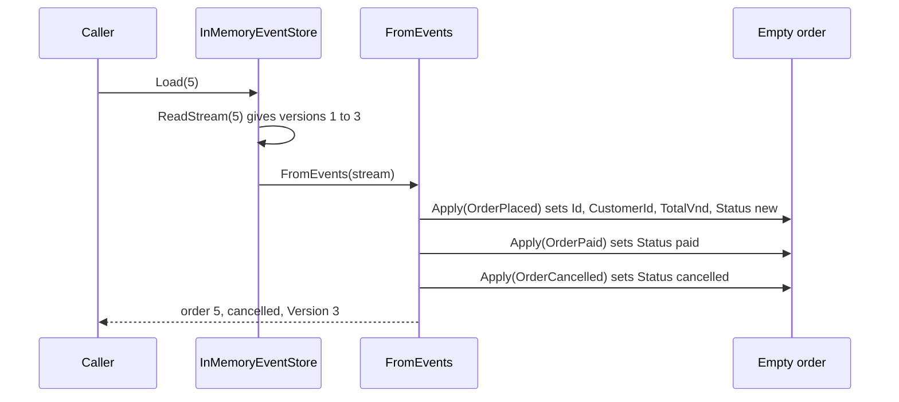

## Before you start

- [[design.l3.event-sourcing]] — you know the sample's `EventSourcedOrder` is stored only as its event stream, and that `Cancel` checks its rule before it records `OrderCancelled`.
- [[design.l3.aggregates-and-invariants]] — you know a rule spanning an aggregate holds only if every change passes through one place that checks it.
- [[design.l2.status-changes-through-methods]] — you know each allowed status change is a method that checks the starting status, such as `Ship()` only from `paid`.

## The situation

You run the stage-3 event sourcing sample and look at order 5's stream: `OrderPlaced` as version 1, `OrderPaid` as version 2. Later a cancel appends `OrderCancelled` as version 3. Nothing in the store says `paid` or `cancelled`; there are only the three events. Now a use case needs order 5 to decide whether it can be shipped, and a support colleague asks what the order looked like before the cancel. `EventSourcedOrder` has the fields `Status` and `Version`, but no row to read them from, and its methods throw when a rule fails. How does the sample turn the stored events back into an order, and which rules run while it does?

## Core concepts

- **event replay** — rebuilding an aggregate's state by applying its stored events again, in the order they were stored, to an empty instance; in the sample, `InMemoryEventStore.Load` does it with `EventSourcedOrder.FromEvents` each time it loads an order.
- applying an event — the sample's private `Apply` method: it sets the fields one event changes and adds one to `Version`, and does nothing else.
- recording an event — what `Pay`, `Cancel` and `Ship` do once their rule passes: `Record` applies the new event and adds it to the order's new events, the list a save appends.

## How it works



In the situation above, the caller asks `InMemoryEventStore`, the sample's event store, which keeps streams in memory, for order 5 with `Load`. The store reads order 5's stream from the first event and hands it to `EventSourcedOrder.FromEvents`. That method creates an empty order, with `Status` empty and `Version` at 0, then applies each event in the order it was stored. This is event replay. Each apply sets the fields its event changes and adds one to `Version`, so the loaded order is `cancelled` at version 3.

Notice what replay does not call. It never calls `Pay` or `Cancel`, so no rule runs. Applying an event only sets fields, and it never throws. The event is already in the stream: it happened, and its rule was checked when a method recorded it. Replay also adds nothing to the order's new events, so saving an order straight after loading it appends nothing.

The rules still matter, on the other path. When the use case now calls `Ship()` on the loaded order, `Ship` checks the status, finds `cancelled`, and throws before it records anything.

Replay has one more use. Pass `FromEvents` only the first two events and you get order 5 as it was at version 2: `paid`. The stage-2 `orders` row could not do this: a cancel wrote `cancelled` over `paid`, and the row kept no earlier value.

## In the Đơn Hàng system

The sample order's `Apply`:

```csharp file=samples/DonHang.Samples/Samples/Design/EventSourcing/EventSourcedOrder.cs tag=stage-3 lines=99-121
    private void Apply(OrderEvent domainEvent)
    {
        switch (domainEvent)
        {
            case OrderPlaced placed:
                Id = placed.OrderId;
                CustomerId = placed.CustomerId;
                TotalVnd = placed.TotalVnd;
                Status = "new";
                break;
            case OrderPaid:
                Status = "paid";
                break;
            case OrderShipped:
                Status = "shipped";
                break;
            case OrderCancelled:
                Status = "cancelled";
                break;
        }

        Version++;
    }
```

Each case only copies values from the event or sets `Status`, and the last line adds one to `Version`. Nothing here asks what the status was before: `OrderShipped` sets `shipped`, although `Ship()` allows that change only from `paid`. That is safe because, in the sample, an `OrderShipped` gets into an order's new events only through `Ship()`, which checked the rule first. `FromEvents` and `Record`, both outside this excerpt, call this same `Apply`, so a new event and a replayed one change the fields in exactly the same way.

The tests for replay and for the rule:

```csharp file=samples/DonHang.Samples.Tests/EventSourcingTests.cs tag=stage-3 lines=15-38
    [Fact]
    public void Replay_GivesTheStateAfterTheEventsApplied()
    {
        List<OrderEvent> stream =
        [
            new OrderPlaced(5, CustomerId: 3, TotalVnd: 1_010_000, At),
            new OrderPaid(5, At.AddMinutes(30)),
            new OrderCancelled(5, At.AddHours(2)),
        ];

        Assert.Equal("cancelled", EventSourcedOrder.FromEvents(stream).Status);
        Assert.Equal("paid", EventSourcedOrder.FromEvents(stream.Take(2)).Status);
    }

    // The rule runs when an event is recorded, not when one is replayed.
    [Fact]
    public void Ship_CancelledOrder_ThrowsAndRecordsNothing()
    {
        var order = EventSourcedOrder.FromEvents([new OrderPlaced(5, 3, 1_010_000, At), new OrderCancelled(5, At)]);

        Assert.Throws<InvalidOperationException>(() => order.Ship(At));

        Assert.Empty(order.NewEvents);
    }
```

The first test builds order 5's stream by hand: placed, paid, cancelled. `At` is a fixed time the test class defines, so each event gets a known timestamp. Replayed whole, the stream gives `cancelled`; `stream.Take(2)` passes only the first two events and gives `paid`. The second test replays a placed and a cancelled event, then calls `Ship`. `Ship` throws `InvalidOperationException` and `NewEvents` stays empty: the rule refused the change before anything was recorded.

## Seniors often assume…

- **"When an event-sourced order is loaded, every past event is checked against today's rules again."** → Actually replay calls `Apply`, never `Pay`, `Cancel` or `Ship`, so no rule runs while an order is loaded. Each rule ran once, when its event was recorded. If a rule changes later, the events already stored still describe what was allowed when they happened, and the order still loads. You notice this in the second test: it builds a cancelled order from two events with no call to `Cancel`, and the load succeeds without a single check.
- **"Replaying events means publishing them through the broker to every consumer again."** → Actually replay happens inside the code that loads the order: `Load` reads one stream from the store and applies it to an object in memory. Nothing is sent anywhere. You notice this when you run the sample's script: it only runs the samples project with `dotnet run` and starts no containers, yet it prints a replayed order, because nothing in `Load`, `FromEvents` or `Apply` talks to a broker.
- **"Applying an event should throw when the event would break a rule, to protect the aggregate."** → Actually the protection belongs in the method that records the event, before it is recorded; `Apply` runs both then and on every later load. The sample's store never changes or deletes a stored event, so an `Apply` that threw on it would refuse to load that order every time from then on. You notice this in `EventSourcingTests`: the second test's `Ship` throws and records nothing, the guard working where it belongs, while the replay that built the order passed without any check.

## Try it (3 minutes)

1. In the root folder of the example repository at `stage-3`, run `scripts/design/event-sourcing.sh` in a bash shell (Git Bash on Windows). Read the first block of output, under `== the stream of order 5`, and the line that starts with `== replayed`. The script prints this part before the cancel is appended, so the stream still has two events there.
2. Before opening the answer, write down what `FromEvents` would give if it were passed only version 1 of that stream.

Expected result: the first block lists `version 1: OrderPlaced at 09:00` and `version 2: OrderPaid at 09:30`, and the next line reads `== replayed: order 5 is paid at version 2`.

<details><summary>Suggested answer</summary>

Only `OrderPlaced` would be applied. It sets the id, the customer, the total and the status `new`, and `Version` becomes 1. That is order 5 as it was right after it was placed, before the payment at 09:30.

No rule runs in either replay. The only difference between the two loads is the second `Apply` call.

</details>

## Connections

- [[design.l3.event-sourcing]] — the step before: there a method records an event and the store appends it; here the stored events become an order again.
- [[design.l3.stream-concurrency]] — the next step: an order loaded by replay remembers the version it was loaded at, and saving checks that version.
- [[design.l3.snapshots]] — a later lesson that shortens this replay for long streams without changing its result.
- [[design.l2.status-changes-through-methods]] — the same placement of rules: each change is a method that checks its starting status, and replay leaves those checks where they are.
- [[design.l2.valid-from-construction]] — the other way an object comes into being: `Order`'s constructor checks before the order exists, while `FromEvents` builds an order from events whose checks already ran.

## Five-line summary

1. Loading an event-sourced order is event replay: its stream is applied, oldest event first, to an empty order, giving its current state.
2. Applying an event only sets fields; it checks no rule and never throws, because the event happened and its rule was checked then.
3. Rules run in the method that records a new event, so `Ship()` on a cancelled order throws before anything is recorded.
4. Replaying only the events up to a version gives the order as it was then, which an overwritten `orders` row cannot.
5. `EventSourcingTests` replays placed, paid and cancelled to get `cancelled`; the same stream without its last event gives `paid`.
