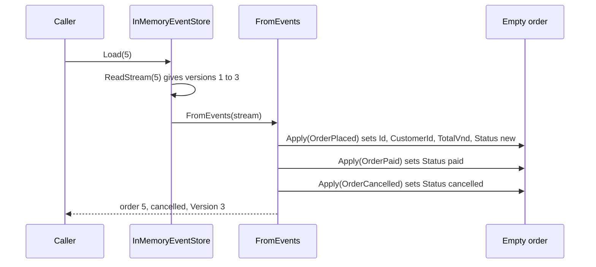

## Bạn cần biết trước

- [[design.l3.event-sourcing]] — bạn biết `EventSourcedOrder` của mẫu chỉ được lưu dưới dạng event stream của nó, và `Cancel` kiểm tra quy tắc trước khi ghi nhận `OrderCancelled`.
- [[design.l3.aggregates-and-invariants]] — bạn biết một quy tắc trải trên cả aggregate chỉ đứng vững khi mọi thay đổi đều đi qua một chỗ duy nhất kiểm tra nó.
- [[design.l2.status-changes-through-methods]] — bạn biết mỗi lần đổi trạng thái được phép là một method kiểm tra trạng thái xuất phát, như `Ship()` chỉ chạy được từ `paid`.

## Tình huống

Bạn chạy mẫu event sourcing của stage-3 và xem stream của đơn 5: `OrderPlaced` là version 1, `OrderPaid` là version 2. Sau đó một lần hủy nối thêm `OrderCancelled` làm version 3. Không chỗ nào trong store ghi `paid` hay `cancelled`, chỉ có ba event. Giờ một use case cần đơn 5 để quyết định có giao được không, và một đồng nghiệp bên hỗ trợ hỏi đơn trông thế nào trước lần hủy. `EventSourcedOrder` có field `Status` và `Version`, nhưng không có dòng nào để đọc chúng ra, và các method của nó ném exception khi quy tắc không qua. Mẫu biến các event đã lưu trở lại thành một đơn bằng cách nào, và quy tắc nào chạy trong lúc đó?

## Khái niệm cốt lõi

- **event replay** (áp lại các event đã lưu theo thứ tự để dựng lại trạng thái từ chúng) — dựng lại trạng thái của một aggregate bằng cách áp lại các event đã lưu của nó, đúng thứ tự đã lưu, lên một instance rỗng. Trong mẫu, `InMemoryEventStore.Load` làm điều này bằng `EventSourcedOrder.FromEvents` mỗi lần nạp một đơn.
- áp một event — method `Apply` private của mẫu: nó đặt các field mà event đó thay đổi, cộng một vào `Version`, và không làm gì khác.
- ghi nhận một event — điều `Pay`, `Cancel` và `Ship` làm khi quy tắc của chúng qua: `Record` áp event mới và thêm nó vào danh sách event mới của đơn, danh sách mà một lần lưu sẽ nối vào stream.

## Cơ chế hoạt động



Trong tình huống trên, caller gọi `Load` để xin đơn 5 từ `InMemoryEventStore`, event store của mẫu, giữ các stream trong bộ nhớ. Store đọc stream của đơn 5 từ event đầu tiên và đưa nó cho `EventSourcedOrder.FromEvents`. Method này tạo một đơn rỗng, `Status` trống và `Version` bằng 0, rồi áp từng event theo đúng thứ tự đã lưu. Đây chính là event replay. Mỗi lần áp đặt các field mà event đó thay đổi và cộng một vào `Version`, nên đơn nạp lên là `cancelled` ở version 3.

Hãy để ý những gì replay không gọi. Nó không bao giờ gọi `Pay` hay `Cancel`, nên không quy tắc nào chạy. Áp một event chỉ đặt field và không bao giờ ném exception. Event đã nằm trong stream: chuyện đó đã xảy ra, và quy tắc của nó đã được kiểm tra lúc một method ghi nhận nó. Replay cũng không thêm gì vào danh sách event mới của đơn, nên lưu một đơn ngay sau khi nạp sẽ không nối thêm gì.

Quy tắc vẫn có tác dụng, nhưng ở nhánh còn lại. Khi use case gọi `Ship()` trên đơn vừa nạp, `Ship` kiểm tra trạng thái, thấy `cancelled`, và ném exception trước khi ghi nhận bất cứ gì.

Replay còn một công dụng nữa. Chỉ đưa cho `FromEvents` hai event đầu, bạn nhận được đơn 5 như lúc nó ở version 2: `paid`. Dòng `orders` của stage-2 không làm được điều này: lần hủy ghi `cancelled` đè lên `paid`, và dòng đó không giữ giá trị cũ nào.

## Trong hệ thống Đơn Hàng

`Apply` của đơn mẫu:

```csharp file=samples/DonHang.Samples/Samples/Design/EventSourcing/EventSourcedOrder.cs tag=stage-3 lines=99-121
    private void Apply(OrderEvent domainEvent)
    {
        switch (domainEvent)
        {
            case OrderPlaced placed:
                Id = placed.OrderId;
                CustomerId = placed.CustomerId;
                TotalVnd = placed.TotalVnd;
                Status = "new";
                break;
            case OrderPaid:
                Status = "paid";
                break;
            case OrderShipped:
                Status = "shipped";
                break;
            case OrderCancelled:
                Status = "cancelled";
                break;
        }

        Version++;
    }
```

Mỗi case chỉ chép giá trị từ event hoặc đặt `Status`, và dòng cuối cộng một vào `Version`. Không chỗ nào ở đây hỏi trạng thái trước đó là gì: `OrderShipped` đặt `shipped`, dù `Ship()` chỉ cho đổi như vậy từ `paid`. Điều đó an toàn vì trong mẫu, một `OrderShipped` chỉ vào được danh sách event mới của đơn qua `Ship()`, method đã kiểm tra quy tắc trước. `FromEvents` và `Record`, cả hai nằm ngoài đoạn trích, đều gọi chung `Apply` này, nên event mới và event được áp lại thay đổi các field y hệt nhau.

Các test cho replay và cho quy tắc:

```csharp file=samples/DonHang.Samples.Tests/EventSourcingTests.cs tag=stage-3 lines=15-38
    [Fact]
    public void Replay_GivesTheStateAfterTheEventsApplied()
    {
        List<OrderEvent> stream =
        [
            new OrderPlaced(5, CustomerId: 3, TotalVnd: 1_010_000, At),
            new OrderPaid(5, At.AddMinutes(30)),
            new OrderCancelled(5, At.AddHours(2)),
        ];

        Assert.Equal("cancelled", EventSourcedOrder.FromEvents(stream).Status);
        Assert.Equal("paid", EventSourcedOrder.FromEvents(stream.Take(2)).Status);
    }

    // The rule runs when an event is recorded, not when one is replayed.
    [Fact]
    public void Ship_CancelledOrder_ThrowsAndRecordsNothing()
    {
        var order = EventSourcedOrder.FromEvents([new OrderPlaced(5, 3, 1_010_000, At), new OrderCancelled(5, At)]);

        Assert.Throws<InvalidOperationException>(() => order.Ship(At));

        Assert.Empty(order.NewEvents);
    }
```

Test đầu tự dựng stream của đơn 5: đặt, thanh toán, hủy. `At` là một thời điểm cố định do class test khai báo, nên mỗi event có timestamp biết trước. Áp lại cả stream thì ra `cancelled`, còn `stream.Take(2)` chỉ đưa hai event đầu và ra `paid`. Test thứ hai áp lại một event đặt đơn và một event hủy, rồi gọi `Ship`. `Ship` ném `InvalidOperationException` và `NewEvents` vẫn rỗng: quy tắc đã từ chối thay đổi trước khi có gì được ghi nhận.

## Senior hay nhầm rằng…

- **"Khi nạp một đơn lưu theo event, mọi event cũ lại được kiểm tra với quy tắc hiện hành."** → Thực ra replay gọi `Apply`, không bao giờ gọi `Pay`, `Cancel` hay `Ship`, nên không quy tắc nào chạy khi nạp đơn. Mỗi quy tắc đã chạy một lần, lúc event của nó được ghi nhận. Nếu sau này quy tắc đổi, các event đã lưu vẫn mô tả điều được phép vào lúc chúng xảy ra, và đơn vẫn nạp được. Bạn sẽ nhận ra điều này ở test thứ hai: nó dựng một đơn đã hủy từ hai event mà không gọi `Cancel`, và lần nạp thành công mà không qua một phép kiểm tra nào.
- **"Replay event nghĩa là phát lại chúng qua broker tới mọi consumer."** → Thực ra replay diễn ra ngay trong đoạn code nạp đơn: `Load` đọc một stream từ store và áp nó lên một object trong bộ nhớ. Không có gì được gửi đi đâu cả. Bạn sẽ nhận ra khi chạy script của mẫu: nó chỉ chạy project mẫu bằng `dotnet run`, không khởi động container nào, mà vẫn in ra một đơn được áp lại, vì không chỗ nào trong `Load`, `FromEvents` hay `Apply` nói chuyện với broker.
- **"Áp một event nên ném exception khi event đó phá quy tắc, để bảo vệ aggregate."** → Thực ra chỗ bảo vệ là method ghi nhận event, trước khi event được ghi nhận. `Apply` chạy cả lúc đó lẫn ở mọi lần nạp về sau. Store của mẫu không bao giờ sửa hay xóa event đã lưu, nên một `Apply` ném exception với event đó sẽ từ chối nạp đơn ấy ở mọi lần từ đó trở đi. Bạn sẽ nhận ra điều này trong `EventSourcingTests`: `Ship` ở test thứ hai ném exception và không ghi nhận gì, đó là phép canh làm việc đúng chỗ, còn lần replay dựng nên đơn thì đi qua mà không có phép kiểm tra nào.

## Thử ngay (3 phút)

1. Ở thư mục gốc của repo ví dụ tại `stage-3`, chạy `scripts/design/event-sourcing.sh` trong bash (Git Bash trên Windows). Đọc khối output đầu tiên, dưới `== the stream of order 5`, và dòng bắt đầu bằng `== replayed`. Script in phần này trước khi lần hủy được nối vào, nên lúc đó stream vẫn chỉ có hai event.
2. Trước khi mở đáp án, ghi ra `FromEvents` sẽ trả về gì nếu chỉ được đưa version 1 của stream đó.

Kết quả mong đợi: khối đầu tiên liệt kê `version 1: OrderPlaced at 09:00` và `version 2: OrderPaid at 09:30`, và dòng tiếp theo là `== replayed: order 5 is paid at version 2`.

<details><summary>Gợi ý đáp án</summary>

Chỉ `OrderPlaced` được áp. Nó đặt id, khách hàng, tổng tiền và trạng thái `new`, còn `Version` thành 1. Đó là đơn 5 ngay sau khi được đặt, trước lần thanh toán lúc 09:30.

Không quy tắc nào chạy trong cả hai lần replay. Khác biệt duy nhất giữa hai lần nạp là lời gọi `Apply` thứ hai.

</details>

## Liên hệ

- [[design.l3.event-sourcing]] — bước trước: ở đó một method ghi nhận event và store nối nó vào, còn ở đây các event đã lưu lại trở thành một đơn.
- [[design.l3.stream-concurrency]] — bước tiếp theo: đơn nạp bằng replay nhớ version lúc nó được nạp, và lần lưu sẽ kiểm tra version đó.
- [[design.l3.snapshots]] — một bài sau rút ngắn lần replay này cho các stream dài mà không đổi kết quả.
- [[design.l2.status-changes-through-methods]] — quy tắc được đặt ở cùng chỗ: mỗi thay đổi là một method kiểm tra trạng thái xuất phát, và replay để nguyên các phép kiểm tra đó ở chỗ của chúng.
- [[design.l2.valid-from-construction]] — cách còn lại để một object ra đời: constructor của `Order` kiểm tra trước khi đơn tồn tại, còn `FromEvents` dựng đơn từ các event đã qua kiểm tra từ trước.

## Tóm tắt 5 dòng

1. Nạp một đơn lưu theo event chính là event replay: stream của nó được áp lên một đơn rỗng, event cũ nhất trước, cho ra trạng thái hiện tại.
2. Áp một event chỉ đặt field, không kiểm tra quy tắc nào và không bao giờ ném exception, vì event đã xảy ra và quy tắc của nó đã được kiểm tra lúc đó.
3. Quy tắc chạy trong method ghi nhận event mới, nên `Ship()` trên một đơn đã hủy ném exception trước khi có gì được ghi nhận.
4. Chỉ áp lại các event tới một version thì ra đơn như lúc đó, điều mà một dòng `orders` bị ghi đè không làm được.
5. `EventSourcingTests` áp lại đặt, thanh toán và hủy để ra `cancelled`, cùng stream đó bỏ event cuối thì ra `paid`.
