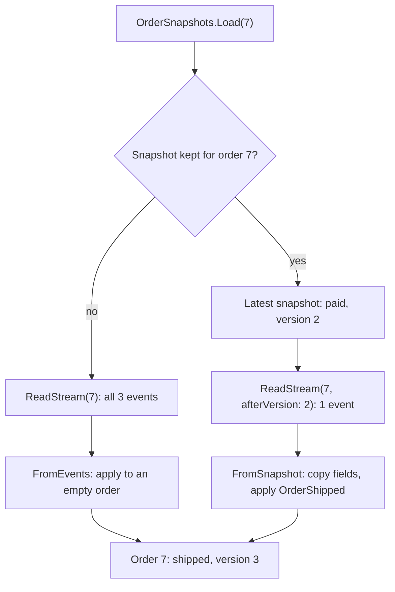

## Before you start

- [[design.l3.event-projections]] — you know a projection reads every event through `ReadAll` and can be rebuilt by starting again from position 0.
- [[design.l3.rebuilding-state-from-events]] — you know loading an event-sourced order replays its stream through `Apply`, and `Version` counts the events applied.

## The situation

In the stage-3 sample, `InMemoryEventStore.Load` replays an order's whole stream every time it is called. A sample order's stream holds at most three events, so that replay is cheap. A colleague worries about an aggregate whose stream grows with every change, and proposes saving the order's fields every few events, so a load can start from there. A second colleague goes further: once that copy exists, delete the events before it to keep the stream short. Both ideas save work. Which of them is safe: what can a saved copy of an order's state replace, and what must it never replace?

## Core concepts

- **snapshot (event sourcing)** — an aggregate's state at one version, saved so that a later load starts from it and applies only the events stored after that version.
- snapshot version — the version the order had when its snapshot was taken; the sample keeps it in the `Version` field of `OrderSnapshot`.
- snapshot interval — how many new events must be stored before the next snapshot is taken; the sample's `every`, chosen by the caller.

## How it works



The diagram follows order 7 from the test below: placed, paid and shipped, with a snapshot every 2 events. In the situation above, the first colleague's idea is a snapshot. `OrderSnapshots` wraps the sample store. Its `Save` appends the order's new events first, then checks how many events the order has applied since its latest snapshot. When that number reaches `every`, it keeps a new `OrderSnapshot`: the order's id, customer, total, status and version.

Its `Load` looks for that snapshot. Without one, it replays the whole stream. With one, it reads only the events after the snapshot's version and applies them on top of the copied fields. Both paths end at the same order. The store refuses an append when the stream no longer holds as many events as the order had when loaded: optimistic concurrency. So the snapshot also restores `Version`, the number that check uses.

An event store only appends, so the second colleague would first have to change that rule; even then, the idea breaks the design. The events stay the truth; the snapshot is a cache of what replaying them gives. Delete every snapshot and the next loads replay every event: slower, still correct. Delete the events and nothing can check or rebuild the snapshot. When the order's fields change shape, such as a new field for when it was paid, you delete the old snapshots and let new ones be taken from the events. The events have no second source: they keep their stored shape, so new code must still apply it.

## In the Đơn Hàng system

`OrderSnapshots`, the sample's snapshot code at stage-3:

```csharp file=samples/DonHang.Samples/Samples/Design/EventSourcing/OrderSnapshots.cs tag=stage-3 lines=17-40
    public void Save(EventSourcedOrder order)
    {
        store.Save(order);

        var snapshotVersion = latest.TryGetValue(order.Id, out var snapshot) ? snapshot.Version : 0;
        if (order.Version - snapshotVersion >= every)
        {
            latest[order.Id] = order.ToSnapshot();
        }
    }

    public EventSourcedOrder Load(int orderId)
    {
        if (!latest.TryGetValue(orderId, out var snapshot))
        {
            var stream = store.ReadStream(orderId);
            EventsReplayedByLastLoad = stream.Count;
            return EventSourcedOrder.FromEvents(stream);
        }

        var eventsAfter = store.ReadStream(orderId, afterVersion: snapshot.Version);
        EventsReplayedByLastLoad = eventsAfter.Count;
        return EventSourcedOrder.FromSnapshot(snapshot, eventsAfter);
    }
```

`store.Save(order)` runs first, so a snapshot is taken only once the events it covers are in the store; when the append is refused, because another save added events since this order was loaded, `Save` throws before a snapshot could describe events the store never kept. `latest` holds one snapshot per order id, and `ToSnapshot` copies the order's five fields into an `OrderSnapshot`. `snapshotVersion` is 0 for an order with no snapshot yet. `ReadStream(orderId, afterVersion: snapshot.Version)` skips the events the snapshot already covers. `EventsReplayedByLastLoad` counts how many events the last load applied. `FromSnapshot`, in `EventSourcedOrder.cs` outside this excerpt, copies the five fields from the snapshot, `Version` included, then applies each later event with the same `Apply` that replay uses.

The test that compares both ways of loading:

```csharp file=samples/DonHang.Samples.Tests/EventSourcingTests.cs tag=stage-3 lines=114-132
    [Fact]
    public void Snapshot_LoadsTheSameOrder_AndCanBeDeleted()
    {
        var snapshots = new OrderSnapshots(new InMemoryEventStore(), every: 2);
        var order = EventSourcedOrder.Place(7, customerId: 3, totalVnd: 2_140_000, At);
        snapshots.Save(order);
        order.Pay(At);
        snapshots.Save(order);
        order.Ship(At);
        snapshots.Save(order);

        var fromSnapshot = snapshots.Load(7);
        Assert.Equal(1, snapshots.EventsReplayedByLastLoad);
        snapshots.DeleteAll();
        var fromEvents = snapshots.Load(7);

        Assert.Equal(3, snapshots.EventsReplayedByLastLoad);
        Assert.Equal(fromEvents.ToSnapshot(), fromSnapshot.ToSnapshot());
    }
```

The snapshot interval is 2. Order 7 is placed, paid and shipped, and saved after each change. The save after `Pay` takes the snapshot at version 2; after `Ship`, only one more event has passed, so none is taken. The first load applies 1 event on top of the snapshot; after `DeleteAll`, the load replays all 3. Two `OrderSnapshot` records with equal fields are equal. So the last line checks that both loads give the same id, customer, total, status and version.

## Seniors often assume…

- **"Every event-sourced aggregate needs snapshots from the start."** → Actually a snapshot saves only the replay of the events before it. A sample order's stream holds at most three: placed, paid, then shipped or cancelled. Replaying three events is already cheap, while `OrderSnapshots` adds a class, a second load path and a version to keep right. Snapshots pay off when an aggregate's stream grows long; before that they are extra code to keep correct. You notice this when a field that `FromSnapshot` forgot to copy gives a different order than replay would, for a load that was never slow.
- **"Once a snapshot is saved, the events before it can be deleted."** → Actually the snapshot is computed from those events and can be computed again only while they exist. Projections need them too: a rebuild of `OrderTimeline` starts from the first event of the store. You notice this when the order's fields change shape: with the events kept, you delete the old snapshots and take new ones; without them, the old orders have nothing to be rebuilt from.
- **"A snapshot is just another name for a projection."** → Actually both are built from events and both can be thrown away, but they serve different sides. A projection reads every stream in append order and keeps a read model that queries use. A snapshot holds one order's state at one version, and only `Load` reads it, to rebuild that order before a method runs. You notice this in the sample: a projection tracks `Position` across all events, while `OrderSnapshot` stores `Version` within one stream.

## Try it (3 minutes)

1. In the root folder of the example repository at `stage-3`, run `scripts/design/event-sourcing.sh` in a bash shell (Git Bash on Windows). Do not read the last block yet.
2. The last block, `== a snapshot every 2 events`, places, pays and ships order 7, saving after each change, then loads it with its snapshot and again after deleting the snapshots. Write down how many events each load applies, then read the block.

Expected result: the block reads `with the snapshot: shipped, 1 event replayed` and `snapshots deleted: shipped, 3 events replayed`.

<details><summary>Suggested answer</summary>

The snapshot is taken by the save after the payment, when order 7 is at version 2: two events have passed since version 0. The save after shipping adds only one more, fewer than 2, so no new snapshot is taken. The load with the snapshot applies only `OrderShipped` on top of it.

With the snapshots deleted, the same `shipped` order comes from replaying all three events. Only the count changes.

</details>

## Connections

- [[design.l3.rebuilding-state-from-events]] — prerequisite: the replay a snapshot shortens; `FromSnapshot` applies the later events with the same `Apply`.
- [[design.l3.event-projections]] — the other thing built from events: a read model for queries, where a snapshot is a starting point for loading one order.
- [[backend.l2.cache-aside]] — the same idea in another place: a copy you can afford to lose, because the source it came from stays.
- [[design.l3.when-not-to-event-source]] — the next lesson: weighing these costs, and why Đơn Hàng keeps `Order` state-based.

## Five-line summary

1. A snapshot saves an aggregate's state at one version, so loading starts from it and replays only the events stored after it.
2. The sample's `OrderSnapshots` takes one each time `every` events have passed; `EventSourcingTests` checks that loads with and without it give the same order.
3. A snapshot is a cache, not the source of truth: the events stay the truth, so deleting every snapshot only makes loading slower.
4. When the order's fields change shape, old snapshots are deleted and taken again from the events, which must stay readable.
5. A sample order's stream holds at most three events, so replaying it is cheap; snapshots pay off only for long streams.
