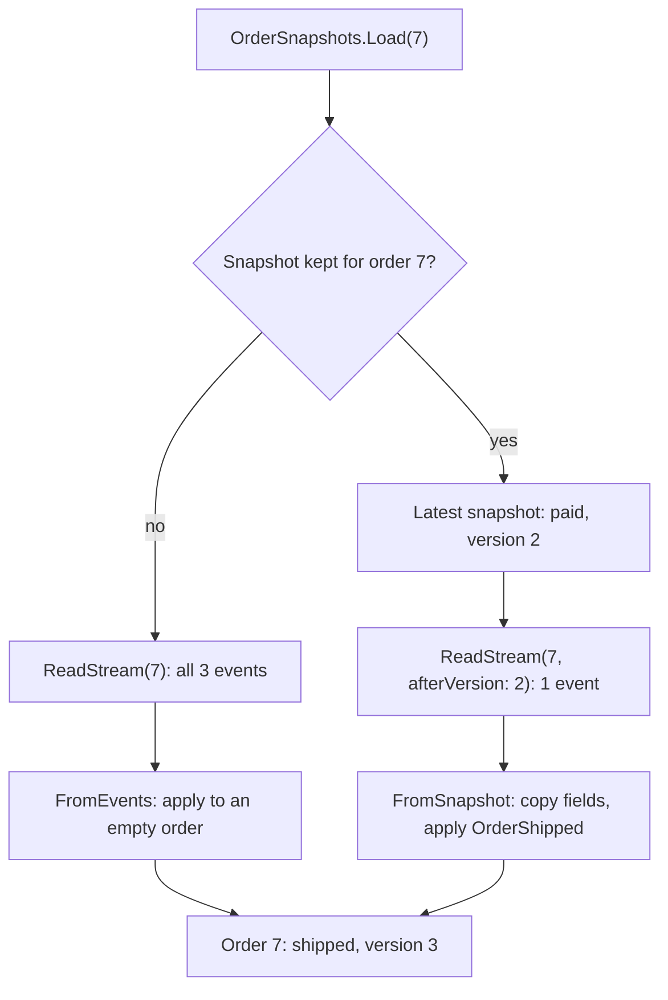

## Bạn cần biết trước

- [[design.l3.event-projections]] — bạn biết một projection đọc mọi event qua `ReadAll` và dựng lại được bằng cách bắt đầu lại từ vị trí 0.
- [[design.l3.rebuilding-state-from-events]] — bạn biết nạp một đơn theo event sourcing là áp lại stream của nó qua `Apply`, và `Version` đếm số event đã áp.

## Tình huống

Trong mẫu ở stage-3, mỗi lần được gọi, `InMemoryEventStore.Load` áp lại toàn bộ stream của đơn. Stream của một đơn mẫu có nhiều nhất ba event, nên lần áp lại đó rẻ. Một đồng nghiệp lo cho những aggregate có stream dài thêm sau mỗi thay đổi. Người đó đề xuất cứ vài event lại lưu các trường của đơn một lần, để lần nạp sau bắt đầu từ đó. Một đồng nghiệp khác đi xa hơn: khi đã có bản sao đó thì xóa các event nằm trước nó cho stream ngắn lại. Cả hai ý đều bớt được việc. Ý nào an toàn: một bản sao trạng thái của đơn thay được cho cái gì, và không bao giờ được thay cho cái gì?

## Khái niệm cốt lõi

- **snapshot (event sourcing)** (trạng thái của một aggregate tại một version, lưu lại để lần nạp sau chỉ cần áp các event sau đó) — trạng thái của một aggregate tại một version, được lưu lại để lần nạp sau bắt đầu từ đó và chỉ áp các event lưu sau version ấy.
- version của snapshot — version mà đơn có lúc snapshot được lấy. Mẫu giữ nó trong trường `Version` của `OrderSnapshot`.
- khoảng cách giữa hai snapshot — số event mới phải được lưu trước khi lấy snapshot tiếp theo. Trong mẫu đó là `every`, do bên gọi chọn.

## Cơ chế hoạt động



Sơ đồ theo đơn 7 trong test bên dưới: được đặt, thanh toán rồi giao, cứ 2 event lấy một snapshot. Với tình huống trên, ý của đồng nghiệp thứ nhất chính là snapshot. `OrderSnapshots` bọc store của mẫu. `Save` của nó nối các event mới của đơn vào store trước, rồi xem đơn đã áp bao nhiêu event kể từ snapshot gần nhất. Khi con số đó đạt `every`, nó giữ một `OrderSnapshot` mới: id, khách hàng, tổng tiền, trạng thái và version của đơn.

`Load` của nó tìm snapshot đó. Không có thì nó áp lại cả stream. Có thì nó chỉ đọc các event sau version của snapshot rồi áp chúng lên các trường đã chép. Cả hai đường đều ra cùng một đơn. Store từ chối một lần nối khi stream không còn đúng số event mà đơn có lúc được nạp: đó là optimistic concurrency. Vì vậy snapshot cũng phải khôi phục `Version`, con số mà phép kiểm tra đó dùng.

Event store chỉ cho nối thêm, nên đồng nghiệp thứ hai trước hết phải đổi quy tắc đó. Dù đổi được, ý này vẫn phá thiết kế. Event vẫn là sự thật, còn snapshot là cache của kết quả áp lại chúng. Xóa hết snapshot thì các lần nạp sau áp lại mọi event: chậm hơn nhưng vẫn đúng. Xóa event thì không còn gì để kiểm tra hay dựng lại snapshot. Khi các trường của đơn đổi hình dạng, chẳng hạn thêm một trường ghi lúc thanh toán, bạn xóa các snapshot cũ và để snapshot mới được lấy từ event. Event thì không có nguồn thứ hai: chúng giữ nguyên hình dạng lúc được lưu, nên code mới vẫn phải áp được hình dạng đó.

## Trong hệ thống Đơn Hàng

`OrderSnapshots`, code snapshot của mẫu ở stage-3:

```csharp file=samples/DonHang.Samples/Samples/Design/EventSourcing/OrderSnapshots.cs tag=stage-3 lines=17-40
    public void Save(EventSourcedOrder order)
    {
        store.Save(order);

        var snapshotVersion = latest.TryGetValue(order.Id, out var snapshot) ? snapshot.Version : 0;
        if (order.Version - snapshotVersion >= every)
        {
            latest[order.Id] = order.ToSnapshot();
        }
    }

    public EventSourcedOrder Load(int orderId)
    {
        if (!latest.TryGetValue(orderId, out var snapshot))
        {
            var stream = store.ReadStream(orderId);
            EventsReplayedByLastLoad = stream.Count;
            return EventSourcedOrder.FromEvents(stream);
        }

        var eventsAfter = store.ReadStream(orderId, afterVersion: snapshot.Version);
        EventsReplayedByLastLoad = eventsAfter.Count;
        return EventSourcedOrder.FromSnapshot(snapshot, eventsAfter);
    }
```

`store.Save(order)` chạy trước, nên snapshot chỉ được lấy khi các event nó bao đã nằm trong store. Khi lần nối bị từ chối, vì một lần lưu khác đã thêm event từ lúc đơn này được nạp, `Save` ném lỗi trước khi kịp có snapshot mô tả những event mà store chưa từng giữ. `latest` giữ một snapshot cho mỗi id đơn, và `ToSnapshot` chép năm trường của đơn vào một `OrderSnapshot`. Với đơn chưa có snapshot, `snapshotVersion` bằng 0. `ReadStream(orderId, afterVersion: snapshot.Version)` bỏ qua các event mà snapshot đã bao. `EventsReplayedByLastLoad` đếm số event mà lần nạp gần nhất đã áp. `FromSnapshot`, nằm trong `EventSourcedOrder.cs` ngoài đoạn trích, chép năm trường từ snapshot, kể cả `Version`, rồi áp từng event sau đó bằng chính `Apply` mà lần áp lại dùng.

Test so sánh hai cách nạp:

```csharp file=samples/DonHang.Samples.Tests/EventSourcingTests.cs tag=stage-3 lines=114-132
    [Fact]
    public void Snapshot_LoadsTheSameOrder_AndCanBeDeleted()
    {
        var snapshots = new OrderSnapshots(new InMemoryEventStore(), every: 2);
        var order = EventSourcedOrder.Place(7, customerId: 3, totalVnd: 2_140_000, At);
        snapshots.Save(order);
        order.Pay(At);
        snapshots.Save(order);
        order.Ship(At);
        snapshots.Save(order);

        var fromSnapshot = snapshots.Load(7);
        Assert.Equal(1, snapshots.EventsReplayedByLastLoad);
        snapshots.DeleteAll();
        var fromEvents = snapshots.Load(7);

        Assert.Equal(3, snapshots.EventsReplayedByLastLoad);
        Assert.Equal(fromEvents.ToSnapshot(), fromSnapshot.ToSnapshot());
    }
```

Khoảng cách giữa hai snapshot là 2. Đơn 7 được đặt, thanh toán rồi giao, và được lưu sau mỗi thay đổi. Lần lưu sau `Pay` lấy snapshot ở version 2. Sau `Ship` mới qua thêm một event, nên không lấy snapshot nào. Lần nạp đầu áp 1 event lên snapshot. Sau `DeleteAll`, lần nạp áp lại cả 3. Hai record `OrderSnapshot` có các trường bằng nhau thì bằng nhau. Vì vậy dòng cuối kiểm tra rằng hai lần nạp cho cùng id, khách hàng, tổng tiền, trạng thái và version.

## Senior hay nhầm rằng…

- **"Aggregate nào theo event sourcing cũng cần snapshot ngay từ đầu."** → Thực ra snapshot chỉ tiết kiệm phần áp lại các event nằm trước nó. Stream của một đơn mẫu có nhiều nhất ba event: đặt, thanh toán, rồi giao hoặc hủy. Áp lại ba event vốn đã rẻ, trong khi `OrderSnapshots` thêm một class, một đường nạp thứ hai và một version phải giữ cho đúng. Snapshot đáng giá khi stream của aggregate dài ra. Trước lúc đó, nó chỉ là thêm code phải giữ cho đúng. Bạn sẽ nhận ra khi một trường mà `FromSnapshot` quên chép làm ra một đơn khác với kết quả áp lại, cho một lần nạp vốn chưa bao giờ chậm.
- **"Đã lưu snapshot thì xóa được các event nằm trước nó."** → Thực ra snapshot được tính từ những event đó, và chỉ tính lại được khi chúng còn. Projection cũng cần chúng: dựng lại `OrderTimeline` thì bắt đầu từ event đầu tiên của store. Bạn sẽ nhận ra khi các trường của đơn đổi hình dạng: còn giữ event thì bạn xóa snapshot cũ và lấy snapshot mới, mất event thì các đơn cũ không còn gì để dựng lại.
- **"Snapshot chỉ là tên khác của projection."** → Thực ra cả hai đều dựng từ event và đều bỏ đi được, nhưng chúng phục vụ hai phía khác nhau. Projection đọc mọi stream theo thứ tự được nối và giữ một read model cho các truy vấn. Snapshot giữ trạng thái của một đơn tại một version, và chỉ `Load` đọc nó, để dựng lại đơn đó trước khi một method chạy. Bạn sẽ nhận ra điều này trong mẫu: projection theo dõi `Position` trên mọi event, còn `OrderSnapshot` lưu `Version` trong một stream.

## Thử ngay (3 phút)

1. Ở thư mục gốc của repo ví dụ tại `stage-3`, chạy `scripts/design/event-sourcing.sh` trong bash (Git Bash trên Windows). Khoan đọc khối cuối cùng.
2. Khối cuối, `== a snapshot every 2 events`, đặt, thanh toán rồi giao đơn 7, lưu sau mỗi thay đổi, sau đó nạp đơn bằng snapshot và nạp lại sau khi xóa các snapshot. Ghi ra mỗi lần nạp áp bao nhiêu event, rồi mới đọc khối đó.

Kết quả mong đợi: khối in ra `with the snapshot: shipped, 1 event replayed` và `snapshots deleted: shipped, 3 events replayed`.

<details><summary>Gợi ý đáp án</summary>

Snapshot được lấy ở lần lưu sau khi thanh toán, lúc đơn 7 ở version 2: đã qua hai event kể từ version 0. Lần lưu sau khi giao chỉ thêm một event, ít hơn 2, nên không lấy snapshot mới. Lần nạp có snapshot chỉ áp `OrderShipped` lên nó.

Khi các snapshot đã bị xóa, cùng đơn `shipped` đó có được nhờ áp lại cả ba event. Chỉ con số thay đổi.

</details>

## Liên hệ

- [[design.l3.rebuilding-state-from-events]] — bài cần trước: lần áp lại mà snapshot rút ngắn. `FromSnapshot` áp các event sau đó bằng chính `Apply` ấy.
- [[design.l3.event-projections]] — thứ khác cũng dựng từ event: một read model cho truy vấn, còn snapshot là điểm xuất phát để nạp một đơn.
- [[backend.l2.cache-aside]] — cùng ý tưởng ở chỗ khác: một bản sao mất cũng không sao, vì nguồn sinh ra nó vẫn còn.
- [[design.l3.when-not-to-event-source]] — bài tiếp theo: cân các chi phí này, và vì sao Đơn Hàng giữ `Order` lưu theo trạng thái.

## Tóm tắt 5 dòng

1. Snapshot lưu trạng thái của một aggregate tại một version, nên khi nạp chỉ cần bắt đầu từ đó và áp lại các event lưu sau nó.
2. `OrderSnapshots` của mẫu lấy một snapshot mỗi khi qua đủ `every` event, và `EventSourcingTests` kiểm tra rằng nạp có hay không có snapshot đều ra cùng một đơn.
3. Snapshot là cache, không phải nguồn sự thật: event mới là sự thật, nên xóa hết snapshot chỉ làm các lần nạp chậm đi.
4. Khi các trường của đơn đổi hình dạng, snapshot cũ bị xóa và được lấy lại từ event, nên event phải luôn đọc được.
5. Stream của một đơn mẫu có nhiều nhất ba event nên áp lại rất rẻ, snapshot chỉ đáng giá với stream dài.
