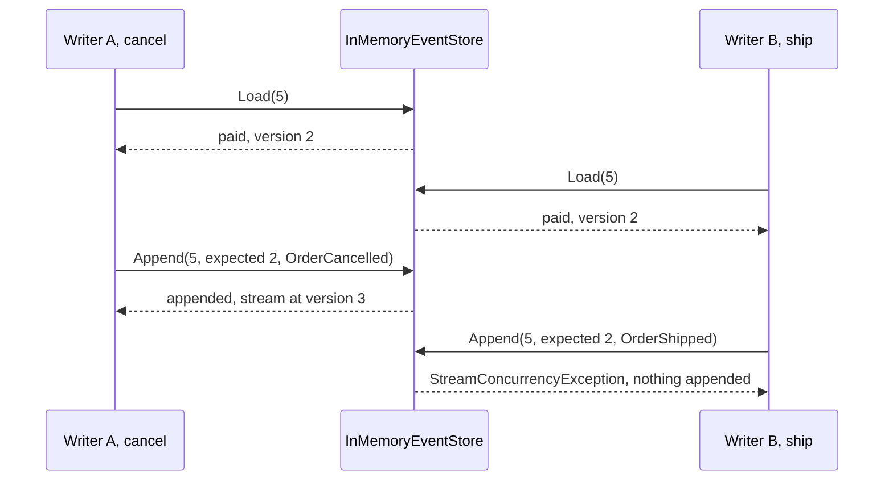

## Before you start

- [[design.l3.rebuilding-state-from-events]] — you know loading an event-sourced order replays its stream, and each applied event adds one to `Version`.
- [[backend.l2.optimistic-concurrency]] — you know `xmin` makes the second save of order 5 fail instead of writing over the first.

## The situation

You are in the stage-3 event sourcing sample. Order 5's stream holds `OrderPlaced` and `OrderPaid`, so it is at version 2. A support colleague loads order 5 to cancel it for the customer. At the same moment a staff member loads order 5 to ship it. Both see `paid`, and both rules pass: `Cancel()` allows a paid order, and `Ship()` needs one.

The cancel is saved first. The store never overwrites an event, so nothing is lost there. But if the ship's event were appended too, the stream would say order 5 was cancelled and then shipped. What stops the second save, and what should the staff member's code do next?

## Core concepts

- loaded version — the version an order had when it was replayed from its stream; the sample's `EventSourcedOrder` works it out as `LoadedVersion`, its `Version` minus the events recorded since the load.
- expected version — the version a writer passes to `Append` with its new events, meaning "I decided against the stream as it was at this version".
- `StreamConcurrencyException` — what the sample's `Append` throws when the stream is no longer at the expected version; it appends nothing.
- the stream's version as concurrency token — the number of events in the stream, compared at save time the way `xmin` is compared for an `orders` row.

## How it works



In the situation above, writer A and writer B each call `Load(5)`. Each gets its own order, replayed from the same two events: `paid`, at version 2. Neither holds anything in the store while it decides.

Writer A calls `Cancel()`. The rule passes, the order records `OrderCancelled`, and its `Version` becomes 3. Its loaded version stays 2, because it is `Version` minus the one new event. Saving sends only that new event, with expected version 2. The stream is still at version 2, so the store appends the event, and the stream is now at version 3.

Writer B calls `Ship()`. Its copy still says `paid`, so the rule passes, and the order records `OrderShipped`. Saving sends that event with expected version 2. This time the stream is at version 3. The store throws `StreamConcurrencyException` and appends nothing. The first append wins; the second is refused instead of adding a decision made on a state that is no longer true.

This is optimistic concurrency, as with `xmin` at stage-2. There, EF Core put the `xmin` it had read into the `UPDATE`'s `WHERE`. Here, the store compares the version the writer loaded with the stream's current version inside `Append`. The stream's version number plays the role of the concurrency token, and nothing was locked between the load and the save.

What does writer B do next? It reloads order 5. The replay now includes `OrderCancelled`, so its new copy is `cancelled` at version 3. It calls `Ship()` again, and this time the rule itself refuses.

## In the Đơn Hàng system

The sample store's `Append`:

```csharp file=samples/DonHang.Samples/Samples/Design/EventSourcing/InMemoryEventStore.cs tag=stage-3 lines=13-30
    // lesson: design.l3.stream-concurrency
    // Appends only if the stream is still at expectedVersion, the version the
    // writer loaded. Otherwise someone else appended first: it throws and
    // appends nothing, so no change is made on top of a stale state.
    public void Append(int orderId, int expectedVersion, IReadOnlyList<OrderEvent> events)
    {
        if (!streams.TryGetValue(orderId, out var stream))
        {
            stream = [];
            streams[orderId] = stream;
        }

        if (stream.Count != expectedVersion)
            throw new StreamConcurrencyException(orderId, expectedVersion, stream.Count);

        stream.AddRange(events);
        all.AddRange(events);
    }
```

The whole check is one line: `stream.Count != expectedVersion`. A stream's version is the number of events in it, because each applied event adds one to `Version`. The check comes before both `AddRange` calls, so a refused append adds nothing to the order's stream or to `all`, the list of every event.

`Save`, outside this excerpt, calls `Append` with the order's `LoadedVersion` and `NewEvents`, and clears the new events only after `Append` returns. So a refused save leaves the order's new events in place, and the order is not marked as saved.

The test that plays the situation:

```csharp file=samples/DonHang.Samples.Tests/EventSourcingTests.cs tag=stage-3 lines=40-60
    // lesson: design.l3.stream-concurrency
    // Two writers load order 5 at version 2. A appends first; B's append is
    // refused, and after reloading, B's Ship() is refused by the rule itself.
    [Fact]
    public void TwoWriters_SecondAppendIsRefused_AndRetryMeetsTheRule()
    {
        var store = new InMemoryEventStore();
        var order = EventSourcedOrder.Place(5, customerId: 3, totalVnd: 1_010_000, At);
        order.Pay(At);
        store.Save(order);

        var writerA = store.Load(5);
        var writerB = store.Load(5);
        writerA.Cancel(At);
        store.Save(writerA);
        writerB.Ship(At);

        Assert.Throws<StreamConcurrencyException>(() => store.Save(writerB));
        Assert.Equal(3, store.ReadStream(5).Count);
        Assert.Throws<InvalidOperationException>(() => store.Load(5).Ship(At));
    }
```

`Place` and `Pay` record two events, and the first `Save` appends them, so the stream is at version 2; `At` is a fixed time the test class passes to every method. Both writers load at version 2. `writerA`'s save succeeds; `writerB`'s throws `StreamConcurrencyException`, and the stream holds 3 events, not 4. The last line is the retry: a fresh `Load(5)` gives a cancelled order, and `Ship` throws `InvalidOperationException` from the rule, not from the store.

## Seniors often assume…

- **"Since events are only ever appended, two writers can never conflict."** → Actually appending protects the old events, not the new decisions. Writer B's `Ship()` checked its rule against `paid`, which stopped being true once A appended. Without the version check, both appends would succeed, and replay, which applies events without checking rules, would load order 5 as `shipped`. You notice this when a stream shows a step its rules forbid, such as `OrderShipped` after `OrderCancelled`.
- **"When the append is refused, just append the same event again at the next version."** → Actually that passes the check by claiming a state the writer never saw. `Append` with expected version 3 and B's `OrderShipped` would succeed, and the stream would say a cancelled order was shipped: the lost update again, in event form: the cancel is still stored, but replay ends on `shipped`, so its effect is lost. B's event was decided against version 2, so only `Ship()` can decide again, after a reload. You notice this in the test's last line: the retry is `store.Load(5).Ship(At)`, and it throws because order 5 is now cancelled.
- **"Event sourcing has to lock the stream for as long as a request holds the order."** → Actually the sample locks nothing between `Load` and `Save`; the only check is the version comparison inside `Append`. Both writers load order 5 freely, and only the late save fails. You notice this in the test: `writerB` loads order 5 while `writerA` still holds an unsaved copy, and that load succeeds.

## Try it (3 minutes)

1. In the root folder of the example repository at `stage-3`, run `scripts/design/event-sourcing.sh` in a bash shell (Git Bash on Windows). Find the block under `== two writers load order 5 at version 2`.
2. Before reading its last line, write down which check stops writer B's second attempt: the store's version check or the rule in `Ship()`.

Expected result: the block has three lines: `A cancels and appends: the stream is now at version 3`, `B ships and appends: refused (order 5: expected version 2, but the stream is at version 3)`, and `B reloads and ships again: order 5 is cancelled, so it cannot be shipped`.

<details><summary>Suggested answer</summary>

The rule in `Ship()`. After the reload, B's copy is loaded at version 3, the stream's current version, so an append would pass the store's check. But the replayed order is `cancelled`, and `Ship()` throws before it records anything.

The version check caught the stale state. The rule then decided about the change itself.

</details>

## Connections

- [[design.l3.rebuilding-state-from-events]] — the step before: replay builds the order each writer decides on; here two replays of one stream compete to append.
- [[backend.l2.optimistic-concurrency]] — the same idea on a table row: there `xmin` is the token in the `UPDATE`'s `WHERE`, here the stream's version is the token in `Append`.
- [[backend.l2.transactions-in-practice]] — the problem this check prevents, in its stage-2 form: the lost update of a read-then-write.
- [[design.l3.event-projections]] — the next lesson: code that reads every stream's events in append order to build read models.

## Five-line summary

1. Saving an event-sourced order appends its new events only if the stream is still at the version the order was loaded at.
2. `EventSourcedOrder` remembers that version as `LoadedVersion`, and `Save` passes it to `Append` with only the new events.
3. When two writers load order 5 at version 2, the first append wins and the second throws `StreamConcurrencyException`, appending nothing.
4. This is optimistic concurrency, as with `xmin`: nothing is locked, and the stream's version number is the concurrency token.
5. The refused writer reloads and calls its method again; in `EventSourcingTests`, `Ship()` then fails because order 5 is cancelled.
