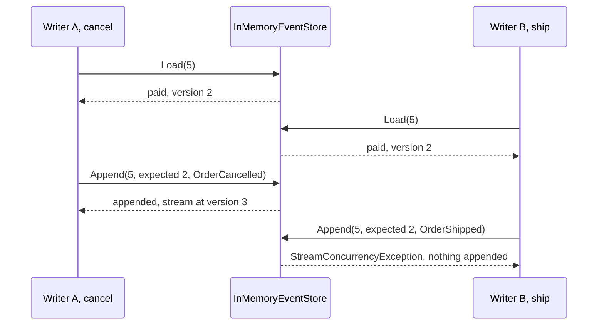

## Bạn cần biết trước

- [[design.l3.rebuilding-state-from-events]] — bạn biết nạp một đơn lưu theo event là áp lại stream của nó, và mỗi event được áp cộng một vào `Version`.
- [[backend.l2.optimistic-concurrency]] — bạn biết `xmin` khiến lần lưu thứ hai của đơn 5 thất bại thay vì ghi đè lên lần thứ nhất.

## Tình huống

Bạn đang ở mẫu event sourcing của stage-3. Stream của đơn 5 có `OrderPlaced` và `OrderPaid`, nên nó đang ở version 2. Một đồng nghiệp bên hỗ trợ nạp đơn 5 để hủy giúp khách. Cùng lúc đó, một nhân viên nạp đơn 5 để giao hàng. Cả hai đều thấy `paid`, và quy tắc của cả hai đều qua: `Cancel()` cho hủy đơn đã thanh toán, còn `Ship()` cần đúng một đơn như thế.

Lần hủy được lưu trước. Store không bao giờ ghi đè một event, nên ở đó không mất gì. Nhưng nếu event giao hàng cũng được nối vào, stream sẽ nói đơn 5 bị hủy rồi sau đó được giao. Cái gì chặn lần lưu thứ hai, và code của nhân viên đó nên làm gì tiếp?

## Khái niệm cốt lõi

- version lúc nạp — version của đơn khi nó được áp lại từ stream. `EventSourcedOrder` của mẫu tính nó thành `LoadedVersion`: lấy `Version` trừ đi số event ghi nhận từ sau lần nạp.
- version mong đợi — version mà một bên ghi truyền cho `Append` cùng các event mới, với nghĩa "tôi đã quyết định dựa trên stream lúc nó ở version này".
- `StreamConcurrencyException` — thứ `Append` của mẫu ném ra khi stream không còn ở version mong đợi. Khi đó nó không nối thêm gì.
- version của stream làm concurrency token — số event trong stream, được so sánh lúc lưu giống như `xmin` được so sánh cho một dòng `orders`.

## Cơ chế hoạt động



Trong tình huống trên, bên ghi A và bên ghi B đều gọi `Load(5)`. Mỗi bên nhận một đơn riêng, áp lại từ cùng hai event: `paid`, ở version 2. Trong lúc quyết định, không bên nào giữ gì trong store.

Bên A gọi `Cancel()`. Quy tắc qua, đơn ghi nhận `OrderCancelled`, và `Version` thành 3. Version lúc nạp vẫn là 2, vì nó bằng `Version` trừ đi một event mới. Lần lưu chỉ gửi event mới đó, kèm version mong đợi là 2. Stream vẫn đang ở version 2, nên store nối event vào, và stream giờ ở version 3.

Bên B gọi `Ship()`. Bản của B vẫn nói `paid`, nên quy tắc qua, và đơn ghi nhận `OrderShipped`. Lần lưu gửi event đó kèm version mong đợi là 2. Lần này stream đang ở version 3. Store ném `StreamConcurrencyException` và không nối thêm gì. Lần nối thêm đầu tiên thắng. Lần thứ hai bị từ chối, thay vì thêm vào một quyết định dựa trên trạng thái không còn đúng.

Đây là optimistic concurrency, giống `xmin` ở stage-2. Ở đó, EF Core đặt `xmin` nó đã đọc vào `WHERE` của câu `UPDATE`. Ở đây, store so version mà bên ghi đã nạp với version hiện tại của stream, ngay trong `Append`. Số version của stream đóng vai concurrency token, và không có gì bị khóa giữa lúc nạp và lúc lưu.

Bên B làm gì tiếp? Nó nạp lại đơn 5. Lần áp lại này có cả `OrderCancelled`, nên bản mới của B là `cancelled` ở version 3. B gọi `Ship()` lần nữa, và lần này chính quy tắc từ chối.

## Trong hệ thống Đơn Hàng

`Append` của store mẫu:

```csharp file=samples/DonHang.Samples/Samples/Design/EventSourcing/InMemoryEventStore.cs tag=stage-3 lines=13-30
    // lesson: design.l3.stream-concurrency
    // Appends only if the stream is still at expectedVersion, the version the
    // writer loaded. Otherwise someone else appended first: it throws and
    // appends nothing, so no change is made on top of a stale state.
    public void Append(int orderId, int expectedVersion, IReadOnlyList<OrderEvent> events)
    {
        if (!streams.TryGetValue(orderId, out var stream))
        {
            stream = [];
            streams[orderId] = stream;
        }

        if (stream.Count != expectedVersion)
            throw new StreamConcurrencyException(orderId, expectedVersion, stream.Count);

        stream.AddRange(events);
        all.AddRange(events);
    }
```

Toàn bộ phép kiểm tra chỉ là một dòng: `stream.Count != expectedVersion`. Version của một stream là số event trong nó, vì mỗi event được áp cộng một vào `Version`. Phép kiểm tra đứng trước cả hai lời gọi `AddRange`, nên một lần nối thêm bị từ chối không thêm gì vào stream của đơn, cũng không thêm gì vào `all`, danh sách mọi event.

`Save`, nằm ngoài đoạn trích, gọi `Append` với `LoadedVersion` và `NewEvents` của đơn, và chỉ xóa các event mới sau khi `Append` trả về. Vì vậy một lần lưu bị từ chối để nguyên các event mới của đơn, và đơn không bị coi là đã lưu.

Test diễn lại tình huống:

```csharp file=samples/DonHang.Samples.Tests/EventSourcingTests.cs tag=stage-3 lines=40-60
    // lesson: design.l3.stream-concurrency
    // Two writers load order 5 at version 2. A appends first; B's append is
    // refused, and after reloading, B's Ship() is refused by the rule itself.
    [Fact]
    public void TwoWriters_SecondAppendIsRefused_AndRetryMeetsTheRule()
    {
        var store = new InMemoryEventStore();
        var order = EventSourcedOrder.Place(5, customerId: 3, totalVnd: 1_010_000, At);
        order.Pay(At);
        store.Save(order);

        var writerA = store.Load(5);
        var writerB = store.Load(5);
        writerA.Cancel(At);
        store.Save(writerA);
        writerB.Ship(At);

        Assert.Throws<StreamConcurrencyException>(() => store.Save(writerB));
        Assert.Equal(3, store.ReadStream(5).Count);
        Assert.Throws<InvalidOperationException>(() => store.Load(5).Ship(At));
    }
```

`Place` và `Pay` ghi nhận hai event, và lần `Save` đầu tiên nối chúng vào, nên stream ở version 2. `At` là một thời điểm cố định mà class test truyền cho mọi method. Cả hai bên ghi đều nạp ở version 2. Lần lưu của `writerA` thành công. Lần lưu của `writerB` ném `StreamConcurrencyException`, và stream có 3 event chứ không phải 4. Dòng cuối là lần thử lại: một lần `Load(5)` mới cho ra đơn đã hủy, và `Ship` ném `InvalidOperationException` từ quy tắc, không phải từ store.

## Senior hay nhầm rằng…

- **"Event chỉ được nối thêm, nên hai bên ghi không bao giờ xung đột."** → Thực ra nối thêm bảo vệ các event cũ, không bảo vệ các quyết định mới. `Ship()` của bên B kiểm tra quy tắc dựa trên `paid`, điều đã hết đúng ngay khi A nối event vào. Không có phép kiểm tra version, cả hai lần nối thêm đều thành công, và replay, vốn áp event mà không kiểm tra quy tắc, sẽ nạp đơn 5 thành `shipped`. Bạn sẽ nhận ra khi một stream có một bước mà quy tắc của nó cấm, như `OrderShipped` sau `OrderCancelled`.
- **"Khi lần nối thêm bị từ chối, cứ nối lại đúng event đó ở version tiếp theo."** → Thực ra làm vậy là qua được phép kiểm tra bằng cách nhận mình đã thấy một trạng thái mà bên ghi chưa từng thấy. `Append` với version mong đợi 3 và `OrderShipped` của B sẽ thành công, và stream sẽ nói một đơn đã hủy lại được giao. Đó chính là lost update, chỉ là ở dạng event: lần hủy vẫn được lưu, nhưng replay kết thúc ở `shipped`, nên tác dụng của lần hủy bị mất. Event của B được quyết định dựa trên version 2, nên chỉ `Ship()` mới được quyết định lại, sau khi nạp lại. Bạn sẽ nhận ra điều này ở dòng cuối của test: lần thử lại là `store.Load(5).Ship(At)`, và nó ném exception vì đơn 5 giờ đã bị hủy.
- **"Event sourcing phải khóa stream suốt thời gian một request đang giữ đơn."** → Thực ra mẫu không khóa gì giữa `Load` và `Save`. Phép kiểm tra duy nhất là phép so version trong `Append`. Cả hai bên ghi đều nạp đơn 5 thoải mái, và chỉ lần lưu đến muộn thất bại. Bạn sẽ nhận ra điều này trong test: `writerB` nạp đơn 5 trong lúc `writerA` vẫn đang giữ một bản chưa lưu, và lần nạp đó thành công.

## Thử ngay (3 phút)

1. Ở thư mục gốc của repo ví dụ tại `stage-3`, chạy `scripts/design/event-sourcing.sh` trong bash (Git Bash trên Windows). Tìm khối nằm dưới `== two writers load order 5 at version 2`.
2. Trước khi đọc dòng cuối của khối, ghi ra phép kiểm tra nào chặn lần thử thứ hai của bên B: phép kiểm tra version của store hay quy tắc trong `Ship()`.

Kết quả mong đợi: khối có ba dòng: `A cancels and appends: the stream is now at version 3`, `B ships and appends: refused (order 5: expected version 2, but the stream is at version 3)`, và `B reloads and ships again: order 5 is cancelled, so it cannot be shipped`.

<details><summary>Gợi ý đáp án</summary>

Quy tắc trong `Ship()`. Sau khi nạp lại, bản của B được nạp ở version 3, đúng version hiện tại của stream, nên một lần nối thêm sẽ qua phép kiểm tra của store. Nhưng đơn được áp lại là `cancelled`, và `Ship()` ném exception trước khi ghi nhận bất cứ gì.

Phép kiểm tra version bắt được trạng thái cũ. Sau đó quy tắc mới quyết định về chính thay đổi.

</details>

## Liên hệ

- [[design.l3.rebuilding-state-from-events]] — bước trước: replay dựng nên đơn mà mỗi bên ghi dựa vào để quyết định, còn ở đây hai lần replay của cùng một stream tranh nhau nối thêm.
- [[backend.l2.optimistic-concurrency]] — cùng ý tưởng trên một dòng của bảng: ở đó `xmin` là token trong `WHERE` của câu `UPDATE`, ở đây version của stream là token trong `Append`.
- [[backend.l2.transactions-in-practice]] — vấn đề mà phép kiểm tra này ngăn, ở dạng của stage-2: lost update khi đọc rồi ghi.
- [[design.l3.event-projections]] — bài tiếp theo: code đọc event của mọi stream theo thứ tự nối thêm để dựng các read model.

## Tóm tắt 5 dòng

1. Lưu một đơn lưu theo event chỉ nối các event mới của nó vào khi stream vẫn ở đúng version lúc đơn được nạp.
2. `EventSourcedOrder` nhớ version đó thành `LoadedVersion`, và `Save` truyền nó cho `Append` cùng với chỉ các event mới.
3. Khi hai bên ghi cùng nạp đơn 5 ở version 2, lần nối thêm đầu tiên thắng, còn lần thứ hai ném `StreamConcurrencyException` và không nối thêm gì.
4. Đây là optimistic concurrency, giống `xmin`: không có gì bị khóa, và số version của stream là concurrency token.
5. Bên ghi bị từ chối nạp lại đơn rồi gọi lại method của mình. Trong `EventSourcingTests`, `Ship()` khi đó thất bại vì đơn 5 đã bị hủy.
