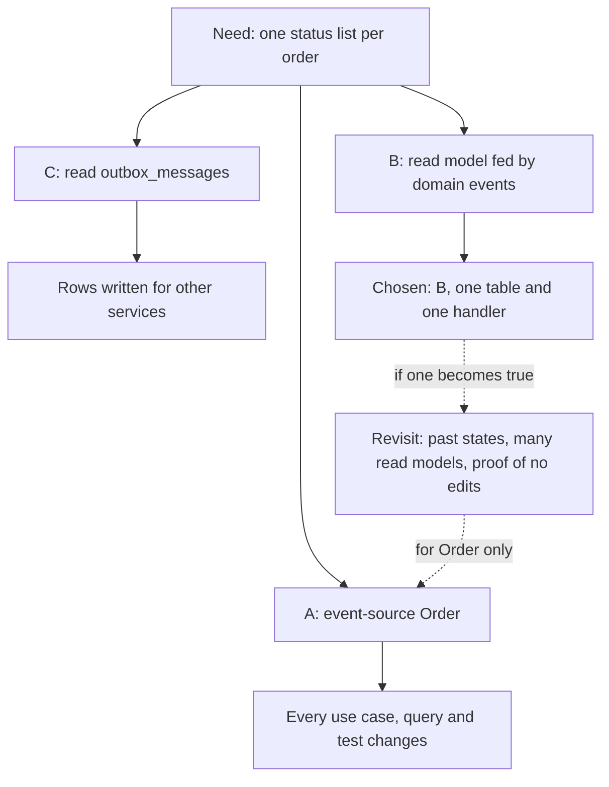

## Before you start

- [[design.l3.snapshots]] — you know the last of the costs this module showed: snapshots, projections and replay are extra code that event sourcing brings with it.
- [[management.l2.design-doc]] — you know a design doc names the options it rejected and why, so a reader can follow the choice.
- [[design.l3.subdomains]] — you know design effort is spent where it pays most, and that at stage-2 only `Order` had methods guarding rules.

## The situation

It is stage-3, and you have run the event sourcing sample: streams, replay, projections, snapshots. A teammate points out that `Order` already records an event for every status change its use cases make: `OrderPlaced`, `OrderCancelled`, `OrderShipped` and the three refund events. "We are halfway there," they say. "Store those events instead of the `orders` row, and the history, the read model and any later report come for free." Yet the stage-3 code keeps `Order` in its row and writes `order_status_history` beside it. Was that a missed chance, or a weighed choice? When does storing an aggregate as its events pay for what it costs?

## Core concepts

- event sourcing — storing an aggregate as its event stream and working out its current state by replaying the events.
- state-based storage — keeping an aggregate's current state as the record and overwriting it on each change, as `Order` is kept in its `orders` row.
- read model beside the state — a table written from the changes of a state-based aggregate, such as `order_status_history`, while the row stays the truth.
- reason to revisit — a condition written into a design doc that, once it becomes true, reopens a choice that was already made.

## How it works



Start from the need, not the technique. Event sourcing pays off when the history itself is the business's data: when someone must answer what an aggregate looked like at a past moment, when past changes must be checked later, or when many read models need the same changes and each should be rebuildable by replay.

Its costs come with it, whatever the size of the need. Queries change. No table holds the current state, so a question about one order means replaying or reading its stream, and any question across orders, such as a list or a count, needs a read model built by an event projection. Events stored long ago must stay readable after the classes that wrote them change. And the team must learn a different way to store data.

In the situation above, the need is narrow: one list of statuses per order, oldest first. The diagram shows the three ways the stage-3 design doc weighs. Event-sourcing `Order` answers the need and much more, at the price of changing how every use case loads and saves an order. A read model fed by the domain events `Order` already records answers exactly the need, with one table and one handler. Reading `outbox_messages` adds nothing new, but relies on rows written for other services.

The dashed arrows are the conditions under which the choice should be weighed again. When one becomes true, the answer can change for `Order` alone. Event sourcing is chosen per aggregate, so a team can event-source the one whose history matters and keep the others state-based.

## In the Đơn Hàng system

The first two options in `order-history-design.md`, the design doc that records this choice at stage-3:

```markdown file=docs/design/order-history-design.md tag=stage-3 lines=15-37
## Phương án A: event sourcing cho `Order`

Lưu `Order` thành chuỗi event của nó thay cho dòng trong `orders`; trạng thái
hiện tại tính lại từ các event mỗi lần cần.

- Được: lịch sử đầy đủ, dựng lại được đơn ở bất kỳ phiên bản nào.
- Mất: mọi use case, truy vấn và test đang nạp và lưu `Order` qua EF Core phải
  đổi (`OrderService`, `EfOrderRepository`, danh sách đơn, kiểm tra `xmin`,
  outbox). Mỗi truy vấn cần một projection. Event cũ phải đọc được mãi sau khi
  code đổi. Cả đội phải học một cách lưu dữ liệu mới.
- Thử trên mẫu trong bộ nhớ: `samples/DonHang.Samples/Samples/Design/EventSourcing/`.

## Phương án B: read model cập nhật từ domain event (chọn)

`Order` vẫn lưu theo trạng thái. Handler `RecordOrderStatusHistory` nhận mọi
domain event của `Order` và thêm một dòng vào `order_status_history` trước
`SaveChangesAsync`, trong cùng transaction với thay đổi của đơn.

- Được: lịch sử không bao giờ chậm hơn trạng thái của đơn; `Order` không biết
  bảng này tồn tại; không use case nào phải đổi.
- Mất: thêm một lệnh INSERT mỗi lần đổi trạng thái. Đơn có trước stage-3 chỉ có
  một dòng `placed` (lấy từ `placed_at`): các thay đổi giữa chừng đã bị ghi đè,
  không lấy lại được.
```

Option A gains a full history and the order at any version. Its losses name real stage-3 code: `OrderService` and `EfOrderRepository` load and save `Order` through EF Core, and the `xmin` check is the concurrency token that `Order.Version` maps to. The general costs from "How it works" follow: event projections for queries across orders, old events readable forever, a new way of storing data. Option B, the one chosen, gains a history that never trails the order and changes no use case. Its loss is stated plainly: orders placed before stage-3 keep only a `placed` row.

The third option, the decision and the reasons to revisit:

```markdown file=docs/design/order-history-design.md tag=stage-3 lines=39-63
## Phương án C: đọc bảng `outbox_messages`

Mỗi thay đổi trạng thái đã có một dòng outbox để gửi cho service khác, nên đọc
lại bảng đó là đủ?

- Không: dòng outbox chỉ mang thứ service nhận cần (email, tên khách), được
  viết cho người nhận chứ không cho việc tra lịch sử, và đơn có trước stage-3
  không có dòng nào. Một màn hình dựa vào nó sẽ hỏng khi hình dạng message đổi.

## Quyết định

Chọn B. Nhu cầu là một danh sách cho từng đơn; B đáp ứng đúng nhu cầu đó với
một bảng và một handler. A đổi cách mọi use case của stage-3 nạp và lưu đơn để
lấy một khả năng chưa ai cần. C dựa vào dữ liệu được viết cho mục đích khác.

## Khi nào xem lại

- Có yêu cầu cho biết cả đơn trông thế nào ở một thời điểm bất kỳ trong quá
  khứ, không chỉ trạng thái.
- Nhiều read model mới cùng cần các thay đổi của đơn, và mỗi cái lại cần một
  handler riêng.
- Kiểm toán đòi chứng minh lịch sử chưa từng bị sửa.

Khi đó cân nhắc event sourcing riêng cho `Order`; các aggregate khác vẫn có
thể lưu theo trạng thái.
```

Option C is rejected because outbox rows carry what the receiving service needs, such as the customer's email and name, and a screen built on them breaks when the message shape changes. The decision weighs each option against the need, not against everything it could do: A buys an ability no one has asked for. "Khi nào xem lại" lists three reasons to revisit: showing what a whole order looked like at a past moment, many new read models each needing its own handler, and an audit that must prove the history was never edited. The last sentence sets the scope: if that day comes, event sourcing is considered for `Order` alone.

## Seniors often assume…

- **"Any system that already has domain events should go all the way to event sourcing."** → Actually domain events and event sourcing answer different questions. `Order` records `OrderCancelled` so that handlers can react, while `OrderService` still loads the `orders` row as the truth. Going further makes the events the record, and every use case, query and test that loads an order changes with it. Having domain events makes a read model cheap, not event sourcing. You notice this when a proposal to event-source "since the events exist" lists what it gains but not the code that loads `Order` today.
- **"Event sourcing is mainly a way to get an audit log for free."** → Actually an audit log, a record of every change kept so it can be checked later, is not free when it is the store itself: every query across orders needs an event projection, and every stored event must stay readable for as long as the stream exists. A list of what happened to each order costs one table and one handler as a read model. Proof that history was never edited is a different need: `order_status_history` is an ordinary table that code could update, while an event store only appends, which is what such a proof would rest on. The design doc lists it as a reason to revisit, not as today's need. You notice this at stage-3: `GET /api/v1/orders/{id}/history` answers from `order_status_history`, and the way orders are loaded did not change.
- **"Once one aggregate is event-sourced, every aggregate in the system has to be."** → Actually how an aggregate is stored sits behind the code that loads and saves it, such as `EfOrderRepository` for `Order`. Another aggregate can keep its own row while `Order` moves to a stream. That is why the design doc ends with event sourcing for `Order` alone. You notice this when a plan to event-source one aggregate also rewrites tables whose history no one has asked for.

## Try it (3 minutes)

1. In the example repository, run `git show stage-3:docs/design/order-history-design.md` and read "Khi nào xem lại".
2. Three requests arrive. (a) Show each order's history newest first. (b) Show an order's items and total exactly as they were on any past day. (c) Add one report that counts orders per status per day. For each, decide: does it match a reason to revisit, and what would you change?

Expected result: only one request matches a reason in "Khi nào xem lại"; the other two are met without touching how `Order` is stored.

<details><summary>Suggested answer</summary>

(a) is still one list per order, only sorted the other way: a change to the query of the read model, not a reason to revisit.

(b) matches the first reason: the whole order at a past moment, not only its status. `order_status_history` records changes of status only. Nothing records changes to the rest of an order, so the moment items or prices can change after placement, no table could show an earlier version. This is when the design doc says to consider event sourcing for `Order` alone.

(c) is one new read model with one more handler, or a query over `order_status_history` if its rows suffice. The second reason speaks of many new read models, each needing its own handler; one report does not reach that yet, but it is worth noting as the count grows.

</details>

## Connections

- [[design.l3.read-model]] — the option chosen: the read model fed by domain events that this lesson weighs against event sourcing.
- [[design.l3.event-sourcing]] — the option weighed and not taken for `Order`, tried on the in-memory sample instead.
- [[design.l3.when-to-extract-a-service]] — the same reasoning in another place: a split, like event sourcing, earns its cost only for a need one simpler design cannot meet, and the choice is written down.
- [[management.l2.design-doc]] — prerequisite: `order-history-design.md` is a design doc, with rejected options and reasons to revisit.

## Five-line summary

1. Event sourcing pays off when history is business data: past states must be answered or checked, or many read models need the same changes.
2. Its costs come with it: event projections for queries across aggregates, old events readable forever, and a new way of storing data.
3. At stage-3 `order-history-design.md` weighs event-sourcing `Order`, a read model fed by domain events, and reading `outbox_messages`.
4. It chooses the read model, because the need is one list per order, and writes down the reasons that would reopen the choice.
5. Event sourcing is chosen per aggregate: a team can event-source the one whose history matters and keep the others state-based.
