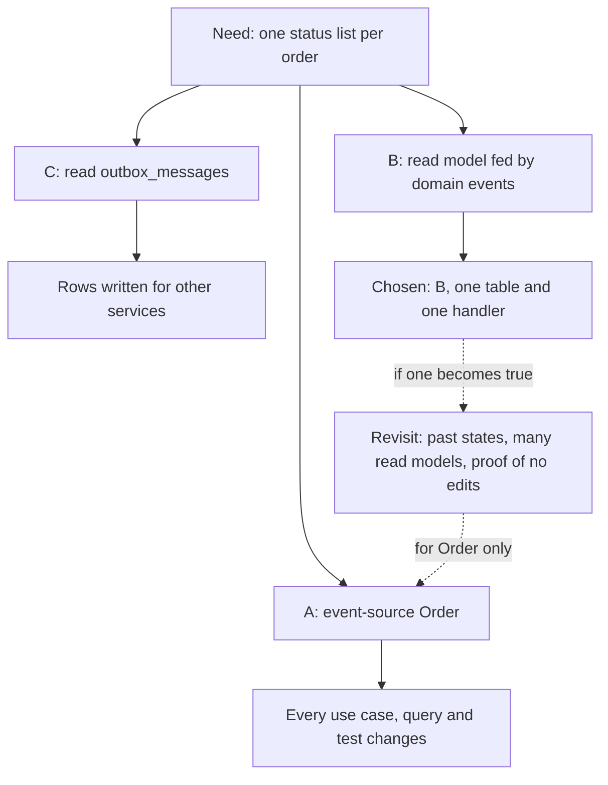

## Bạn cần biết trước

- [[design.l3.snapshots]] — bạn biết chi phí cuối cùng mà module này đã chỉ ra: snapshot, projection và replay là phần code thêm mà event sourcing kéo theo.
- [[management.l2.design-doc]] — bạn biết một design doc nêu tên các phương án nó loại và lý do, để người đọc lần theo được lựa chọn.
- [[design.l3.subdomains]] — bạn biết công thiết kế nên dồn vào chỗ đáng nhất, và ở stage-2 chỉ `Order` có method canh giữ quy tắc.

## Tình huống

Đang ở stage-3, và bạn đã chạy mẫu event sourcing: stream, replay, projection, snapshot. Một đồng nghiệp chỉ ra rằng `Order` đã ghi một event cho mọi lần đổi trạng thái mà các use case của nó gây ra: `OrderPlaced`, `OrderCancelled`, `OrderShipped` và ba event hoàn tiền. "Mình đi được nửa đường rồi," người đó nói. "Lưu các event đó thay cho dòng trong `orders`, thế là lịch sử, read model và mọi báo cáo sau này đều có sẵn." Vậy mà code ở stage-3 vẫn giữ `Order` trong dòng của nó và ghi `order_status_history` bên cạnh. Đó là bỏ lỡ cơ hội, hay một lựa chọn đã cân nhắc? Khi nào lưu một aggregate thành các event của nó mới đáng với cái giá phải trả?

## Khái niệm cốt lõi

- event sourcing — lưu một aggregate thành event stream của nó và tính ra trạng thái hiện tại bằng cách áp lại các event.
- lưu theo trạng thái — giữ trạng thái hiện tại của một aggregate làm bản ghi và ghi đè lên nó mỗi lần thay đổi, như `Order` được giữ trong dòng `orders` của nó.
- read model bên cạnh trạng thái — một bảng được ghi từ các thay đổi của một aggregate lưu theo trạng thái, chẳng hạn `order_status_history`, trong khi dòng kia vẫn là sự thật.
- lý do để xem lại — một điều kiện ghi trong design doc, khi nó thành đúng thì một lựa chọn đã chốt được mở lại.

## Cơ chế hoạt động



Bắt đầu từ nhu cầu, không phải từ kỹ thuật. Event sourcing đáng giá khi chính lịch sử là dữ liệu của nghiệp vụ: khi có người cần biết một aggregate trông thế nào ở một thời điểm trong quá khứ, khi các thay đổi cũ phải được kiểm tra về sau, hoặc khi nhiều read model cần cùng những thay đổi đó và mỗi cái phải dựng lại được bằng replay.

Chi phí của nó đi kèm, dù nhu cầu lớn hay nhỏ. Truy vấn phải đổi. Không bảng nào giữ trạng thái hiện tại, nên hỏi về một đơn nghĩa là áp lại hoặc đọc stream của nó. Mọi câu hỏi trên nhiều đơn, như một danh sách hay một phép đếm, cần một read model do event projection dựng. Event lưu từ lâu phải đọc được mãi, kể cả khi các class từng ghi chúng đã đổi. Và cả đội phải học cách lưu dữ liệu khác hẳn.

Trong tình huống trên, nhu cầu hẹp: một danh sách trạng thái cho mỗi đơn, cũ nhất trước. Sơ đồ cho thấy ba cách mà design doc ở stage-3 cân nhắc. Event sourcing cho `Order` đáp ứng nhu cầu đó và nhiều hơn thế, đổi lại phải sửa cách mọi use case nạp và lưu một đơn. Một read model nhận các domain event mà `Order` vốn đã ghi thì đáp ứng đúng nhu cầu, với một bảng và một handler. Đọc `outbox_messages` không thêm gì mới, nhưng dựa vào những dòng được viết cho service khác.

Các mũi tên nét đứt là những điều kiện khiến lựa chọn cần được cân lại. Khi một điều kiện thành đúng, câu trả lời có thể đổi, nhưng chỉ cho riêng `Order`. Event sourcing được chọn theo từng aggregate, nên một đội có thể dùng event sourcing cho aggregate có lịch sử quan trọng và giữ các aggregate khác lưu theo trạng thái.

## Trong hệ thống Đơn Hàng

Hai phương án đầu trong `order-history-design.md`, design doc ghi lại lựa chọn này ở stage-3:

```markdown file=docs/design/order-history-design.md tag=stage-3 lines=15-37
## Phương án A: event sourcing cho `Order`

Lưu `Order` thành chuỗi event của nó thay cho dòng trong `orders`; trạng thái
hiện tại tính lại từ các event mỗi lần cần.

- Được: lịch sử đầy đủ, dựng lại được đơn ở bất kỳ phiên bản nào.
- Mất: mọi use case, truy vấn và test đang nạp và lưu `Order` qua EF Core phải
  đổi (`OrderService`, `EfOrderRepository`, danh sách đơn, kiểm tra `xmin`,
  outbox). Mỗi truy vấn cần một projection. Event cũ phải đọc được mãi sau khi
  code đổi. Cả đội phải học một cách lưu dữ liệu mới.
- Thử trên mẫu trong bộ nhớ: `samples/DonHang.Samples/Samples/Design/EventSourcing/`.

## Phương án B: read model cập nhật từ domain event (chọn)

`Order` vẫn lưu theo trạng thái. Handler `RecordOrderStatusHistory` nhận mọi
domain event của `Order` và thêm một dòng vào `order_status_history` trước
`SaveChangesAsync`, trong cùng transaction với thay đổi của đơn.

- Được: lịch sử không bao giờ chậm hơn trạng thái của đơn; `Order` không biết
  bảng này tồn tại; không use case nào phải đổi.
- Mất: thêm một lệnh INSERT mỗi lần đổi trạng thái. Đơn có trước stage-3 chỉ có
  một dòng `placed` (lấy từ `placed_at`): các thay đổi giữa chừng đã bị ghi đè,
  không lấy lại được.
```

Phương án A được lịch sử đầy đủ và đơn ở bất kỳ phiên bản nào. Phần mất của nó nêu tên code thật ở stage-3: `OrderService` và `EfOrderRepository` nạp và lưu `Order` qua EF Core, còn kiểm tra `xmin` là concurrency token mà `Order.Version` được ánh xạ vào. Các chi phí chung ở "Cơ chế hoạt động" theo sau: event projection cho truy vấn trên nhiều đơn, event cũ phải đọc được mãi, cả đội học cách lưu dữ liệu mới. Phương án B, phương án được chọn, có lịch sử không bao giờ chậm hơn đơn và không đổi use case nào. Phần mất của nó được nói thẳng: các đơn đặt trước stage-3 chỉ giữ một dòng `placed`.

Phương án thứ ba, quyết định và các lý do để xem lại:

```markdown file=docs/design/order-history-design.md tag=stage-3 lines=39-63
## Phương án C: đọc bảng `outbox_messages`

Mỗi thay đổi trạng thái đã có một dòng outbox để gửi cho service khác, nên đọc
lại bảng đó là đủ?

- Không: dòng outbox chỉ mang thứ service nhận cần (email, tên khách), được
  viết cho người nhận chứ không cho việc tra lịch sử, và đơn có trước stage-3
  không có dòng nào. Một màn hình dựa vào nó sẽ hỏng khi hình dạng message đổi.

## Quyết định

Chọn B. Nhu cầu là một danh sách cho từng đơn; B đáp ứng đúng nhu cầu đó với
một bảng và một handler. A đổi cách mọi use case của stage-3 nạp và lưu đơn để
lấy một khả năng chưa ai cần. C dựa vào dữ liệu được viết cho mục đích khác.

## Khi nào xem lại

- Có yêu cầu cho biết cả đơn trông thế nào ở một thời điểm bất kỳ trong quá
  khứ, không chỉ trạng thái.
- Nhiều read model mới cùng cần các thay đổi của đơn, và mỗi cái lại cần một
  handler riêng.
- Kiểm toán đòi chứng minh lịch sử chưa từng bị sửa.

Khi đó cân nhắc event sourcing riêng cho `Order`; các aggregate khác vẫn có
thể lưu theo trạng thái.
```

Phương án C bị loại vì dòng outbox mang thứ service nhận cần, như email và tên khách hàng, và một màn hình dựa vào chúng sẽ hỏng khi hình dạng message đổi. Quyết định cân từng phương án với nhu cầu, không phải với mọi thứ phương án đó làm được: A mua một khả năng chưa ai đòi. "Khi nào xem lại" liệt kê ba lý do để xem lại: cần cho thấy cả đơn trông thế nào ở một thời điểm trong quá khứ, nhiều read model mới mà mỗi cái cần handler riêng, và một cuộc kiểm toán phải chứng minh lịch sử chưa từng bị sửa. Câu cuối đặt phạm vi: nếu ngày đó đến, event sourcing chỉ được cân nhắc cho riêng `Order`.

## Senior hay nhầm rằng…

- **"Hệ thống nào đã có domain event thì nên đi hết đường tới event sourcing."** → Thực ra domain event và event sourcing trả lời hai câu hỏi khác nhau. `Order` ghi `OrderCancelled` để các handler phản ứng, trong khi `OrderService` vẫn nạp dòng `orders` làm sự thật. Đi xa hơn nghĩa là biến các event thành bản ghi, và mọi use case, truy vấn, test nạp một đơn đều đổi theo. Có domain event thì read model rẻ, chứ event sourcing không rẻ. Bạn sẽ nhận ra khi một đề xuất dùng event sourcing "vì event có sẵn rồi" liệt kê những gì được mà không nhắc tới code đang nạp `Order` hôm nay.
- **"Event sourcing chủ yếu là cách có audit log miễn phí."** → Thực ra audit log, tức bản ghi mọi thay đổi được giữ lại để kiểm tra về sau, không hề miễn phí khi nó chính là nơi lưu dữ liệu: mọi truy vấn trên nhiều đơn cần một event projection, và mọi event đã lưu phải đọc được chừng nào stream còn tồn tại. Một danh sách những gì đã xảy ra với từng đơn chỉ tốn một bảng và một handler nếu làm bằng read model. Chứng minh lịch sử chưa từng bị sửa là một nhu cầu khác: `order_status_history` là một bảng bình thường mà code có thể update, còn event store chỉ cho nối thêm, và một bằng chứng như vậy dựa vào chính điều đó. Design doc ghi nó là lý do để xem lại, không phải nhu cầu hôm nay. Bạn sẽ nhận ra điều này ở stage-3: `GET /api/v1/orders/{id}/history` trả lời từ `order_status_history`, còn cách nạp đơn không hề đổi.
- **"Đã có một aggregate dùng event sourcing thì mọi aggregate trong hệ thống cũng phải theo."** → Thực ra cách lưu một aggregate nằm sau phần code nạp và lưu nó, như `EfOrderRepository` với `Order`. Một aggregate khác vẫn giữ dòng của nó trong khi `Order` chuyển sang stream. Đó là lý do design doc kết thúc bằng event sourcing cho riêng `Order`. Bạn sẽ nhận ra khi một kế hoạch dùng event sourcing cho một aggregate lại viết lại cả những bảng mà chưa ai hỏi tới lịch sử.

## Thử ngay (3 phút)

1. Trong repo ví dụ, chạy `git show stage-3:docs/design/order-history-design.md` và đọc "Khi nào xem lại".
2. Có ba yêu cầu gửi tới. (a) Hiện lịch sử của từng đơn, mới nhất trước. (b) Hiện các món hàng và tổng tiền của một đơn đúng như chúng từng là vào một ngày bất kỳ trong quá khứ. (c) Thêm một báo cáo đếm số đơn theo từng trạng thái mỗi ngày. Với mỗi yêu cầu, quyết định: nó có khớp một lý do để xem lại không, và bạn sẽ đổi gì?

Kết quả mong đợi: chỉ một yêu cầu khớp một lý do trong "Khi nào xem lại", hai yêu cầu còn lại đáp ứng được mà không đụng tới cách lưu `Order`.

<details><summary>Gợi ý đáp án</summary>

(a) vẫn là một danh sách cho mỗi đơn, chỉ sắp theo chiều ngược lại: đổi truy vấn của read model, không phải lý do để xem lại.

(b) khớp lý do đầu tiên: cả đơn ở một thời điểm trong quá khứ, không chỉ trạng thái. `order_status_history` chỉ ghi các lần đổi trạng thái. Không gì ghi lại thay đổi ở phần còn lại của đơn, nên ngay khi món hàng hay giá có thể đổi sau lúc đặt, không bảng nào cho thấy được phiên bản trước. Đây là lúc design doc bảo cân nhắc event sourcing cho riêng `Order`.

(c) là một read model mới với thêm một handler, hoặc một truy vấn trên `order_status_history` nếu các dòng của nó đủ dùng. Lý do thứ hai nói về nhiều read model mới, mỗi cái cần handler riêng. Một báo cáo chưa tới mức đó, nhưng đáng ghi nhận khi số lượng tăng lên.

</details>

## Liên hệ

- [[design.l3.read-model]] — phương án được chọn: read model nhận domain event mà bài này đặt lên cân với event sourcing.
- [[design.l3.event-sourcing]] — phương án đã cân nhắc nhưng không chọn cho `Order`, thay vào đó được thử trên mẫu trong bộ nhớ.
- [[design.l3.when-to-extract-a-service]] — cùng cách lập luận ở chỗ khác: tách service, cũng như event sourcing, chỉ đáng chi phí khi có nhu cầu mà một thiết kế đơn giản hơn không đáp ứng được, và lựa chọn được ghi lại.
- [[management.l2.design-doc]] — bài cần trước: `order-history-design.md` là một design doc, có các phương án bị loại và các lý do để xem lại.

## Tóm tắt 5 dòng

1. Event sourcing đáng giá khi lịch sử là dữ liệu của nghiệp vụ: cần trả lời hoặc kiểm tra các trạng thái cũ, hoặc nhiều read model cần cùng những thay đổi.
2. Chi phí đi kèm nó: event projection cho truy vấn trên nhiều aggregate, event cũ phải đọc được mãi, và cả đội phải học cách lưu dữ liệu mới.
3. Ở stage-3, `order-history-design.md` cân ba phương án: event sourcing cho `Order`, read model nhận domain event, và đọc `outbox_messages`.
4. Nó chọn read model, vì nhu cầu là một danh sách cho mỗi đơn, và ghi lại các lý do sẽ mở lại lựa chọn này.
5. Event sourcing được chọn theo từng aggregate: một đội có thể dùng nó cho aggregate có lịch sử quan trọng và giữ các aggregate khác lưu theo trạng thái.
