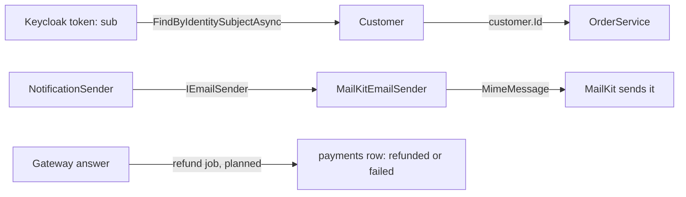

## Bạn cần biết trước

- [[design.l3.conformist]] — bạn biết API nhận nguyên các tên `sub`, `roles` và `staff` của Keycloak, và conform là một lựa chọn.
- [[design.l2.adapter-pattern]] — bạn biết `MailKitEmailSender` implement `IEmailSender` và chuyển mỗi lời gọi thành các lời gọi của MailKit.
- [[backend.l2.resource-based-authorization]] — bạn biết `OrderOwnerHandler` chỉ cho người gọi vào một đơn hàng khi họ là chủ đơn hoặc có role `staff`.

## Tình huống

`refund-design.md` là bản thiết kế hoàn tiền của Đơn Hàng, chưa được xây: một background job sẽ gọi cổng thanh toán, tức hệ thống bên ngoài chuyển tiền trả lại, rồi ghi kết quả vào các cột mới của bảng `payments`. Một đồng nghiệp đề xuất đi tắt: cổng trả về chuỗi trạng thái nào thì chép thẳng chuỗi đó vào cột `status` mới. Trước hết, hãy xem Đơn Hàng đang đối xử với các hệ thống bên ngoài thế nào. Request đặt hàng nào cũng mang theo một token của Keycloak, vậy mà `OrderService.PlaceOrderAsync` chỉ nhận một `customerId` thuần. Email nào cũng đi ra qua MailKit, vậy mà `NotificationSender` không hề chạm tới một kiểu nào của MailKit. Có một thứ gì đó đứng ở cửa, chuyển từ ngữ của hệ thống khác thành từ ngữ của Đơn Hàng.

Nên chuyển mô hình của hệ thống khác thành mô hình của mình ở đâu, và khi nào phần code đó đáng bỏ công?

## Khái niệm cốt lõi

- **anti-corruption layer** (lớp code ở rìa downstream context, dịch mô hình của upstream sang mô hình của mình) — code ở rìa một downstream context, dịch giữa mô hình của upstream và mô hình của downstream theo bất kỳ chiều nào mà từ ngữ đi qua, để từ ngữ của upstream không bao giờ lan vào bên trong.
- dịch (translation) — chuyển từ ngữ, giá trị và quy tắc của một mô hình khác thành của riêng mình, chẳng hạn chuyển `sub` trong token thành một `Customer`. Đổi tên một field chỉ là phần nhỏ nhất của nó.
- rìa (edge) — số ít chỗ mà một context chạm vào context khác: ở đây là chỗ đọc người gọi của một request, chỗ email đi ra, và chỗ cổng thanh toán sẽ trả lời.

## Cơ chế hoạt động



Ở hàng trên, token mang `sub`, id mà Keycloak đặt cho người dùng. Mỗi chỗ trong `DonHang.Api` đọc `sub` đều đưa chuỗi đó cho `FindByIdentitySubjectAsync` và nhận lại `Customer` của Đơn Hàng. Sau đó `OrderService.PlaceOrderAsync` chỉ nhận `Id` của khách hàng. Các lần tra cứu này chính là anti-corruption layer hướng về Keycloak.

Ở hàng giữa, phép dịch chạy ra ngoài. Ở đây MailKit là upstream, vì Đơn Hàng phải theo mô hình của nó để gửi mail. `NotificationSender` đưa cho `IEmailSender` một địa chỉ, một tiêu đề và một nội dung. `MailKitEmailSender` dựng ba thứ đó thành một `MimeMessage`, kiểu dữ liệu của MimeKit, thư viện mà MailKit xây bên trên, rồi MailKit gửi nó đi. Mô hình của MimeKit không bao giờ vào tới bên trong.

Class đó cũng là một adapter: nó implement `IEmailSender` bằng MailKit. Adapter là một công cụ để xây lớp như vậy, còn nhiệm vụ của lớp thì rộng hơn: từ ngữ, giá trị và quy tắc. Một lớp có thể chứa nhiều adapter, hoặc không có adapter nào. Phía Keycloak, phép dịch là một lần tra cứu lặp ở ba chỗ (`OrderOwnerHandler`, `OrdersController` và `OrdersV2Controller`), và không class nào bọc Keycloak.

Hàng dưới là một kế hoạch: `refund-design.md` đặt mọi lời gọi tới cổng thanh toán vào một background job, nơi câu trả lời của cổng sẽ được chuyển thành `refunded` và `failed`.

Phép dịch là code phải chạy theo mô hình của upstream. Nó đáng công khi mô hình đó khác mô hình của bạn, hoặc thay đổi ngoài tầm kiểm soát của bạn, vì khi đó một thay đổi ở upstream chỉ chạm tới phần rìa. Người dùng Keycloak không phải là khách hàng, nên Đơn Hàng dịch người dùng. Role `staff` đã mang đúng nghĩa mà Đơn Hàng cần, nên API conform với nó. Khi từ ngữ của upstream đã mang đúng nghĩa của bạn, conform rẻ hơn, vì không có phép dịch nào phải chạy theo.

Cổng thanh toán là hệ thống bên ngoài, Đơn Hàng không kiểm soát các từ chỉ trạng thái của nó, nên chép chúng vào `status` sẽ làm chúng lan vào bên trong.

## Trong hệ thống Đơn Hàng

Phía Keycloak, trong `OrderOwnerHandler`, phần kiểm tra "chủ đơn hàng, hoặc nhân viên":

```csharp file=DonHang.Api/Authorization/OrderOwnerHandler.cs tag=stage-2 lines=16-35
public sealed class OrderOwnerHandler(ICustomerRepository customers)
    : AuthorizationHandler<OrderOwnerRequirement, Order>
{
    protected override async Task HandleRequirementAsync(
        AuthorizationHandlerContext context, OrderOwnerRequirement requirement, Order order)
    {
        if (context.User.IsInRole("staff"))
        {
            context.Succeed(requirement);
            return;
        }

        var subject = context.User.FindFirstValue("sub");
        var caller = subject is null ? null : await customers.FindByIdentitySubjectAsync(subject);
        if (caller is not null && caller.Id == order.CustomerId)
        {
            context.Succeed(requirement);
        }
    }
}
```

Phép kiểm tra `IsInRole("staff")` ở đầu là nửa conform: role được dùng đúng như Keycloak viết. Tiếp theo, `FindFirstValue("sub")` đọc từ của Keycloak, và dòng kế đưa chuỗi đó cho `ICustomerRepository`, một interface của `DonHang.Domain`, để nhận lại một `Customer`. Quy tắc chủ sở hữu so `caller.Id` với `order.CustomerId`, hai id của Đơn Hàng, nên id của Keycloak đã biến mất trước khi quy tắc chạy. Người gọi không có role `staff` và không có dòng khách hàng nào sẽ thành `null`, và không bao giờ thỏa requirement. Vậy phép dịch mang theo một quy tắc chứ không chỉ một cái tên: người dùng Keycloak không có dòng khách hàng thì không sở hữu đơn hàng nào. Bên ngoài đoạn trích, `OrdersController` và `OrdersV2Controller` lặp lại đúng lần tra cứu đó và truyền `customer.Id` vào `PlaceOrderAsync`.

Phía email, nơi phép dịch chạy về phía một thư viện:

```csharp file=DonHang.Infrastructure/MailKitEmailSender.cs tag=stage-2 lines=15-34
// lesson: design.l2.adapter-pattern
// Implements Đơn Hàng's IEmailSender with MailKit: builds a MimeMessage and
// hands it to MailKit's SmtpClient. Only this class knows MailKit exists.
public sealed class MailKitEmailSender(SmtpSettings smtp) : IEmailSender
{
    public async Task SendAsync(string toAddress, string subject, string body, CancellationToken cancellationToken)
    {
        var message = new MimeMessage();
        message.From.Add(new MailboxAddress("Đơn Hàng", "orders@donhang.local"));
        message.To.Add(MailboxAddress.Parse(toAddress));
        message.Subject = subject;
        message.Body = new TextPart("plain") { Text = body };

        using var client = new SmtpClient { Timeout = 10_000 };
        // Mailpit in the lab speaks plain SMTP, without TLS.
        await client.ConnectAsync(smtp.Host, smtp.Port, SecureSocketOptions.None, cancellationToken);
        await client.SendAsync(message, cancellationToken);
        await client.DisconnectAsync(quit: true, cancellationToken);
    }
}
```

`SendAsync` nhận ba thứ mà `IEmailSender` gọi tên, bằng từ ngữ của Đơn Hàng. Năm dòng từ `new MimeMessage()` tới phần nội dung `TextPart` dựng lại chúng theo mô hình của MimeKit. Mailpit là mail server dùng để test trong lab, còn SMTP là giao thức dùng để gửi mail. Ba lời gọi `client` sau khi dựng xong message là phần gửi của riêng MailKit. MailKit không gửi một `MimeMessage` thiếu địa chỉ người gửi, mà `IEmailSender` không có địa chỉ đó, nên điền `From` bằng giá trị của chính Đơn Hàng cũng là một phần của phép dịch. Điều này khớp với bài adapter: gửi gì vẫn do bên gọi quyết định, còn `From` là một giá trị cố định, giống nhau cho mọi email. Dòng chú thích phía trên class nói rõ ranh giới: chỉ class này biết MailKit tồn tại.

Rìa thứ ba mới chỉ nằm trên giấy. Trong `docs/design/refund-design.md`, bước 3 đặt các lời gọi tới cổng thanh toán vào một job, bước 5 đánh dấu một dòng hoàn tiền là `failed` sau một lần từ chối dứt khoát (cổng thẳng thừng không cho hoàn tiền) hoặc sau 24 giờ thử lại, và bước 6 đánh dấu nó là `refunded` khi cổng xác nhận. Giới hạn 24 giờ đó là quy tắc của Đơn Hàng, không phải của cổng thanh toán, nên chính job quyết định 24 giờ không có xác nhận từ cổng nghĩa là gì.

## Senior hay nhầm rằng…

- **"Anti-corruption layer chỉ là tên khác của Adapter pattern."** → Thực ra Adapter là một công cụ, còn lớp này là một nhiệm vụ: dịch từ ngữ, giá trị và quy tắc của mô hình khác ngay tại rìa một context. `MailKitEmailSender` là cả hai, trong khi phía Keycloak không class nào bọc Keycloak theo Adapter pattern: phép dịch là một lần tra cứu lặp ở ba chỗ. Bạn sẽ nhận ra khi một class implement interface của bạn hoàn toàn đúng, nhưng lại trả về nguyên chuỗi trạng thái của cổng thanh toán, và các phép kiểm tra trên chuỗi đó bắt đầu xuất hiện trong code nghiệp vụ.
- **"Anti-corruption layer phải là một service riêng đứng giữa hai hệ thống."** → Thực ra ở stage-2, mọi phần của nó là code bình thường trong cùng một process: các lần tra cứu trong `DonHang.Api`, class email trong `DonHang.Infrastructure`. Nhiệm vụ là dịch, còn code chạy ở đâu là một quyết định khác. Bạn sẽ nhận ra khi một đề xuất "thêm lớp dịch" đi kèm một lần deploy mới và một lời gọi mạng mới, trong khi bản thân phép dịch chỉ là một lần tra cứu.
- **"Lớp dịch chỉ đổi tên field, còn giá trị và quy tắc đi qua nguyên vẹn."** → Thực ra `sub` không thành id khách hàng chỉ nhờ đổi tên: nó cần một lần tra cứu, và người gọi không có dòng khách hàng trở thành "không phải chủ". Job hoàn tiền theo kế hoạch còn thêm một quy tắc của riêng nó, giới hạn 24 giờ. Bạn sẽ nhận ra khi cổng thanh toán trả về một giá trị không ai lường trước, và giá trị đó nằm trong `payments` như một trạng thái mà không phần nào của Đơn Hàng biết xử lý.

## Thử ngay (3 phút)

1. Trong repository `don-hang`, chạy `git grep -n FindByIdentitySubjectAsync stage-2 -- 'DonHang.Api/*'` để liệt kê mọi chỗ trong API chuyển `sub` thành một `Customer`.
2. Chạy `git grep -n MimeMessage stage-2 -- '*.cs'` để liệt kê mọi dòng C# có nhắc tới kiểu message của MimeKit.

Kết quả mong đợi: mỗi dòng bắt đầu bằng `stage-2:`, đường dẫn file, rồi số dòng. Lệnh thứ nhất in ba dòng, trong `Authorization/OrderOwnerHandler.cs`, `Controllers/OrdersController.cs` và `Controllers/V2/OrdersV2Controller.cs`. Lệnh thứ hai in hai dòng, cả hai trong `DonHang.Infrastructure/MailKitEmailSender.cs`: dòng chú thích phía trên class và dòng tạo message. Rìa thứ nhất trải trên ba file, rìa thứ hai gói trong một class.

## Liên hệ

- [[design.l3.conformist]] — lựa chọn ngược lại: nhận nguyên mô hình của upstream. Với Keycloak, Đơn Hàng chọn cả hai, cho những phần khác nhau trong mô hình của mình.
- [[design.l2.adapter-pattern]] — công cụ ở mức thấp hơn một bậc: `MailKitEmailSender` được xây ở đó như một adapter, còn ở đây nó được đọc như một phần của lớp dịch.
- [[backend.l2.resource-based-authorization]] — nơi `OrderOwnerHandler` được viết ra. Ở đây, lần tra cứu `sub` của nó được đọc như phần rìa hướng về Keycloak.
- [[design.l2.ports-and-adapters]] — cùng phần rìa đó nhìn từ lõi: Đơn Hàng khai báo các interface bằng từ ngữ của mình, và code bên ngoài phải khớp vào.
- [[backend.l2.database-job-queue]] — mô hình background job mà job hoàn tiền theo kế hoạch sẽ theo, nên cũng là nơi phép dịch của nó sẽ nằm.
- [[design.l3.context-map]] — bản đồ đã vẽ các mũi tên upstream mà lớp trong bài này đứng trên.

## Tóm tắt 5 dòng

1. Anti-corruption layer dịch, ngay tại rìa một downstream context, giữa mô hình của upstream và mô hình của mình, theo cả hai chiều, để từ ngữ của upstream ở ngoài.
2. Ở stage-2, mỗi chỗ trong `DonHang.Api` đọc `sub` đều chuyển nó thành một `Customer` qua `FindByIdentitySubjectAsync`, nên `OrderService` chỉ thấy id khách hàng.
3. `MailKitEmailSender` là phần rìa hướng về MailKit, dịch ra ngoài: `MimeMessage` chỉ tồn tại bên trong nó, phần còn lại của Đơn Hàng gửi mail qua `IEmailSender`.
4. Adapter là một công cụ cho lớp như vậy, còn lớp thì dịch từ ngữ, giá trị và quy tắc, và có thể chứa nhiều adapter hoặc không có adapter nào.
5. Phép dịch là code phải chạy theo upstream, nên nó đáng công khi mô hình upstream khác hoặc thay đổi ngoài tầm kiểm soát của bạn. Ngược lại, conform rẻ hơn.
