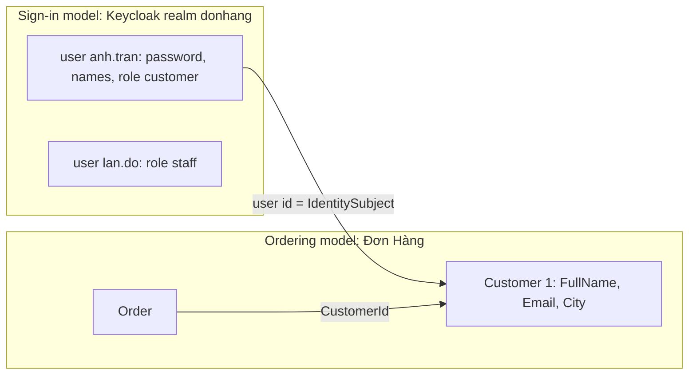

## Bạn cần biết trước

- [[design.l3.ubiquitous-language]] — bạn biết ubiquitous language gán cho mỗi từ một nghĩa đã thống nhất. Bài này hỏi sự thống nhất ấy đi xa tới đâu.
- [[backend.l2.validating-provider-tokens]] — bạn biết `sub` trong token của Keycloak là id mà Keycloak đặt cho người dùng, và API tìm ra khách hàng qua `customers.identity_subject`.
- [[backend.l2.role-based-access]] — bạn biết Keycloak gán cho mỗi người dùng các realm role như `customer` và `staff`, và API đọc chúng từ access token.

## Tình huống

Một bên liên quan hỏi Đơn Hàng có bao nhiêu khách hàng. Bạn mở `keycloak/donhang-realm.json`, file thiết lập realm của Keycloak cho môi trường lab, được Keycloak nạp khi khởi động trong container riêng. Bạn đếm được sáu người dùng. Một đồng nghiệp đếm số dòng của `customers` trong database lab và ra năm. Người dùng thứ sáu là `lan.do@example.com`, tài khoản nhân viên lo giao đơn.

Đồng nghiệp còn để ý rằng Keycloak giữ tên và họ riêng, còn `customers` giữ một họ tên đầy đủ kèm thành phố. Người đó đề nghị xóa một trong hai bản ghi về cùng những con người này. Vậy bản nào mới là khách hàng thật?

## Khái niệm cốt lõi

- **bounded context** (ranh giới mà bên trong nó một mô hình và ngôn ngữ của nó có hiệu lực, ra ngoài thì cùng một từ có thể mang nghĩa khác) — ranh giới mà bên trong nó một mô hình và bộ từ của nó có hiệu lực. Ra ngoài ranh giới, cùng một từ có thể mang nghĩa khác, và đó không phải lỗi. Mô hình ở đây là những gì một phần của hệ thống lưu giữ về nghiệp vụ: các đối tượng, các trường của chúng và tên gọi của chúng. Nó không nhất thiết là một domain model có method.
- mô hình đăng nhập — realm `donhang` của Keycloak (tập người dùng, mật khẩu và role mà Keycloak giữ cho Đơn Hàng). Ở đó, một người là một người dùng có username, mật khẩu, tên, họ và các realm role.
- mô hình đặt hàng — các class và bảng của chính Đơn Hàng. Ở đó, người đặt hàng là một `Customer` có họ tên đầy đủ, email và thành phố.
- giá trị liên kết — id mà Keycloak đặt cho một người dùng, được Đơn Hàng lưu trong `customers.identity_subject` để bản ghi về một người ở mô hình này khớp được với bản ghi ở mô hình kia.

## Cơ chế hoạt động



Trong tình huống trên, hai mô hình mô tả cùng những con người, và mỗi mô hình có hiệu lực trong ranh giới riêng. Trong realm của Keycloak, các từ là người dùng, username, mật khẩu và realm role. Ở đó, một người là bất kỳ ai đăng nhập, nên nhân viên Đỗ Ngọc Lan cũng là người dùng. Trong Đơn Hàng, khách hàng là người mà các đơn thuộc về, và mỗi `Order` trỏ tới khách của mình qua `CustomerId`. Mỗi mô hình là một bounded context, và mỗi con số trả lời câu hỏi riêng của nó. Sáu người đăng nhập được, năm người đặt hàng được.

Vậy ai được tính là khách hàng tùy vào bạn hỏi mô hình nào. Lan đăng nhập thành công, nhưng `customers` không có dòng nào cho cô. `GET /api/v1/orders` tìm khách hàng có `identity_subject` khớp với token của cô, không thấy ai, và trả về `403` thay vì liệt kê gì cả.

Hai mô hình nối với nhau bằng một giá trị, không bằng một class dùng chung. File realm cho mỗi người dùng một `id` cố định, và một migration đã chép id của năm người dùng là khách hàng, như Trần Minh Anh (`anh.tran`), vào `customers.identity_subject`. `sub` của token mang id đó, và API dùng nó để tìm khách hàng. Mỗi bên chỉ giữ những trường mình cần, nên địa chỉ email được lưu hai lần.

Gộp chúng thành một class sẽ đặt dữ liệu đăng nhập cạnh dữ liệu đặt hàng. Khi đó Đơn Hàng phải giữ username, mật khẩu và role ngay trong `Customer`, thay vì để Keycloak lo. Một thay đổi vì chuyện đăng nhập, như một quy tắc mới về mật khẩu, sẽ chạm tới class mà phần đặt hàng dùng. Hiện tại, quy tắc mật khẩu mới không lan tới code đặt hàng, vì class và bảng của Đơn Hàng không giữ mật khẩu người dùng nào.

## Trong hệ thống Đơn Hàng

Trần Minh Anh trong mô hình đăng nhập:

```json file=keycloak/donhang-realm.json tag=stage-2 lines=64-74
    {
      "id": "92f6ba26-729c-4d61-854b-c04c9f2db11a",
      "username": "anh.tran@example.com",
      "email": "anh.tran@example.com",
      "emailVerified": true,
      "firstName": "Minh Anh",
      "lastName": "Trần",
      "enabled": true,
      "credentials": [{ "type": "password", "value": "donhang-dev-password", "temporary": false }],
      "realmRoles": ["customer"]
    },
```

Hãy xem mô hình này quan tâm tới gì: cô đăng nhập ra sao (`username`, `credentials`), email của cô đã được xác minh chưa, và cô có realm role nào. Tên cô bị tách thành `firstName` và `lastName`. Mục của `lan.do@example.com`, ở cuối cùng file, có cùng dạng, với `realmRoles` là `["staff"]`. Dòng `id` chính là giá trị mà Đơn Hàng lưu.

Cùng người đó trong mô hình đặt hàng:

```csharp file=DonHang.Domain/Entities.cs tag=stage-2 lines=6-16
public sealed class Customer
{
    public int Id { get; set; }
    public required string FullName { get; set; }
    public required string Email { get; set; }
    public required string City { get; set; }

    // lesson: backend.l2.validating-provider-tokens
    // Keycloak's id for this customer (the `sub` of their tokens); null until they have an account there.
    public string? IdentitySubject { get; set; }
}
```

Ở đây không có username, mật khẩu hay role, nhưng có `City` và một `FullName` duy nhất. `db/seed.sql`, script nạp các dòng mẫu vào database lab khi database được tạo lần đầu, thêm cô vào dưới dạng `(1, 'Trần Minh Anh', 'anh.tran@example.com', 'Hà Nội')` cùng bốn khách hàng khác, không ai trong số đó là Lan.

`IdentitySubject` là giá trị liên kết. Kiểu `string?` cho phép nó null, và comment nói khi nào: cho tới khi khách có tài khoản trong Keycloak. `ICustomerRepository.FindByIdentitySubjectAsync` là đường API đi từ một token sang class này. Migration `AddCustomerIdentitySubject`, nằm ngoài các đoạn trích, thêm cột đó. Sau đó, với từng khách trong năm khách hàng, nó chạy một lệnh `UPDATE` tìm dòng theo email và ghi `id` Keycloak của người dùng tương ứng vào `identity_subject`.

## Senior hay nhầm rằng…

- **"Bounded context cũng chính là một service được deploy riêng."** → Thực ra đó là ranh giới của một mô hình và bộ từ của nó, không phải ranh giới của một tiến trình. Keycloak tình cờ chạy trong container riêng, nhưng điều làm nó thành một context riêng là mô hình về một con người của nó khác với mô hình của Đơn Hàng. Bạn sẽ nhận ra khi code được tách thành hai chương trình deploy riêng mà cả hai vẫn dùng một class chung có trường cho cả hai mục đích. Khi đó, đổi theo mục đích nào cũng vẫn phải sửa cả hai chương trình.
- **"Người dùng của Keycloak và `Customer` của Đơn Hàng mô tả cùng một người, nên một trong hai là bản trùng cần xóa."** → Thực ra chúng chung một con người và một giá trị, không chung mục đích. Xóa `customers` sẽ mất thành phố và mất các dòng mà đơn hàng trỏ tới. Xóa người dùng của Keycloak sẽ bắt Đơn Hàng tự lo đăng nhập, và cả mật khẩu. Ngay cái tên cũng có hình dạng khác nhau ở mỗi bên. Bạn sẽ nhận ra khi một script chép tên từ bên này sang bên kia phải quyết định ghép `firstName` và `lastName` thành `FullName` thế nào.
- **"Trong một công ty, mỗi từ nghiệp vụ phải có đúng một nghĩa ở mọi nơi."** → Thực ra một nghĩa cho mỗi từ là điều ngôn ngữ cam kết bên trong một ranh giới. Qua các ranh giới, `customer` là một realm role trong Keycloak và là một class có thành phố trong Đơn Hàng. Một nghĩa chung cho cả công ty thường hóa ra quá rộng cho cả hai bên, hoặc phải thương lượng rất lâu. Khi một báo cáo trải trên toàn bộ nghiệp vụ, đội vẫn có thể thống nhất một định nghĩa riêng cho báo cáo đó. Bạn sẽ nhận ra khi một cuộc thảo luận về khách hàng "duy nhất đúng" cứ thêm những trường mà chỉ một bên từng đọc.

## Thử ngay (3 phút)

Trong thư mục gốc của repo ví dụ, mở terminal:

1. Chạy `git grep -n -F "lan.do@example.com" stage-2 -- keycloak/donhang-realm.json db/seed.sql`. `git grep -n` in mọi dòng chứa đoạn chữ, kèm tên file và số dòng. Các đường dẫn sau `--` giới hạn việc tìm trong hai file đó. `-F` khớp đoạn chữ nguyên văn, còn `stage-2` tìm trong các file đúng như ở tag đó.
2. Chạy lại lệnh đó với `anh.tran@example.com`.
3. Với Anh, liệt kê trường nào chỉ mô hình đăng nhập giữ, trường nào chỉ mô hình đặt hàng giữ, và trường nào cả hai cùng giữ.

Kết quả mong đợi: lệnh đầu in hai dòng, cả hai từ `keycloak/donhang-realm.json` (username và email), và không có gì từ `db/seed.sql`. Lệnh thứ hai in hai dòng của file realm và một dòng của `db/seed.sql`.

<details><summary>Gợi ý đáp án</summary>

Chỉ mô hình đăng nhập: `username`, credential mật khẩu, `emailVerified`, tên tách đôi và realm role `customer`. Chỉ mô hình đặt hàng: `Customer.Id` 1, họ tên đầy đủ một trường và thành phố `Hà Nội`. Cả hai: địa chỉ email. `id` của Keycloak là giá trị liên kết: trong các file này chỉ mô hình đăng nhập có nó, còn `customers` nhận nó từ migration, không phải từ `db/seed.sql`.

</details>

## Liên hệ

- [[design.l3.ubiquitous-language]] — cùng ý tưởng đó, nay có đường biên: một nghĩa cho mỗi từ đúng bên trong một bounded context, không đúng xuyên qua tất cả.
- [[design.l3.entities-and-identity]] — danh tính của một entity thuộc về một mô hình. `Customer.Id` và id người dùng của Keycloak định danh cùng một người trong hai mô hình.
- [[backend.l2.validating-provider-tokens]] — nơi `identity_subject` ra đời. Bài này giải thích vì sao liên kết là một giá trị chứ không phải một class dùng chung.
- [[design.l3.contexts-inside-don-hang]] — bài tiếp theo: các ranh giới bên trong chính code của Đơn Hàng.

## Tóm tắt 5 dòng

1. Bounded context là ranh giới mà bên trong nó một mô hình và bộ từ của nó có hiệu lực. Ra ngoài, cùng một từ có thể mang nghĩa khác.
2. Trong Keycloak, Trần Minh Anh là một người dùng có username, mật khẩu, tên, họ và realm role `customer`.
3. Trong Đơn Hàng, cô là một `Customer` có họ tên đầy đủ, email và thành phố. Người dùng nhân viên `lan.do@example.com` không có dòng nào như thế.
4. Một giá trị nối hai bên: id người dùng của Keycloak nằm trong `customers.identity_subject`. Mỗi bên giữ trường riêng, nên email được lưu hai lần.
5. Một class dùng chung sẽ trộn mật khẩu với thành phố, nên thay đổi vì đăng nhập sẽ chạm tới code viết cho đặt hàng.
