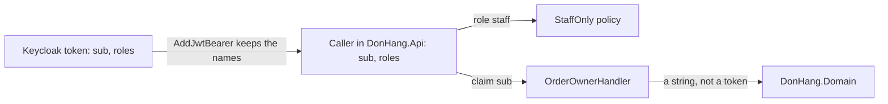

## Bạn cần biết trước

- [[design.l3.context-map]] — bạn biết Keycloak là upstream của Đơn Hàng, và API giữ nguyên tên claim `sub` và `roles` đúng như Keycloak viết.
- [[backend.l2.role-based-access]] — bạn biết policy `StaffOnly` đòi role `staff`, role mà API đọc từ claim `roles`.

## Tình huống

Bạn thêm endpoint thứ hai chỉ dành cho nhân viên vào `DonHang.Api` rồi mở pull request. Một reviewer để lại đúng một bình luận: "Mình dùng `staff` và `sub` chỉ vì Keycloak dùng thế. API không nên có từ ngữ riêng sao, chẳng hạn một cờ `IsEmployee` và một `UserId`, rồi chuyển mỗi token sang các từ đó? Hiện giờ mình chỉ chép lại những gì Keycloak gửi." Reviewer thứ hai đáp rằng code chuyển đổi là thêm một thứ phải giữ cho chạy đúng. Ý kiến nào nghe cũng có lý, và pull request nằm chờ.

Nhận nguyên các tên của Keycloak có phải là một quyết định thiết kế không, và khi nào đó là quyết định đúng?

## Khái niệm cốt lõi

- **conformist** (quan hệ trong đó downstream context dùng nguyên mô hình của upstream context, không tự dịch) — downstream context dùng nguyên mô hình của upstream context, không có lớp dịch nào của riêng mình. Từ này cũng là tên của mối quan hệ đó trên context map.
- lớp dịch (translation) — code ở phía downstream chuyển tên gọi và giá trị của upstream sang từ ngữ của riêng mình, chẳng hạn chuyển claim `roles` thành cờ `IsEmployee`. Reviewer thứ nhất đang đòi một lớp như vậy.
- claim type — claim là một cặp tên và giá trị mà token mang theo, như `sub` hay `roles`. Claim type là tên mà claim đó mang bên trong ASP.NET Core sau khi token được đọc, và tên này không nhất thiết trùng với tên viết trong token.
- realm — phần cấu hình Keycloak dành cho Đơn Hàng: người dùng, role, và những gì được đưa vào mỗi token.

## Cơ chế hoạt động



Keycloak viết token: `sub` là id mà Keycloak đặt cho người dùng, còn `roles` là danh sách do realm quy định. Trong `DonHang.Api`, `AddJwtBearer` đọc token thành người gọi, tức `User` mà controller và handler nhìn thấy, và giữ nguyên cả hai claim type như được viết. Policy `StaffOnly` đòi role `staff`, viết đúng như trong realm. `OrderOwnerHandler` đọc `sub`. Đây là phần kiểm tra đứng sau policy `OrderOwner`, để khách hàng chỉ vào được đơn hàng của chính mình.

Không chỗ nào Đơn Hàng chen một từ của riêng mình vào giữa Keycloak và một quy tắc. Chính điều đó khiến API là một conformist: `staff` trong `Program.cs` là chính từ của Keycloak, không phải một từ mà code chuyển đổi nào đó ánh xạ sang.

Conform không có nghĩa là để Keycloak tràn vào khắp nơi. Mũi tên cuối dừng ở `DonHang.Domain`, project chứa các class nghiệp vụ như `Order` và `Customer`. `OrderOwnerHandler` chỉ đưa cho nó giá trị của `sub`, một chuỗi thuần mà phần tìm khách hàng trong domain gọi là `identitySubject`. Domain không bao giờ thấy tên claim `sub`, claim `roles` hay một token nào.

Conform không tốn gì để xây: không class chuyển đổi, không phần ánh xạ nào phải test, và một `UserId` cũng chỉ chứa giá trị của `sub` dưới một cái tên mới. Hóa đơn đến sau, nếu Keycloak đổi tên, vì những dòng viết `sub`, `roles` hay `staff` phải đổi theo. Conform hợp với một generic subdomain như đăng nhập khi mô hình của nó khớp với mô hình của bạn, và ở đây nó khớp: với Đơn Hàng, nhân viên chính là role `staff` của realm, không hơn. Cấu hình realm nằm ngay trong repository này, ở `keycloak/donhang-realm.json`, file mà Keycloak import khi khởi động lần đầu. Chừng nào đội chỉ sửa realm qua file đó, một lần đổi tên sẽ đến trong một pull request, ngay cạnh phần code mà nó làm hỏng.

## Trong hệ thống Đơn Hàng

Phía production, quyết định này gói trong ba dòng của `Program.cs`: `MapInboundClaims = false`, `RoleClaimType = "roles"` và `RequireRole("staff")`.

```csharp file=DonHang.Api/Program.cs tag=stage-2 lines=52-66
        // Keep claim names as Keycloak wrote them ("sub", "roles"), and read
        // the caller's roles from the flat "roles" claim the realm adds.
        options.MapInboundClaims = false;
        options.TokenValidationParameters.RoleClaimType = "roles";
    });

// lesson: backend.l2.role-based-access
// lesson: backend.l2.resource-based-authorization
// Neither policy names an authentication scheme: they ask about the caller,
// not about how the caller signed in.
builder.Services.AddAuthorization(options =>
{
    options.AddPolicy("StaffOnly", policy => policy.RequireRole("staff"));
    options.AddPolicy("OrderOwner", policy => policy.AddRequirements(new OrderOwnerRequirement()));
});
```

Mấy dòng đầu là phần cuối của cấu hình `AddJwtBearer`, với `options` là các thiết lập của nó. `MapInboundClaims = false` tắt cơ chế ASP.NET Core tự đổi tên các claim gửi tới. Nếu để bật, cơ chế này sẽ gán cho một số tên quen thuộc, trong đó có `sub`, những claim type dài hơn của riêng framework. Khi đó tìm `"sub"` sẽ không thấy gì, và API phải viết tên của framework thay vì tên của Keycloak. Tiếp theo, `RoleClaimType = "roles"` khiến mọi phép kiểm tra role đều đọc claim `roles`. Bên dưới, `RequireRole("staff")` gọi tên role đúng như realm gọi. Phần chú thích phía trên `AddAuthorization` và dòng `OrderOwner` thuộc về các bài trước.

Bên ngoài đoạn trích, `OrderOwnerHandler` lặp lại cùng cách làm: `IsInRole("staff")` cho nhân viên vào mọi đơn hàng, còn `FindFirstValue("sub")` đọc id của người gọi. Cả hai controller đơn hàng, `OrdersController` và `OrdersV2Controller`, cũng đọc `sub` theo cùng cách.

Phần test cũng chọn như vậy.

```csharp file=DonHang.Tests/Integration/TestAuthHandler.cs tag=stage-2 lines=20-32
    protected override Task<AuthenticateResult> HandleAuthenticateAsync()
    {
        var subject = Request.Headers["X-Test-Subject"].ToString();
        if (subject.Length == 0) return Task.FromResult(AuthenticateResult.NoResult());

        var claims = new List<Claim> { new("sub", subject) };
        var roles = Request.Headers["X-Test-Roles"].ToString();
        claims.AddRange(roles.Split(',', StringSplitOptions.RemoveEmptyEntries).Select(role => new Claim("roles", role)));

        var identity = new ClaimsIdentity(claims, SchemeName, nameType: "sub", roleType: "roles");
        var ticket = new AuthenticationTicket(new ClaimsPrincipal(identity), SchemeName);
        return Task.FromResult(AuthenticateResult.Success(ticket));
    }
```

`TestAuthHandler` dựng người gọi từ hai header, `X-Test-Subject` và `X-Test-Roles`, thay vì từ token. Không có header `X-Test-Subject` thì nó báo là không có người gọi nào. Hãy nhìn tên nó đặt cho các claim: `sub` và `roles`. Nó truyền đúng cặp tên đó vào `nameType` và `roleType`, hai tham số cho identity biết claim nào giữ tên người gọi và claim nào giữ role. Đây là bản sao phía test của `RoleClaimType` trong `Program.cs`. Ba dòng cuối gói các claim này thành người gọi, tức `User`, rồi báo đăng nhập thành công. Test cũng conform, nên code được test chỉ đọc một dạng người gọi duy nhất và không cần trường hợp đặc biệt nào cho test. Điều đó cũng có nghĩa là test viết tên của Keycloak, nên một lần đổi tên cũng phải chép sang test.

## Senior hay nhầm rằng…

- **"Đội downstream chọn conformist đơn giản là không làm thiết kế gì cả."** → Thực ra conform là một quyết định dùng từ ngữ của ai, và nó đi kèm một ranh giới. Dòng chú thích phía trên `MapInboundClaims` nói rõ lựa chọn đó, và API phải tắt một mặc định của framework để thực hiện nó. Phần xác thực nằm trong `DonHang.Api`. Project `DonHang.Domain` không tham chiếu package ASP.NET Core nào, và không class nào trong đó đọc token. Bạn sẽ nhận ra khi ai đó đề xuất "thêm chút thiết kế" bằng cách ánh xạ role sang một enum, và thay đổi đó chạm vào mọi phép kiểm tra role mà không đổi câu trả lời nào của API.
- **"Dùng thẳng tên role của Keycloak luôn là sai, mọi tên đến từ bên ngoài đều phải được dịch."** → Thực ra lớp dịch chỉ đáng công khi mô hình bên ngoài khác mô hình của bạn, hoặc thay đổi ngoài tầm kiểm soát của bạn, và ở đây không điều nào đúng. Với Đơn Hàng, nhân viên đúng là role `staff` của realm. Chừng nào realm chỉ được sửa qua file của nó trong repository này, một lần đổi tên sẽ đến trong một pull request, như phần "Cơ chế hoạt động" đã cho thấy. Bạn sẽ nhận ra khi một class ánh xạ cứ thêm một dòng cho mỗi role, và dòng nào cũng biến một tên thành chính tên đó.

## Thử ngay (3 phút)

1. Trong repository `don-hang`, chạy `git grep -l -E '"(sub|roles|staff)"' stage-2 -- '*.cs'` để liệt kê mọi file C# ở `stage-2` có viết một trong ba tên của Keycloak dưới dạng chuỗi.
2. Nhóm các file theo project, và kiểm tra xem có file nào nằm trong `DonHang.Domain` không.

Kết quả mong đợi: sáu file, mỗi file có tiền tố `stage-2:`, bốn file trong `DonHang.Api` và hai file trong `DonHang.Tests`, không file nào trong `DonHang.Domain`. Sáu file này là cái giá của conform: file nào cũng viết ít nhất một tên của Keycloak, nên một lần đổi tên phải được mang vào từng file.

<details><summary>Gợi ý đáp án</summary>

`DonHang.Api`: `Authorization/OrderOwnerHandler.cs`, `Controllers/OrdersController.cs`, `Controllers/V2/OrdersV2Controller.cs`, `Program.cs`. `DonHang.Tests`: `Integration/TestAuthHandler.cs`, và `Integration/OrdersApiTests.cs`, nơi test giao hàng đòi một người gọi có role `staff`. Không có `DonHang.Domain`, vì phần xác thực nằm yên trong `DonHang.Api` và domain không bao giờ đọc token.

</details>

## Liên hệ

- [[design.l3.context-map]] — bài cần học trước: bản đồ đã vẽ mũi tên từ Keycloak tới Đơn Hàng, còn bài này gọi tên loại quan hệ trên mũi tên đó.
- [[backend.l2.role-based-access]] — nơi `RoleClaimType` và `StaffOnly` được thiết lập. Ở đây, cũng những dòng ấy được đọc như một lựa chọn thiết kế.
- [[design.l2.testing-protected-endpoints]] — nơi `TestAuthHandler` được viết ra. Tên claim của nó cho thấy phần test cũng theo Keycloak.
- [[design.l3.subdomains]] — lý do conform hợp ở đây: đăng nhập là một generic subdomain, để dùng lại chứ không phải để thiết kế.
- [[design.l3.anti-corruption-layer]] — lựa chọn ngược lại: dịch mô hình của upstream ngay ở rìa thay vì nhận nguyên nó.

## Tóm tắt 5 dòng

1. Một downstream context là conformist khi nó dùng nguyên mô hình của upstream, và đó là một lựa chọn dùng từ ngữ của ai.
2. Ở stage-2, `MapInboundClaims = false` và `RoleClaimType = "roles"` giữ nguyên tên của Keycloak, nên `StaffOnly` kiểm tra đúng role `staff` của realm.
3. `TestAuthHandler` dựng người gọi trong test với cùng claim type `sub` và `roles`, nên phần test cũng conform.
4. Conform không tốn gì để xây. Cái giá đến sau, khi Keycloak đổi tên và mọi file viết các tên đó phải đổi theo.
5. Từ ngữ của Keycloak không lọt vào `DonHang.Domain`: chỉ `DonHang.Api` và phần test của nó viết chúng, và không class nào trong domain đọc token.
