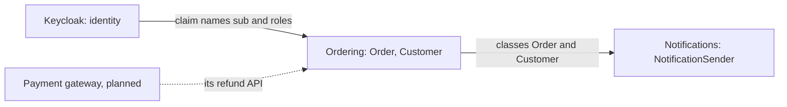

## Bạn cần biết trước

- [[design.l3.subdomains]] — bạn biết Đơn Hàng dùng lại Keycloak cho phần đăng nhập, một generic subdomain, và dồn công sức thiết kế vào phần đặt hàng.
- [[backend.l2.validating-provider-tokens]] — bạn biết API tự kiểm tra token của Keycloak và tìm ra khách hàng qua `sub` và `customers.identity_subject`.
- [[management.l2.design-doc]] — bạn biết `refund-design.md` lên kế hoạch cho một background job gọi cổng thanh toán kèm idempotency key, và liệt kê các câu hỏi còn bỏ ngỏ.

## Tình huống

Trong cùng một tuần có hai pull request. Pull request thứ nhất dọn lại cấu hình Keycloak cho Đơn Hàng và đổi tên claim `roles`, claim liệt kê các role của người dùng. (Claim là một trường có tên trong payload của access token, `sub` cũng là một claim.) Pull request thứ hai đổi tên các property của `Customer` trong `Entities.cs` cho khớp với từ ngữ trong biên bản họp. Mỗi tác giả chỉ kiểm tra phía mình. Trong khi đó, bản thiết kế hoàn tiền vẫn chờ câu trả lời từ một cổng thanh toán mà không ai trong đội kiểm soát.

Không ai có trong tay một bức tranh cho biết phần nào của Đơn Hàng dựa vào phần nào. Khi một phần đổi tên gọi hay quy tắc của mình, phần nào khác phải đổi theo?

## Khái niệm cốt lõi

- **context map** (hình vẽ các bounded context và cách mỗi cặp phụ thuộc nhau) — hình vẽ các bounded context và cách mỗi cặp phụ thuộc vào nhau, vẽ ra để đội thấy một thay đổi ở bên này lan sang bên kia ở chỗ nào.
- **upstream context** (context có mô hình mà context kia phải theo) — trong một mối quan hệ, đây là context có mô hình (các tên gọi, class và định dạng do nó định nghĩa) mà context kia phụ thuộc vào. Thay đổi của nó lan sang phía bên kia, còn chiều ngược lại thì không.
- **downstream context** (context phải thích nghi khi mô hình của upstream context thay đổi) — trong cùng mối quan hệ đó, đây là context phải thích nghi khi mô hình của upstream context thay đổi.

## Cơ chế hoạt động



Đây là một phần context map của stage-2: ba mối quan hệ mà ở đó thay đổi ở một bên lan sang bên kia. Mỗi hộp là một bounded context. Mỗi mũi tên đi từ upstream context tới downstream context và ghi rõ thứ mà phía downstream coi là có sẵn, không bàn lại.

Xét pull request thứ nhất. API giữ nguyên tên claim như Keycloak viết và đọc role từ claim `roles`. Đổi tên claim đó trong cấu hình Keycloak thì Keycloak vẫn chạy bình thường, nhưng API không tìm thấy role nào, nên nhân viên bị từ chối ở các endpoint chỉ dành cho nhân viên. Không có gì báo lỗi lúc biên dịch: `"roles"` chỉ là một chuỗi trong code của API, nên chỗ hỏng chỉ lộ ra khi một nhân viên gọi tới. Keycloak không đọc gì từ mô hình của Đơn Hàng, nên Keycloak là upstream, Đơn Hàng là downstream. Trên bản đồ, mũi tên dừng ở context đặt hàng, phần đọc các claim. Context thông báo, tức job gửi email, là một background job không do request nào khởi động, nên nó không đọc token nào cả.

Pull request thứ hai vượt qua một ranh giới nằm ngay bên trong API duy nhất của Đơn Hàng. Theo cách đọc ở một bài trước, API này chứa ba context: đặt hàng, danh mục sản phẩm và thông báo. Mỗi context có từ ngữ riêng, như `Order.Status` (đơn hàng đang ở giai đoạn nào trong vòng đời) và `Notification.Status` (một email đã được gửi đi hay chưa) cho thấy. Context đặt hàng sở hữu `Order` và `Customer`, còn context thông báo đọc thẳng hai class này để biết gửi email tới ai. Đặt hàng là upstream, nên một lần đổi tên vì lý do của riêng đặt hàng sẽ lan tới job gửi email, và thông báo phải đổi theo.

Mũi tên nét đứt là một mối quan hệ chưa tồn tại. Bản thiết kế hoàn tiền dự tính dùng một cổng thanh toán, và Đơn Hàng sẽ phải chấp nhận mọi thứ mà API hoàn tiền của cổng đó quy định. Điều này cũng biến cổng thanh toán thành upstream.

## Trong hệ thống Đơn Hàng

Đơn Hàng là downstream của Keycloak: API nhận đúng các tên mà cấu hình Keycloak dành cho Đơn Hàng, gọi là realm, đặt vào token.

```csharp file=DonHang.Api/Program.cs tag=stage-2 lines=52-55
        // Keep claim names as Keycloak wrote them ("sub", "roles"), and read
        // the caller's roles from the flat "roles" claim the realm adds.
        options.MapInboundClaims = false;
        options.TokenValidationParameters.RoleClaimType = "roles";
```

`MapInboundClaims = false` tắt cơ chế ASP.NET Core tự đổi tên các claim gửi tới, nên API thấy `sub` và `roles` đúng như Keycloak viết. `RoleClaimType = "roles"` khiến mọi phép kiểm tra role đều đọc đúng claim đó, claim mà realm thêm vào và pull request thứ nhất đổi tên. Bên ngoài đoạn trích, `OrderOwnerHandler`, phần kiểm tra để khách hàng chỉ thấy đơn hàng của chính mình, đọc `sub` của người gọi bằng `FindFirstValue("sub")` để tìm ra khách hàng. Không tên nào trong số này do Đơn Hàng chọn. API chỉ lặp lại tên của Keycloak.

Thông báo là downstream của đặt hàng: job gửi email đọc các class của đặt hàng.

```csharp file=DonHang.Api/Jobs/NotificationSender.cs tag=stage-2 lines=65-81
    private async Task SendOneAsync(IEmailSender email, Notification notification, CancellationToken stoppingToken)
    {
        try
        {
            var customer = notification.Order!.Customer!;
            await email.SendAsync(customer.Email, $"Order {notification.OrderId}: {notification.Subject}",
                $"Hello {customer.FullName}, this is about your order {notification.OrderId}: {notification.Subject}.",
                stoppingToken);
            notification.Status = "sent";
            notification.SentAt = DateTimeOffset.UtcNow;
            logger.LogInformation("Sent notification {NotificationId} for order {OrderId}", notification.Id, notification.OrderId);
        }
        catch (Exception ex) when (!stoppingToken.IsCancellationRequested)
        {
            RecordFailure(notification, ex);
        }
    }
```

Dòng đầu tiên trong `try`, `notification.Order!.Customer!`, đi từ notification, bản ghi của job cho một email cần gửi, sang `Order` của nó rồi tới `Customer` của đơn hàng đó. Hai dòng tiếp theo đọc `customer.Email` và `customer.FullName`, hai property của `Customer` thuộc context đặt hàng. Context thông báo không có class riêng nào cho người nhận email. Đổi tên `FullName` thì file này nằm trong số những file không còn biên dịch được: pull request thứ hai làm hỏng job gửi email, dù nó chưa từng chạm vào job đó.

Mối quan hệ thứ ba mới chỉ nằm trong `refund-design.md`. Các câu hỏi bỏ ngỏ của tài liệu này nêu hai điều cổng thanh toán chưa trả lời. Nếu cổng bỏ qua idempotency key, một lần thử lại sau khi mất câu trả lời có thể hoàn tiền hai lần, nên bước 4 (gửi key) phải hỏi trạng thái của lần hoàn tiền trước. Nếu cổng chỉ báo kết quả bằng cách gọi ngược lại, bước 6 (ghi nhận xác nhận của cổng) phải thay đổi. Trong cả hai trường hợp, Đơn Hàng là bên thích nghi, còn cổng thanh toán thì không.

Qua cả ba mối quan hệ, chỗ hỏng lộ ra đầu tiên ở đâu phụ thuộc vào cách phía downstream nắm giữ mô hình của upstream: dưới dạng chuỗi chữ được kiểm lúc chạy, dưới dạng class được biên dịch cùng, hay dưới dạng một bản kế hoạch.

## Senior hay nhầm rằng…

- **"Context map cũng chính là sơ đồ các server và những lời gọi mạng giữa chúng."** → Thực ra nó cho thấy mỗi bên theo mô hình của ai, và điều đó không nhất thiết khớp với lời gọi mạng nào. Đặt hàng và thông báo chạy trong cùng một process, `DonHang.Api`, không có lời gọi nào giữa hai bên, vậy mà thông báo vẫn phụ thuộc vào các class của đặt hàng. API chỉ gọi Keycloak để lấy metadata và key, không phải ở mỗi request, nhưng lại dựa vào tên claim của Keycloak ở mọi request. Bạn sẽ nhận ra khi sơ đồ các server đang chạy chỉ có một hộp cho API, trong khi một lần đổi tên trong `Entities.cs` làm hỏng job gửi email.
- **"Upstream đơn giản là bên gửi request."** → Thực ra upstream là bên có mô hình mà bên kia phụ thuộc vào, còn request có thể đi theo chiều nào cũng được. API gửi các request lấy key của Keycloak, và Keycloak vẫn là upstream. Xét riêng cổng thanh toán. Theo bản thiết kế hoàn tiền, Đơn Hàng sẽ gọi cổng. Nếu cổng gọi ngược lại, request sẽ đi theo chiều kia, và Đơn Hàng vẫn phải chấp nhận định dạng của cổng. Bạn sẽ nhận ra khi một bản đồ vẽ theo mũi tên request đặt Đơn Hàng làm upstream của cổng thanh toán, rồi cổng đổi API hoàn tiền và chỉ mình Đơn Hàng phải sửa.
- **"Làm downstream của một context khác là lỗi thiết kế, cần loại bỏ."** → Thực ra làm downstream là cái giá thường gặp khi dùng lại thành quả của người khác. Đơn Hàng chọn Keycloak cho một generic subdomain, và theo tên claim của Keycloak là một phần của lựa chọn đó. Bỏ mối quan hệ này nghĩa là xây lại phần đăng nhập, đúng thứ công sức mà bài trước đã chỉ ra là không tạo khác biệt nào. Điều bản đồ thêm vào là sự phụ thuộc được ghi lại, để mỗi thay đổi ở upstream đi kèm một lần kiểm tra ở downstream. Bạn sẽ nhận ra khi một kế hoạch "bỏ phụ thuộc vào Keycloak" biến thành xây lại phần đăng nhập tự viết mà stage-2 đã thay bằng Keycloak.

## Thử ngay (3 phút)

Không cần chạy gì, với mỗi thay đổi dưới đây, viết một dòng: upstream context, downstream context, và chỗ hỏng lộ ra đầu tiên ở đâu.

1. Cấu hình Keycloak thôi không thêm claim `roles` vào token.
2. Ai đó đổi tên `Customer.FullName` thành `Customer.Name` trong `Entities.cs`.
3. Cổng thanh toán cho biết sẽ không nhận idempotency key.

Kết quả mong đợi: ba dòng, mỗi dòng nêu một upstream context và một downstream context, với triệu chứng đầu tiên khác nhau: một lúc chạy, một lúc build, một trong tài liệu thiết kế.

<details><summary>Gợi ý đáp án</summary>

1. Keycloak là upstream, Đơn Hàng (trên bản đồ là context đặt hàng) là downstream. Build vẫn qua. Lúc chạy, nhân viên bị từ chối ở các endpoint chỉ dành cho nhân viên, vì API chỉ đọc role từ `roles`.
2. Đặt hàng là upstream, thông báo là downstream. Build thất bại trước khi có gì được phát hành, và `NotificationSender.cs` nằm trong số những file không còn biên dịch được, vì `SendOneAsync` đọc `FullName`.
3. Cổng thanh toán là upstream, Đơn Hàng (trên bản đồ là context đặt hàng) là downstream. Chưa có code nào. Bước 4 của `refund-design.md` phải đổi để hỏi trạng thái của lần hoàn tiền trước mỗi lần thử mới, đúng như các câu hỏi bỏ ngỏ của nó đã nêu.

</details>

## Liên hệ

- [[design.l3.subdomains]] — lựa chọn đứng sau mũi tên thứ nhất: Keycloak được dùng lại cho một generic subdomain, và bài này cho thấy sự phụ thuộc mà lần dùng lại đó tạo ra.
- [[backend.l2.validating-provider-tokens]] — nơi API học cách đọc token của Keycloak, chính là mô hình upstream mà bản đồ này chỉ tới.
- [[management.l2.design-doc]] — bản thiết kế hoàn tiền, nơi các câu hỏi bỏ ngỏ cho thấy cái giá của một upstream mà đội không kiểm soát.
- [[backend.l2.idempotent-endpoints]] — cùng ý tưởng nhìn từ phía bên kia: ở đó Đơn Hàng nhận idempotency key từ bên gọi nó, ở đây Đơn Hàng cần cổng thanh toán upstream nhận chúng.
- [[backend.l2.retry-with-backoff]] — ý tưởng backoff mà job hoàn tiền dùng lại với lịch riêng ở bước 5, và lý do bước 4 phải đổi nếu cổng bỏ qua idempotency key.
- [[design.l3.conformist]] — bài tiếp theo: một hướng để downstream context sống chung với mô hình của upstream.
- [[design.l3.anti-corruption-layer]] — cách còn lại, sau bài đó.

## Tóm tắt 5 dòng

1. Context map cho thấy, với mỗi cặp bounded context, bên nào phải theo mô hình của bên nào, để đội thấy một thay đổi lan tới đâu.
2. Upstream context sở hữu mô hình, downstream context thích nghi khi mô hình đó đổi, bất kể bên nào gửi request.
3. Keycloak là upstream của Đơn Hàng: API giữ nguyên tên claim `sub` và `roles` của Keycloak và đọc chúng đúng như được viết.
4. Ngay trong một process, thông báo là downstream của đặt hàng: `NotificationSender` đọc thẳng `Order` và `Customer`.
5. Một cổng thanh toán đang được dự tính cũng sẽ là upstream, và các câu hỏi bỏ ngỏ của bản thiết kế hoàn tiền đã liệt kê những chỗ Đơn Hàng sẽ phải thích nghi.
