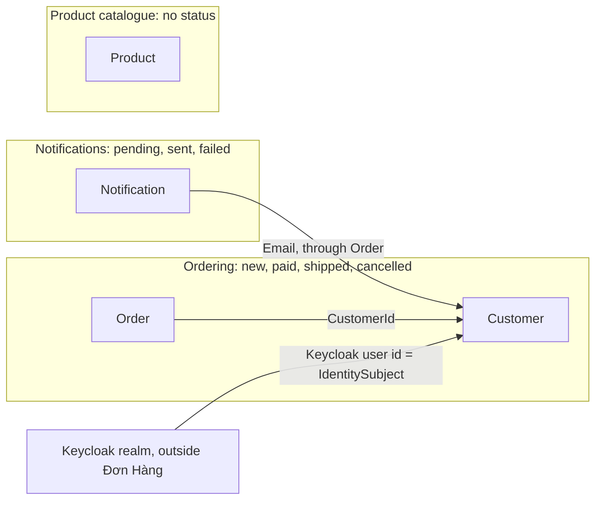

## Bạn cần biết trước

- [[design.l3.bounded-context]] — bạn biết bounded context là nơi một mô hình và bộ từ của nó có hiệu lực, và realm của Keycloak với Đơn Hàng là hai context như thế.
- [[backend.l2.database-job-queue]] — bạn biết mỗi dòng `notifications` là một job gửi email, được `NotificationSender` nhận xử lý rồi đánh dấu `sent`.
- [[design.l3.reference-other-aggregates-by-id]] — bạn biết `Order` trỏ tới khách hàng của nó qua `CustomerId`, còn `Order.Customer` được giữ lại để đọc.

## Tình huống

Trưởng nhóm hỏi bạn tuần trước có bao nhiêu đơn hàng bị lỗi. Bạn tìm `Status` trong `DonHang.Domain/Entities.cs` và thấy nó ở hai class: `Order` và `Notification`. Chỉ một trong hai có thể mang giá trị `failed`, và đó không phải đơn hàng.

Một đồng nghiệp đề nghị dùng chung một kiểu `Status` cho cả hai class. Chúng nằm cùng file, được lưu qua cùng `DonHangDbContext` và cùng về một database PostgreSQL. Bài trước đã vẽ ranh giới giữa Keycloak và Đơn Hàng, hai chương trình tách rời. Còn bản thân Đơn Hàng là một solution với một database. Nó chứa một bounded context, hay nhiều?

## Khái niệm cốt lõi

- mô hình đặt hàng — `Order` cùng các dòng hàng và `Customer` của nó. Ở đây `Status` là `new`, `paid`, `shipped` hoặc `cancelled`, và các method như `Cancel()` từ chối thay đổi mà quy tắc không cho phép.
- mô hình thông báo — class `Notification` và các dòng `notifications` của nó. Ở đây `Status` là `pending`, `sent` hoặc `failed`, và code bên ngoài class quyết định giá trị nào được gán.
- danh mục sản phẩm — `Product`, có tên và giá, không có trạng thái và không có method nào ở stage-2.
- ranh giới chỉ trên lời nói — một đường mà đội gọi tên được nhưng không code nào kiểm tra. Hai bên dùng chung file, chung một `DbContext` và một database, và code bên này đọc thẳng class của bên kia.

## Cơ chế hoạt động



Trong tình huống trên, từ `Status` thuộc về hai ngôn ngữ. Trên `Order`, nó cho biết đơn hàng đang ở đâu trong vòng đời, và `Cancel()` hay `Ship()` từ chối thay đổi khi trạng thái xuất phát không đúng. Trên `Notification`, nó cho biết một job gửi email đang ở đâu. Một thông báo `failed` không nói gì về đơn hàng của nó. Một kiểu dùng chung sẽ chứa bảy giá trị, trong khi mỗi class chỉ nhận ba hoặc bốn.

Bounded context được vẽ ở chỗ từ ngữ và quy tắc của một mô hình dừng lại, không theo project, thư mục hay database. Một database có thể chứa nhiều context, kể cả khi sau này mỗi context được tách ra kho lưu trữ riêng. Đặt hàng và thông báo dùng chung `Entities.cs`, `DonHangDbContext` và một database, nhưng từ ngữ của chúng khác nhau. Không gì ngăn code bên này đọc class của bên kia: mũi tên duy nhất từ `Notification` tới `Customer` trong sơ đồ, khi xuống code, là một lần đi xuyên qua `Order`. Các mũi tên còn lại là `CustomerId` và `IdentitySubject` của Keycloak.

`Product`, mô hình thứ ba, có tên và giá, không có trạng thái và không có method. Quy tắc duy nhất về giá trị của nó, giá phải lớn hơn 0, nằm trong `db/schema.sql` và `UpdateProductPriceRequest`. Khác với thông báo, sản phẩm không có quy tắc riêng, nên lý do tách danh mục thành context riêng yếu hơn. Dù vậy lý do ấy vẫn đứng được: không method trạng thái nào của `Order` đọc hay sửa một `Product`, và `OrderItem` chỉ giữ một `ProductId`.

Vẽ ranh giới ở đâu là một lựa chọn thiết kế. Một cách đọc hợp lý về stage-2 là ba context: đặt hàng, danh mục sản phẩm và thông báo, còn realm của Keycloak nằm bên ngoài. `Payment` chưa được dùng ở đâu ngoài `Entities.cs`, `DonHangDbContext` và các migration được sinh ra cho nó, nên nó không làm thay đổi gì. Một đội khác có thể gộp thông báo vào đặt hàng, vì thông báo nào cũng thuộc về một đơn. Cách đọc nào cũng nên đi theo từ ngữ và quy tắc, không theo cách sắp xếp file.

## Trong hệ thống Đơn Hàng

Mô hình thông báo, nằm cùng file với `Order`:

```csharp file=DonHang.Domain/Entities.cs tag=stage-2 lines=116-131
// lesson: backend.l2.database-job-queue
// From stage-2 each row is also a job: an email waiting to be sent (pending),
// sent, or given up on after too many failed attempts (failed).
public sealed class Notification
{
    public int Id { get; set; }
    public int OrderId { get; set; }
    public Order? Order { get; set; }
    public required string Channel { get; set; }
    public required string Subject { get; set; }
    public required string Status { get; set; }
    public int Attempts { get; set; }
    public DateTimeOffset CreatedAt { get; set; }
    public DateTimeOffset NextAttemptAt { get; set; }
    public DateTimeOffset? SentAt { get; set; }
}
```

Comment cho `Status` này ba giá trị, và đó là những từ nói về một job, không nói về một đơn hàng. `Attempts` và `NextAttemptAt` thuộc cùng ngôn ngữ đó: chúng đếm số lần thử gửi một email. `Status` của `Order`, ở phía trên trong cùng file, có setter private. Constructor gán `new`, sau đó giá trị chỉ đổi qua `MarkPaid()`, `Cancel()` và `Ship()`. Bạn sẽ thấy các dòng này ở phần Thử ngay. Còn ở đây setter là public, và code bên ngoài class gán giá trị: `pending` khi email được xếp hàng, `sent` hoặc `failed` trong `NotificationSender`.

Mô hình thông báo đi sang mô hình đặt hàng:

```csharp file=DonHang.Api/Jobs/NotificationSender.cs tag=stage-2 lines=65-81
    private async Task SendOneAsync(IEmailSender email, Notification notification, CancellationToken stoppingToken)
    {
        try
        {
            var customer = notification.Order!.Customer!;
            await email.SendAsync(customer.Email, $"Order {notification.OrderId}: {notification.Subject}",
                $"Hello {customer.FullName}, this is about your order {notification.OrderId}: {notification.Subject}.",
                stoppingToken);
            notification.Status = "sent";
            notification.SentAt = DateTimeOffset.UtcNow;
            logger.LogInformation("Sent notification {NotificationId} for order {OrderId}", notification.Id, notification.OrderId);
        }
        catch (Exception ex) when (!stoppingToken.IsCancellationRequested)
        {
            RecordFailure(notification, ex);
        }
    }
```

Hãy nhìn dòng đầu tiên trong `try`. Để tìm địa chỉ email, job đi từ `Notification` của nó sang `Order` của phần đặt hàng, rồi tới `Customer` của đơn. Cả compiler lẫn test đều không chặn đường đi này. Ranh giới giữa thông báo và đặt hàng là điều đội nói ra được, chứ không phải điều code kiểm tra. `RecordFailure`, ở phía dưới trong cùng file, gán `failed` khi đã hết số lần thử.

Danh mục sản phẩm không cần đoạn trích riêng. `ProductsController.List` bắt đầu từ `db.Products` và tạo một trang kết quả bằng `OrderBy`, `Skip`, `Take` và `Select`. Comment phía trên controller viết: "it has no rule to apply, only a query to shape."

## Senior hay nhầm rằng…

- **"Mỗi bounded context cần project riêng và database riêng ngay từ đầu."** → Thực ra context là ranh giới của từ ngữ và quy tắc trong một mô hình, còn tách project và database là một trong những cách để sau này buộc code tôn trọng ranh giới đó. Theo cách đọc ở trên, stage-2 có ba context trong một solution và một database, và trong mỗi context từ ngữ vẫn nhất quán. Khi ranh giới còn đang dịch chuyển, tách project sớm sẽ đóng cứng một đường mà đội có thể sắp vẽ lại. Bạn sẽ nhận ra khi một class cứ bị chuyển qua lại giữa hai project mỗi lần đội đổi ý.
- **"`Order` và `Notification` khai báo trong cùng file, nên chúng thuộc cùng một bounded context."** → Thực ra `Entities.cs` được sắp theo bảng, không theo mô hình. Comment ở đầu file viết "One class per table in db/schema.sql". Hai class chung file và chung từ `Status`, nhưng không chung giá trị hay quy tắc. Bạn sẽ nhận ra khi một thay đổi về gửi lại email, như thêm một property vào `Notification`, đến trong một pull request chạm vào chính file chứa quy tắc của đơn hàng.
- **"Bounded context chỉ là một aggregate lớn hơn."** → Thực ra aggregate là một khối thay đổi giữ cho các invariant của nó luôn đúng, còn context là nơi một ngôn ngữ có hiệu lực và có thể chứa nhiều aggregate. Phần đặt hàng chứa ít nhất hai aggregate, `Order` và `Customer`, và `Order` trỏ tới khách hàng của nó bằng id. Bạn sẽ nhận ra khi ai đó cố bắt một class canh giữ mọi quy tắc của cả context, và việc hủy một đơn bắt đầu đòi phải nạp cả khách hàng của đơn đó.

## Thử ngay (3 phút)

Trong thư mục gốc của repo ví dụ, mở terminal:

1. Chạy `git grep -n -w Status stage-2 -- DonHang.Domain/Entities.cs`. `-w` chỉ khớp `Status` khi nó là một từ trọn vẹn, nên `OrderStatusException` không được tính.
2. Với mỗi dòng được in, ghi lại nó thuộc class nào: `Order` bắt đầu ở dòng 30, `Notification` ở dòng 119.
3. Ghi ra `Status` của mỗi class nhận những giá trị nào, và các giá trị đó được kiểm tra ở đâu.

Kết quả mong đợi: 14 dòng. Mười ba dòng nằm giữa dòng 35 và 95, bên trong `Order`. Một dòng, dòng 126, là khai báo của `Notification.Status`. Một dòng của `Order` gán chuỗi rỗng trong constructor private, đó không phải trạng thái thật. Với `Notification`, không dòng nào trong file này gán hay kiểm tra giá trị, chuyện đó diễn ra bên ngoài class.

<details><summary>Gợi ý đáp án</summary>

`Order` gán `new`, `paid`, `shipped` và `cancelled`, và chính các method của nó kiểm tra trạng thái xuất phát trước mỗi thay đổi. Chuỗi rỗng trong constructor private không bao giờ là trạng thái thật: EF Core dùng constructor đó khi nạp một đơn hàng, rồi điền `Status` từ dòng dữ liệu. `Notification` khai báo property và không làm gì thêm trong file này. Các giá trị của nó, `pending`, `sent` và `failed`, nằm trong comment phía trên class và được code bên ngoài class gán: `pending` khi email được xếp hàng, `sent` hoặc `failed` do code gửi email gán. Một từ, hai tập giá trị, hai nơi đặt quy tắc: hai ngôn ngữ trong một file.

</details>

## Liên hệ

- [[design.l3.bounded-context]] — cùng ý tưởng đó, áp dụng bên trong một codebase: ở bài trước ranh giới chạy giữa hai chương trình, ở đây nó chạy giữa các class trong một file.
- [[design.l2.where-a-rule-belongs]] — quy tắc nằm ở đâu cho biết nó thuộc mô hình nào: quy tắc trạng thái của `Order` nằm trong các method của nó, còn của thông báo thì nằm trong code bên ngoài class.
- [[design.l3.reference-other-aggregates-by-id]] — một context chứa nhiều aggregate. `Order` và `Customer` của phần đặt hàng nối với nhau qua `CustomerId`.
- [[design.l3.context-map]] — bài tiếp theo: các context tìm được ở đây liên hệ với nhau ra sao.
- [[design.l3.subdomains]] — câu hỏi tiếp theo về ba context này: context nào đáng được đầu tư thiết kế nhiều nhất.

## Tóm tắt 5 dòng

1. Bounded context được vẽ ở chỗ từ ngữ và quy tắc của một mô hình dừng lại, không theo project, thư mục hay database. Một codebase có thể chứa nhiều context.
2. Ở stage-2, `Order.Status` là `new`, `paid`, `shipped` hoặc `cancelled`, còn `Notification.Status` là `pending`, `sent` hoặc `failed`.
3. Đặt hàng và thông báo dùng chung `Entities.cs` và `DonHangDbContext`, và `NotificationSender` đọc email của khách hàng xuyên qua `Order` và `Customer`.
4. Class sản phẩm không có trạng thái và không có quy tắc, nên `ProductsController` liệt kê chúng thẳng từ `DonHangDbContext`.
5. Vẽ ranh giới là một lựa chọn thiết kế. Một cách đọc hợp lý về stage-2 là đặt hàng, danh mục sản phẩm và thông báo, còn Keycloak nằm bên ngoài.
