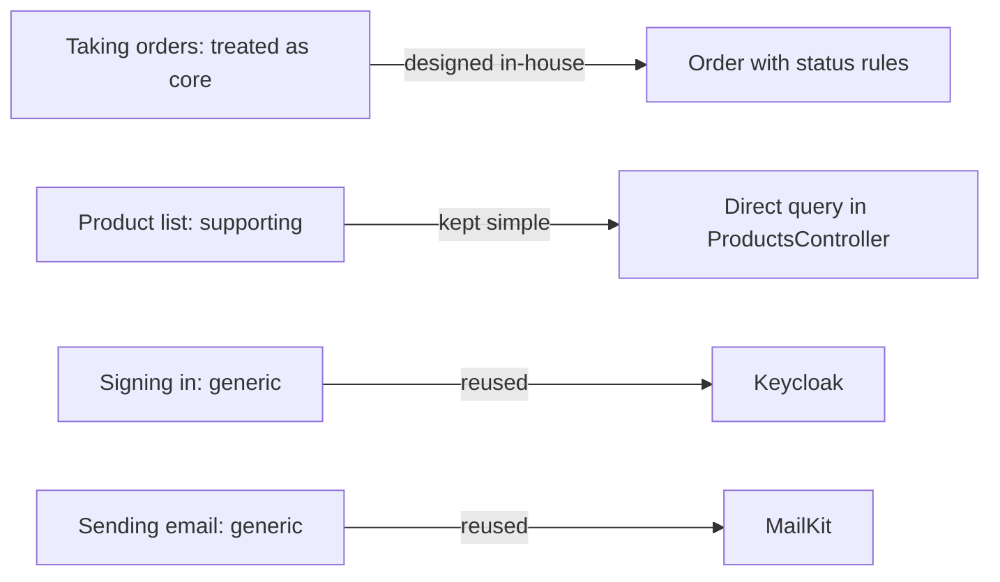

## Bạn cần biết trước

- [[design.l3.contexts-inside-don-hang]] — bạn biết stage-2 có thể được đọc hợp lý thành ba context: đặt hàng, danh mục sản phẩm và thông báo, còn Keycloak nằm bên ngoài.
- [[design.l2.where-a-rule-belongs]] — bạn biết domain model chỉ đáng công viết method ở nơi có quy tắc, còn liệt kê sản phẩm vẫn chỉ là một truy vấn trực tiếp.
- [[design.l2.adapter-pattern]] — bạn biết `MailKitEmailSender` chuyển MailKit sang `IEmailSender` của chính Đơn Hàng.

## Tình huống

Trong buổi lên kế hoạch sprint, một đồng nghiệp đề xuất hai đầu việc. Thứ nhất, cho `Product` và `Payment` có kiểm tra trong constructor và method giống như `Order`, để mọi class trong `Entities.cs` được thiết kế cùng một kiểu. Thứ hai, đưa phần đăng nhập trở lại API. Ở stage-1, Đơn Hàng tự kiểm tra mật khẩu. Sang stage-2, code đó đã bị bỏ và Keycloak lo đăng nhập. "Đăng nhập là phần sống còn," đồng nghiệp nói, "nên mình phải tự làm."

Cả hai đầu việc nghe đều cẩn thận, và mỗi việc tốn một sprint. Phần nào của Đơn Hàng đáng được đầu tư thiết kế như vậy, và ai là người quyết định?

## Khái niệm cốt lõi

- **subdomain (DDD)** (một phần của bài toán mà doanh nghiệp giải quyết, như nhận đơn hay đăng nhập) — một phần của bài toán mà doanh nghiệp giải quyết, như nhận đơn, hiển thị sản phẩm, gửi email hay đăng nhập. Bounded context là ranh giới trong phần mềm. Hai thứ này thường trùng nhau nhưng không bắt buộc phải trùng.
- **core domain** (phần nghiệp vụ làm doanh nghiệp khác đối thủ, đáng được đầu tư thiết kế nhiều nhất) — subdomain làm doanh nghiệp khác những nơi làm cùng loại việc, nên xứng đáng được chăm chút thiết kế nhiều nhất. Subdomain nào là core là quyết định kinh doanh, không phải quyết định kỹ thuật.
- **supporting subdomain** (phần nghiệp vụ riêng của doanh nghiệp nhưng đơn giản, cần có mà không tạo khác biệt) — subdomain riêng của doanh nghiệp này nhưng đơn giản, như danh sách sản phẩm của Đơn Hàng: cần có, nhưng không phải thứ làm doanh nghiệp khác biệt.
- **generic subdomain** (bài toán mà hầu hết doanh nghiệp đều có, như đăng nhập hay gửi email, thường dùng lại giải pháp sẵn có) — bài toán mà hầu hết doanh nghiệp đều gặp, như đăng nhập hay gửi email, và thường được giải bằng cách dùng lại thứ người khác đã làm sẵn.

## Cơ chế hoạt động



Subdomain là một phần của bài toán, còn ba context ở bài trước là ranh giới trong phần mềm. Ở đây chúng đi thành cặp: context đặt hàng ứng với nhận đơn, danh mục sản phẩm ứng với danh sách sản phẩm, và thông báo ứng với gửi email. Context thông báo phần lớn vẫn là code của chính Đơn Hàng: job của nó quyết định khi nào mỗi email được gửi đi và thử lại khi thất bại, chỉ riêng khâu gửi là dùng lại qua MailKit. Đăng nhập không có context nào: Keycloak lo phần đó ở bên ngoài. Hai bên không nhất thiết khớp nhau. Hai subdomain có thể dùng chung một context, như nhận đơn và danh sách sản phẩm sẽ thế nếu đội coi chúng là một mô hình.

Tiếp theo, hãy hỏi phần nào làm doanh nghiệp khác biệt. Đăng nhập là phần sống còn, nhưng gần như doanh nghiệp nào cũng có, nên nó không phải core. Quyết định này thuộc về những người điều hành doanh nghiệp. Bài này không có ghi chép nào về quyết định đó cho Đơn Hàng, nên nó lấy công sức bỏ vào code làm thước đo thay thế: code coi nhận đơn là core, tự thiết kế `Order` với các method canh giữ quy tắc trạng thái của nó.

Hai loại còn lại cố ý được đầu tư ít hơn. Danh sách sản phẩm không có quy tắc nào trong class của nó, nên một truy vấn trực tiếp là đủ. Bài này coi nó là supporting chứ không phải generic: nó liệt kê sản phẩm của chính Đơn Hàng theo đúng cách Đơn Hàng bán, và đội đã chọn tự viết, giữ cho đơn giản. Một đội mua công cụ quản lý danh mục thay vì tự viết có thể gọi nó là generic, và điều đó cũng hợp lý. Đăng nhập và gửi email là generic, nên Đơn Hàng dùng lại Keycloak và MailKit.

Công sức bỏ vào một generic subdomain chỉ mua được kết quả mà doanh nghiệp khác cũng có. Công sức bỏ vào một supporting subdomain không có quy tắc chỉ mua được code chẳng có gì để bảo vệ. Khi đội phải chọn, core domain là nơi thiết kế tốt hơn đem lại lợi ích.

## Trong hệ thống Đơn Hàng

Nơi công sức thiết kế được dồn vào: các quy tắc đặt hàng trong `Order`.

```csharp file=DonHang.Domain/Entities.cs tag=stage-2 lines=72-96
    // lesson: design.l2.status-changes-through-methods
    // One method per allowed change, each checking the status it starts from.
    // No endpoint takes payments at stage-2; OrderTests uses this to get a paid order.
    public void MarkPaid()
    {
        if (Status == "cancelled") throw new OrderStatusException(Id, "already-cancelled", $"order {Id} is cancelled");
        if (Status != "new") throw new OrderStatusException(Id, "already-paid", $"order {Id} is already paid");
        Status = "paid";
    }

    // lesson: design.l2.domain-model
    public void Cancel()
    {
        if (Status == "cancelled") throw new OrderStatusException(Id, "already-cancelled", $"order {Id} is already cancelled");
        if (Status == "shipped") throw new OrderStatusException(Id, "already-shipped", $"order {Id} has already shipped");
        Status = "cancelled";
    }

    public void Ship()
    {
        if (Status == "cancelled") throw new OrderStatusException(Id, "already-cancelled", $"order {Id} is cancelled");
        if (Status == "shipped") throw new OrderStatusException(Id, "already-shipped", $"order {Id} has already shipped");
        if (Status != "paid") throw new OrderStatusException(Id, "not-paid", $"order {Id} is not paid yet");
        Status = "shipped";
    }
```

Ba method này là những method duy nhất trong `Entities.cs`, và method nào cũng từ chối một thay đổi mà quy tắc đặt hàng không cho phép. Constructor của `Order`, nằm ngoài đoạn trích, cũng từ chối một đơn hàng không có món nào. `Product`, ở phía trên trong cùng file, chỉ có `Id`, `Name` và `PriceVnd`. `Payment`, bản ghi thanh toán cho một đơn hàng, cũng chỉ là dữ liệu thuần. Ở stage-2 chưa có gì cần hơn thế, vì như comment phía trên `MarkPaid` ghi, chưa có endpoint nào nhận thanh toán. `ProductsController.List` đọc sản phẩm thẳng từ `DonHangDbContext`, và comment của nó viết rằng danh sách này "has no rule to apply, only a query to shape."

Nơi công sức không được bỏ vào: đăng nhập.

```csharp file=DonHang.Api/Program.cs tag=stage-2 lines=34-39
// lesson: backend.l2.oauth2-roles
// lesson: backend.l2.openid-connect-id-token
// lesson: backend.l2.validating-provider-tokens
// Keycloak issues the tokens; the api only checks them. AddJwtBearer reads
// Keycloak's metadata and public keys once, then checks each token's
// signature, issuer, audience and expiry itself, without calling Keycloak.
```

Với bài này, hãy đọc dòng comment thứ tư: "Keycloak issues the tokens; the api only checks them." Bạn không cần các từ còn lại trong những dòng này cho bài này. Phần cấu hình ngay sau các dòng này, nằm ngoài đoạn trích, cho biết token được kiểm tra thế nào, và một bài trước đã nói về nó. Điều quan trọng ở đây là thứ đã biến mất: `AuthController` và `PasswordHasher` của stage-1 không còn ở stage-2, và một migration đã xóa cột `password_hash` mà chúng dùng. Email cũng theo cùng khuôn đó: `MailKitEmailSender` là class duy nhất dùng MailKit. (Một từ trong comment còn lỏng: API tải lại metadata của Keycloak, cùng các key được liệt kê trong đó, theo định kỳ và khi gặp một token có key lạ, chứ không chỉ một lần.)

## Senior hay nhầm rằng…

- **"Subdomain nào cũng nên có một domain model đầy đủ, để cả codebase được thiết kế cùng một kiểu."** → Thực ra domain model chỉ đáng công viết method ở nơi có quy tắc cần giữ, và `Product` không có quy tắc nào trong class của nó. Kiểm tra giá của nó, giá phải lớn hơn 0, nằm bên ngoài class: database từ chối giá bằng 0 hoặc nhỏ hơn, và kiểu request dùng để cập nhật giá cũng vậy. Method đặt ở đó sẽ chẳng canh giữ gì. Bạn sẽ nhận ra khi một method mới trên `Product` chỉ chép tham số vào một property, và test của nó không kiểm tra gì ngoài lần chép đó.
- **"Core domain đơn giản là phần có nhiều code nhất."** → Thực ra core là phần làm doanh nghiệp khác biệt, còn lượng code phụ thuộc cả vào những thứ khác, như cấu hình và kết nối các thành phần. Ở stage-2, `Program.cs` dài 126 dòng, gần như toàn bộ là cấu hình cho service, xác thực, metrics và health check, trong khi các quy tắc đặt hàng gói gọn trong `Order`: constructor của nó và ba method. Bạn sẽ nhận ra khi một bảng xếp hạng theo số dòng đặt code khởi động lên trên các quy tắc mà doanh nghiệp dựa vào để cạnh tranh.
- **"Đăng nhập là phần sống còn của doanh nghiệp, nên nó phải thuộc core domain và phải tự xây."** → Thực ra sống còn và tạo khác biệt là hai câu hỏi khác nhau. Khách hàng không thể đặt hàng nếu không đăng nhập, nhưng hầu hết doanh nghiệp đều có cùng bài toán đăng nhập, và một công cụ làm riêng cho nó, như Keycloak, đã giải quyết sẵn. Khi đội vẫn tự xây, công sức thiết kế đổ vào nơi không tạo ra khác biệt nào. Bạn sẽ nhận ra khi cả một sprint dành cho chức năng đặt lại mật khẩu trong lúc một quy tắc đặt hàng vẫn đang chờ được làm.

## Thử ngay (3 phút)

Trong thư mục gốc của repo ví dụ, mở terminal:

1. Chạy `git grep -n "public void" stage-2 -- DonHang.Domain/Entities.cs`.
2. Ghi lại mỗi dòng được in thuộc class nào: `Order` chạy từ dòng 30 tới dòng 97.
3. Sau đó, không cần chạy gì, xếp bốn phần sau của Đơn Hàng vào core, supporting và generic: nhận đơn, danh sách sản phẩm, đăng nhập, gửi email về đơn hàng. Với mỗi phần, viết một câu về những gì code làm cho phần đó ở stage-2.

Kết quả mong đợi: ba dòng, 75, 83 và 90, ứng với `MarkPaid`, `Cancel` và `Ship`, đều nằm trong `Order`. Không class nào khác trong file có method `public void`.

<details><summary>Gợi ý đáp án</summary>

Nhận đơn được coi là core: `Order` tự giữ các quy tắc trạng thái của nó trong ba method bạn vừa tìm thấy. Danh sách sản phẩm là supporting: đó là dữ liệu của chính Đơn Hàng, nhưng `ProductsController.List` đọc thẳng từ `DonHangDbContext` vì không có quy tắc nào cần áp dụng. Đăng nhập là generic: Keycloak cấp token, còn API chỉ kiểm tra. Gửi email về đơn hàng cũng là generic: MailKit gửi email, và chỉ `MailKitEmailSender` dùng nó. Câu trả lời đầu tiên là một quyết định kinh doanh mà code phản ánh. Nếu doanh nghiệp cạnh tranh bằng danh mục sản phẩm, công sức sẽ phải dồn vào đó.

</details>

## Liên hệ

- [[design.l3.contexts-inside-don-hang]] — cùng ba phần ấy nhìn từ phía bên kia: ở đó là ranh giới trong phần mềm, ở đây là các phần của bài toán, xếp theo mức đáng được đầu tư.
- [[design.l2.where-a-rule-belongs]] — quy tắc mà bài này áp dụng ở quy mô lớn hơn: một mô hình chỉ đáng có method ở nơi có quy tắc.
- [[design.l2.transaction-script]] — một kiểu viết đơn giản hơn, hợp với supporting subdomain có các thao tác ít quy tắc.
- [[design.l2.adapter-pattern]] — cách cắm một generic subdomain vào hệ thống: MailKit đứng sau `IEmailSender` của chính Đơn Hàng.
- [[backend.l2.oauth2-roles]] — nơi đăng nhập chuyển từ code của Đơn Hàng sang Keycloak, chính là sự dùng lại mà bài này gọi là generic.
- [[design.l3.context-map]] — bài tiếp theo: các context của Đơn Hàng phụ thuộc vào nhau và vào Keycloak ra sao.

## Tóm tắt 5 dòng

1. Khi phải chọn chỗ bỏ công sức, công sức đáng giá nhất ở nơi doanh nghiệp cạnh tranh: core domain xứng đáng có một mô hình đầy đủ, các phần khác thường nhận thứ đơn giản hơn.
2. Subdomain là một phần của bài toán nghiệp vụ, còn bounded context là ranh giới trong phần mềm. Hai thứ này thường trùng nhau nhưng không bắt buộc.
3. Subdomain nào là core là quyết định kinh doanh. Một phần có thể sống còn, như đăng nhập, mà vẫn không làm doanh nghiệp khác biệt.
4. Supporting subdomain nhận thứ đơn giản, ở đây là truy vấn trực tiếp của danh sách sản phẩm. Generic subdomain, như đăng nhập hay email, dùng lại Keycloak hoặc MailKit.
5. Ở stage-2, công sức thiết kế của Đơn Hàng nằm ở phần đặt hàng: chỉ `Order` có method, và chúng canh giữ các quy tắc trạng thái của nó.
