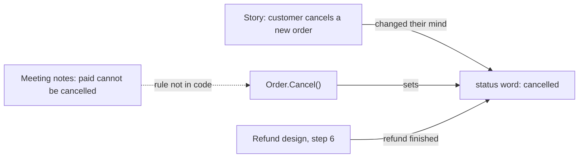

## Bạn cần biết trước

- [[design.l2.status-changes-through-methods]] — bạn biết mỗi thay đổi trạng thái được phép của một đơn là một method của `Order`, như `Cancel()`, và method đó kiểm tra trạng thái xuất phát.
- [[design.l3.domain-events]] — bạn biết domain event được đặt tên theo một việc nghiệp vụ quan tâm, như `OrderCancelled`, nên tên của nó là một từ nghiệp vụ. `Cancel()` trong bài đó là bản stage-3, bản từ chối đơn `paid`. Bài này đọc code stage-2 cũ hơn, khi bước kiểm tra ấy chưa có.
- [[management.l2.design-doc]] — bạn đã đọc thiết kế hoàn tiền trong `docs/design/refund-design.md`, kế hoạch của đội cho tính năng hoàn tiền ở stage-2.

## Tình huống

Product owner, người thay mặt nghiệp vụ quyết định Đơn Hàng phải làm gì, hỏi bạn: ở stage-2, khách còn hủy được một đơn đã thanh toán không? Biên bản họp trong `docs/team/meeting-notes-example.md` nói không: khách phải yêu cầu hoàn tiền. Thế nhưng `Order.Cancel()` chỉ từ chối đơn `cancelled` và `shipped`, nên một đơn `paid` vẫn hủy được.

Thiết kế hoàn tiền còn kết thúc một lần hoàn tiền xong bằng cách chuyển đơn sang `cancelled`. Trong user story hủy đơn, `docs/team/story-example.md`, từ đó nghĩa là khách đổi ý. Tài liệu và code dùng chung từ, nhưng không còn nói cùng một điều. Cần giữ cái gì luôn khớp nhau để một từ chỉ mang một nghĩa ở mọi nơi?

## Khái niệm cốt lõi

- **ubiquitous language** (bộ từ mà người nghiệp vụ, tài liệu và code cùng dùng cho cùng một thứ, mỗi từ một nghĩa đã thống nhất) — tập hợp các từ mà người làm nghiệp vụ, tài liệu và code cùng dùng để gọi cùng một thứ, mỗi từ chỉ có một nghĩa đã thống nhất.
- một từ trạng thái — một trong bốn giá trị của `Order.Status` ở stage-2: `new`, `paid`, `shipped` và `cancelled`. Tài liệu của đội viết chúng y hệt như code.
- một quy tắc chỉ nằm trong tài liệu — một quyết định đội đã ghi lại, như "đơn `paid` không được hủy", mà chưa có bước kiểm tra nào trong code thực thi.

## Cơ chế hoạt động



Trong tình huống trên, chính ubiquitous language giúp bạn kiểm tra câu hỏi của product owner trong vài phút. Acceptance criteria của story nói khách hủy được một đơn `new`, và đơn đó thành `cancelled`. Biên bản họp quyết định không được hủy đơn `paid` từ app. `Order` có property `Status` giữ đúng những chuỗi đó, và một method tên `Cancel()` đặt `Status` thành `cancelled`. Vì các từ khớp nhau, một câu trong tài liệu chỉ thẳng tới vài dòng code, và bạn đọc được quy tắc có ở đó hay không.

Ở đây thì không có. Biên bản họp ghi một đầu việc là thêm bước kiểm tra trạng thái đó vào API hủy đơn ngay trong sprint ấy, vậy mà ở stage-2 `Cancel()` vẫn nhận đơn `paid`. Thiết kế hoàn tiền nhận ra lỗ hổng này và ghi nó vào phần câu hỏi mở gửi product owner. Ở stage-2, quy tắc chỉ nằm trong tài liệu, nên sơ đồ vẽ mũi tên đó bằng nét đứt.

Vấn đề thứ hai nằm ngay trong từ. Bước 6 của thiết kế hoàn tiền chuyển đơn đã hoàn tiền sang `cancelled`. Khi đã có hoàn tiền, một từ sẽ phủ hai sự kiện nghiệp vụ: khách đổi ý về một đơn chưa thanh toán, và một lần hoàn tiền đã xong. Một câu hỏi như "khách đã hủy bao nhiêu đơn?" khi đó sẽ đếm lẫn cả các lần hoàn tiền.

Cả hai đều là dấu hiệu ngôn ngữ cần được sửa. Quy tắc chỉ nằm trong tài liệu cần một bước kiểm tra trong code. Với quy tắc về thay đổi trạng thái, chỗ đó là `Order`, nơi các bước kiểm tra trạng thái khác đã nằm sẵn. Một từ mang hai nghĩa cần một từ rõ hơn, thống nhất với nghiệp vụ. Trong cả hai trường hợp, code đổi cùng lúc với tài liệu.

## Trong hệ thống Đơn Hàng

Các từ trạng thái, đúng như code đang giữ:

```csharp file=DonHang.Domain/Entities.cs tag=stage-2 lines=72-96
    // lesson: design.l2.status-changes-through-methods
    // One method per allowed change, each checking the status it starts from.
    // No endpoint takes payments at stage-2; OrderTests uses this to get a paid order.
    public void MarkPaid()
    {
        if (Status == "cancelled") throw new OrderStatusException(Id, "already-cancelled", $"order {Id} is cancelled");
        if (Status != "new") throw new OrderStatusException(Id, "already-paid", $"order {Id} is already paid");
        Status = "paid";
    }

    // lesson: design.l2.domain-model
    public void Cancel()
    {
        if (Status == "cancelled") throw new OrderStatusException(Id, "already-cancelled", $"order {Id} is already cancelled");
        if (Status == "shipped") throw new OrderStatusException(Id, "already-shipped", $"order {Id} has already shipped");
        Status = "cancelled";
    }

    public void Ship()
    {
        if (Status == "cancelled") throw new OrderStatusException(Id, "already-cancelled", $"order {Id} is cancelled");
        if (Status == "shipped") throw new OrderStatusException(Id, "already-shipped", $"order {Id} has already shipped");
        if (Status != "paid") throw new OrderStatusException(Id, "not-paid", $"order {Id} is not paid yet");
        Status = "shipped";
    }
```

Cả bốn từ trạng thái trong acceptance criteria của story đều xuất hiện ở đây nguyên dạng, và mỗi method được đặt tên theo một hành động nghiệp vụ. Giờ hãy đọc `Cancel()` đối chiếu với biên bản họp: có một bước kiểm tra `cancelled`, một bước kiểm tra `shipped`, và không có bước nào cho `paid`. Dòng còn thiếu đó chính là quyết định của cuộc họp, thứ chưa bao giờ tới được code.

Lỗ hổng này chạm tới được ngay hôm nay qua API, dù app ở stage-2 không có nút hủy. `PATCH /api/v1/orders/{id}/cancel` đi tới `Cancel()` qua `OrderService.CancelOrderAsync`, nên một đơn `paid` mà chủ đơn gửi tới đó sẽ bị hủy. Không endpoint nào nhận thanh toán, nhưng dữ liệu mẫu nạp vào database đã có sẵn năm đơn `paid`. Trong code, `OrderTests`, class unit test của `Order`, gọi `MarkPaid()`. `OrderStatusException` là thứ mà mỗi thay đổi bị từ chối ném ra.

Bước 6 của thiết kế hoàn tiền, viết bằng tiếng Việt. Đoạn sau khối trích giải thích bước này làm gì, còn YC-5 là một yêu cầu được đánh số trong `docs/team/refund-requirements.md`:

```markdown file=docs/design/refund-design.md tag=stage-2 lines=35-37
6. Cổng xác nhận: trong cùng một transaction, dòng thành `refunded` với
   `paid_at`, đơn chuyển sang `cancelled`, và một dòng `notifications`
   `pending` được thêm; email đi theo đường của mọi thông báo khác (YC-5).
```

Khi cổng thanh toán xác nhận một lần hoàn tiền, một giao dịch đánh dấu dòng riêng của lần hoàn tiền là `refunded` và điền `paid_at`, thời điểm tiền được trả lại. Các bước trước đó, nằm ngoài đoạn trích, giữ dòng ấy trong `payments`. Cũng giao dịch đó chuyển đơn sang `cancelled` và thêm một dòng `pending` vào `notifications`, dòng này sẽ thành email gửi khách. YC-5, yêu cầu mà bước này làm theo, cũng đòi `cancelled`. Đó chính là `cancelled` mà story đặt khi khách hủy một đơn `new`. Trong phần rủi ro và câu hỏi mở, thiết kế ghi lại lỗ hổng còn lại: endpoint hủy đơn vẫn hủy được đơn `paid`, và product owner sẽ quyết định có chặn nó ngay bây giờ hay không.

## Senior hay nhầm rằng…

- **"Ubiquitous language là một tài liệu thuật ngữ mà đội viết một lần lúc đầu dự án rồi cất đi."** → Thực ra đó là những từ mọi người dùng trong cuộc họp, trong story, trong thiết kế và trong chính `Order`, và nó đổi theo nghiệp vụ. Tài liệu yêu cầu và thiết kế hoàn tiền, thêm vào repo sau story, sắp gán cho `cancelled` một nghĩa thứ hai. Một danh sách viết lúc đầu sẽ chẳng nhắc gì tới hoàn tiền. Bạn sẽ nhận ra khi danh sách nói một đằng, còn tài liệu thiết kế mới nhất dùng từ đó theo nghĩa khác.
- **"Code cứ dùng tên kỹ thuật riêng, miễn tài liệu dùng từ của nghiệp vụ."** → Thực ra chính sự khớp nhau đã giúp bước kiểm tra trong tình huống diễn ra nhanh. Nếu `Order` có một method chung đặt số trạng thái thay cho `Cancel()`, và lưu một con số thay cho `cancelled`, thì không gì trong biên bản họp chỉ tới được một dòng code. Bạn sẽ nhận ra khi để trả lời "đơn đã thanh toán có hủy được không?", bạn phải lần theo các con số qua nhiều class thay vì đọc một method.
- **"Khi code và biên bản họp vênh nhau, code đúng, vì code mới là thứ chạy."** → Thực ra code cho thấy điều đang xảy ra, không phải điều nghiệp vụ đã quyết định. Ở đây code cho hủy một đơn đã thanh toán mà không hoàn tiền. Biên bản họp bác bỏ điều đó vì nó để lại một đơn đã hủy trong khi tiền vẫn bị giữ, một trạng thái không ai xử lý. Chính chỗ vênh mới là lỗi, và nghiệp vụ quyết định bên nào phải đổi. Bạn sẽ nhận ra khi một yêu cầu hỗ trợ hỏi vì sao một đơn đã hủy mà chưa bao giờ được hoàn tiền.

## Thử ngay (3 phút)

Trong thư mục gốc của repo ví dụ, dùng Git Bash:

1. Chạy `git grep -n -w "cancelled" stage-2 -- docs/team/story-example.md docs/design/refund-design.md DonHang.Domain/Entities.cs`. `-n` in số dòng, `-w` chỉ khớp nguyên từ, còn `stage-2` tìm trong các file đúng như ở tag đó. Mỗi dòng bắt đầu bằng `stage-2:`, đường dẫn và số dòng.
2. Với mỗi dòng từ hai tài liệu, ghi lại bằng từ ngữ nghiệp vụ chuyện gì đã xảy ra với đơn. Dòng nào mô tả một sự kiện nghiệp vụ khác với các dòng còn lại?

Kết quả mong đợi: chín dòng, bốn dòng từ `DonHang.Domain/Entities.cs`, hai dòng từ `docs/design/refund-design.md` và ba dòng từ `docs/team/story-example.md`.

<details><summary>Gợi ý đáp án</summary>

Ba dòng của story (12, 14, 19) đều nói về khách hủy một đơn, hoặc về nút hủy. Dòng 61 của thiết kế hoàn tiền trích các bước kiểm tra trong `Order.Cancel()`. Dòng 36 là dòng lạc loài: nó nói một lần hoàn tiền đã xong. Nếu đội thống nhất rằng đơn đã hoàn tiền xứng đáng có từ riêng, thay đổi không dừng ở tài liệu. Khi đó `Order` cần một trạng thái tương ứng và một method đặt nó, và story lẫn thiết kế cũng dùng từ đó.

</details>

## Liên hệ

- [[design.l3.bounded-context]] — bài tiếp theo: chỗ một model và bộ từ của nó hết hiệu lực, và cùng một từ có thể mang nghĩa khác.
- [[design.l2.status-changes-through-methods]] — các method đã biến từ trạng thái thành code. Bài này đọc chúng đối chiếu với tài liệu.
- [[management.l1.meetings-and-communication]] — nguồn gốc của biên bản họp. Một quyết định ghi ở đó chỉ có giá trị khi code cũng mang nó.
- [[management.l1.user-story-and-ac]] — story có acceptance criteria dùng cùng các từ trạng thái với `Order`.
- [[management.l2.design-doc]] — thiết kế hoàn tiền, ở đây được đọc vì câu chữ chứ không vì kế hoạch.

## Tóm tắt 5 dòng

1. Ubiquitous language là bộ từ mà người nghiệp vụ, tài liệu và code dùng chung, mỗi từ một nghĩa đã thống nhất.
2. Ở stage-2, `new`, `paid`, `shipped` và `cancelled` xuất hiện nguyên dạng trong acceptance criteria của story và trong `Order`. Biên bản họp dùng cùng từ `paid`.
3. Biên bản họp cấm hủy đơn `paid`, nhưng `Order.Cancel()` vẫn nhận. Thiết kế hoàn tiền ghi việc này là câu hỏi mở.
4. Thiết kế hoàn tiền chuyển đơn đã hoàn tiền sang `cancelled`, nên một từ sẽ phủ cả khách đổi ý lẫn hoàn tiền đã xong.
5. Từ mang hai nghĩa hay quy tắc chỉ nằm trong tài liệu cần một từ hoặc quy tắc rõ hơn, và code cũng phải đổi theo.
