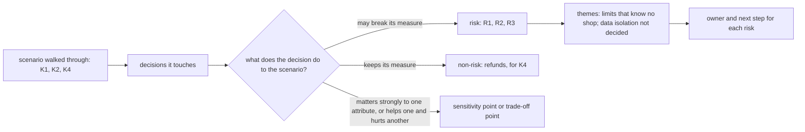

## Before you start

- [[design.l4.reduced-atam]] — you know how the session turned the drivers into scenarios, ranked them twice, and chose K1, K2 and K4 to walk through. K1: during one shop's sale, the other shops keep their usual product-read errors and order response times. K2: shop A's staff see no row of another shop. K4: a refund request from any shop is answered within 2 seconds, even when the outside payment service fails. K3 (opening a shop) and K5 (changing a shop's settings), both without a deploy, were not walked through.
- [[backend.l3.multi-tenancy]] — you know that shops sharing one system also share its capacity and limits, so a noisy neighbor slows the others even when their data stays apart.
- [[backend.l3.rate-limiting]] — you know that the `orders` policy gives each customer a fixed window, counted by the access token's `sub`, and that a refused request never reaches the controller.

## The situation

The review session from the last lesson is halfway through. It is checking ADR `0012`, which serves every shop from one shared deployment and leaves each shop's data layout to a later ADR. The team has walked K1 through `DonHang.Api/Program.cs` and found that one shop's sale can fill the product-read limit for every shop. The product owner asks: "So does ADR `0012` pass or fail?" A backend developer calls the decision wrong and opens `Program.cs` to change the limit. K2 and K4 are still waiting. If a review should end neither in a verdict nor in a fix made on the spot, what should it leave behind?

## Core concepts

- risk — a decision that may stop a scenario's measure from being met; in the review, a numbered finding such as R1.
- non-risk — a decision the team checked against a scenario and found to keep its measure, written down so the team knows it was checked.
- risk theme — a group of risks that share one cause, named after the decision they all point back to.
- owner and next step — the person who carries a risk after the session, and the action they take: a later ADR, a technical debt register entry or a fitness function to add.

## How it works



The session takes K1, K2 and K4 and names the decisions each touches. Every row of the record, one decision for the scenarios it names, gets one label: a risk, a non-risk, a sensitivity point or a trade-off point. Labels attach to decisions, not to the architecture as a whole.

K1 touches two decisions that are risks. R1: the `catalog-reads` limit counts every caller of one api process together, so one busy shop can use up its places and other shops' product reads are refused. `Program.cs` sends `429` only when a limiter can say when to retry, which this one cannot, so they get the default `503`. R2: the `orders` limit counts per customer, never per shop, so a busy shop with many customers meets no limit at all.

K2 touches a decision nobody has made yet: ADR `0012` left each shop's data layout to a later ADR, and whether shop A's staff can see shop B's orders depends on it. The review records this as R3 and hands it on.

K4 is a non-risk. A refund request is saved and answered with `202` without calling the outside payment service, whichever shop sends it, so YC-7, the requirement K4 was written from, holds as it did for one shop.

Two rows carry the other labels. `PermitLimit` of `catalog-reads` is a sensitivity point: K1 depends strongly on that one number. The shared deployment is a trade-off point: it makes K3 and K5 easy and K1 and K2 harder.

R1 and R2 share one cause, limits that know no shop, so they form one theme with one decision to revisit. R3 has its own cause and stands as a second theme. Each risk then gets an owner and a next step, so the review changes what the team does next.

## In the Đơn Hàng system

The findings, themes and next steps, in `docs/design/multi-shop-architecture-review.md`:

```markdown file=docs/design/multi-shop-architecture-review.md tag=stage-4 lines=57-78
| Kịch bản | Quyết định liên quan | Xếp loại | Ghi chú |
|---|---|---|---|
| K1 | Giới hạn `catalog-reads` trong `Program.cs` | Rủi ro R1 | Đếm chung mọi người gọi của một process api: tối đa 20 lượt đọc cùng lúc và 5 lượt chờ. Một cửa hàng đông dùng hết số chỗ đó, và đọc sản phẩm của các cửa hàng khác bị từ chối `503` |
| K1 | Giới hạn `orders` trong `Program.cs` | Rủi ro R2 | Đếm theo `sub` của khách (10 đơn mỗi phút mỗi khách), không theo cửa hàng: một cửa hàng đông có nhiều khách thì không giới hạn nào dừng nó. Giới hạn này cũng chỉ gắn vào `POST /api/v1/orders` |
| K1 | Số lượt đọc cùng lúc (`PermitLimit` của `catalog-reads`) | Điểm nhạy | Thấp quá thì cửa hàng nào cũng nhận `503` sớm; cao quá thì database dùng chung chịu hết tải |
| K2 | ADR 0012 để cách lưu dữ liệu của từng cửa hàng cho một ADR sau | Rủi ro R3 | Cô lập giữa cửa hàng phụ thuộc cách lưu chưa được chọn. Buổi đánh giá chuyển câu hỏi cho ADR đó, không quyết |
| K4 | `POST /api/v1/orders/{id}/refund` lưu yêu cầu và message trong một transaction, trả `202` mà không gọi cổng; Payments gửi sang cổng sau | Không rủi ro | Yêu cầu được trả lời mà không chờ cổng, dù đến từ cửa hàng nào; YC-7 giữ như khi chỉ có một cửa hàng |
| K1, K2, K3, K5 | Một bản triển khai chung (ADR 0012) | Điểm đánh đổi | Giúp K3, K5 (mở cửa hàng và đổi cấu hình là thêm dữ liệu; deploy, migration, dashboard chạy một lần cho mọi cửa hàng), nhưng làm K1, K2 khó hơn: cô lập không có sẵn từ cách triển khai mà phải làm bên trong hệ thống |

### Chủ đề rủi ro

- Giới hạn không biết cửa hàng (R1, R2): mọi giới hạn tải hôm nay đếm theo
  process hoặc theo khách. Gom thành một chủ đề vì cả hai trỏ về cùng một quyết
  định cần xem lại: giới hạn tải phải biết cửa hàng của request.
- Cô lập dữ liệu chưa được quyết (R3).

### Việc tiếp theo

| Rủi ro | Người chịu trách nhiệm | Bước tiếp theo |
|---|---|---|
| R1, R2 | Trưởng nhóm | Đề xuất một ADR về giới hạn tải theo cửa hàng; khi xây, thêm một fitness function cho thấy một cửa hàng vượt trần không làm cửa hàng khác bị từ chối (`fitness-functions.md`, mục Chưa có phép kiểm tự động) |
| R3 | Lập trình viên backend | Đề xuất ADR chọn cách lưu dữ liệu của từng cửa hàng, kèm cách kiểm rằng một cửa hàng không đọc được dữ liệu cửa hàng khác |
```

Lines 59–64 are one row per decision for the scenarios it names, with its label in the third column: "Rủi ro" is risk, "Không rủi ro" non-risk, "Điểm nhạy" sensitivity point, "Điểm đánh đổi" trade-off point. One scenario can hold several rows: K1 has two risks and a sensitivity point. Lines 66–71 group R1 and R2 into the theme "limits that know no shop", because both point at one decision: load limits must know the request's shop. Lines 73–78 give each risk an owner and a next step: an ADR on per-shop limits for the team lead, a data layout ADR for a backend developer. Lines 80–81 of the record, just after this excerpt, add that `Program.cs` keeps both limits unchanged until the ADR for R1 and R2 is built.

The two risks of K1 come from this part of `Program.cs`:

```csharp file=DonHang.Api/Program.cs tag=stage-4 lines=143-166
// lesson: backend.l3.bulkhead
// "catalog-reads": at most PermitLimit product reads run at once and QueueLimit
// more wait for a turn; any read beyond that is refused at once. With Redis
// down every product read needs a database connection, and orders need them too.
var catalogReads = new ConcurrencyLimiterOptions { PermitLimit = 20, QueueLimit = 5 };
builder.Configuration.GetSection("RateLimiting:CatalogReads").Bind(catalogReads);

builder.Services.AddRateLimiter(options =>
{
    options.AddPolicy("orders", context =>
    {
        var customer = context.User.FindFirst("sub")?.Value;
        if (customer is null) return RateLimitPartition.GetNoLimiter("signed-out");
        return RateLimitPartition.GetFixedWindowLimiter(customer, _ => new FixedWindowRateLimiterOptions
        {
            PermitLimit = ordersLimit.PermitLimit,
            Window = ordersLimit.Window,
        });
    });
    options.AddConcurrencyLimiter("catalog-reads", limiter =>
    {
        limiter.PermitLimit = catalogReads.PermitLimit;
        limiter.QueueLimit = catalogReads.QueueLimit;
    });
```

`orders` builds one limiter per customer, under the `sub` value; `ordersLimit`, declared above the excerpt, holds its settings, 10 orders a minute. Nothing in it knows the shop, which is R2. `catalog-reads` is one limit on how many product reads may run at once, for the whole process, with no separate count per customer or per shop: every product read from every shop competes for the same 20 places and 5 queue slots, which is R1. ADR `0012` already warned in its consequences that the existing limits do not know the shop.

## Trade-offs

| How the review ends | What the team gets | What goes wrong |
|---|---|---|
| A verdict: pass or fail | one word for the product owner to repeat | it says nothing about which decision to look at; a fail invites reopening the whole ADR, a pass hides R1 to R3 |
| A list of problems, no labels or owners | a record that worries were heard | nobody carries any item, and two items with one cause are fixed twice, or not at all |
| Fixes made during the session | one problem gone at once | the session runs out before K2 and K4; a quick change to a limit skips the ADR its options deserve |
| Risks tied to decisions, grouped into themes, each with an owner and a next step | the decisions to revisit, and who acts on each | it costs writing time after the walk-through, and it needs someone to follow the next steps up |

A record of risks costs more than a verdict, and it is the only one of these four endings that tells the team which decisions to revisit and who acts on each. It pays off when the risks are owned and followed: the record's last section notes that R3 and the R1–R2 theme were each taken up by a later ADR.

## What would you choose if…

…a risk sits inside one module and has only one sensible fix? It still goes in the record, with an owner, so the review stays complete. Its next step can be a pull request, because there are no options worth weighing in an ADR.

…the product owner must tell the business, in one sentence, whether building on ADR `0012` can start? Say which risks must be answered before the part they touch is built, and which can wait. In Đơn Hàng, R3 touches how every shop's data is stored, so it comes first. That answers the question without turning the review into a pass or fail.

…the decision behind a risk belongs to another team, once Đơn Hàng has three or four? Hand the risk to an owner in that team, with the scenario and its measure attached. A risk owned by nobody changes what the team does no more than a risk not found.

## Seniors often assume…

- **"An architecture review ends with a pass or a fail for the architecture."** → Actually it ends with labels on decisions: Đơn Hàng's review found three risks, one non-risk, one sensitivity point and one trade-off point, and no overall mark. You notice this belief when a review is summed up as "it passed", and a later failure in production traces back to a risk nobody wrote down.
- **"A review that finds risks shows that the decision it looked at was wrong."** → Actually a risk says where a decision needs more work, not that it should be reversed. The review found R1 to R3 and still did not reopen ADR `0012`: re-deciding it was outside the session, and the trade-off row records that the same shared deployment is what makes K3 and K5 easy. It handed the risks to later ADRs. You notice this belief when every finding starts a debate about replacing the whole architecture, and the session never reaches the next scenario.
- **"Risks found in a review should be fixed during the same session."** → Actually the session finds and records; fixing waits for an owner and a next step. Changing `catalog-reads` on the spot would skip the per-shop options an ADR must weigh, and leave K2 and K4 unexamined. You notice this belief when a session ends with one limit edited and two scenarios never walked through.

## Try it (3 minutes)

Use the findings table above, lines 57–64.

1. A teammate proposes closing R1 by raising `PermitLimit` of `catalog-reads` from 20 to 200. Which detail in R1's row says this does not remove the risk, and which row says what the change would cost?
2. Suppose the walk-through of K1 had also found that the code that reads the outbox and publishes its messages is shared by every shop. Before adding it as R4, what question do you ask to decide whether it belongs to an existing theme?

Expected result: for step 1, the words in R1's note that make the limit shared, and the line number (57–64) of the row that gives the cost; for step 2, one question about the cause.

<details><summary>Suggested answer</summary>

1. R1's note says the limit counts every caller of one api process together ("Đếm chung mọi người gọi"). With 200 places, one busy shop can still fill them all, so the risk stays. The sensitivity point row, line 61, gives the cost: set too high, the shared database takes the whole load.
2. Ask whether it has the same cause as R1 and R2: a shared resource that does not know the request's shop. If it does, it joins the theme "limits that know no shop" and the ADR on per-shop limits; if its cause is different, it starts a theme of its own with its own owner.

</details>

## Connections

- [[design.l4.reduced-atam]] — prerequisite: the session whose walk-through produces these findings.
- [[backend.l3.multi-tenancy]] — the noisy neighbor problem that R1 and R2 are instances of.
- [[backend.l3.rate-limiting]] — the `orders` policy that R2 records as counting per customer, not per shop.
- [[backend.l3.tenant-isolation-models]] — the options the data layout ADR chooses among when it takes up R3.
- [[management.l3.technical-debt-register]] — one place a risk's next step can land when it is accepted for now.
- [[design.l4.fitness-functions]] — the automated check that R1 and R2's next step adds.
- [[design.l4.quantifying-technical-debt]] — next in this module: putting hours on the debt a review leaves behind.

## Five-line summary

1. An architecture review ends in risks tied to the decisions behind them, each with an owner and a next step, not a pass or fail.
2. Each scenario walked through names its decisions and labels each one a risk, a non-risk, a sensitivity point or a trade-off point.
3. Đơn Hàng's K1 found R1 and R2: `catalog-reads` counts every caller together, and `orders` counts per customer, never per shop.
4. Risks with one cause become one theme, limits that know no shop, because a theme points at the single decision to revisit.
5. R3, data isolation, was handed to a later ADR instead of decided; refunds were a non-risk, since YC-7 holds for every shop.
