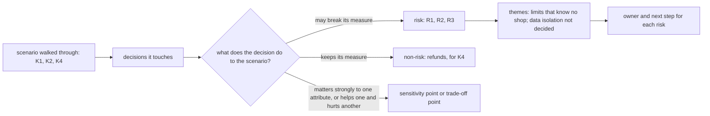

## Bạn cần biết trước

- [[design.l4.reduced-atam]] — bạn biết buổi đánh giá đã biến các yếu tố định hình thành kịch bản, xếp hạng mỗi kịch bản hai lần, và chọn K1, K2, K4 để đưa đi qua. K1: trong đợt khuyến mãi của một cửa hàng, các cửa hàng khác vẫn giữ mức lỗi đọc sản phẩm và thời gian trả lời đơn như ngày thường. K2: nhân viên cửa hàng A không thấy dòng nào của cửa hàng khác. K4: yêu cầu hoàn tiền từ cửa hàng bất kỳ được trả lời trong 2 giây, kể cả khi dịch vụ thanh toán bên ngoài lỗi. K3 (mở một cửa hàng) và K5 (đổi cấu hình một cửa hàng), cả hai đều không cần deploy, không được đưa đi qua.
- [[backend.l3.multi-tenancy]] — bạn biết các cửa hàng dùng chung một hệ thống thì cũng dùng chung sức chứa và giới hạn của nó, nên một noisy neighbor làm chậm các cửa hàng khác dù dữ liệu vẫn tách riêng.
- [[backend.l3.rate-limiting]] — bạn biết policy `orders` cho mỗi khách một cửa sổ cố định, đếm theo `sub` của access token, và request bị từ chối thì không bao giờ tới được controller.

## Tình huống

Buổi đánh giá từ bài trước đã đi được nửa đường. Nó đang kiểm ADR `0012`, quyết định phục vụ mọi cửa hàng từ một bản triển khai chung và để cách bố trí dữ liệu của từng cửa hàng cho một ADR sau. Nhóm đã đưa K1 đi qua `DonHang.Api/Program.cs` và thấy đợt khuyến mãi của một cửa hàng có thể dùng hết giới hạn đọc sản phẩm của mọi cửa hàng. Product owner hỏi: "Vậy ADR `0012` đạt hay trượt?" Một lập trình viên backend nói quyết định này sai và mở `Program.cs` để sửa giới hạn. K2 và K4 vẫn đang chờ. Nếu một buổi đánh giá không nên kết thúc bằng một phán quyết, cũng không bằng một chỗ sửa ngay tại chỗ, thì nó nên để lại gì?

## Khái niệm cốt lõi

- rủi ro — một quyết định có thể làm thước đo của một kịch bản không đạt; trong buổi đánh giá, đó là một phát hiện được đánh số, như R1.
- không rủi ro — một quyết định nhóm đã kiểm với một kịch bản và thấy vẫn giữ được thước đo, được ghi lại để nhóm biết nó đã được kiểm.
- chủ đề rủi ro — một nhóm rủi ro có chung một nguyên nhân, đặt tên theo quyết định mà tất cả cùng trỏ về.
- người chịu trách nhiệm và bước tiếp theo — người mang một rủi ro sau buổi, và việc họ làm: một ADR sau, một mục trong sổ nợ kỹ thuật, hay một fitness function cần thêm.

## Cơ chế hoạt động



Buổi đánh giá lấy K1, K2, K4 và gọi tên các quyết định mà mỗi kịch bản chạm tới. Mỗi dòng của bản ghi, tức một quyết định với các kịch bản nó nêu, nhận đúng một nhãn: rủi ro, không rủi ro, điểm nhạy hoặc điểm đánh đổi. Nhãn gắn vào quyết định, không gắn vào cả kiến trúc.

K1 chạm tới hai quyết định là rủi ro. R1: giới hạn `catalog-reads` đếm chung mọi người gọi của một process api, nên một cửa hàng đông có thể dùng hết số chỗ, và lần đọc sản phẩm của các cửa hàng khác bị từ chối. `Program.cs` chỉ gửi `429` khi limiter nói được lúc nào thử lại, mà limiter này thì không, nên họ nhận `503` mặc định. R2: giới hạn `orders` đếm theo khách, không bao giờ theo cửa hàng, nên một cửa hàng đông có nhiều khách không gặp giới hạn nào cả.

K2 chạm tới một quyết định chưa ai đưa ra: ADR `0012` để cách bố trí dữ liệu của từng cửa hàng cho một ADR sau, và nhân viên cửa hàng A có thấy đơn của cửa hàng B hay không phụ thuộc vào nó. Buổi đánh giá ghi điều này là R3 và chuyển tiếp.

K4 là không rủi ro. Yêu cầu hoàn tiền được lưu và trả lời bằng `202` mà không gọi dịch vụ thanh toán bên ngoài, dù cửa hàng nào gửi, nên YC-7, yêu cầu mà K4 được viết từ đó, vẫn giữ như khi chỉ có một cửa hàng.

Hai dòng mang các nhãn còn lại. `PermitLimit` của `catalog-reads` là điểm nhạy: K1 phụ thuộc mạnh vào đúng con số đó. Bản triển khai chung là điểm đánh đổi: nó làm K3, K5 dễ và K1, K2 khó hơn.

R1 và R2 có chung một nguyên nhân, giới hạn không biết cửa hàng, nên chúng thành một chủ đề với một quyết định cần xem lại. R3 có nguyên nhân riêng và đứng thành chủ đề thứ hai. Sau đó mỗi rủi ro nhận một người chịu trách nhiệm và một bước tiếp theo, để buổi đánh giá thay đổi điều nhóm làm tiếp.

## Trong hệ thống Đơn Hàng

Các phát hiện, chủ đề và bước tiếp theo, trong `docs/design/multi-shop-architecture-review.md`:

```markdown file=docs/design/multi-shop-architecture-review.md tag=stage-4 lines=57-78
| Kịch bản | Quyết định liên quan | Xếp loại | Ghi chú |
|---|---|---|---|
| K1 | Giới hạn `catalog-reads` trong `Program.cs` | Rủi ro R1 | Đếm chung mọi người gọi của một process api: tối đa 20 lượt đọc cùng lúc và 5 lượt chờ. Một cửa hàng đông dùng hết số chỗ đó, và đọc sản phẩm của các cửa hàng khác bị từ chối `503` |
| K1 | Giới hạn `orders` trong `Program.cs` | Rủi ro R2 | Đếm theo `sub` của khách (10 đơn mỗi phút mỗi khách), không theo cửa hàng: một cửa hàng đông có nhiều khách thì không giới hạn nào dừng nó. Giới hạn này cũng chỉ gắn vào `POST /api/v1/orders` |
| K1 | Số lượt đọc cùng lúc (`PermitLimit` của `catalog-reads`) | Điểm nhạy | Thấp quá thì cửa hàng nào cũng nhận `503` sớm; cao quá thì database dùng chung chịu hết tải |
| K2 | ADR 0012 để cách lưu dữ liệu của từng cửa hàng cho một ADR sau | Rủi ro R3 | Cô lập giữa cửa hàng phụ thuộc cách lưu chưa được chọn. Buổi đánh giá chuyển câu hỏi cho ADR đó, không quyết |
| K4 | `POST /api/v1/orders/{id}/refund` lưu yêu cầu và message trong một transaction, trả `202` mà không gọi cổng; Payments gửi sang cổng sau | Không rủi ro | Yêu cầu được trả lời mà không chờ cổng, dù đến từ cửa hàng nào; YC-7 giữ như khi chỉ có một cửa hàng |
| K1, K2, K3, K5 | Một bản triển khai chung (ADR 0012) | Điểm đánh đổi | Giúp K3, K5 (mở cửa hàng và đổi cấu hình là thêm dữ liệu; deploy, migration, dashboard chạy một lần cho mọi cửa hàng), nhưng làm K1, K2 khó hơn: cô lập không có sẵn từ cách triển khai mà phải làm bên trong hệ thống |

### Chủ đề rủi ro

- Giới hạn không biết cửa hàng (R1, R2): mọi giới hạn tải hôm nay đếm theo
  process hoặc theo khách. Gom thành một chủ đề vì cả hai trỏ về cùng một quyết
  định cần xem lại: giới hạn tải phải biết cửa hàng của request.
- Cô lập dữ liệu chưa được quyết (R3).

### Việc tiếp theo

| Rủi ro | Người chịu trách nhiệm | Bước tiếp theo |
|---|---|---|
| R1, R2 | Trưởng nhóm | Đề xuất một ADR về giới hạn tải theo cửa hàng; khi xây, thêm một fitness function cho thấy một cửa hàng vượt trần không làm cửa hàng khác bị từ chối (`fitness-functions.md`, mục Chưa có phép kiểm tự động) |
| R3 | Lập trình viên backend | Đề xuất ADR chọn cách lưu dữ liệu của từng cửa hàng, kèm cách kiểm rằng một cửa hàng không đọc được dữ liệu cửa hàng khác |
```

Dòng 59–64 là mỗi dòng một quyết định với các kịch bản nó nêu, nhãn nằm ở cột thứ ba: "Rủi ro", "Không rủi ro", "Điểm nhạy", "Điểm đánh đổi". Một kịch bản có thể chiếm nhiều dòng: K1 có hai rủi ro và một điểm nhạy. Dòng 66–71 gom R1 và R2 vào chủ đề "giới hạn không biết cửa hàng", vì cả hai trỏ về một quyết định: giới hạn tải phải biết cửa hàng của request. Dòng 73–78 cho mỗi rủi ro một người chịu trách nhiệm và một bước tiếp theo: trưởng nhóm lo ADR về giới hạn theo cửa hàng, một lập trình viên backend lo ADR về cách bố trí dữ liệu. Dòng 80–81 của bản ghi, ngay sau đoạn trích, thêm rằng `Program.cs` giữ nguyên cả hai giới hạn cho tới khi ADR cho R1 và R2 được xây.

Hai rủi ro của K1 đến từ phần này của `Program.cs`:

```csharp file=DonHang.Api/Program.cs tag=stage-4 lines=143-166
// lesson: backend.l3.bulkhead
// "catalog-reads": at most PermitLimit product reads run at once and QueueLimit
// more wait for a turn; any read beyond that is refused at once. With Redis
// down every product read needs a database connection, and orders need them too.
var catalogReads = new ConcurrencyLimiterOptions { PermitLimit = 20, QueueLimit = 5 };
builder.Configuration.GetSection("RateLimiting:CatalogReads").Bind(catalogReads);

builder.Services.AddRateLimiter(options =>
{
    options.AddPolicy("orders", context =>
    {
        var customer = context.User.FindFirst("sub")?.Value;
        if (customer is null) return RateLimitPartition.GetNoLimiter("signed-out");
        return RateLimitPartition.GetFixedWindowLimiter(customer, _ => new FixedWindowRateLimiterOptions
        {
            PermitLimit = ordersLimit.PermitLimit,
            Window = ordersLimit.Window,
        });
    });
    options.AddConcurrencyLimiter("catalog-reads", limiter =>
    {
        limiter.PermitLimit = catalogReads.PermitLimit;
        limiter.QueueLimit = catalogReads.QueueLimit;
    });
```

`orders` tạo một limiter cho mỗi khách, theo giá trị `sub`. `ordersLimit`, khai báo phía trên đoạn trích, giữ cấu hình của nó: 10 đơn mỗi phút. Không chỗ nào trong đó biết cửa hàng, và đó là R2. `catalog-reads` là một giới hạn duy nhất cho số lần đọc sản phẩm được chạy cùng lúc, cho cả process, không đếm riêng theo khách hay theo cửa hàng: mọi lần đọc sản phẩm từ mọi cửa hàng tranh cùng 20 chỗ và 5 chỗ chờ, và đó là R1. ADR `0012` đã cảnh báo trong phần hệ quả rằng các giới hạn hiện có không biết cửa hàng.

## Đánh đổi

| Buổi đánh giá kết thúc thế nào | Nhóm được gì | Hỏng ở đâu |
|---|---|---|
| Một phán quyết: đạt hoặc trượt | một chữ để product owner nhắc lại | không nói phải xem quyết định nào. Trượt thì mời mở lại cả ADR, đạt thì giấu R1 tới R3 |
| Một danh sách vấn đề, không nhãn, không người chịu trách nhiệm | một bản ghi cho thấy lo lắng đã được nghe | không ai mang mục nào, và hai mục cùng nguyên nhân bị sửa hai lần, hoặc không lần nào |
| Sửa ngay trong buổi | một vấn đề biến mất tức thì | buổi hết giờ trước khi tới K2 và K4, và sửa vội một giới hạn bỏ qua ADR mà các phương án của nó đáng có |
| Rủi ro gắn với quyết định, gom thành chủ đề, mỗi rủi ro có người chịu trách nhiệm và bước tiếp theo | các quyết định cần xem lại, và ai làm gì với từng cái | tốn thời gian viết sau lần đưa kịch bản đi qua, và cần người theo dõi các bước tiếp theo |

Một bản ghi rủi ro tốn hơn một phán quyết, và trong bốn cách kết thúc này, nó là cách duy nhất cho nhóm biết cần xem lại quyết định nào và ai làm gì với từng cái. Nó đáng công khi các rủi ro có người nhận và được theo tới cùng: mục cuối của bản ghi ghi rằng R3 và chủ đề R1–R2 mỗi thứ đã được một ADR sau tiếp nhận.

## Bạn sẽ chọn gì nếu…

…một rủi ro nằm gọn trong một module và chỉ có đúng một hướng sửa hợp lý? Nó vẫn vào bản ghi, có người chịu trách nhiệm, để buổi đánh giá đầy đủ. Bước tiếp theo của nó có thể là một pull request, vì không có phương án nào đáng cân nhắc trong một ADR.

…product owner phải nói với kinh doanh, trong một câu, rằng có thể bắt đầu xây theo ADR `0012` chưa? Hãy nói rủi ro nào phải được trả lời trước khi xây phần nó chạm tới, và rủi ro nào chờ được. Ở Đơn Hàng, R3 chạm tới cách lưu dữ liệu của mọi cửa hàng, nên nó đi trước. Câu đó trả lời được câu hỏi mà không biến buổi đánh giá thành đạt hay trượt.

…quyết định đứng sau một rủi ro thuộc về một nhóm khác, khi Đơn Hàng đã có ba bốn nhóm? Giao rủi ro cho một người chịu trách nhiệm trong nhóm đó, kèm kịch bản và thước đo của nó. Một rủi ro không ai nhận cũng chẳng thay đổi việc nhóm làm, y như một rủi ro không được tìm thấy.

## Senior hay nhầm rằng…

- **"Một buổi đánh giá kiến trúc kết thúc bằng đạt hoặc trượt cho cả kiến trúc."** → Thực ra nó kết thúc bằng các nhãn gắn trên quyết định: buổi đánh giá của Đơn Hàng tìm ra ba rủi ro, một không rủi ro, một điểm nhạy và một điểm đánh đổi, và không có điểm tổng nào. Bạn sẽ nhận ra niềm tin này khi một buổi review được tóm lại là "đạt rồi", và một sự cố sau này trên production lần ngược về một rủi ro không ai ghi lại.
- **"Buổi đánh giá tìm ra rủi ro nghĩa là quyết định được xem xét đã sai."** → Thực ra một rủi ro nói quyết định cần làm thêm ở đâu, không nói nó phải bị đảo ngược. Buổi đánh giá tìm ra R1 tới R3 mà vẫn không mở lại ADR `0012`: quyết lại nó nằm ngoài phạm vi buổi, và dòng điểm đánh đổi ghi rằng chính bản triển khai chung đó làm K3, K5 dễ. Buổi chuyển các rủi ro cho những ADR sau. Bạn sẽ nhận ra niềm tin này khi phát hiện nào cũng mở ra một cuộc tranh luận về thay cả kiến trúc, và buổi không bao giờ tới được kịch bản tiếp theo.
- **"Rủi ro tìm ra trong buổi đánh giá nên được sửa ngay trong buổi đó."** → Thực ra buổi chỉ tìm và ghi lại, còn sửa thì chờ người chịu trách nhiệm và bước tiếp theo. Đổi `catalog-reads` ngay tại chỗ sẽ bỏ qua các phương án theo cửa hàng mà một ADR phải cân, và để K2, K4 chưa được kiểm. Bạn sẽ nhận ra niềm tin này khi một buổi kết thúc với một giới hạn đã bị sửa và hai kịch bản chưa từng được đưa đi qua.

## Thử ngay (3 phút)

Dùng bảng phát hiện ở trên, dòng 57–64.

1. Một đồng đội đề xuất đóng R1 bằng cách nâng `PermitLimit` của `catalog-reads` từ 20 lên 200. Chi tiết nào trong dòng R1 cho thấy cách này không xóa được rủi ro, và dòng nào nói thay đổi đó tốn gì?
2. Giả sử lần đưa K1 đi qua còn phát hiện phần code đọc outbox và phát message của nó được mọi cửa hàng dùng chung. Trước khi thêm nó thành R4, bạn hỏi câu gì để quyết định nó có thuộc một chủ đề đã có không?

Kết quả mong đợi: với bước 1, các chữ trong ghi chú của R1 cho thấy giới hạn là dùng chung, và số dòng (trong 57–64) của dòng nói chi phí. Với bước 2, một câu hỏi về nguyên nhân.

<details><summary>Gợi ý đáp án</summary>

1. Ghi chú của R1 nói giới hạn đếm chung mọi người gọi của một process api ("Đếm chung mọi người gọi"). Với 200 chỗ, một cửa hàng đông vẫn có thể lấp hết, nên rủi ro vẫn còn. Dòng điểm nhạy, dòng 61, nói chi phí: đặt cao quá thì database dùng chung chịu hết tải.
2. Hỏi xem nó có cùng nguyên nhân với R1 và R2 không: một tài nguyên dùng chung không biết cửa hàng của request. Nếu có, nó vào chủ đề "giới hạn không biết cửa hàng" và ADR về giới hạn theo cửa hàng. Nếu nguyên nhân khác, nó mở một chủ đề riêng với người chịu trách nhiệm riêng.

</details>

## Liên hệ

- [[design.l4.reduced-atam]] — bài cần học trước: buổi đánh giá mà lần đưa kịch bản đi qua tạo ra các phát hiện này.
- [[backend.l3.multi-tenancy]] — vấn đề noisy neighbor mà R1 và R2 là hai trường hợp cụ thể.
- [[backend.l3.rate-limiting]] — policy `orders` mà R2 ghi là đếm theo khách, không theo cửa hàng.
- [[backend.l3.tenant-isolation-models]] — các phương án mà ADR về cách bố trí dữ liệu sẽ chọn khi tiếp nhận R3.
- [[management.l3.technical-debt-register]] — một nơi bước tiếp theo của rủi ro có thể đến, khi rủi ro được tạm chấp nhận.
- [[design.l4.fitness-functions]] — phép kiểm tự động mà bước tiếp theo của R1 và R2 thêm vào.
- [[design.l4.quantifying-technical-debt]] — tiếp theo trong module: gắn số giờ cho khoản nợ mà một buổi đánh giá để lại.

## Tóm tắt 5 dòng

1. Một buổi đánh giá kiến trúc kết thúc bằng các rủi ro gắn với quyết định đứng sau chúng, mỗi rủi ro có người chịu trách nhiệm và bước tiếp theo, không bằng đạt hay trượt.
2. Mỗi kịch bản được đưa đi qua gọi tên các quyết định của nó, và gắn cho mỗi quyết định một nhãn: rủi ro, không rủi ro, điểm nhạy hoặc điểm đánh đổi.
3. K1 của Đơn Hàng tìm ra R1 và R2: `catalog-reads` đếm chung mọi người gọi, còn `orders` đếm theo khách, không bao giờ theo cửa hàng.
4. Các rủi ro cùng nguyên nhân thành một chủ đề, giới hạn không biết cửa hàng, vì một chủ đề trỏ về đúng một quyết định cần xem lại.
5. R3, cô lập dữ liệu, được chuyển cho một ADR sau thay vì quyết ngay, còn hoàn tiền là không rủi ro, vì YC-7 giữ cho mọi cửa hàng.
