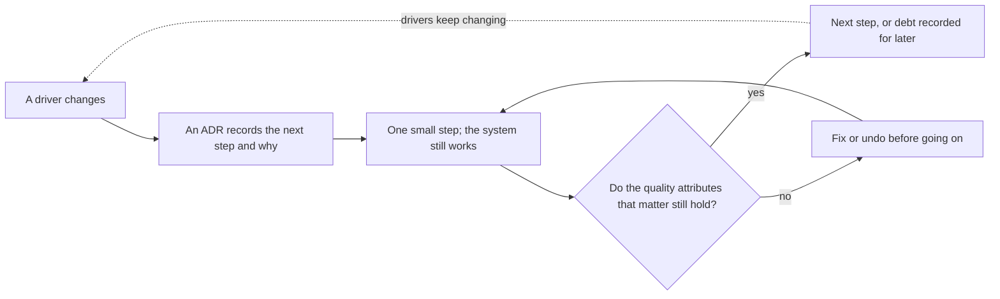

## Before you start

- [[design.l4.merging-a-service-back]] — you know that a split or a merge is weighed against the drivers written in an ADR.
- [[design.l4.over-abstraction]] — you know that paying now for a need nobody has yet is a cost, not a safeguard.
- [[management.l3.where-debt-comes-from]] — you know debt N1, the old `notifications` table that the split left behind.
- [[management.l3.superseding-an-adr]] — you know that a changed decision gets a new ADR and the old one keeps its reasons.

## The situation

You join Đơn Hàng at stage-3 and read its history. At stage-2, order emails were sent from inside `DonHang.Api`; now a separate `DonHang.Notifications` service sends them, yet the old `notifications` table still sits in the `donhang` database, unread, and ADR `0008` plans to remove it over several later steps. A teammate sums it up: "One split and a string of clean-up steps for one feature. If the first design had been right, none of this would exist. On the next system, we draw the final architecture before writing any code." You are not sure the history shows a mistake. What makes changing an architecture step by step safe, rather than a sign that the first design was wrong?

## Core concepts

- **evolutionary architecture** — an architecture built to be changed in small, guided steps as its drivers change, instead of being fixed up front for drivers guessed in advance.
- **quality attribute** — a property the whole system must have, such as how fast it answers, how well its parts stay apart or how safely it can be changed; the drivers decide which ones matter.
- a step — one change small enough that the system works before it and after it, recorded with its reason.
- a check around a step — any way of confirming, after any step or before one that cannot be undone, that the quality attributes that matter hold: tests that run, or a person who confirms.

## How it works



In the situation above, the history is an evolutionary architecture at work. At stage-2 no driver asked for email outside the API. When two drivers changed, the team took the one step that answered them, recorded in ADR `0002` (written afterwards, as its lines 4–8 say; ADR `0008` was written before its steps).

A step is small when the system works before it and after it. The split was one step. The team found the leftover table later and recorded it as debt N1; removing it became steps of its own instead of reopening the split.

The diamond is what makes small steps safe. The split secured two quality attributes: a slow email server no longer takes resources from the process that takes orders, and Notifications does not read the API's `customers` table, because the message carries the customer's email and name (ADR `0002` lines 38–39). A later step, made for another driver, could quietly give either back. Without a check, such a step looks just like one that works. If a check fails, the step is fixed or undone before the next one starts; if it passes, the team takes the next step or records what is left as debt, as with N1.

The drivers decide which quality attributes the checks watch: one shop and two developers may care little how parts stay apart; several services and teams care more.

The dotted arrow is the point of the loop: drivers keep changing, so the steps never stop. An architecture fixed up front assumes they stop.

## In the Đơn Hàng system

Why the first step was taken:

```markdown file=docs/adr/0002-tach-notifications-thanh-service.md tag=stage-3 lines=10-24
### Bối cảnh

Đến stage-2, email cho khách là dòng trong bảng `notifications` của database
`donhang`. `QueuedNotifier` ghi dòng đó cùng transaction với đơn, và
`NotificationSender` chạy trong mọi bản sao của `DonHang.Api`, nhận dòng bằng
`FOR UPDATE SKIP LOCKED`. Cách này đúng cho một process. Hai điều đã đổi:

- Cổng thanh toán sắp được gọi từ một service khác (ADR 0003), và service đó
  cũng phải báo tin cho khách. Nếu email vẫn nằm trong API, Payments phải gọi
  vào API hoặc ghi vào bảng của API.
- Máy chủ email chậm hay lỗi thì job gửi chiếm tài nguyên của chính process
  đang nhận đơn. Lỗi của việc gửi email nên tách khỏi việc đặt đơn.

Chỉ chuyện số bản sao thì chưa đủ lý do: job gửi email vẫn chạy được với số
bản sao của API.
```

Lines 12–15 show the stage-2 shape: email as a row in `notifications`, written by `QueuedNotifier` in the same transaction as the order and sent by `NotificationSender`, which runs in every copy of `DonHang.Api`. Line 15 then says "Cách này đúng cho một process" (this was right for one process: sending lived inside the process that takes orders, as line 20 notes) and "Hai điều đã đổi" (two things changed). Lines 17–21 are those two drivers: Payments must also message customers, and a slow or failing email server takes resources from the process that takes orders. Lines 23–24 name a reason that did not count. The step was taken because drivers changed, not because the first design was wrong.

How the debt that step left behind is removed. ADR `0008` also removes a second leftover, debt N2: the old `payments` table, left when Payments got its own database, its data copied to `donhang_payments`:

```markdown file=docs/adr/0008-xoa-bang-cu-trong-donhang.md tag=stage-3 lines=29-53
1. Dump hai bảng bằng `pg_dump -Fc --table`, lưu cùng các bản sao lưu khác.
2. Migration xóa `notifications` trước, cùng pull request bỏ bảng đó khỏi
   lệnh `TRUNCATE` của `PostgresFixture`.
3. Migration xóa `payments` sau khi kế toán xác nhận đã đối chiếu xong với
   `donhang_payments`, cũng sửa `PostgresFixture` như bước 2.

Ở tag stage-3 hai bảng vẫn còn; các bước trên làm trong sprint sau.

### Hệ quả

- Schema của `donhang` chỉ còn bảng API thật sự dùng.
- Dữ liệu cũ chỉ còn trong file dump; đọc lại cần khôi phục vào một database
  tạm.
- Không xóa cùng lúc nên có một khoảng chỉ còn bảng `payments` cũ.

### Ý kiến đã nhận

- Kế toán phản đối việc xóa `payments` ngay: các khoản thanh toán cũ là thứ họ
  đối soát cuối quý, và họ chưa kiểm bản chép sang `donhang_payments`. Quyết
  định đổi vì phản đối này: bảng `payments` chỉ bị xóa sau khi kế toán xác
  nhận (bước 3), không cùng lúc với `notifications` như bản đề xuất ban đầu.
- Tester hỏi test tích hợp có dựa vào hai bảng không. Không test nào đọc
  chúng, nhưng `PostgresFixture` xóa sạch dữ liệu của cả hai giữa các test
  (lệnh `TRUNCATE`). Mỗi migration xóa bảng vì thế sửa lệnh đó trong cùng
  pull request; điều này được thêm vào bước 2 và 3.
```

Line 29 comes first so that no later step loses data for good: the tables are dumped before anything is deleted. Lines 30–33 split the removal into two migrations, and lines 50–53 explain why each one changes `PostgresFixture` in the same pull request: the fixture clears both tables between tests, so the step and the fix to the tests travel together. Line 35 says that at stage-3 none of this has run yet, and the system works with the tables in place.

Lines 46–49 show a check made by a person before a step that cannot be undone. Accounting reconciles old payments each quarter and had not checked the copy in `donhang_payments`, so the `payments` table goes only after they confirm. Line 42 accepts the in-between state this creates, with only the old `payments` table left.

## Trade-offs

| Approach | When drivers change as guessed | When a driver nobody guessed appears | Cost before the first release | What protects the qualities already secured |
|---|---|---|---|---|
| Final architecture designed up front | fits | the fixed shape is redesigned or worked around | high: a guess for every driver | the design, until someone changes it |
| Small steps, each checked | a few steps reach the same shape | the next step answers it | lower: what present drivers need, plus the checks | the checks after each step |
| Changes with no design and no checks | code grows wherever is easiest | code grows wherever is easiest | lowest | nothing; a loss shows up when users meet it |

Deciding early is not wrong in itself. When a choice would be very costly to undo, such as the shape of data that other systems already store, deciding it carefully up front can be the cheaper path. The second row pays for the checks and for recording each step; the third row pays nothing up front, and its cost arrives later, when a lost quality attribute is found by users.

## What would you choose if…

…a teammate proposed one migration that drops both old tables at once, to close N1 and N2 in a single sprint? Lines 46–49 answer it: accounting still reconciles old payments and had not checked the copy. Keep the steps: dump first, `notifications` next, `payments` after accounting confirms.

…a decision would be very costly to undo once made, such as the format of data that other systems already store? Spend more design up front on that one decision, and record its reasons in an ADR. Leave cheaper decisions to later steps, when their drivers are known.

…a driver changed, but nothing would tell you if the next step gave back a quality attribute the last ADR secured? Make the step smaller, so that there is less to undo if it gives something back, and set up the check first, even if the check is a person confirming before the step, as accounting does in `0008`.

## Seniors often assume…

- **"A good architect designs the final architecture up front, so that it never has to change."** → Actually drivers change after the design is drawn: at stage-2 no other service needed to message customers. Designing for every guessed driver pays now for futures that may not come. You notice this belief when a design meeting spends its time on needs nobody has yet, while code is already bent around a shape that no longer fits.
- **"Having to change the architecture later proves the first design was wrong."** → Actually line 15 of ADR `0002` calls the stage-2 design right for one process; it changed because two drivers changed. You notice this belief when a team delays a needed step because it feels like admitting a mistake, or wants to rewrite the old ADR to hide it.
- **"An evolutionary architecture means skipping design and letting the code grow on its own."** → Actually each step is designed and recorded: `0002` weighed two options (keep email as a module in the API, or split a service; lines 26–34), and `0008` ordered its steps and changed them after objections. What it skips is guessing distant drivers, not design. You notice this belief when "we will evolve it" answers every question, and no ADR or check backs a change.

## Try it (3 minutes)

Open `docs/adr/0002-tach-notifications-thanh-service.md`, `docs/adr/0008-xoa-bang-cu-trong-donhang.md` and `docs/team/tech-debt-register.md` in the `don-hang` repository at tag `stage-3`.

1. List each step order emails and their old table have taken since stage-2, including the planned ones.
2. Next to each step, write what confirms the quality attributes that matter still hold around it, or "none named".

Expected result: a list of four or five steps, each with a check or "none named", and line numbers from the files.

<details><summary>Suggested answer</summary>

1. The split into `DonHang.Notifications` with its own database and an outbox (`0002` lines 36–39; the register's T2 row, line 28): none named in these files.
2. Dump both old tables (`0008` line 29): none named beyond keeping the dump with the other backups.
3. Drop `notifications` (`0008` lines 30–31): the tests still run, because `PostgresFixture` is fixed in the same pull request (lines 50–53).
4. Drop `payments` (`0008` lines 32–33): before it, accounting confirms it has checked the old payments (lines 46–49); after it, none named beyond the fixture fix.
5. Afterwards N1 moves to "Nợ đã trả" in the register (line 38).

The "none named" rows are where a step could undo an earlier decision unseen.

</details>

## Connections

- [[design.l3.before-extracting-a-module]] — the preparation that keeps one kind of step, a module becoming a service, small and safe.
- [[design.l4.architectural-drivers]] — the drivers whose changes start each step in this lesson.
- [[design.l4.merging-a-service-back]] — a step in the opposite direction, decided by the same drivers.
- [[management.l3.where-debt-comes-from]] — why a step can leave debt such as N1 behind with nobody cutting a corner.
- [[management.l3.superseding-an-adr]] — how a step that reverses a decision is recorded without rewriting the old one.
- [[design.l4.fitness-functions]] — next: checks that run automatically after every step.

## Five-line summary

1. An evolutionary architecture changes in small, checked steps as its drivers change, instead of being fixed up front for guessed drivers.
2. A quality attribute is a property the whole system must keep, such as speed, separation of parts or safe change; drivers decide which matter.
3. Đơn Hàng's email left `DonHang.Api` when two drivers changed, as ADR `0002` records; the stage-2 design was right for its time.
4. Each step leaves the system working: the split left the old `notifications` table behind as debt N1, which ADR `0008` removes in steps.
5. Small steps are safe only with checks after each one; without them a step can quietly undo what an earlier decision secured.
