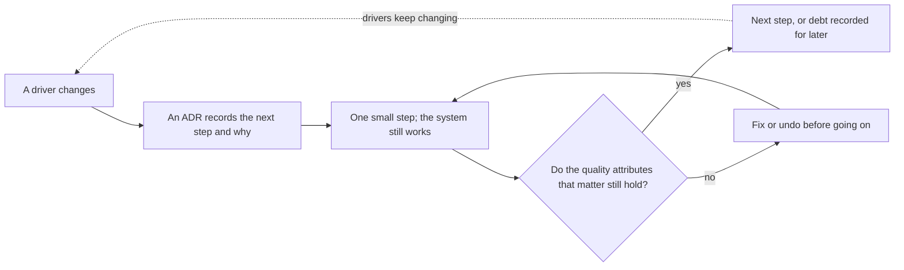

## Bạn cần biết trước

- [[design.l4.merging-a-service-back]] — bạn biết một lần tách hay gộp được cân với các yếu tố định hình kiến trúc ghi trong ADR.
- [[design.l4.over-abstraction]] — bạn biết trả giá từ bây giờ cho một nhu cầu chưa ai có là một khoản chi phí, không phải sự phòng xa.
- [[management.l3.where-debt-comes-from]] — bạn biết nợ N1, bảng `notifications` cũ mà lần tách để lại.
- [[management.l3.superseding-an-adr]] — bạn biết quyết định đổi thì có một ADR mới, còn ADR cũ giữ nguyên lý do của nó.

## Tình huống

Bạn vào làm ở Đơn Hàng lúc stage-3 và đọc lại lịch sử của nó. Ở stage-2, email đơn hàng được gửi từ bên trong `DonHang.Api`. Giờ một service riêng là `DonHang.Notifications` gửi chúng, nhưng bảng `notifications` cũ vẫn nằm trong database `donhang`, không ai đọc, và ADR `0008` lên kế hoạch xóa nó qua vài bước sau. Một đồng nghiệp tóm lại: "Một lần tách và một chuỗi bước dọn dẹp, chỉ cho một tính năng. Nếu thiết kế đầu tiên đúng thì đã chẳng có mấy thứ này. Hệ thống sau, mình vẽ kiến trúc cuối cùng trước khi viết dòng code nào." Bạn không chắc lịch sử này cho thấy một sai lầm. Điều gì khiến đổi kiến trúc từng bước là an toàn, chứ không phải dấu hiệu thiết kế đầu tiên đã sai?

## Khái niệm cốt lõi

- **kiến trúc tiến hóa** (evolutionary architecture) — kiến trúc được làm để đổi từng bước nhỏ, có định hướng, khi các yếu tố định hình nó thay đổi, thay vì chốt cứng từ đầu theo những yếu tố đoán trước.
- **thuộc tính chất lượng** (quality attribute) — tính chất cả hệ thống phải có, như trả lời nhanh đến đâu, các phần tách bạch đến đâu hay sửa an toàn đến đâu. Các yếu tố định hình kiến trúc quyết định thuộc tính nào quan trọng.
- một bước — một thay đổi đủ nhỏ để hệ thống chạy được cả trước lẫn sau nó, có ghi lại lý do.
- phép kiểm quanh một bước — bất cứ cách nào xác nhận rằng các thuộc tính chất lượng quan trọng vẫn giữ được, làm sau mỗi bước hoặc trước một bước không quay lại được: test chạy tự động, hoặc một người xác nhận.

## Cơ chế hoạt động



Trong tình huống trên, lịch sử đó chính là kiến trúc tiến hóa đang vận hành. Ở stage-2, chưa yếu tố nào đòi email nằm ngoài API. Khi hai yếu tố đổi, đội làm đúng một bước để đáp ứng chúng và ghi vào ADR `0002` (viết sau khi làm, như dòng 4–8 của nó nói; còn ADR `0008` được viết trước các bước của nó).

Một bước là nhỏ khi hệ thống chạy được cả trước lẫn sau nó. Lần tách là một bước. Đội phát hiện bảng còn sót lại sau đó và ghi nó thành nợ N1. Xóa bảng đó trở thành những bước riêng, thay vì mở lại lần tách.

Hình thoi là thứ làm cho các bước nhỏ an toàn. Lần tách giữ được hai thuộc tính chất lượng. Server email chậm không còn lấy tài nguyên của process nhận đơn. Notifications không đọc bảng `customers` của API, vì message mang sẵn email và tên khách (ADR `0002` dòng 38–39). Một bước sau, làm vì một yếu tố khác, có thể lặng lẽ đánh mất một trong hai. Không có phép kiểm thì bước như vậy trông y hệt một bước chạy tốt. Nếu phép kiểm fail, bước đó được sửa hoặc hoàn tác trước khi bước kế tiếp bắt đầu. Nếu pass, đội làm bước tiếp theo hoặc ghi phần còn lại thành nợ, như N1.

Các yếu tố định hình kiến trúc quyết định phép kiểm theo dõi thuộc tính chất lượng nào: một cửa hàng với hai developer có thể không mấy bận tâm các phần tách bạch đến đâu, còn nhiều service và nhiều đội thì bận tâm hơn.

Mũi tên đứt nét là ý chính của vòng lặp: các yếu tố cứ đổi, nên các bước không bao giờ dừng. Một kiến trúc chốt cứng từ đầu thì giả định rằng chúng sẽ dừng.

## Trong hệ thống Đơn Hàng

Vì sao bước đầu tiên được làm:

```markdown file=docs/adr/0002-tach-notifications-thanh-service.md tag=stage-3 lines=10-24
### Bối cảnh

Đến stage-2, email cho khách là dòng trong bảng `notifications` của database
`donhang`. `QueuedNotifier` ghi dòng đó cùng transaction với đơn, và
`NotificationSender` chạy trong mọi bản sao của `DonHang.Api`, nhận dòng bằng
`FOR UPDATE SKIP LOCKED`. Cách này đúng cho một process. Hai điều đã đổi:

- Cổng thanh toán sắp được gọi từ một service khác (ADR 0003), và service đó
  cũng phải báo tin cho khách. Nếu email vẫn nằm trong API, Payments phải gọi
  vào API hoặc ghi vào bảng của API.
- Máy chủ email chậm hay lỗi thì job gửi chiếm tài nguyên của chính process
  đang nhận đơn. Lỗi của việc gửi email nên tách khỏi việc đặt đơn.

Chỉ chuyện số bản sao thì chưa đủ lý do: job gửi email vẫn chạy được với số
bản sao của API.
```

Dòng 12–15 cho thấy hình dạng ở stage-2: email là một dòng trong `notifications`, do `QueuedNotifier` ghi trong cùng giao dịch với đơn và do `NotificationSender` gửi, mà `NotificationSender` chạy trong mọi bản sao của `DonHang.Api`. Sau đó dòng 15 nói "Cách này đúng cho một process" (khâu gửi nằm ngay trong process nhận đơn, như dòng 20 ghi) và "Hai điều đã đổi". Dòng 17–21 là hai yếu tố đó: Payments cũng phải báo tin cho khách, và server email chậm hay lỗi thì lấy tài nguyên của process nhận đơn. Dòng 23–24 nêu một lý do không được tính. Bước này được làm vì các yếu tố đã đổi, không phải vì thiết kế đầu tiên sai.

Món nợ mà bước đó để lại được xóa thế nào. ADR `0008` cũng xóa một thứ sót lại khác, nợ N2: bảng `payments` cũ, còn lại khi Payments có database riêng và dữ liệu đã được chép sang `donhang_payments`:

```markdown file=docs/adr/0008-xoa-bang-cu-trong-donhang.md tag=stage-3 lines=29-53
1. Dump hai bảng bằng `pg_dump -Fc --table`, lưu cùng các bản sao lưu khác.
2. Migration xóa `notifications` trước, cùng pull request bỏ bảng đó khỏi
   lệnh `TRUNCATE` của `PostgresFixture`.
3. Migration xóa `payments` sau khi kế toán xác nhận đã đối chiếu xong với
   `donhang_payments`, cũng sửa `PostgresFixture` như bước 2.

Ở tag stage-3 hai bảng vẫn còn; các bước trên làm trong sprint sau.

### Hệ quả

- Schema của `donhang` chỉ còn bảng API thật sự dùng.
- Dữ liệu cũ chỉ còn trong file dump; đọc lại cần khôi phục vào một database
  tạm.
- Không xóa cùng lúc nên có một khoảng chỉ còn bảng `payments` cũ.

### Ý kiến đã nhận

- Kế toán phản đối việc xóa `payments` ngay: các khoản thanh toán cũ là thứ họ
  đối soát cuối quý, và họ chưa kiểm bản chép sang `donhang_payments`. Quyết
  định đổi vì phản đối này: bảng `payments` chỉ bị xóa sau khi kế toán xác
  nhận (bước 3), không cùng lúc với `notifications` như bản đề xuất ban đầu.
- Tester hỏi test tích hợp có dựa vào hai bảng không. Không test nào đọc
  chúng, nhưng `PostgresFixture` xóa sạch dữ liệu của cả hai giữa các test
  (lệnh `TRUNCATE`). Mỗi migration xóa bảng vì thế sửa lệnh đó trong cùng
  pull request; điều này được thêm vào bước 2 và 3.
```

Dòng 29 đứng đầu để không bước nào sau đó làm mất dữ liệu vĩnh viễn: các bảng được dump trước khi xóa bất cứ thứ gì. Dòng 30–33 chia lần xóa thành hai migration, và dòng 50–53 giải thích vì sao mỗi migration sửa `PostgresFixture` trong cùng pull request: fixture xóa sạch cả hai bảng giữa các test, nên bước xóa và phần sửa test đi cùng nhau. Dòng 35 nói ở stage-3 chưa bước nào trong số này chạy, và hệ thống vẫn chạy với các bảng còn nguyên.

Dòng 46–49 cho thấy một phép kiểm do người làm, trước một bước không quay lại được. Kế toán đối soát các khoản thanh toán cũ mỗi quý và chưa kiểm bản chép trong `donhang_payments`, nên bảng `payments` chỉ bị xóa sau khi họ xác nhận. Dòng 42 chấp nhận trạng thái ở giữa mà cách này tạo ra, lúc chỉ còn bảng `payments` cũ.

## Đánh đổi

| Cách làm | Khi các yếu tố đổi như đã đoán | Khi xuất hiện một yếu tố không ai đoán trước | Chi phí trước lần release đầu | Thứ bảo vệ các thuộc tính đã giữ được |
|---|---|---|---|---|
| Thiết kế kiến trúc cuối cùng từ đầu | vừa khớp | hình dạng đã chốt phải thiết kế lại hoặc phải lách quanh | cao: đoán trước cho mọi yếu tố | bản thiết kế, cho tới khi có người đổi nó |
| Từng bước nhỏ, bước nào cũng được kiểm | vài bước là tới cùng hình dạng đó | bước tiếp theo đáp ứng nó | thấp hơn: đủ cho các yếu tố hiện tại, cộng các phép kiểm | các phép kiểm sau mỗi bước |
| Thay đổi không thiết kế, không kiểm | code mọc ra chỗ nào dễ nhất | code mọc ra chỗ nào dễ nhất | thấp nhất | không gì cả, mất mát chỉ lộ ra khi người dùng gặp nó |

Quyết định sớm tự nó không sai. Khi một lựa chọn rất tốn kém để đảo ngược, như hình dạng dữ liệu mà các hệ thống khác đã lưu, quyết định cẩn thận ngay từ đầu có thể là đường rẻ hơn. Hàng thứ hai trả giá cho các phép kiểm và cho công ghi lại từng bước. Hàng thứ ba lúc đầu không trả gì, và cái giá của nó đến sau, khi người dùng phát hiện một thuộc tính chất lượng đã mất.

## Bạn sẽ chọn gì nếu…

…một đồng nghiệp đề xuất một migration xóa cả hai bảng cũ cùng lúc, để đóng N1 và N2 trong một sprint? Dòng 46–49 trả lời: kế toán vẫn đối soát các khoản thanh toán cũ và chưa kiểm bản chép. Hãy giữ các bước: dump trước, rồi `notifications`, rồi `payments` sau khi kế toán xác nhận.

…một quyết định sẽ rất tốn kém để đảo ngược sau khi đã chốt, như định dạng dữ liệu mà các hệ thống khác đã lưu? Hãy dành nhiều công thiết kế hơn từ đầu cho riêng quyết định đó, và ghi lý do vào một ADR. Để các quyết định rẻ hơn cho những bước sau, khi đã biết các yếu tố của chúng.

…một yếu tố đã đổi, nhưng không có gì báo cho bạn nếu bước tiếp theo đánh mất một thuộc tính chất lượng mà ADR trước đã giữ được? Hãy làm bước nhỏ lại, để nếu nó đánh mất gì thì có ít thứ phải hoàn tác hơn, và dựng phép kiểm trước, kể cả khi phép kiểm là một người xác nhận trước bước đó, như kế toán làm trong `0008`.

## Senior hay nhầm rằng…

- **"Kiến trúc sư giỏi thiết kế kiến trúc cuối cùng ngay từ đầu, để nó không bao giờ phải đổi."** → Thực ra các yếu tố đổi sau khi bản thiết kế đã vẽ xong: ở stage-2, chưa service nào khác cần báo tin cho khách. Thiết kế cho mọi yếu tố đoán trước là trả giá từ bây giờ cho những tương lai có thể không tới. Bạn sẽ nhận ra niềm tin này khi một buổi họp thiết kế dành hết thời gian cho những nhu cầu chưa ai có, trong khi code đã phải uốn quanh một hình dạng không còn vừa.
- **"Phải đổi kiến trúc về sau chứng tỏ thiết kế đầu tiên đã sai."** → Thực ra dòng 15 của ADR `0002` gọi thiết kế ở stage-2 là đúng cho một process. Nó đổi vì hai yếu tố đã đổi. Bạn sẽ nhận ra niềm tin này khi một đội trì hoãn một bước cần làm vì thấy như đang nhận lỗi, hoặc muốn viết lại ADR cũ để giấu đi.
- **"Kiến trúc tiến hóa nghĩa là bỏ qua thiết kế và để code tự lớn lên."** → Thực ra bước nào cũng được thiết kế và ghi lại: `0002` đã cân hai phương án (giữ email là module trong API, hoặc tách thành service; dòng 26–34), còn `0008` sắp thứ tự các bước và đổi chúng sau khi nhận phản đối. Thứ nó bỏ qua là đoán những yếu tố còn xa, không phải thiết kế. Bạn sẽ nhận ra niềm tin này khi câu "rồi mình sẽ cho nó tiến hóa" trả lời mọi câu hỏi, và không ADR hay phép kiểm nào đứng sau một thay đổi.

## Thử ngay (3 phút)

Mở `docs/adr/0002-tach-notifications-thanh-service.md`, `docs/adr/0008-xoa-bang-cu-trong-donhang.md` và `docs/team/tech-debt-register.md` trong repo `don-hang` ở tag `stage-3`.

1. Liệt kê từng bước mà email đơn hàng và bảng cũ của nó đã trải qua từ stage-2, kể cả các bước đã lên kế hoạch.
2. Cạnh mỗi bước, ghi thứ gì xác nhận các thuộc tính chất lượng quan trọng vẫn giữ được quanh bước đó, hoặc ghi "không nêu".

Kết quả mong đợi: một danh sách bốn hoặc năm bước, mỗi bước có một phép kiểm hoặc "không nêu", kèm số dòng trong các file.

<details><summary>Gợi ý đáp án</summary>

1. Tách thành `DonHang.Notifications` với database riêng và một outbox (`0002` dòng 36–39, hàng T2 trong sổ nợ, dòng 28): các file này không nêu.
2. Dump cả hai bảng cũ (`0008` dòng 29): không nêu gì ngoài chuyện giữ file dump cùng các bản sao lưu khác.
3. Xóa `notifications` (`0008` dòng 30–31): test vẫn chạy, vì `PostgresFixture` được sửa trong cùng pull request (dòng 50–53).
4. Xóa `payments` (`0008` dòng 32–33): trước bước này, kế toán xác nhận đã kiểm các khoản thanh toán cũ (dòng 46–49). Sau bước này, không nêu gì ngoài phần sửa fixture.
5. Sau đó N1 chuyển sang "Nợ đã trả" trong sổ nợ (dòng 38).

Những hàng "không nêu" là chỗ một bước có thể lặng lẽ đảo ngược một quyết định trước đó mà không ai thấy.

</details>

## Liên hệ

- [[design.l3.before-extracting-a-module]] — phần chuẩn bị giữ cho một loại bước, module trở thành service, nhỏ và an toàn.
- [[design.l4.architectural-drivers]] — các yếu tố mà mỗi lần đổi lại khởi đầu một bước trong bài này.
- [[design.l4.merging-a-service-back]] — một bước theo chiều ngược lại, được quyết bởi cùng các yếu tố đó.
- [[management.l3.where-debt-comes-from]] — vì sao một bước có thể để lại nợ như N1 mà không ai làm ẩu.
- [[management.l3.superseding-an-adr]] — một bước đảo ngược quyết định được ghi lại thế nào mà không viết lại ADR cũ.
- [[design.l4.fitness-functions]] — tiếp theo: những phép kiểm tự chạy sau mỗi bước.

## Tóm tắt 5 dòng

1. Kiến trúc tiến hóa đổi từng bước nhỏ có kiểm khi các yếu tố định hình nó thay đổi, thay vì chốt cứng từ đầu theo những yếu tố đoán trước.
2. Thuộc tính chất lượng là tính chất cả hệ thống phải giữ, như tốc độ, sự tách bạch giữa các phần hay sửa an toàn. Các yếu tố quyết định thuộc tính nào quan trọng.
3. Email của Đơn Hàng rời `DonHang.Api` khi hai yếu tố đổi, như ADR `0002` ghi lại. Thiết kế ở stage-2 đúng với thời của nó.
4. Bước nào cũng để hệ thống chạy được: lần tách để lại bảng `notifications` cũ thành nợ N1, và ADR `0008` xóa nó theo từng bước.
5. Bước nhỏ chỉ an toàn khi có phép kiểm sau mỗi bước. Không có chúng, một bước có thể lặng lẽ đảo ngược những gì một quyết định trước đã giữ được.
