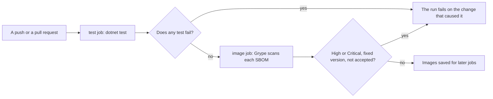

## Before you start

- [[design.l4.evolutionary-architecture]] — you know that small steps are safe only when checks after each one confirm that the quality attributes that matter still hold.
- [[design.l3.testing-module-boundaries]] — you know `ModuleBoundaryTests`, which reads a compiled module's referenced assemblies and fails on the wrong ones.
- [[devops.l2.quality-gate]] — you know that a quality gate is the set of automated checks a change must pass before it may go further.
- [[devops.l3.vulnerability-scanning]] — you know that the Grype step of the `image` job fails only on High or Critical findings with a fixed version.

## The situation

At stage-3 a teammate opens a pull request in which `DonHang.Payments` uses one class from `DonHang.Infrastructure`, to save some typing. The solution builds, the code looks fine in review, and every test about placing orders and refunds passes, yet the `test` job fails on `ServiceUsesNoDonHangProjectButMessaging`. The teammate is annoyed: "Nothing is broken, orders and refunds work; keeping services apart is something we agreed when we split them, so why does a test get a say?" Nobody re-reads the decision that made Payments a service of its own on every pull request, yet this test did. What is this failing test guarding, when no feature is broken?

## Core concepts

- **fitness function** — an automated check that the system still has a quality attribute it must keep, run with every change instead of left to people's memory.
- the attribute a check guards — the property it protects, such as parts staying apart or images shipping without fixable serious vulnerabilities; a feature test guards one behaviour instead.
- what a check states — the exact thing it reads and compares; a fitness function protects its attribute only as far as that statement reaches.
- an accepted exception — a finding the team chose to live with, written down with its reason next to the check, so it stays visible instead of being silently switched off.

## How it works



In the situation above, `ServiceUsesNoDonHangProjectButMessaging` is a fitness function. The quality attribute it guards is that the parts stay apart: Payments may use other Đơn Hàng code only through `DonHang.Messaging`. It tests nothing about orders or refunds. It fails because the change undid something a decision had secured, and it fails in the pull request that made the change.

Read the diagram from the left. Every push and every pull request starts `ci.yml` (lines 3–9). The `test` job runs `dotnet test` on the whole solution (lines 52–53), so `DependencyRuleTests` and `ModuleBoundaryTests` run beside the feature tests, with no step of their own. If any test fails, the job fails, and the `image` job, which needs `test` (line 96), does not start.

When the tests pass, the `image` job builds the images, writes an SBOM of each, and its Grype step scans them. That step is a fitness function for another quality attribute, security: it fails on a High or Critical vulnerability that has a fixed version, unless `.grype.yaml` accepts it. If the scan passes, the images are saved for the later jobs; if it fails, the run fails and they are not.

Both diamonds are a stated condition, checked by a machine on every change, that fails the change. Neither decides the attribute: that stays in an ADR, and the fitness function makes later changes keep it.

## In the Đơn Hàng system

The check that failed in the situation:

```csharp file=DonHang.Tests/Architecture/ModuleBoundaryTests.cs tag=stage-3 lines=55-70
    // lesson: backend.l3.message-broker
    // From stage-3 Notifications and Payments are services of their own: the
    // only Đơn Hàng project either may use is the shared DonHang.Messaging.
    // Everything else they know about an order arrives in a message.
    [Theory]
    [InlineData(typeof(OrderEventsConsumer))]
    [InlineData(typeof(RefundRequestedConsumer))]
    public void ServiceUsesNoDonHangProjectButMessaging(Type typeInTheService)
    {
        var referenced = typeInTheService.Assembly.GetReferencedAssemblies()
            .Select(assembly => assembly.Name!)
            .Where(name => name.StartsWith("DonHang.") && name != "DonHang.Messaging")
            .ToList();

        Assert.Empty(referenced);
    }
```

Lines 60–61 run the test once per service, starting from one type that lives in it: `OrderEventsConsumer` in Notifications, `RefundRequestedConsumer` in Payments. Line 66 keeps every referenced name that starts with `DonHang.` other than `DonHang.Messaging`, and line 69 fails if one is left. `DependencyRuleTests`, in the same folder but outside this excerpt, does the same for Ordering's core: `DomainReferencesNoOuterAssembly` fails when `DonHang.Domain` references a name on its list of outer prefixes, such as `DonHang.Catalog` or `RabbitMQ`.

Compare `OrdersApiTests`: it checks that placing an order returns `201` with a `Location` header. That is a feature. `ModuleBoundaryTests` checks how projects depend on each other, whatever the features do; it would pass with a broken order endpoint, and can fail while the order endpoint works.

Line 64 also shows the limit. The test reads assembly references and nothing else. A service that opened its own connection to another service's database would add no `DonHang.` reference and still pass.

The fitness function for security:

```yaml file=.github/workflows/ci.yml tag=stage-3 lines=132-141
      # lesson: devops.l3.vulnerability-scanning
      # Grype scans each SBOM, and this step fails on a High or Critical
      # vulnerability that has a fixed version (.grype.yaml lists the ones
      # accepted, each with its reason). A failure stops the run before the
      # images are saved, so no later job can deploy or push them.
      - name: Scan each SBOM for known vulnerabilities
        run: |
          for sbom in sbom/*.cdx.json; do
            scripts/devops/scan-image.sh "$sbom"
          done
```

The comment on lines 133–135 describes the condition, which `scripts/devops/scan-image.sh` (line 140) applies, and where accepted exceptions live. At stage-3 `.grype.yaml` accepts one, `CVE-2024-10041`: a Medium flaw with no fix, which the step would not fail on anyway, in PAM, the part of the OS a program uses to authenticate a user. Its comment says why it does not apply: the images run one `dotnet` process and no login. Lines 135–136 say what the failure protects: images that fail it never leave the run.

## Trade-offs

| Who checks the attribute | When it runs | What it can see | Cost to add | What slips through |
|---|---|---|---|---|
| A person in code review | when someone reads the diff and remembers the decision | intent and context, anything the reader understands | none up front; attention on every pull request | a change whose link to the decision the reader misses |
| A test in `DonHang.Tests` | every push and pull request | only what its code reads, such as assembly references | a few lines of xUnit, the test library `DonHang.Tests` already uses; no new tool | anything outside what the test states |
| A separate tool in the pipeline, such as Grype | every run of its job | what the tool and its data know | a pinned tool, its settings, an exceptions file | what the tool's data does not know yet |

A fitness function suits what can be stated exactly and checked on every change. A person stays better at what needs judgment, such as whether a call through a contract is sensible. When an attribute can be stated exactly but is left to people, it is guarded only on the days someone remembers.

## What would you choose if…

…the next ADR secures a new separation, such as a module that must not use another? Write the fitness function, as a test beside `ModuleBoundaryTests`, in the first pull request whose code already obeys the decision: at once when nothing crosses the boundary yet, otherwise in the step that removes the last crossing. The decision is then checked as early as it can pass.

…Grype fails on a High finding that has a fixed version? Take the fixed version when you can. Only when the finding truly does not apply, add it to `.grype.yaml` with its reason, in the same form as the existing entry, and remove it once the reason stops being true.

…the attribute is one no current check can state, such as Notifications never reading the API's tables? Say so: name it as unguarded, keep a reviewer watching for it, and do not read a green run as covering it.

## Seniors often assume…

- **"Architecture is checked in design reviews; automated tests are only for features."** → Actually a meeting checks a design once, and a code review checks a change only when the reviewer connects it to the decision. In the situation the review passed the change; `ServiceUsesNoDonHangProjectButMessaging` did not. You notice this belief when a decision from an ADR turns out, months later, to have been broken by a change nobody linked to it.
- **"A fitness function needs a special tool that the test project does not already have."** → Actually `DependencyRuleTests` and `ModuleBoundaryTests` are plain xUnit tests in `DonHang.Tests` that call `GetReferencedAssemblies`, part of .NET, and run with `dotnet test`. Some attributes do need a tool: security needs Grype and its data. You notice this belief when guarding a decision is postponed until a library is chosen.
- **"If the architecture tests pass, the architecture is fine in every respect."** → Actually each test proves only what it states. `ModuleBoundaryTests` reads assembly references, so a service that connects to another service's database passes it. You notice this belief when a green run sits beside a service reading tables it should only learn about from messages.

## Try it (3 minutes)

Open `.github/workflows/ci.yml`, `DonHang.Tests/Architecture/ModuleBoundaryTests.cs`, `DonHang.Tests/Architecture/DependencyRuleTests.cs` and `.grype.yaml` in the `don-hang` repository at tag `stage-3`. For each change below, write which check fails it and in which job, or "none":

1. `DonHang.Domain` starts using a type from `RabbitMQ.Client`.
2. `DonHang.Notifications` starts using a type from `DonHang.Domain`.
3. `DonHang.Notifications` opens its own connection to the `donhang` database and reads `customers`.
4. A High vulnerability with a fixed version is published for an OS package in the base image of `donhang-payments`, and `.grype.yaml` does not list it.

Expected result: four lines, three naming a check and a job, one reading "none".

<details><summary>Suggested answer</summary>

1. `DomainReferencesNoOuterAssembly` in `DependencyRuleTests` (`RabbitMQ` is on its list, line 20), `test` job.
2. `ServiceUsesNoDonHangProjectButMessaging`, the `OrderEventsConsumer` case, `test` job.
3. None. The connection adds no `DonHang.` reference, so every test passes. This attribute is unguarded.
4. The Grype step, `image` job, on the first run after the vulnerability is in Grype's database; the step updates the database each run.

</details>

## Connections

- [[design.l4.evolutionary-architecture]] — the checks after each step that this lesson makes automatic.
- [[design.l2.testing-the-dependency-rule]] — the first fitness function you met, before it had this name.
- [[design.l2.test-pyramid]] — the feature tests that run beside the fitness functions in the same `dotnet test`.
- [[devops.l2.quality-gate]] — the gate these checks sit in; a fitness function is a gate check tied to a quality attribute.
- [[design.l4.quality-attribute-scenarios]] — next: stating an attribute exactly enough that a check can be written for it.
- [[design.l4.mapping-fitness-functions]] — listing each attribute next to its check, to find the ones nothing guards.

## Five-line summary

1. A fitness function is an automated check, run with every change, that the system still has a quality attribute it must keep.
2. `DependencyRuleTests` and `ModuleBoundaryTests` guard parts staying apart: they fail on a forbidden assembly reference from Ordering's core or a service.
3. They run in the `test` job on every push and pull request, so a crossed boundary fails in the pull request that crossed it.
4. The Grype step guards security: it fails on High or Critical with a fixed version; `.grype.yaml` records each accepted exception with its reason.
5. A fitness function checks an attribute, not a feature, and sees only what it states: a direct database connection passes `ModuleBoundaryTests`.
