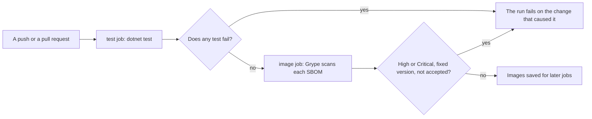

## Bạn cần biết trước

- [[design.l4.evolutionary-architecture]] — bạn biết các bước nhỏ chỉ an toàn khi có phép kiểm sau mỗi bước, xác nhận các thuộc tính chất lượng quan trọng vẫn còn giữ được.
- [[design.l3.testing-module-boundaries]] — bạn biết `ModuleBoundaryTests`, test đọc các assembly mà một module đã biên dịch tham chiếu tới và fail khi gặp assembly không được phép.
- [[devops.l2.quality-gate]] — bạn biết quality gate là bộ kiểm tra tự động mà một thay đổi phải qua trước khi được đi tiếp.
- [[devops.l3.vulnerability-scanning]] — bạn biết bước Grype của job `image` chỉ fail khi có phát hiện High hoặc Critical đã có phiên bản sửa.

## Tình huống

Ở stage-3, một đồng nghiệp mở pull request trong đó `DonHang.Payments` dùng một class của `DonHang.Infrastructure`, cho đỡ phải gõ. Solution build được, code review thấy ổn, mọi test về đặt đơn và hoàn tiền đều pass, vậy mà job `test` fail ở `ServiceUsesNoDonHangProjectButMessaging`. Đồng nghiệp bực mình: "Có gì hỏng đâu, đặt đơn và hoàn tiền vẫn chạy. Giữ các service tách nhau là chuyện cả nhóm thống nhất lúc tách chúng ra, sao một cái test lại có quyền chặn?" Không ai đọc lại quyết định tách Payments thành service riêng ở mỗi pull request, nhưng test này thì có. Khi không tính năng nào hỏng, test đang fail này canh giữ điều gì?

## Khái niệm cốt lõi

- **fitness function** (phép kiểm tự động cho biết hệ thống còn giữ một thuộc tính chất lượng cần giữ hay không) — chạy cùng mỗi thay đổi, thay vì phó mặc cho trí nhớ của con người.
- thuộc tính mà một phép kiểm canh giữ — tính chất nó bảo vệ, như các phần vẫn tách bạch, hay image được giao đi mà không mang lỗ hổng nghiêm trọng nào sửa được. Một test tính năng thì canh giữ một hành vi.
- điều một phép kiểm phát biểu — chính xác thứ nó đọc và so sánh. Fitness function chỉ bảo vệ thuộc tính của nó tới đúng chỗ phát biểu đó với tới.
- một ngoại lệ được chấp nhận — một phát hiện mà nhóm chọn sống chung, ghi lại kèm lý do ngay cạnh phép kiểm, để nó vẫn hiện ra thay vì bị lặng lẽ tắt đi.

## Cơ chế hoạt động



Trong tình huống trên, `ServiceUsesNoDonHangProjectButMessaging` là một fitness function. Thuộc tính chất lượng nó canh giữ là các phần vẫn tách bạch: Payments chỉ được dùng code khác của Đơn Hàng qua `DonHang.Messaging`. Nó không kiểm gì về đặt đơn hay hoàn tiền. Nó fail vì thay đổi đã gỡ bỏ thứ mà một quyết định từng đảm bảo, và fail ngay trong pull request tạo ra thay đổi đó.

Đọc sơ đồ từ trái sang. Mỗi lần push và mỗi pull request đều khởi chạy `ci.yml` (dòng 3–9). Job `test` chạy `dotnet test` trên cả solution (dòng 52–53), nên `DependencyRuleTests` và `ModuleBoundaryTests` chạy cạnh các test tính năng, không cần bước riêng. Test nào fail thì job fail, và job `image`, vốn cần `test` (dòng 96), không bắt đầu.

Khi test pass, job `image` build các image, ghi SBOM cho từng image, và bước Grype của nó quét chúng. Bước đó là fitness function cho một thuộc tính chất lượng khác, bảo mật: nó fail khi có lỗ hổng High hoặc Critical đã có phiên bản sửa, trừ khi `.grype.yaml` chấp nhận lỗ hổng đó. Quét qua thì các image được lưu cho các job sau. Quét fail thì lần chạy fail và image không được lưu.

Cả hai hình thoi đều là một điều kiện đã phát biểu rõ, được máy kiểm ở mỗi thay đổi, và làm thay đổi đó fail. Không hình thoi nào quyết định thuộc tính: việc đó nằm trong ADR, còn fitness function buộc các thay đổi sau phải giữ nó.

## Trong hệ thống Đơn Hàng

Phép kiểm đã fail trong tình huống:

```csharp file=DonHang.Tests/Architecture/ModuleBoundaryTests.cs tag=stage-3 lines=55-70
    // lesson: backend.l3.message-broker
    // From stage-3 Notifications and Payments are services of their own: the
    // only Đơn Hàng project either may use is the shared DonHang.Messaging.
    // Everything else they know about an order arrives in a message.
    [Theory]
    [InlineData(typeof(OrderEventsConsumer))]
    [InlineData(typeof(RefundRequestedConsumer))]
    public void ServiceUsesNoDonHangProjectButMessaging(Type typeInTheService)
    {
        var referenced = typeInTheService.Assembly.GetReferencedAssemblies()
            .Select(assembly => assembly.Name!)
            .Where(name => name.StartsWith("DonHang.") && name != "DonHang.Messaging")
            .ToList();

        Assert.Empty(referenced);
    }
```

Dòng 60–61 chạy test một lần cho mỗi service, xuất phát từ một type nằm trong service đó: `OrderEventsConsumer` ở Notifications, `RefundRequestedConsumer` ở Payments. Dòng 66 giữ lại mọi tên được tham chiếu bắt đầu bằng `DonHang.`, trừ `DonHang.Messaging`, và dòng 69 fail nếu còn sót tên nào. `DependencyRuleTests`, cùng thư mục nhưng nằm ngoài đoạn trích này, làm điều tương tự cho phần lõi của Ordering: `DomainReferencesNoOuterAssembly` fail khi `DonHang.Domain` tham chiếu một tên nằm trong danh sách tiền tố bên ngoài của nó, như `DonHang.Catalog` hay `RabbitMQ`.

So với `OrdersApiTests`: test này kiểm rằng đặt đơn trả về `201` kèm header `Location`. Đó là một tính năng. `ModuleBoundaryTests` kiểm các project phụ thuộc nhau ra sao, bất kể tính năng làm gì. Nó vẫn pass khi endpoint đặt đơn hỏng, và có thể fail khi endpoint đặt đơn chạy tốt.

Dòng 64 cũng cho thấy giới hạn. Test chỉ đọc tham chiếu assembly, ngoài ra không gì khác. Một service tự mở kết nối tới database của service khác sẽ không thêm tham chiếu `DonHang.` nào, và vẫn pass.

Fitness function cho bảo mật:

```yaml file=.github/workflows/ci.yml tag=stage-3 lines=132-141
      # lesson: devops.l3.vulnerability-scanning
      # Grype scans each SBOM, and this step fails on a High or Critical
      # vulnerability that has a fixed version (.grype.yaml lists the ones
      # accepted, each with its reason). A failure stops the run before the
      # images are saved, so no later job can deploy or push them.
      - name: Scan each SBOM for known vulnerabilities
        run: |
          for sbom in sbom/*.cdx.json; do
            scripts/devops/scan-image.sh "$sbom"
          done
```

Comment ở dòng 133–135 mô tả điều kiện, do `scripts/devops/scan-image.sh` (dòng 140) áp dụng, và chỗ ghi các ngoại lệ được chấp nhận. Ở stage-3, `.grype.yaml` chấp nhận một lỗ hổng, `CVE-2024-10041`: mức Medium, chưa có bản sửa, bước này vốn cũng không fail vì nó, nằm trong PAM, phần của hệ điều hành mà chương trình dùng để xác thực người dùng. Comment của nó nói vì sao nó không áp dụng: các image chỉ chạy một process `dotnet` và không có đăng nhập. Dòng 135–136 nói lần fail này bảo vệ điều gì: image không qua được bước này thì không bao giờ rời khỏi lần chạy.

## Đánh đổi

| Ai kiểm thuộc tính | Chạy khi nào | Thấy được gì | Chi phí thêm vào | Thứ lọt qua |
|---|---|---|---|---|
| Một người trong code review | khi có người đọc diff và nhớ ra quyết định | ý định và bối cảnh, mọi thứ người đọc hiểu | không tốn gì lúc đầu, nhưng tốn sự chú ý ở mỗi pull request | thay đổi mà người đọc không thấy nó liên quan tới quyết định |
| Một test trong `DonHang.Tests` | mỗi lần push và pull request | chỉ những gì code của nó đọc, như tham chiếu assembly | vài dòng xUnit, thư viện test mà `DonHang.Tests` đang dùng, không thêm công cụ mới | mọi thứ nằm ngoài điều test phát biểu |
| Một công cụ riêng trong pipeline, như Grype | mỗi lần job của nó chạy | những gì công cụ và dữ liệu của nó biết | một công cụ ghim phiên bản, cấu hình của nó, một file ngoại lệ | những gì dữ liệu của công cụ chưa biết |

Fitness function hợp với những gì phát biểu được chính xác và kiểm được ở mỗi thay đổi. Con người vẫn giỏi hơn ở những gì cần phán đoán, như một lời gọi qua contract có hợp lý không. Khi một thuộc tính phát biểu được chính xác mà vẫn để con người canh, nó chỉ được canh vào những ngày có ai đó nhớ ra.

## Bạn sẽ chọn gì nếu…

…ADR tiếp theo đảm bảo một sự tách bạch mới, như một module không được dùng module khác? Hãy viết fitness function, thành một test cạnh `ModuleBoundaryTests`, trong pull request đầu tiên mà code đã tuân theo quyết định: làm ngay nếu chưa có gì vượt ranh giới, còn không thì làm trong bước gỡ chỗ vượt cuối cùng. Khi đó quyết định được kiểm sớm nhất mà nó có thể pass.

…Grype fail vì một phát hiện High đã có phiên bản sửa? Hãy lấy phiên bản sửa khi có thể. Chỉ khi phát hiện đó thật sự không áp dụng, mới thêm nó vào `.grype.yaml` kèm lý do, theo đúng dạng của mục đang có, và gỡ nó ra khi lý do không còn đúng.

…thuộc tính là thứ chưa phép kiểm nào phát biểu được, như Notifications không bao giờ đọc bảng của API? Hãy nói rõ: gọi tên nó là chưa được canh, giữ một reviewer để mắt tới nó, và đừng coi một lần chạy xanh là đã bao gồm nó.

## Senior hay nhầm rằng…

- **"Kiến trúc được kiểm trong các buổi review thiết kế, còn test tự động chỉ dành cho tính năng."** → Thực ra một buổi họp chỉ kiểm thiết kế một lần, còn code review chỉ kiểm được thay đổi khi người review nối nó với quyết định. Trong tình huống, review đã cho thay đổi qua, còn `ServiceUsesNoDonHangProjectButMessaging` thì không. Bạn sẽ nhận ra niềm tin này khi một quyết định trong ADR, nhiều tháng sau, hóa ra đã bị phá bởi một thay đổi mà không ai liên hệ tới nó.
- **"Fitness function cần một công cụ đặc biệt mà project test chưa có."** → Thực ra `DependencyRuleTests` và `ModuleBoundaryTests` là test xUnit bình thường trong `DonHang.Tests`, gọi `GetReferencedAssemblies` có sẵn trong .NET, và chạy bằng `dotnet test`. Có những thuộc tính đúng là cần công cụ: bảo mật cần Grype và dữ liệu của nó. Bạn sẽ nhận ra niềm tin này khi việc canh giữ một quyết định bị hoãn lại cho tới lúc chọn xong thư viện.
- **"Architecture test pass thì kiến trúc ổn về mọi mặt."** → Thực ra mỗi test chỉ chứng minh điều nó phát biểu. `ModuleBoundaryTests` đọc tham chiếu assembly, nên một service kết nối tới database của service khác vẫn qua được nó. Bạn sẽ nhận ra niềm tin này khi một lần chạy xanh nằm cạnh một service đang đọc những bảng mà lẽ ra nó chỉ được biết qua message.

## Thử ngay (3 phút)

Mở `.github/workflows/ci.yml`, `DonHang.Tests/Architecture/ModuleBoundaryTests.cs`, `DonHang.Tests/Architecture/DependencyRuleTests.cs` và `.grype.yaml` trong repo `don-hang` ở tag `stage-3`. Với mỗi thay đổi dưới đây, ghi phép kiểm nào làm nó fail và trong job nào, hoặc ghi "không có":

1. `DonHang.Domain` bắt đầu dùng một type của `RabbitMQ.Client`.
2. `DonHang.Notifications` bắt đầu dùng một type của `DonHang.Domain`.
3. `DonHang.Notifications` tự mở kết nối tới database `donhang` và đọc `customers`.
4. Một lỗ hổng High đã có phiên bản sửa được công bố cho một package hệ điều hành trong base image của `donhang-payments`, và `.grype.yaml` không liệt kê nó.

Kết quả mong đợi: bốn dòng, ba dòng nêu tên một phép kiểm và một job, một dòng ghi "không có".

<details><summary>Gợi ý đáp án</summary>

1. `DomainReferencesNoOuterAssembly` trong `DependencyRuleTests` (`RabbitMQ` có trong danh sách của nó, dòng 20), job `test`.
2. `ServiceUsesNoDonHangProjectButMessaging`, trường hợp `OrderEventsConsumer`, job `test`.
3. Không có. Kết nối này không thêm tham chiếu `DonHang.` nào, nên mọi test đều pass. Thuộc tính này chưa được canh.
4. Bước Grype, job `image`, ở lần chạy đầu tiên sau khi lỗ hổng có trong cơ sở dữ liệu của Grype. Bước này cập nhật cơ sở dữ liệu ở mỗi lần chạy.

</details>

## Liên hệ

- [[design.l4.evolutionary-architecture]] — các phép kiểm sau mỗi bước mà bài này biến thành tự động.
- [[design.l2.testing-the-dependency-rule]] — fitness function đầu tiên bạn gặp, khi nó chưa mang tên này.
- [[design.l2.test-pyramid]] — các test tính năng chạy cạnh fitness function trong cùng một lần `dotnet test`.
- [[devops.l2.quality-gate]] — cổng mà các phép kiểm này nằm trong đó. Fitness function là một phép kiểm của cổng gắn với một thuộc tính chất lượng.
- [[design.l4.quality-attribute-scenarios]] — tiếp theo: phát biểu một thuộc tính đủ chính xác để viết được phép kiểm cho nó.
- [[design.l4.mapping-fitness-functions]] — liệt kê mỗi thuộc tính cạnh phép kiểm của nó, để tìm ra những thuộc tính chưa gì canh giữ.

## Tóm tắt 5 dòng

1. Fitness function là một phép kiểm tự động, chạy cùng mỗi thay đổi, xác nhận hệ thống vẫn giữ một thuộc tính chất lượng cần giữ.
2. `DependencyRuleTests` và `ModuleBoundaryTests` canh giữ sự tách bạch giữa các phần: chúng fail khi lõi của Ordering hoặc một service tham chiếu assembly bị cấm.
3. Chúng chạy trong job `test` ở mỗi lần push và pull request, nên ranh giới bị vượt sẽ fail ngay trong pull request đã vượt nó.
4. Bước Grype canh giữ bảo mật: nó fail khi có High hoặc Critical đã có phiên bản sửa. `.grype.yaml` ghi mỗi ngoại lệ được chấp nhận kèm lý do.
5. Fitness function kiểm một thuộc tính, không phải một tính năng, và chỉ thấy điều nó phát biểu: kết nối thẳng tới database vẫn qua được `ModuleBoundaryTests`.
