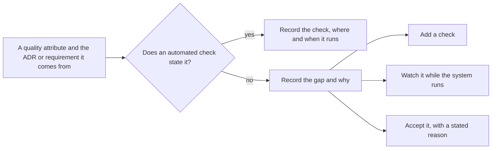

## Before you start

- [[design.l4.quality-attribute-scenarios]] — you know YC-7 as a scenario: a refund request, even while the gateway fails, is answered within 2 seconds.
- [[devops.l2.histograms-and-percentiles]] — you know that a histogram counts requests into buckets by upper bound `le`, so a time can be measured only as precisely as the bounds allow.

## The situation

At stage-4, before the multi-shop work starts, the product owner asks you whether everything Đơn Hàng promised still holds. You point at the pull requests: every run of `ci.yml` is green. Then they read out YC-7 from `refund-requirements.md`: a customer's refund request is answered within 2 seconds, even when the payment gateway fails. You open `ci.yml` to show them the step that measures those 2 seconds, read every job, and find no step that times a refund request. The green runs said nothing about YC-7 either way. Which of Đơn Hàng's quality attributes does some check actually guard, and which does nothing guard?

## Core concepts

- the attribute map — `docs/design/fitness-functions.md`: one row per quality attribute Đơn Hàng must keep, with the ADR or requirement it comes from, the check that guards it, and where and when that check runs.
- when a check runs — the event that starts it, such as a push or a new Pod; a check sees the system only at that moment.
- a gap — a quality attribute the team must keep that no automated check guards.
- a gap choice — the one decision recorded for each gap: add a check, watch the attribute while the system runs, or accept the gap with a stated reason.

## How it works



In the situation above, YC-7 is a quality attribute on the "no" branch. The question that sorts it is not "is the run green" but "which check states this attribute".

Start on the left with one attribute and where it comes from: an ADR, a requirement such as YC-7, or a rule such as the dependency rule of `DonHang.Domain`. When a check states it, the map records the check and when it runs. The dependency rule's row names `DependencyRuleTests` in the `test` job, on every push and pull request.

When a check runs decides what it can see. Every check on Đơn Hàng's map runs on a change: a push, a pull request, or a new Pod. None runs on a schedule. So something that changes outside the code goes unseen until the next change, or until someone starts `ci.yml` by hand. The Grype step, the vulnerability scanner in the `image` job, scans an image when it is built; a vulnerability published after that build is in no scan of that image.

When no check states an attribute, it goes on the "no" branch. The map records why, and one choice. YC-7 is held by the design: the api records the refund and answers `202` at once, without waiting for the gateway, so a slow or failing gateway does not delay the answer. But no check measures the 2 seconds on each change, so the team watches it instead: staging's Prometheus computes S4 of `slo.md`, the share of refund requests answered within the `le="2.048"` bucket, the nearest bucket bound above 2 seconds.

## In the Đơn Hàng system

What starts every check in the workflow:

```yaml file=.github/workflows/ci.yml tag=stage-4 lines=1-9
name: ci

on:
  push:
    # A Dependabot branch always has its pull request, which runs ci.yml
    # already; running it for the push as well would only do it twice.
    branches-ignore: ['dependabot/**']
  pull_request:
  workflow_dispatch:
```

Lines 3–9 list every event that starts `ci.yml`: a push to any branch except Dependabot's, a pull request, and `workflow_dispatch`, a person starting the workflow by hand. There is no `schedule` trigger, so no job in this file starts because time has passed. The one check outside the workflow, the admission policy `require-image-digest`, runs when a Pod is created: an event, not the passing of time.

The part of the map that lists what nothing guards:

```markdown file=docs/design/fitness-functions.md tag=stage-4 lines=53-77
### Chưa có phép kiểm tự động

Mỗi dòng ghi một lựa chọn: thêm phép kiểm, theo dõi, hoặc chấp nhận kèm lý do.
Ghi ra để khoảng trống được biết, không bị tưởng là đã có phép kiểm.

| Thuộc tính | Nguồn | Vì sao chưa có | Lựa chọn |
|---|---|---|---|
| Yêu cầu hoàn tiền được trả lời trong 2 giây | YC-7 của `docs/team/refund-requirements.md` | Thiết kế giữ nó (api trả `202` mà không gọi cổng thanh toán), nhưng không phép kiểm nào đo 2 giây theo mỗi thay đổi | Theo dõi bằng S4 trong `slo.md` và alert `RefundRequestsFastBurn`, `RefundRequestsSlowBurn` trên staging |
| Image đang chạy không mang lỗ hổng công bố sau khi build | TT-5 của `docs/team/compliance-controls.md` | Grype chỉ quét lúc build; không có lần quét theo lịch. Dependabot mở pull request mỗi tuần, nhưng chỉ khi có bản mới của một phụ thuộc | Chấp nhận tới khi có production: lab và staging không giữ dữ liệu khách thật. Xem lại khi production nhận khách |
| Mỗi service chỉ đọc và ghi database của mình | Nguyên tắc NT1, `data-ownership.md` | `ModuleBoundaryTests` không thấy kết nối database | Chấp nhận kèm lý do: `backend-review-checklist.md` hỏi câu này ở mỗi review; role riêng cho từng service (mục "Sau đó" của `docs/team/roadmap.md`) sẽ chặn ở database |
| Một cửa hàng không đọc được dữ liệu cửa hàng khác | CH-1; ADR 0013 | Chưa có code đa cửa hàng ở stage-4 | Thêm phép kiểm khi xây row-level security (release 3 của `multi-shop-data-rollout.md`): một truy vấn quên lọc cửa hàng vẫn không thấy dòng của cửa hàng khác |
| Một cửa hàng đông không làm cửa hàng khác bị từ chối | CH-3; ADR 0016; `multi-shop-architecture-review.md` | Giới hạn theo cửa hàng chưa xây: `Program.cs` giữ giới hạn chung | Thêm phép kiểm khi xây, như `RateLimitTests` nhưng theo cửa hàng |
| Trải nghiệm trên máy khách: phiên không lỗi, thời gian tới màn hình đầu tiên, đơn kẹt trong hàng đợi offline | A1–A3 của `app-experience.md` | App chưa gửi số đo nào | Theo dõi bằng dashboard khi app gửi số đo (`app-experience.md`, mục Khoảng trống) |
| Thuộc tính của ADR 0026–0033 (database riêng cho cửa hàng lớn, thông báo nhiều kênh, đối soát hoàn tiền, ký bảng kê, tìm sản phẩm, báo cáo, chat hỗ trợ, cửa hàng tự đăng ký) | ADR 0026–0033 | Các ADR này chưa xây ở stage-4, nên chưa có gì để kiểm | Thêm phép kiểm cùng lúc xây: mỗi ADR khi được xây thêm phép kiểm cho thuộc tính nó giữ, hoặc thêm một dòng ở đây kèm lựa chọn |

### Khi nào sửa danh sách

- Khi thêm, đổi hay bỏ một phép kiểm hoặc một job trong `ci.yml`.
- Khi một ADR mới đặt ra một thuộc tính phải giữ, hoặc khi một ADR ở bảng
  trên được xây.
- Mỗi quý, cùng lần xem lại `docs/team/architecture-governance.md`: dòng nào ở
  mục "Chưa có" đã đổi lựa chọn.

Một phép kiểm tốn công giữ hơn rủi ro nó che thì không đáng tự động hóa. Lựa
chọn đó cũng ghi ở mục "Chưa có", để không bị đọc là bỏ sót.
```

Lines 55–56 state the rule: each row records one choice, so a gap is known instead of assumed covered. Each row in lines 60–66 gives the attribute, its source, why no check exists and the choice. Line 60 is YC-7, watched through S4 on staging; the two names after S4 are warnings set up on staging for S4, which this lesson does not need. Line 61 is the vulnerability case: Grype scans only at build time, and the team accepts that gap until production exists, because neither staging nor the lab, the local setup `scripts/up.sh` starts, holds real customers' data. Line 62 accepts another gap; its reason is that `backend-review-checklist.md` asks the question in every review, and it names per-service database roles as what will close it later. Lines 63–64 add a check once the multi-shop code they would check is built, line 65 watches the app's experience once the app sends numbers, and line 66 adds a check for each later ADR when it is built.

Lines 70–74 say when the map changes: with a check or job, with an ADR, and once a quarter. Lines 76–77 give the rule behind every "accept": a check costing more to keep than the risk it covers is not worth automating, and writing that down keeps it from looking like an oversight.

## Trade-offs

| Choice for a gap | When a problem shows | Cost to keep | What it needs first | In Đơn Hàng |
|---|---|---|---|---|
| Add a check | in the change that causes it | the check's code, kept in step with the system, and its run time on every change | the attribute stated exactly enough for a machine | shops not reading each other's data, once row-level security is built |
| Watch it while the system runs | after the change is running somewhere | measurements, and someone who looks at them | a running environment that produces those measurements | YC-7 through S4 on staging |
| Accept with a stated reason | only when someone looks again, or when it goes wrong | nothing ongoing, but the risk stays | a reason the team agrees is true, and a point at which to revisit it | vulnerabilities published after the build, until production takes customers |

A check catches a problem earliest, but only for what it states, and only when a change starts it. Watching sees the running system, including what changes without a code change, but only after the fact. Accepting costs nothing until the reason stops being true, which is why each accepted row names when to look again.

## What would you choose if…

…a new ADR adds an attribute that can be stated exactly, such as one module not using another? Add a check, run on every change, in the same work that builds the decision.

…the attribute is a time on the running system, as YC-7 is? If a check on each change would need a running system and stable timing, watching it where it happens can be the cheaper choice. Keep the row on the map either way, so the attribute stays visibly unguarded by CI.

…production starts taking real customers? The accepted row for vulnerabilities published after the build names that as its point to look again. The reason "no real customers' data" is no longer true, so the choice must be made again. A check started by time, not by a change, is the kind that would see a vulnerability published after the build.

## Seniors often assume…

- **"Every quality attribute must be checked automatically on every commit."** → Actually some attributes cost more to check on each change than the risk they cover, and some, like YC-7, are about the running system. The map records watching or accepting as a choice. You notice this belief when a timing test that fails on slow runners becomes a flaky test and is quietly switched off, leaving the attribute with neither a check nor a row.
- **"If CI is green, every quality attribute the system needs is being checked."** → Actually green means only that the checks on the map passed for this change. YC-7 has no step in `ci.yml`, and a vulnerability published after the build is seen by none of them. You notice this belief when a complaint arrives about something every run passed.
- **"A quality attribute that has no automated check is not really a requirement."** → Actually YC-7 is a requirement the product owner set, the design holds it, and the team watches it. A missing check is a recorded choice, not a demotion. You notice this belief when a gap row is deleted because "nothing tests it anyway", and nobody keeps the attribute after that.

## Try it (3 minutes)

Open `docs/design/fitness-functions.md` and `.github/workflows/ci.yml` in the `don-hang` repository at tag `stage-4`. For each attribute, write either the check and when it runs, or "gap" and the recorded choice:

1. Catalog makes public only its contract `ICatalog`.
2. A running image carries no vulnerability published after it was built.
3. A refund request is answered within 2 seconds.
4. Each service reads and writes only its own database.

Then mark each one that can stop holding while nobody changes anything in the repository, and say what, if anything, would see it.

Expected result: four lines, one naming a check and when it runs, three reading "gap" with a choice, and two of them marked.

<details><summary>Suggested answer</summary>

1. `ModuleBoundaryTests` (`CatalogMakesPublicOnlyItsContract`), job `test`, every push and pull request.
2. Gap: accepted until production takes customers, because the lab and staging hold no real customers' data. Marked: a new vulnerability can be published at any time, and nothing sees it; the gap is accepted.
3. Gap: watched through S4 of `slo.md` on staging. Marked: the time is measured on the running system, which can change with no commit; S4 on staging sees it.
4. Gap: accepted with a reason; `backend-review-checklist.md` asks it in every review, and per-service roles will enforce it later.

</details>

## Connections

- [[design.l4.fitness-functions]] — the checks one by one; this lesson lays them side by side to find what is missing.
- [[design.l4.quality-attribute-scenarios]] — the exact statement of an attribute that a check, or a measurement, needs.
- [[devops.l2.histograms-and-percentiles]] — why S4 measures against the `le="2.048"` bucket and not exactly 2 seconds.
- [[devops.l3.vulnerability-scanning]] — the scan whose build-time timing leaves the gap for vulnerabilities published later.
- [[devops.l3.restore-testing]] — a check that must run on a schedule, because what it guards can break without a code change.
- [[design.l4.trade-off-points]] — next: decisions where keeping one attribute costs another.

## Five-line summary

1. Listing each quality attribute next to the check that guards it shows which attributes nothing guards.
2. `fitness-functions.md` records each attribute's source, its check, and where and when that check runs.
3. Every Đơn Hàng check runs on a change, none on a schedule, so what changes outside the code goes unseen.
4. Each gap gets one recorded choice: add a check, watch the attribute while the system runs, or accept it with a reason.
5. A check costing more to keep than the risk it covers is not worth automating; writing that down keeps it from looking like an oversight.
