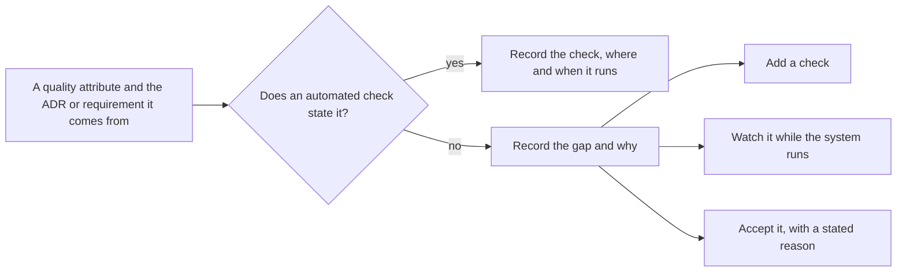

## Bạn cần biết trước

- [[design.l4.quality-attribute-scenarios]] — bạn biết YC-7 dưới dạng một kịch bản: một yêu cầu hoàn tiền, kể cả khi cổng thanh toán đang lỗi, được trả lời trong vòng 2 giây.
- [[devops.l2.histograms-and-percentiles]] — bạn biết histogram đếm request vào các bucket theo cận trên `le`, nên một thời gian chỉ đo được chính xác tới mức các cận cho phép.

## Tình huống

Ở stage-4, trước khi bắt đầu phần đa cửa hàng, product owner hỏi bạn mọi điều Đơn Hàng đã hứa có còn giữ được không. Bạn chỉ vào các pull request: lần chạy nào của `ci.yml` cũng xanh. Rồi họ đọc YC-7 trong `refund-requirements.md`: yêu cầu hoàn tiền của khách được trả lời trong vòng 2 giây, kể cả khi cổng thanh toán lỗi. Bạn mở `ci.yml` để chỉ cho họ bước đo 2 giây đó, đọc hết từng job, và không thấy bước nào đo thời gian một yêu cầu hoàn tiền. Những lần chạy xanh không nói gì về YC-7, dù theo hướng nào. Thuộc tính chất lượng nào của Đơn Hàng thật sự có phép kiểm canh giữ, và thuộc tính nào chưa gì canh giữ?

## Khái niệm cốt lõi

- bản đồ thuộc tính — `docs/design/fitness-functions.md`: mỗi dòng là một thuộc tính chất lượng Đơn Hàng phải giữ, kèm ADR hoặc yêu cầu sinh ra nó, phép kiểm canh giữ nó, và phép kiểm đó chạy ở đâu, khi nào.
- khi nào một phép kiểm chạy — sự kiện khởi chạy nó, như một lần push hay một Pod mới. Phép kiểm chỉ nhìn thấy hệ thống đúng ở thời điểm đó.
- một khoảng trống — một thuộc tính chất lượng nhóm phải giữ mà chưa phép kiểm tự động nào canh giữ.
- lựa chọn cho khoảng trống — quyết định duy nhất được ghi cho mỗi khoảng trống: thêm phép kiểm, theo dõi thuộc tính trong lúc hệ thống chạy, hoặc chấp nhận khoảng trống kèm lý do rõ ràng.

## Cơ chế hoạt động



Trong tình huống trên, YC-7 là một thuộc tính chất lượng nằm ở nhánh "no". Câu hỏi phân loại nó không phải "lần chạy có xanh không" mà là "phép kiểm nào phát biểu thuộc tính này".

Bắt đầu từ bên trái với một thuộc tính và nguồn của nó: một ADR, một yêu cầu như YC-7, hoặc một quy tắc như dependency rule của `DonHang.Domain`. Khi có phép kiểm phát biểu nó, bản đồ ghi lại phép kiểm và lúc nó chạy. Dòng của dependency rule ghi `DependencyRuleTests` trong job `test`, ở mỗi lần push và mỗi pull request.

Lúc phép kiểm chạy quyết định nó thấy được gì. Mọi phép kiểm trên bản đồ của Đơn Hàng đều chạy khi có thay đổi: một lần push, một pull request, hoặc một Pod mới. Không phép kiểm nào chạy theo lịch. Vì vậy thứ gì thay đổi bên ngoài code sẽ không ai thấy cho tới thay đổi kế tiếp, hoặc cho tới khi có người chạy `ci.yml` bằng tay. Bước Grype, trình quét lỗ hổng trong job `image`, quét một image lúc image được build. Một lỗ hổng công bố sau lần build đó không nằm trong lần quét nào của image ấy.

Khi không phép kiểm nào phát biểu một thuộc tính, thuộc tính đó đi vào nhánh "no". Bản đồ ghi lý do, và một lựa chọn. YC-7 được thiết kế giữ: api ghi nhận yêu cầu hoàn tiền và trả `202` ngay, không chờ cổng thanh toán, nên cổng chậm hay lỗi cũng không làm câu trả lời chậm lại. Nhưng không phép kiểm nào đo 2 giây đó ở mỗi thay đổi, nên nhóm theo dõi nó thay vì kiểm: Prometheus của staging tính S4 trong `slo.md`, tức tỷ lệ yêu cầu hoàn tiền được trả lời trong bucket `le="2.048"`, cận bucket gần nhất phía trên 2 giây.

## Trong hệ thống Đơn Hàng

Những gì khởi chạy mọi phép kiểm trong workflow:

```yaml file=.github/workflows/ci.yml tag=stage-4 lines=1-9
name: ci

on:
  push:
    # A Dependabot branch always has its pull request, which runs ci.yml
    # already; running it for the push as well would only do it twice.
    branches-ignore: ['dependabot/**']
  pull_request:
  workflow_dispatch:
```

Dòng 3–9 liệt kê mọi sự kiện khởi chạy `ci.yml`: push lên bất kỳ nhánh nào trừ nhánh của Dependabot, một pull request, và `workflow_dispatch`, tức có người chạy workflow bằng tay. Không có trigger `schedule`, nên không job nào trong file này chạy chỉ vì thời gian trôi qua. Phép kiểm duy nhất nằm ngoài workflow, admission policy `require-image-digest`, chạy khi một Pod được tạo: đó là một sự kiện, không phải thời gian trôi qua.

Phần của bản đồ liệt kê những gì chưa gì canh giữ:

```markdown file=docs/design/fitness-functions.md tag=stage-4 lines=53-77
### Chưa có phép kiểm tự động

Mỗi dòng ghi một lựa chọn: thêm phép kiểm, theo dõi, hoặc chấp nhận kèm lý do.
Ghi ra để khoảng trống được biết, không bị tưởng là đã có phép kiểm.

| Thuộc tính | Nguồn | Vì sao chưa có | Lựa chọn |
|---|---|---|---|
| Yêu cầu hoàn tiền được trả lời trong 2 giây | YC-7 của `docs/team/refund-requirements.md` | Thiết kế giữ nó (api trả `202` mà không gọi cổng thanh toán), nhưng không phép kiểm nào đo 2 giây theo mỗi thay đổi | Theo dõi bằng S4 trong `slo.md` và alert `RefundRequestsFastBurn`, `RefundRequestsSlowBurn` trên staging |
| Image đang chạy không mang lỗ hổng công bố sau khi build | TT-5 của `docs/team/compliance-controls.md` | Grype chỉ quét lúc build; không có lần quét theo lịch. Dependabot mở pull request mỗi tuần, nhưng chỉ khi có bản mới của một phụ thuộc | Chấp nhận tới khi có production: lab và staging không giữ dữ liệu khách thật. Xem lại khi production nhận khách |
| Mỗi service chỉ đọc và ghi database của mình | Nguyên tắc NT1, `data-ownership.md` | `ModuleBoundaryTests` không thấy kết nối database | Chấp nhận kèm lý do: `backend-review-checklist.md` hỏi câu này ở mỗi review; role riêng cho từng service (mục "Sau đó" của `docs/team/roadmap.md`) sẽ chặn ở database |
| Một cửa hàng không đọc được dữ liệu cửa hàng khác | CH-1; ADR 0013 | Chưa có code đa cửa hàng ở stage-4 | Thêm phép kiểm khi xây row-level security (release 3 của `multi-shop-data-rollout.md`): một truy vấn quên lọc cửa hàng vẫn không thấy dòng của cửa hàng khác |
| Một cửa hàng đông không làm cửa hàng khác bị từ chối | CH-3; ADR 0016; `multi-shop-architecture-review.md` | Giới hạn theo cửa hàng chưa xây: `Program.cs` giữ giới hạn chung | Thêm phép kiểm khi xây, như `RateLimitTests` nhưng theo cửa hàng |
| Trải nghiệm trên máy khách: phiên không lỗi, thời gian tới màn hình đầu tiên, đơn kẹt trong hàng đợi offline | A1–A3 của `app-experience.md` | App chưa gửi số đo nào | Theo dõi bằng dashboard khi app gửi số đo (`app-experience.md`, mục Khoảng trống) |
| Thuộc tính của ADR 0026–0033 (database riêng cho cửa hàng lớn, thông báo nhiều kênh, đối soát hoàn tiền, ký bảng kê, tìm sản phẩm, báo cáo, chat hỗ trợ, cửa hàng tự đăng ký) | ADR 0026–0033 | Các ADR này chưa xây ở stage-4, nên chưa có gì để kiểm | Thêm phép kiểm cùng lúc xây: mỗi ADR khi được xây thêm phép kiểm cho thuộc tính nó giữ, hoặc thêm một dòng ở đây kèm lựa chọn |

### Khi nào sửa danh sách

- Khi thêm, đổi hay bỏ một phép kiểm hoặc một job trong `ci.yml`.
- Khi một ADR mới đặt ra một thuộc tính phải giữ, hoặc khi một ADR ở bảng
  trên được xây.
- Mỗi quý, cùng lần xem lại `docs/team/architecture-governance.md`: dòng nào ở
  mục "Chưa có" đã đổi lựa chọn.

Một phép kiểm tốn công giữ hơn rủi ro nó che thì không đáng tự động hóa. Lựa
chọn đó cũng ghi ở mục "Chưa có", để không bị đọc là bỏ sót.
```

Dòng 55–56 nêu quy tắc: mỗi dòng ghi một lựa chọn, để khoảng trống được biết đến thay vì bị tưởng là đã có phép kiểm. Mỗi dòng từ 60 tới 66 ghi thuộc tính, nguồn của nó, vì sao chưa có phép kiểm, và lựa chọn. Dòng 60 là YC-7, được theo dõi qua S4 trên staging. Hai tên sau S4 là các cảnh báo dựng trên staging cho S4, bài này không cần tới. Dòng 61 là trường hợp lỗ hổng: Grype chỉ quét lúc build, và nhóm chấp nhận khoảng trống đó tới khi có production, vì cả staging lẫn lab, môi trường chạy trên máy mà `scripts/up.sh` dựng lên, đều không giữ dữ liệu của khách thật. Dòng 62 chấp nhận một khoảng trống khác. Lý do là `backend-review-checklist.md` hỏi câu này ở mỗi review, và dòng này ghi rằng role database riêng cho từng service sẽ lấp khoảng trống sau này. Dòng 63–64 thêm phép kiểm khi code đa cửa hàng mà chúng sẽ kiểm được xây, dòng 65 theo dõi trải nghiệm của app khi app gửi số đo, và dòng 66 thêm phép kiểm cho từng ADR sau này khi ADR đó được xây.

Dòng 70–74 nói khi nào bản đồ thay đổi: cùng với một phép kiểm hay một job, cùng với một ADR, và mỗi quý một lần. Dòng 76–77 nêu quy tắc đứng sau mọi lựa chọn "chấp nhận": một phép kiểm tốn công giữ hơn rủi ro nó che thì không đáng tự động hóa, và ghi điều đó ra giúp nó không bị trông như một chỗ bỏ sót.

## Đánh đổi

| Lựa chọn cho khoảng trống | Khi nào vấn đề lộ ra | Chi phí duy trì | Cần có gì trước | Ở Đơn Hàng |
|---|---|---|---|---|
| Thêm phép kiểm | ngay trong thay đổi gây ra nó | code của phép kiểm, phải sửa theo hệ thống, cộng thời gian chạy ở mỗi thay đổi | thuộc tính được phát biểu đủ chính xác để máy kiểm được | các cửa hàng không đọc dữ liệu của nhau, khi row-level security được xây |
| Theo dõi trong lúc hệ thống chạy | sau khi thay đổi đã chạy ở đâu đó | số đo, và người chịu nhìn vào chúng | một môi trường đang chạy sinh ra các số đo đó | YC-7 qua S4 trên staging |
| Chấp nhận kèm lý do rõ ràng | chỉ khi có người xem lại, hoặc khi có sự cố | không tốn gì thường xuyên, nhưng rủi ro vẫn còn | một lý do cả nhóm đồng ý là đúng, và một mốc để xem lại | lỗ hổng công bố sau lần build, tới khi production nhận khách |

Phép kiểm bắt được vấn đề sớm nhất, nhưng chỉ với điều nó phát biểu, và chỉ khi có thay đổi khởi chạy nó. Theo dõi thì thấy hệ thống đang chạy, kể cả những gì đổi mà không cần đổi code, nhưng chỉ thấy sau khi chuyện đã xảy ra. Chấp nhận không tốn gì cho tới khi lý do không còn đúng, vì thế mỗi dòng được chấp nhận đều ghi khi nào cần xem lại.

## Bạn sẽ chọn gì nếu…

…một ADR mới đặt ra một thuộc tính phát biểu được chính xác, như một module không dùng module khác? Hãy thêm phép kiểm, chạy ở mỗi thay đổi, ngay trong phần việc xây quyết định đó.

…thuộc tính là một thời gian đo trên hệ thống đang chạy, như YC-7? Nếu phép kiểm ở mỗi thay đổi cần một hệ thống đang chạy và thời gian đo ổn định, thì theo dõi nó ngay nơi nó xảy ra có thể là lựa chọn rẻ hơn. Dù chọn gì, hãy giữ dòng đó trên bản đồ, để ai cũng thấy CI không canh giữ thuộc tính này.

…production bắt đầu nhận khách thật? Dòng chấp nhận cho lỗ hổng công bố sau lần build ghi đúng thời điểm này là mốc xem lại. Lý do "không có dữ liệu khách thật" không còn đúng, nên phải chọn lại. Một phép kiểm khởi chạy theo thời gian, không theo thay đổi, mới là loại thấy được lỗ hổng công bố sau lần build.

## Senior hay nhầm rằng…

- **"Mọi thuộc tính chất lượng đều phải được kiểm tự động ở mỗi commit."** → Thực ra có thuộc tính mà kiểm ở mỗi thay đổi tốn hơn rủi ro nó che, và có thuộc tính, như YC-7, nói về hệ thống đang chạy. Bản đồ ghi theo dõi hay chấp nhận như một lựa chọn. Bạn sẽ nhận ra niềm tin này khi một test đo thời gian hay fail trên runner chậm trở thành flaky test và bị lặng lẽ tắt đi, để lại thuộc tính không có phép kiểm, cũng không có dòng nào trên bản đồ.
- **"CI xanh thì mọi thuộc tính chất lượng hệ thống cần đều đang được kiểm."** → Thực ra xanh chỉ nghĩa là các phép kiểm trên bản đồ đã pass với thay đổi này. YC-7 không có bước nào trong `ci.yml`, và một lỗ hổng công bố sau lần build thì không phép kiểm nào thấy. Bạn sẽ nhận ra niềm tin này khi có khiếu nại về một điều mà lần chạy nào cũng pass.
- **"Thuộc tính chất lượng không có phép kiểm tự động thì không hẳn là yêu cầu."** → Thực ra YC-7 là yêu cầu do product owner đặt ra, thiết kế giữ nó, và nhóm theo dõi nó. Thiếu phép kiểm là một lựa chọn đã ghi lại, không phải một lần hạ cấp. Bạn sẽ nhận ra niềm tin này khi một dòng khoảng trống bị xóa vì "đằng nào cũng chẳng có gì kiểm nó", và từ đó không ai giữ thuộc tính ấy nữa.

## Thử ngay (3 phút)

Mở `docs/design/fitness-functions.md` và `.github/workflows/ci.yml` trong repo `don-hang` ở tag `stage-4`. Với mỗi thuộc tính, ghi phép kiểm và lúc nó chạy, hoặc ghi "khoảng trống" kèm lựa chọn đã ghi:

1. Catalog chỉ công khai contract `ICatalog` của nó.
2. Image đang chạy không mang lỗ hổng nào công bố sau khi nó được build.
3. Yêu cầu hoàn tiền được trả lời trong vòng 2 giây.
4. Mỗi service chỉ đọc và ghi database của mình.

Sau đó đánh dấu những thuộc tính có thể thôi đúng dù không ai đổi gì trong repo, và nói thứ gì, nếu có, sẽ thấy điều đó.

Kết quả mong đợi: bốn dòng, một dòng nêu tên phép kiểm và lúc nó chạy, ba dòng ghi "khoảng trống" kèm lựa chọn, và hai trong số đó được đánh dấu.

<details><summary>Gợi ý đáp án</summary>

1. `ModuleBoundaryTests` (`CatalogMakesPublicOnlyItsContract`), job `test`, ở mỗi lần push và pull request.
2. Khoảng trống: chấp nhận tới khi production nhận khách, vì lab và staging không giữ dữ liệu của khách thật. Đánh dấu: một lỗ hổng mới có thể được công bố bất cứ lúc nào, và không gì thấy nó. Khoảng trống này đã được chấp nhận.
3. Khoảng trống: theo dõi qua S4 trong `slo.md` trên staging. Đánh dấu: thời gian được đo trên hệ thống đang chạy, có thể thay đổi mà không cần commit nào. S4 trên staging thấy được điều đó.
4. Khoảng trống: chấp nhận kèm lý do. `backend-review-checklist.md` hỏi câu này ở mỗi review, và role riêng cho từng service sẽ chặn nó sau này.

</details>

## Liên hệ

- [[design.l4.fitness-functions]] — từng phép kiểm một. Bài này đặt chúng cạnh nhau để tìm ra chỗ còn thiếu.
- [[design.l4.quality-attribute-scenarios]] — cách phát biểu chính xác một thuộc tính, điều mà phép kiểm, hay một số đo, cần có.
- [[devops.l2.histograms-and-percentiles]] — vì sao S4 đo theo bucket `le="2.048"` chứ không đúng 2 giây.
- [[devops.l3.vulnerability-scanning]] — lần quét chạy lúc build, để lại khoảng trống cho các lỗ hổng công bố sau đó.
- [[devops.l3.restore-testing]] — một phép kiểm phải chạy theo lịch, vì thứ nó canh giữ có thể hỏng mà không cần đổi code.
- [[design.l4.trade-off-points]] — tiếp theo: những quyết định mà giữ thuộc tính này thì phải trả bằng thuộc tính khác.

## Tóm tắt 5 dòng

1. Liệt kê mỗi thuộc tính chất lượng cạnh phép kiểm canh giữ nó sẽ cho thấy thuộc tính nào chưa gì canh giữ.
2. `fitness-functions.md` ghi nguồn của mỗi thuộc tính, phép kiểm của nó, và phép kiểm đó chạy ở đâu, khi nào.
3. Mọi phép kiểm của Đơn Hàng chạy khi có thay đổi, không cái nào chạy theo lịch, nên thứ đổi bên ngoài code không ai thấy.
4. Mỗi khoảng trống có một lựa chọn được ghi lại: thêm phép kiểm, theo dõi thuộc tính trong lúc hệ thống chạy, hoặc chấp nhận kèm lý do.
5. Phép kiểm tốn công giữ hơn rủi ro nó che thì không đáng tự động hóa. Ghi điều đó ra giúp nó không bị trông như một chỗ bỏ sót.
