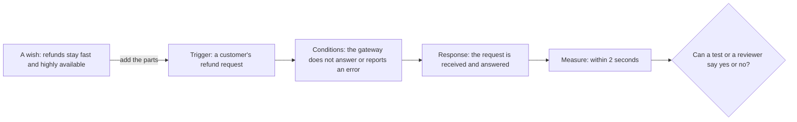

## Before you start

- [[design.l4.fitness-functions]] — you know that a fitness function checks a stated condition on every change, and sees only what it states.
- [[management.l2.non-functional-requirements]] — you know that YC-7 to YC-10 say how well refunds must work, and that each names a case and a measure.
- [[backend.l3.payments-service]] — you know that at stage-3 `DonHang.Payments` alone calls the payment gateway, the outside service that moves the money.

## The situation

At stage-3 a teammate opens a pull request that changes how refunds reach `DonHang.Payments`. The description says: "Refunds stay fast and highly available." A second teammate comments that the change makes refunds slower whenever the gateway is down. The first replies that it does not, and the thread grows for two days. Nobody can settle it, because nobody can say fast for which request, while what is failing, or measured how. In the same repository, nobody argues about YC-7, because anyone can test it. What does YC-7 have that "fast and highly available" lacks?

## Core concepts

- **quality attribute scenario** — one quality requirement stated as a situation that can be checked: what triggers it, under which conditions, what the system must do, and how that response is measured.
- trigger — the event that starts the scenario, such as a customer sending a refund request.
- conditions — what is true of the system and its surroundings when the trigger arrives, such as the gateway not answering.
- required response — what the system must do about the trigger, such as receive the request and answer it.
- measure — the number or the yes-or-no test that says whether the response was good enough, such as "within 2 seconds".

## How it works



In the situation above, "fast and highly available" is the box on the left: a wish. It names quality attributes, speed and staying usable, but no event, no circumstance and no number. Each teammate fills those gaps with a different picture, so both can be right in their own heads.

Read the diagram from the left. The trigger says which event the requirement is about: not every request, but a customer's refund request. The conditions say what is going on when it arrives: the gateway is silent or failing, which is exactly the case the two teammates disagree about. The required response says what the system must do: receive the request and answer it, not complete the refund. The measure says how good that response must be: within 2 seconds.

With all four parts, the question at the right has an answer. A tester can stop the gateway, send a refund request and time the answer. A reviewer can read a design and ask whether anything inside the customer's request waits for the gateway. In the situation, the pull request either keeps YC-7 or breaks it, and the thread can end.

Real requirements rarely label their parts, and the parts are not always four separate phrases. What matters is that each part can be found. A missing part is where the arguments start.

## In the Đơn Hàng system

The requirements the situation points to:

```markdown file=docs/team/refund-requirements.md tag=stage-3 lines=41-50
## Yêu cầu phi chức năng

- YC-7: Yêu cầu hoàn tiền của khách được nhận và trả lời trong 2 giây, kể cả
  khi cổng thanh toán không trả lời hoặc báo lỗi.
- YC-8: Mỗi yêu cầu hoàn tiền lưu người yêu cầu và thời điểm yêu cầu; hai thông
  tin này không bị sửa hay xóa về sau, để kế toán đối soát.
- YC-9: Một đơn không bao giờ được hoàn tiền hai lần, kể cả khi việc gửi sang
  cổng thanh toán phải thử lại.
- YC-10: Khi cổng thanh toán lỗi, yêu cầu được gửi lại tự động trong ít nhất 24
  giờ trước khi chuyển cho nhân viên xử lý.
```

YC-7 (lines 43–44) is already a scenario. Trigger: a customer's refund request. Conditions: the payment gateway does not answer or reports an error. Response: the request is received and answered. Measure: within 2 seconds.

YC-10 (lines 49–50) is another. Here the trigger and the conditions share one phrase: the gateway fails when a refund is sent to it. Response: the request is sent again automatically, and only then handed to staff. Measure: at least 24 hours of automatic sending before that handover.

YC-8 and YC-9 have the same shape with a yes-or-no measure. YC-8: trigger, a refund request arrives; response, who asked and when are stored; measure, neither is ever changed or deleted later. YC-9: when sending to the gateway has to be retried, an order is still never refunded twice. The measure is a count that must never exceed one.

The same lines served a second use when the team chose a design:

```markdown file=docs/adr/0003-tach-payments-thanh-service.md tag=stage-3 lines=11-17
### Bối cảnh

Hoàn tiền phải đáp ứng `docs/team/refund-requirements.md`: nhận yêu cầu trong
2 giây kể cả khi cổng thanh toán lỗi (YC-7), không hoàn hai lần (YC-9), tự
gửi lại trong 24 giờ (YC-10). Khóa API của cổng và các dòng tiền là phần nhạy
cảm nhất của hệ thống. Ở thiết kế bản 1, mọi bản sao của `DonHang.Api` đều giữ
khóa đó và đọc ghi được bảng `payments`.
```

The context of ADR `0003` opens by restating YC-7, YC-9 and YC-10 (lines 13–15), before any option is listed. Lines 15–17 add a security concern in plain words: the gateway's key and the money records sat in every copy of `DonHang.Api`.

One scenario serves several later uses because each needs to know exactly what must hold. Comparing designs needs a case to run each design through. A fitness function needs a condition it can state and check. An architecture review, later in this module, walks through scenarios one by one.

## Trade-offs

| How the need is written | Cost to write | Can designs be compared against it? | Can a check be written from it? | What goes wrong |
|---|---|---|---|---|
| A wish: "refunds must be fast" | a minute | no, each reader fills in a case and a number | no | arguments with no end; the real need shows up only after release, when real customers hit it |
| A scenario: trigger, conditions, response, measure | a conversation with whoever owns the need, to agree the case and the number | yes | yes: it says what to set up and what to compare | the number can be precise and still wrong, if nobody who owns the need agreed to it |
| A scenario for every case anyone can imagine | many such conversations, and a long list to keep current | yes, but slowly | yes, many checks | the scenarios that matter drown among those that do not |

A scenario costs agreement up front: someone must decide the number, and that is a decision, not a fact you look up. That cost is worth paying when a design choice depends on the answer, as YC-7 did for refunds. When no choice depends on it yet, a short wish written down as a known gap can wait.

## What would you choose if…

…a stakeholder asks that refunds be "highly available"? Ask the scenario's questions: available for which request, while what is failing, and measured how. Each answer you get is one scenario. YC-7 is already the answer for the gateway-down case; write new ones only for cases it does not cover.

…nobody can give the number yet? Write the trigger, the conditions and the response now, and record the missing measure as an open question with the person who will answer it. `refund-requirements.md` keeps such a table after YC-10, outside this excerpt.

…two scenarios ask for things that pull against each other? Keep both as written, and name the conflict instead of quietly weakening one. How to reason about such a conflict is a later lesson in this module, [[design.l4.trade-off-points]].

## Seniors often assume…

- **"A requirement like 'the system must be highly available' is precise enough to design against."** → Actually it names an attribute, not a need: it has no trigger, no conditions and no measure, so every design meets it in its author's eyes. You notice this belief when a discussion of a design ends in opinions, as the pull request thread in the situation did.
- **"A quality attribute scenario is just a user story under another name."** → Actually a user story says what a user wants to do and why, which is a feature. A scenario says how well the system must respond in a stated case, often while something around it fails, and gives a measure. No customer asks for "a refund while the gateway is down"; YC-7 still has to hold then. You notice this belief when every story's acceptance criteria cover the normal path, and nobody owns the gateway-down case.
- **"Only speed can be written as a measurable requirement; security or ease of change cannot."** → Actually YC-8 is about records that must stay intact for accounting, and its measure is yes-or-no: who asked and when are never changed or deleted. Ease of change can be given a measure too, for example how many services one kind of change touches. You notice this belief when a design document gives speed a number and leaves security and ease of change as adjectives, so only speed ever gets checked.

## Try it (3 minutes)

Open `docs/team/refund-requirements.md` in the `don-hang` repository at tag `stage-3`.

1. Write the four parts of YC-9: trigger, conditions, required response, measure. If two parts share one phrase, say so.
2. Rewrite this wish as one scenario: "Placing an order must be highly available."

Expected result: four labelled parts for YC-9, and one sentence for step 2 in which you can point to a trigger, a condition, a response and a measure.

<details><summary>Suggested answer</summary>

1. YC-9 — trigger and conditions share one phrase: a refund is being sent to the gateway and the sending has to be retried. Required response: the order is refunded. Measure: never more than once per order, a count that must stay at one or below.
2. Something like: "When a signed-in customer places an order while `DonHang.Notifications` (the service that sends order emails) is stopped, the order is accepted and answered with `201` (created), in every such attempt." Here the measure is yes-or-no: every attempt must succeed; a time such as "within 2 seconds" would be another valid measure. Your trigger, condition or number may differ; what matters is that a tester could set up the condition and say yes or no.

</details>

## Connections

- [[management.l2.non-functional-requirements]] — the same requirements one level down: there a case and a measure, here four named parts and the uses they serve.
- [[design.l4.fitness-functions]] — prerequisite: a fitness function can only check what a scenario states exactly.
- [[management.l2.requirements-document]] — the document that holds these scenarios, and its open-questions table for a measure nobody can give yet.
- [[backend.l3.saga-in-progress-status]] — the `refunding` status an order holds while the refund saga runs, the window in which YC-9 and YC-10 must hold.
- [[design.l4.trade-off-points]] — later in this module: what to do when helping one scenario hurts another.
- [[design.l4.mapping-fitness-functions]] — next: listing each scenario next to the check that guards it, to find the ones nothing guards.

## Five-line summary

1. A quality attribute scenario states one quality requirement as a checkable situation: trigger, conditions, required response and measure.
2. YC-7 already has that shape: a refund request, while the gateway fails, is received and answered within 2 seconds.
3. YC-10 is another: when the gateway fails, the request is sent again automatically for at least 24 hours before staff take over.
4. "The system must be fast" is a wish, not a scenario; adding the trigger, conditions, response and measure makes it checkable.
5. One scenario serves comparing designs, writing a fitness function and reviewing an architecture, because each needs to know exactly what must hold.
