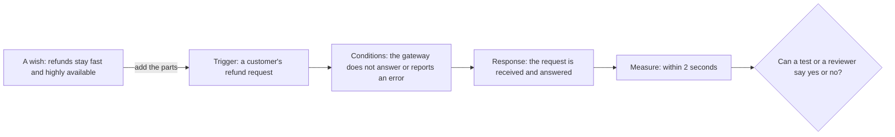

## Bạn cần biết trước

- [[design.l4.fitness-functions]] — bạn biết fitness function kiểm một điều kiện đã phát biểu ở mỗi thay đổi, và chỉ thấy đúng điều nó phát biểu.
- [[management.l2.non-functional-requirements]] — bạn biết YC-7 tới YC-10 nói hoàn tiền phải chạy tốt đến mức nào, và mỗi yêu cầu nêu một trường hợp cùng một thước đo.
- [[backend.l3.payments-service]] — bạn biết ở stage-3 chỉ có `DonHang.Payments` gọi cổng thanh toán, dịch vụ bên ngoài thực sự chuyển tiền.

## Tình huống

Ở stage-3, một đồng nghiệp mở pull request thay đổi cách yêu cầu hoàn tiền đi tới `DonHang.Payments`. Phần mô tả ghi: "Hoàn tiền vẫn nhanh và sẵn sàng cao." Một đồng nghiệp khác bình luận rằng thay đổi này làm hoàn tiền chậm đi mỗi khi cổng thanh toán sập. Người thứ nhất trả lời là không, và cuộc tranh luận kéo dài hai ngày. Không ai phân xử được, vì không ai nói được nhanh là cho request nào, trong lúc cái gì đang hỏng, và đo bằng cách nào. Cũng trong repo đó, không ai cãi nhau về YC-7, vì ai cũng kiểm được nó. YC-7 có gì mà "nhanh và sẵn sàng cao" không có?

## Khái niệm cốt lõi

- **kịch bản thuộc tính chất lượng** (quality attribute scenario) — một yêu cầu chất lượng viết thành một tình huống kiểm được: cái gì kích hoạt nó, trong điều kiện nào, hệ thống phải làm gì, và phản hồi đó được đo ra sao.
- tác nhân kích hoạt — sự kiện mở đầu kịch bản, chẳng hạn khách gửi yêu cầu hoàn tiền.
- điều kiện — hệ thống và mọi thứ xung quanh đang ở trạng thái nào khi tác nhân kích hoạt xảy ra, chẳng hạn cổng thanh toán không trả lời.
- phản hồi bắt buộc — điều hệ thống phải làm trước tác nhân đó, chẳng hạn nhận yêu cầu và trả lời.
- thước đo — con số hoặc phép kiểm có/không cho biết phản hồi đã đủ tốt chưa, chẳng hạn "trong 2 giây".

## Cơ chế hoạt động



Trong tình huống trên, "nhanh và sẵn sàng cao" là ô ngoài cùng bên trái: một mong muốn. Nó gọi tên các thuộc tính chất lượng, tốc độ và khả năng luôn dùng được, nhưng không nêu sự kiện nào, hoàn cảnh nào hay con số nào. Mỗi đồng nghiệp tự lấp các chỗ trống đó bằng một hình dung khác nhau, nên trong đầu mỗi người, cả hai đều đúng.

Đọc sơ đồ từ trái sang. Tác nhân kích hoạt cho biết yêu cầu nói về sự kiện nào: không phải mọi request, mà là yêu cầu hoàn tiền của khách. Điều kiện cho biết lúc yêu cầu tới thì chuyện gì đang xảy ra: cổng thanh toán im lặng hoặc đang lỗi, đúng trường hợp hai đồng nghiệp bất đồng. Phản hồi bắt buộc cho biết hệ thống phải làm gì: nhận yêu cầu và trả lời, chứ không phải hoàn tiền xong. Thước đo cho biết phản hồi đó phải tốt đến đâu: trong 2 giây.

Đủ bốn phần thì câu hỏi ở bên phải có câu trả lời. Người kiểm thử có thể tắt cổng thanh toán, gửi một yêu cầu hoàn tiền và đo thời gian trả lời. Người review có thể đọc một thiết kế và hỏi có gì bên trong request của khách phải chờ cổng thanh toán không. Trong tình huống, pull request hoặc giữ được YC-7, hoặc phá nó, và cuộc tranh luận có thể khép lại.

Yêu cầu thật hiếm khi dán nhãn cho từng phần, và các phần cũng không phải lúc nào cũng là bốn cụm từ riêng. Điều quan trọng là tìm ra được từng phần. Phần nào thiếu thì tranh cãi bắt đầu từ đó.

## Trong hệ thống Đơn Hàng

Các yêu cầu mà tình huống nhắc tới:

```markdown file=docs/team/refund-requirements.md tag=stage-3 lines=41-50
## Yêu cầu phi chức năng

- YC-7: Yêu cầu hoàn tiền của khách được nhận và trả lời trong 2 giây, kể cả
  khi cổng thanh toán không trả lời hoặc báo lỗi.
- YC-8: Mỗi yêu cầu hoàn tiền lưu người yêu cầu và thời điểm yêu cầu; hai thông
  tin này không bị sửa hay xóa về sau, để kế toán đối soát.
- YC-9: Một đơn không bao giờ được hoàn tiền hai lần, kể cả khi việc gửi sang
  cổng thanh toán phải thử lại.
- YC-10: Khi cổng thanh toán lỗi, yêu cầu được gửi lại tự động trong ít nhất 24
  giờ trước khi chuyển cho nhân viên xử lý.
```

YC-7 (dòng 43–44) vốn đã là một kịch bản. Tác nhân kích hoạt: yêu cầu hoàn tiền của khách. Điều kiện: cổng thanh toán không trả lời hoặc báo lỗi. Phản hồi: yêu cầu được nhận và trả lời. Thước đo: trong 2 giây.

YC-10 (dòng 49–50) là một kịch bản khác. Ở đây tác nhân kích hoạt và điều kiện chung một cụm từ: cổng thanh toán lỗi khi một yêu cầu hoàn tiền được gửi sang. Phản hồi: yêu cầu được gửi lại tự động, và chỉ sau đó mới chuyển cho nhân viên. Thước đo: ít nhất 24 giờ tự động gửi lại trước lần chuyển giao đó.

YC-8 và YC-9 có cùng hình dạng, với thước đo dạng có/không. YC-8: tác nhân kích hoạt là một yêu cầu hoàn tiền tới, phản hồi là lưu ai yêu cầu và lúc nào, thước đo là hai thông tin đó không bao giờ bị sửa hay xóa về sau. YC-9: khi việc gửi sang cổng thanh toán phải thử lại, một đơn vẫn không bao giờ bị hoàn tiền hai lần. Thước đo là một số đếm không bao giờ được vượt quá một.

Những dòng này còn được dùng lần thứ hai, khi nhóm chọn thiết kế:

```markdown file=docs/adr/0003-tach-payments-thanh-service.md tag=stage-3 lines=11-17
### Bối cảnh

Hoàn tiền phải đáp ứng `docs/team/refund-requirements.md`: nhận yêu cầu trong
2 giây kể cả khi cổng thanh toán lỗi (YC-7), không hoàn hai lần (YC-9), tự
gửi lại trong 24 giờ (YC-10). Khóa API của cổng và các dòng tiền là phần nhạy
cảm nhất của hệ thống. Ở thiết kế bản 1, mọi bản sao của `DonHang.Api` đều giữ
khóa đó và đọc ghi được bảng `payments`.
```

Phần bối cảnh của ADR `0003` mở đầu bằng cách nhắc lại YC-7, YC-9 và YC-10 (dòng 13–15), trước khi liệt kê bất kỳ phương án nào. Dòng 15–17 thêm một mối lo về bảo mật bằng lời thường: khóa của cổng thanh toán và các bản ghi tiền nằm trong mọi bản sao của `DonHang.Api`.

Một kịch bản phục vụ được nhiều mục đích về sau, vì mục đích nào cũng cần biết chính xác điều gì phải đúng. So sánh các thiết kế cần một trường hợp để đưa từng thiết kế đi qua. Fitness function cần một điều kiện phát biểu và kiểm được. Một buổi đánh giá kiến trúc, ở phần sau của module này, đi qua từng kịch bản một.

## Đánh đổi

| Cách viết nhu cầu | Chi phí để viết | So sánh được các thiết kế với nó không? | Viết được phép kiểm từ nó không? | Chỗ dễ hỏng |
|---|---|---|---|---|
| Một mong muốn: "hoàn tiền phải nhanh" | một phút | không, mỗi người đọc tự điền một trường hợp và một con số | không | tranh cãi không hồi kết, nhu cầu thật chỉ lộ ra sau khi phát hành, khi khách thật gặp phải |
| Một kịch bản: tác nhân kích hoạt, điều kiện, phản hồi, thước đo | một buổi trao đổi với người chịu trách nhiệm về nhu cầu, để thống nhất trường hợp và con số | có | có: nó nói cần dựng gì và so sánh với gì | con số có thể chính xác mà vẫn sai, nếu không ai chịu trách nhiệm về nhu cầu đồng ý với nó |
| Một kịch bản cho mọi trường hợp ai đó nghĩ ra được | rất nhiều buổi trao đổi như thế, và một danh sách dài phải giữ cho cập nhật | có, nhưng chậm | có, nhiều phép kiểm | các kịch bản quan trọng bị chìm giữa những kịch bản không quan trọng |

Kịch bản đòi trả trước bằng sự đồng thuận: phải có người quyết định con số, và đó là một quyết định, không phải một sự thật để tra cứu. Chi phí này đáng bỏ ra khi một lựa chọn thiết kế phụ thuộc vào câu trả lời, như YC-7 với hoàn tiền. Khi chưa lựa chọn nào phụ thuộc vào nó, một mong muốn ngắn, ghi lại như một chỗ hổng đã biết, có thể chờ.

## Bạn sẽ chọn gì nếu…

…một bên liên quan yêu cầu hoàn tiền phải "sẵn sàng cao"? Hãy hỏi các câu hỏi của kịch bản: sẵn sàng cho request nào, trong lúc cái gì đang hỏng, và đo bằng cách nào. Mỗi câu trả lời nhận được là một kịch bản. YC-7 đã là câu trả lời cho trường hợp cổng thanh toán sập, chỉ viết kịch bản mới cho những trường hợp nó chưa bao.

…chưa ai đưa ra được con số? Hãy viết tác nhân kích hoạt, điều kiện và phản hồi ngay bây giờ, rồi ghi thước đo còn thiếu thành một câu hỏi mở, kèm tên người sẽ trả lời. `refund-requirements.md` có một bảng như vậy sau YC-10, nằm ngoài đoạn trích này.

…hai kịch bản đòi những thứ kéo ngược chiều nhau? Giữ nguyên cả hai như đã viết, và gọi tên xung đột thay vì lặng lẽ nới lỏng một bên. Cách lập luận về một xung đột như vậy là một bài sau trong module này, [[design.l4.trade-off-points]].

## Senior hay nhầm rằng…

- **"Một yêu cầu kiểu 'hệ thống phải sẵn sàng cao' là đủ chính xác để thiết kế theo."** → Thực ra nó gọi tên một thuộc tính, chưa phải một nhu cầu: không có tác nhân kích hoạt, không có điều kiện, không có thước đo, nên thiết kế nào cũng đáp ứng nó trong mắt người làm ra thiết kế đó. Bạn sẽ nhận ra niềm tin này khi một cuộc thảo luận về thiết kế kết thúc bằng các ý kiến cá nhân, như cuộc tranh luận trên pull request trong tình huống.
- **"Kịch bản thuộc tính chất lượng chỉ là user story đổi tên."** → Thực ra user story nói người dùng muốn làm gì và để làm gì, tức là một tính năng. Kịch bản nói hệ thống phải phản hồi tốt đến đâu trong một trường hợp đã nêu, thường là lúc có thứ xung quanh nó đang hỏng, và đưa ra một thước đo. Không khách nào yêu cầu "hoàn tiền trong lúc cổng thanh toán sập", vậy mà YC-7 vẫn phải đúng vào lúc đó. Bạn sẽ nhận ra niềm tin này khi acceptance criteria của mọi story chỉ bao đường đi bình thường, và không ai chịu trách nhiệm về trường hợp cổng thanh toán sập.
- **"Chỉ tốc độ mới viết được thành yêu cầu đo được, còn bảo mật hay khả năng dễ sửa đổi thì không."** → Thực ra YC-8 nói về những bản ghi phải giữ nguyên vẹn cho kế toán, và thước đo của nó là có/không: ai yêu cầu và lúc nào không bao giờ bị sửa hay xóa. Khả năng dễ sửa đổi cũng có thể có thước đo, chẳng hạn một loại thay đổi chạm tới bao nhiêu service. Bạn sẽ nhận ra niềm tin này khi một tài liệu thiết kế cho tốc độ một con số, còn để bảo mật và khả năng dễ sửa đổi ở dạng tính từ, nên chỉ có tốc độ là được kiểm.

## Thử ngay (3 phút)

Mở `docs/team/refund-requirements.md` trong repo `don-hang` ở tag `stage-3`.

1. Viết bốn phần của YC-9: tác nhân kích hoạt, điều kiện, phản hồi bắt buộc, thước đo. Nếu hai phần chung một cụm từ, hãy ghi rõ.
2. Viết lại mong muốn này thành một kịch bản: "Đặt đơn phải sẵn sàng cao."

Kết quả mong đợi: bốn phần có nhãn cho YC-9, và một câu cho bước 2 trong đó bạn chỉ ra được tác nhân kích hoạt, điều kiện, phản hồi và thước đo.

<details><summary>Gợi ý đáp án</summary>

1. YC-9 — tác nhân kích hoạt và điều kiện chung một cụm từ: một yêu cầu hoàn tiền đang được gửi sang cổng thanh toán và việc gửi phải thử lại. Phản hồi bắt buộc: đơn được hoàn tiền. Thước đo: không bao giờ quá một lần mỗi đơn, một số đếm phải luôn từ một trở xuống.
2. Đại loại: "Khi một khách đã đăng nhập đặt đơn trong lúc `DonHang.Notifications` (service gửi email đơn hàng) đang dừng, đơn được nhận và trả lời bằng `201` (created), ở mọi lần thử như vậy." Ở đây thước đo là có/không: mọi lần thử đều phải thành công. Một thời gian như "trong 2 giây" cũng là một thước đo hợp lệ khác. Tác nhân kích hoạt, điều kiện hay con số của bạn có thể khác, điều quan trọng là người kiểm thử dựng được điều kiện đó và trả lời được có hoặc không.

</details>

## Liên hệ

- [[management.l2.non-functional-requirements]] — cũng những yêu cầu này ở mức thấp hơn một bậc: ở đó là một trường hợp và một thước đo, ở đây là bốn phần có tên và các mục đích chúng phục vụ.
- [[design.l4.fitness-functions]] — bài tiên quyết: fitness function chỉ kiểm được điều mà một kịch bản phát biểu chính xác.
- [[management.l2.requirements-document]] — tài liệu chứa các kịch bản này, cùng bảng câu hỏi mở cho thước đo chưa ai đưa ra được.
- [[backend.l3.saga-in-progress-status]] — trạng thái `refunding` mà đơn mang trong lúc saga hoàn tiền chạy, khoảng thời gian YC-9 và YC-10 phải đúng.
- [[design.l4.trade-off-points]] — ở phần sau của module này: làm gì khi giúp một kịch bản lại làm hại kịch bản khác.
- [[design.l4.mapping-fitness-functions]] — tiếp theo: liệt kê mỗi kịch bản cạnh phép kiểm canh giữ nó, để tìm ra những kịch bản chưa gì canh giữ.

## Tóm tắt 5 dòng

1. Kịch bản thuộc tính chất lượng phát biểu một yêu cầu chất lượng thành một tình huống kiểm được: tác nhân kích hoạt, điều kiện, phản hồi bắt buộc và thước đo.
2. YC-7 đã có hình dạng đó: một yêu cầu hoàn tiền, trong lúc cổng thanh toán lỗi, được nhận và trả lời trong 2 giây.
3. YC-10 là một kịch bản khác: khi cổng thanh toán lỗi, yêu cầu được tự động gửi lại trong ít nhất 24 giờ trước khi nhân viên tiếp nhận.
4. "Hệ thống phải nhanh" là một mong muốn, chưa phải kịch bản. Thêm tác nhân kích hoạt, điều kiện, phản hồi và thước đo thì nó mới kiểm được.
5. Một kịch bản phục vụ cả so sánh thiết kế, viết fitness function và đánh giá kiến trúc, vì mỗi việc đều cần biết chính xác điều gì phải đúng.
