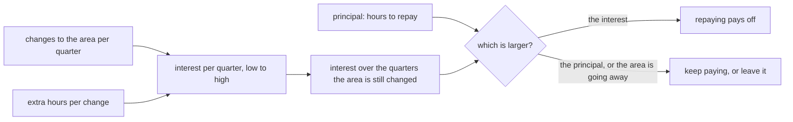

## Before you start

- [[management.l3.debt-as-a-portfolio]] — you know that a debt's interest comes from how often its area changes and what each change costs extra, and that each register row gets one of four decisions.
- [[management.l2.three-point-estimation]] — you know that for work nobody has done before, a range shows how uncertain an estimate is, and a wide gap is information, not a bad estimate.
- [[design.l4.architecture-review-findings]] — you know a review ends in risks with owners and next steps, and that one place a next step can land is the technical debt register.

## The situation

It is sprint planning at stage-4, just after the architecture review, and beside the features the team has room for some debt work. `docs/team/tech-debt-register.md` lists three open debts: N2, the old `payments` table; N3, the ignored `unitPriceVnd` field; N4, the app's hard-coded `localhost`. Each row states its interest in words. N2: readers think the API still keeps the money, though payments moved to their own database; N3: every change to the order DTO must remember a field that does nothing. The person who picks the sprint's stories says: "I can weigh one story against another. I cannot weigh 'readers get confused' against a story."

How do you turn a debt into something the plan can weigh?

## Core concepts

- interest per quarter — the extra hours a debt adds to the changes the team expects to make in its area during one quarter.
- principal — the hours it would take to repay the debt: to reshape the area so later changes stop paying that extra.
- range estimate — a low and a high value, labelled as the team's assumption, written instead of one number.
- break-even comparison — the interest added up over the quarters the area will still be changed, set against the principal.

## How it works



Quantifying a debt means putting two numbers on it, both in hours and both as ranges. The first is interest per quarter: how often the team changes the area, times how much extra each change pays because of the debt. Multiply low end by low end and high end by high end. In the situation above, N2's area is changed 2 to 4 times a quarter at 1 to 3 extra hours each, so its interest is 2 to 12 hours a quarter.

The second number is the principal. For N2 it is a migration that drops the old table, plus removing the table from the test setup, and moving or dropping the queries that still read it: 6 to 10 hours.

Interest is charged again every quarter the area is changed, so add it up over that time and compare the sum with the principal. How many quarters is also the team's assumption, taken from work it already expects: two planned ADRs will touch N2's area for at least four quarters. That costs 8 to 48 hours against a principal of 6 to 10, so repaying pays off.

When the principal is larger, keep paying and write down when to look again. An area about to be removed has few quarters left, so its summed interest usually stays under the principal and leaving it costs less. That is why the diagram's lower exit includes it.

Hours are what lets the person picking stories weigh this. The repayment goes into the plan as a story of its own or a stated share of each sprint, sized from these hours. The ranges show how far a decision depends on which end is right.

## In the Đơn Hàng system

The estimates, added to the register at stage-4:

```markdown file=docs/team/tech-debt-register.md tag=stage-4 lines=22-39
### Ước lượng lãi và gốc

Từ stage-4, mỗi món đang mang có thêm ước lượng bằng giờ, để việc trả nợ được
lập kế hoạch và cân như một story. Mọi số dưới đây là giả định của đội, ghi
thành khoảng thấp–cao vì đó là ước lượng, không phải số đo. Số lần sửa mỗi quý
là ước tính của đội; `scripts/management/change-hotspots.sh` chỉ là một nguồn,
vì lịch sử repo phần lớn là commit dựng bài. Sổ không quy giờ ra tiền; đội nào
muốn thì nhân với chi phí giờ của mình.

Lãi mỗi quý = số lần sửa vùng đó mỗi quý × giờ thêm mỗi lần. Trả nợ có lời khi
lãi cộng lại trong thời gian vùng đó còn được sửa lớn hơn gốc; vùng sắp bỏ thì
để nguyên rẻ hơn.

| Số | Lần sửa mỗi quý | Giờ thêm mỗi lần | Lãi mỗi quý | Gốc | Vùng còn được sửa | Kết luận |
|---|---|---|---|---|---|---|
| N2 | 2–4: mỗi lần chạm database `donhang`, `PostgresFixture` hay truy vấn tiền, và mỗi câu hỏi của kế toán | 1–3 giờ: giải thích bảng nào là thật, kiểm lại truy vấn như `db/queries/revenue-by-customer.sql` còn đọc bảng cũ | 2–12 giờ | 6–10 giờ: migration xóa bảng (dump đã có), bỏ bảng khỏi `PostgresFixture`, chuyển hoặc bỏ truy vấn còn đọc bảng cũ | Ít nhất 4 quý: đối soát (ADR 0028) và báo cáo (ADR 0031) đều sẽ chạm câu hỏi "tiền nằm ở bảng nào" | Trả có lời: 4 quý lãi 8–48 giờ, hơn gốc. Trả ngay khi kế toán xác nhận |
| N3 | 2–3: mỗi lần sửa DTO hay controller đơn | 0,25–0,5 giờ: nhớ field không làm gì, giải thích trong review | 0,5–1,5 giờ | 40–80 giờ: một phiên bản API mới không nhận `unitPriceVnd` (request của `/api/v2/orders` cũng mang field này), chuyển app sang, chờ và theo dõi tới khi client cũ ngừng gọi, rồi ngừng phiên bản cũ | Nhiều năm: đặt đơn là phần sửa nhiều nhất | Chấp nhận: 8 quý lãi 4–12 giờ, vẫn dưới gốc. Xem lại khi `/api/v1` có ngày ngừng, vì khi đó gốc gần như chỉ còn phần sửa code |
| N4 | 1–2: mỗi lần cần chạy app ở địa chỉ khác `localhost` | 1–2 giờ: sửa địa chỉ trong code, build lại, nhớ hoàn tác | 1–4 giờ | 16–24 giờ (2–3 ngày): đọc địa chỉ từ cấu hình lúc build | Lâu dài, nhưng lãi tăng mạnh từ khi app chạy trên cluster: mỗi lần build cho môi trường nào cũng phải sửa | Hôm nay chưa có lời: 4 quý lãi 4–16 giờ, chưa tới gốc. Trả cùng lần đưa app lên cluster, như quyết định ở trên |
```

Lines 24–29 set the rules. Every number is the team's assumption, written low–high because it is an estimate, not a measurement. The changes per quarter are the team's own guess, with `change-hotspots.sh` as only one source, since most commits in the repository were made to set up this course, not by a team changing the system. Hours are never turned into money. Lines 31–33 are the formula and the rule: interest per quarter equals changes per quarter times extra hours per change, and repaying pays off when the summed interest exceeds the principal.

Lines 37–39 apply it. The columns read: changes per quarter, extra hours each time, interest per quarter, principal, how long the area is still changed, conclusion. N3, line 38, is the row these numbers keep accepted, the register's word for keep paying knowingly. Its interest is small, 0.5 to 1.5 hours a quarter: remembering a field that does nothing during a change or a review. Its principal is 40 to 80 hours, because repaying is not a code edit: it needs a new API version that does not accept `unitPriceVnd` (the request of `/api/v2/orders` still carries it), moving the app over, waiting until old clients stop calling, then retiring the old version. The area is changed for many years, so the register stops the sum at eight quarters, a cut-off the team assumed: 4 to 12 hours, still under the principal.

N4, line 39, does not pay off today either: 4 to 16 hours over four quarters against 16 to 24. It is repaid together with moving the app onto the cluster, because from then on every build for any environment needs the address changed.

## Trade-offs

| How the debt is described | What the team gets | What goes wrong |
|---|---|---|
| In words only, as each register row first states its interest | the cause and the pain, in the team's own language | nothing to weigh against a story; the loudest complaint wins the room in the sprint |
| One number of hours per debt | something to compare with a story | it claims a precision the guess does not have; when one such number is missed, the next one is trusted less |
| A low–high range of hours, labelled as assumptions | a comparison, plus whether the decision holds at both ends | more thought to fill in, and readers may still quote only one end |

Words still matter: the register keeps them beside the hours, because they say what the interest is. Ranges cost a little more to write than one number, and they are the only one of these three that shows whether a decision depends on the guess. N3's does not: even the high end of eight quarters' interest, 12 hours, is far below the low end of its principal, 40. N2's ranges overlap at one corner, 8 hours of interest against up to 10 of principal, so its decision rests a little more on the assumptions. A single number would hide both facts.

## What would you choose if…

…`/api/v1` gets an end date? Recompute N3. The row itself says that the principal then shrinks to almost only the code change. It does not say how, and `/api/v2/orders` carries the field too, so list what the new principal still covers before trusting it. The interest does not change, because an end date does not change how often the order DTO is edited. If eight quarters of interest now exceed the recomputed principal, N3 moves from accepted to repaid.

…the app is about to move onto the cluster? Estimate N4's changes per quarter again first: from then on, every build for an environment is one. Then repay it together with that move, as the register decided, instead of paying the higher interest from the first build onwards.

…leadership asks what the debt costs in money? Give the hours, and let the team multiply by its own hourly cost, as the register says. A price taken from outside the team adds a number nobody in the room can check.

## Seniors often assume…

- **"Technical debt can only be described in words; it cannot be measured at all."** → Actually its interest and principal can be estimated in hours, from two things the team already knows roughly: how often an area changes and what each change costs extra. Đơn Hàng's register keeps the words and adds the hours beside them, calling them estimates, not measurements. You notice this belief when debt work loses every planning discussion, because "the code is confusing" has nothing to weigh.
- **"One exact number for a debt's cost is more trustworthy than a range."** → Actually one exact number claims a precision the guess does not have, and hides whether the decision depends on it. N3's ranges show its decision holds at both ends; N2's show where it leans on the assumptions. You notice this belief when a single estimate is missed and the team stops trusting debt estimates altogether.
- **"The debt that would take longest to repay is the most urgent one to repay."** → Actually urgency comes from the interest over the time left against the principal, and a large principal argues for waiting. N3 has the largest principal in the register and stays accepted; N2 has the smallest and pays off. You notice this belief when a sprint goes into one large repayment while a cheap one keeps charging every change.

## Try it (3 minutes)

Use the table above, lines 37–39.

1. Suppose the app has moved onto the cluster, and the team now changes N4's area 8 to 10 times a quarter, still at 1 to 2 extra hours each. Compute N4's interest per quarter and over four quarters, then compare it with N4's principal.
2. Order N2, N3 and N4 by principal, largest first. Then say which of them pays off today. Does the largest principal come first?

Expected result: for step 1, two ranges in hours and a yes or no; for step 2, one order and one answer.

<details><summary>Suggested answer</summary>

1. 8 × 1 = 8 and 10 × 2 = 20, so 8 to 20 hours a quarter and 32 to 80 hours over four quarters. Even the low end is above the high end of the principal, 24 hours, so repaying pays off at both ends. The 8 to 10 changes are assumed for this exercise; the register gives 1 to 2 for today.
2. By principal: N3 (40–80), N4 (16–24), N2 (6–10). Only N2 pays off today; N3, with the largest principal, stays accepted. The largest principal does not come first.

</details>

## Connections

- [[management.l3.debt-as-a-portfolio]] — prerequisite: the four decisions and the interest factors that these hours make comparable.
- [[management.l2.three-point-estimation]] — the same habit of giving a range for uncertain work, here with two ends instead of three values.
- [[design.l4.architecture-review-findings]] — where a review's next steps can add rows that this lesson then puts hours on.
- [[management.l3.technical-debt-register]] — the register whose rows this lesson adds hours to.
- [[management.l2.schedule-buffer]] — the same rule applied to the plan: time for uncertainty shown where everyone sees it, not hidden in each estimate.

## Five-line summary

1. Quantifying a debt estimates, in hours and as a range, the interest it charges per quarter and the principal it takes to repay.
2. Interest per quarter is the expected changes to the area in a quarter times the extra hours each change pays.
3. Repaying pays off when interest over the time the area is still changed exceeds the principal; an area going away is left.
4. Đơn Hàng's register repays N2, keeps N3 accepted because it needs a new API version, and repays N4 with the cluster move.
5. Hours let a repayment be planned like a story; ranges labelled as assumptions keep the numbers from claiming false precision.
