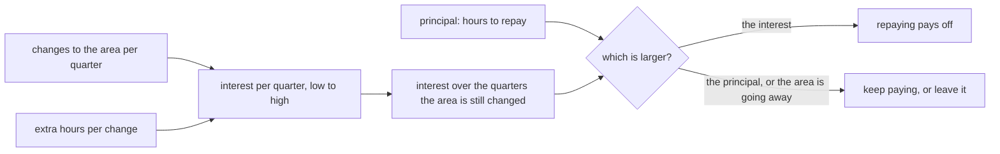

## Bạn cần biết trước

- [[management.l3.debt-as-a-portfolio]] — bạn biết tiền lãi của một món nợ đến từ việc vùng đó được sửa thường xuyên đến đâu và mỗi lần sửa tốn thêm bao nhiêu, và biết mỗi dòng trong sổ nhận một trong bốn quyết định.
- [[management.l2.three-point-estimation]] — bạn biết với việc chưa ai làm bao giờ, một khoảng cho thấy ước lượng bất định đến đâu, và khoảng rộng là thông tin chứ không phải ước lượng tồi.
- [[design.l4.architecture-review-findings]] — bạn biết một buổi đánh giá kết thúc bằng các rủi ro có người chịu trách nhiệm và bước tiếp theo, và một nơi bước tiếp theo có thể đến là sổ nợ kỹ thuật.

## Tình huống

Đang là buổi sprint planning ở stage-4, ngay sau buổi đánh giá kiến trúc, và bên cạnh các feature đội còn chỗ cho một ít việc trả nợ. `docs/team/tech-debt-register.md` có ba món nợ đang mở: N2, bảng `payments` cũ. N3, field `unitPriceVnd` bị bỏ qua. N4, `localhost` viết cứng trong app. Mỗi dòng ghi tiền lãi bằng lời. N2: người đọc tưởng API vẫn giữ tiền, dù thanh toán đã chuyển sang database riêng. N3: lần sửa DTO đơn hàng nào cũng phải nhớ một field chẳng làm gì. Người chọn story cho sprint nói: "Tôi cân được story này với story kia. Tôi không cân được 'người đọc bị rối' với một story."

Làm sao biến một món nợ thành thứ mà kế hoạch cân được?

## Khái niệm cốt lõi

- lãi mỗi quý — số giờ thêm mà một món nợ cộng vào các lần sửa đội dự kiến làm ở vùng đó trong một quý.
- gốc — số giờ cần để trả món nợ: sửa lại hình dạng vùng đó để các lần sửa sau thôi phải trả phần thêm ấy.
- ước lượng dạng khoảng — một giá trị thấp và một giá trị cao, ghi rõ là giả định của đội, viết thay cho một con số.
- phép so điểm hòa vốn — tiền lãi cộng lại qua những quý vùng đó còn được sửa, đặt cạnh gốc.

## Cơ chế hoạt động



Lượng hóa một món nợ là gắn cho nó hai con số, cả hai tính bằng giờ và cả hai là khoảng. Số thứ nhất là lãi mỗi quý: đội sửa vùng đó bao nhiêu lần, nhân với số giờ thêm mỗi lần sửa phải trả vì món nợ. Nhân đầu thấp với đầu thấp, đầu cao với đầu cao. Trong tình huống trên, vùng của N2 được sửa 2 đến 4 lần mỗi quý, mỗi lần thêm 1 đến 3 giờ, nên lãi của nó là 2 đến 12 giờ mỗi quý.

Số thứ hai là gốc. Với N2, đó là một migration xóa bảng cũ, cộng với bỏ bảng khỏi phần chuẩn bị test, và chuyển hoặc bỏ các truy vấn còn đọc nó: 6 đến 10 giờ.

Lãi bị tính lại mỗi quý vùng đó còn được sửa, nên hãy cộng nó qua khoảng thời gian ấy rồi so tổng với gốc. Bao nhiêu quý cũng là giả định của đội, lấy từ những việc đội đã dự kiến: hai ADR đã lên kế hoạch sẽ chạm vào vùng của N2 trong ít nhất bốn quý. Như vậy là 8 đến 48 giờ, so với gốc 6 đến 10, nên trả nợ có lời.

Khi gốc lớn hơn, cứ tiếp tục trả lãi và ghi lại khi nào xem lại. Một vùng sắp bị bỏ thì còn ít quý, nên tổng lãi của nó thường nằm dưới gốc, và để nguyên thì rẻ hơn. Vì thế lối ra phía dưới của sơ đồ có cả trường hợp này.

Chính số giờ giúp người chọn story cân được món nợ. Việc trả nợ vào kế hoạch thành một story riêng hoặc một phần nói rõ của mỗi sprint, với kích cỡ lấy từ các số giờ này. Các khoảng cho thấy quyết định phụ thuộc đến đâu vào chuyện đầu nào của khoảng là đúng.

## Trong hệ thống Đơn Hàng

Các ước lượng được thêm vào sổ ở stage-4:

```markdown file=docs/team/tech-debt-register.md tag=stage-4 lines=22-39
### Ước lượng lãi và gốc

Từ stage-4, mỗi món đang mang có thêm ước lượng bằng giờ, để việc trả nợ được
lập kế hoạch và cân như một story. Mọi số dưới đây là giả định của đội, ghi
thành khoảng thấp–cao vì đó là ước lượng, không phải số đo. Số lần sửa mỗi quý
là ước tính của đội; `scripts/management/change-hotspots.sh` chỉ là một nguồn,
vì lịch sử repo phần lớn là commit dựng bài. Sổ không quy giờ ra tiền; đội nào
muốn thì nhân với chi phí giờ của mình.

Lãi mỗi quý = số lần sửa vùng đó mỗi quý × giờ thêm mỗi lần. Trả nợ có lời khi
lãi cộng lại trong thời gian vùng đó còn được sửa lớn hơn gốc; vùng sắp bỏ thì
để nguyên rẻ hơn.

| Số | Lần sửa mỗi quý | Giờ thêm mỗi lần | Lãi mỗi quý | Gốc | Vùng còn được sửa | Kết luận |
|---|---|---|---|---|---|---|
| N2 | 2–4: mỗi lần chạm database `donhang`, `PostgresFixture` hay truy vấn tiền, và mỗi câu hỏi của kế toán | 1–3 giờ: giải thích bảng nào là thật, kiểm lại truy vấn như `db/queries/revenue-by-customer.sql` còn đọc bảng cũ | 2–12 giờ | 6–10 giờ: migration xóa bảng (dump đã có), bỏ bảng khỏi `PostgresFixture`, chuyển hoặc bỏ truy vấn còn đọc bảng cũ | Ít nhất 4 quý: đối soát (ADR 0028) và báo cáo (ADR 0031) đều sẽ chạm câu hỏi "tiền nằm ở bảng nào" | Trả có lời: 4 quý lãi 8–48 giờ, hơn gốc. Trả ngay khi kế toán xác nhận |
| N3 | 2–3: mỗi lần sửa DTO hay controller đơn | 0,25–0,5 giờ: nhớ field không làm gì, giải thích trong review | 0,5–1,5 giờ | 40–80 giờ: một phiên bản API mới không nhận `unitPriceVnd` (request của `/api/v2/orders` cũng mang field này), chuyển app sang, chờ và theo dõi tới khi client cũ ngừng gọi, rồi ngừng phiên bản cũ | Nhiều năm: đặt đơn là phần sửa nhiều nhất | Chấp nhận: 8 quý lãi 4–12 giờ, vẫn dưới gốc. Xem lại khi `/api/v1` có ngày ngừng, vì khi đó gốc gần như chỉ còn phần sửa code |
| N4 | 1–2: mỗi lần cần chạy app ở địa chỉ khác `localhost` | 1–2 giờ: sửa địa chỉ trong code, build lại, nhớ hoàn tác | 1–4 giờ | 16–24 giờ (2–3 ngày): đọc địa chỉ từ cấu hình lúc build | Lâu dài, nhưng lãi tăng mạnh từ khi app chạy trên cluster: mỗi lần build cho môi trường nào cũng phải sửa | Hôm nay chưa có lời: 4 quý lãi 4–16 giờ, chưa tới gốc. Trả cùng lần đưa app lên cluster, như quyết định ở trên |
```

Dòng 24–29 đặt quy tắc. Mọi con số là giả định của đội, ghi dạng thấp–cao vì đó là ước lượng, không phải số đo. Số lần sửa mỗi quý là đội tự ước tính, `change-hotspots.sh` chỉ là một nguồn, vì phần lớn commit trong repo được tạo ra để dựng khóa học này, không phải do một đội đang sửa hệ thống. Giờ không bao giờ được quy ra tiền. Dòng 31–33 là công thức và quy tắc: lãi mỗi quý bằng số lần sửa mỗi quý nhân với số giờ thêm mỗi lần, và trả nợ có lời khi tổng lãi vượt gốc.

Dòng 37–39 áp dụng nó. Các cột lần lượt là: số lần sửa mỗi quý, giờ thêm mỗi lần, lãi mỗi quý, gốc, vùng đó còn được sửa bao lâu, kết luận. N3, dòng 38, là dòng mà các con số này giữ ở trạng thái chấp nhận, chữ sổ dùng cho tiếp tục trả lãi có chủ ý. Lãi của nó nhỏ, 0,5 đến 1,5 giờ mỗi quý: nhớ một field chẳng làm gì trong lúc sửa hay review. Gốc của nó là 40 đến 80 giờ, vì trả món này không phải là sửa code. Nó cần một phiên bản API mới không nhận `unitPriceVnd` (request của `/api/v2/orders` vẫn mang field này), chuyển app sang, chờ tới khi client cũ ngừng gọi, rồi ngừng phiên bản cũ. Vùng đó còn được sửa nhiều năm, nên sổ dừng phép cộng ở tám quý, một mốc cắt do đội giả định: 4 đến 12 giờ, vẫn dưới gốc.

N4, dòng 39, hôm nay cũng chưa có lời: 4 đến 16 giờ qua bốn quý, so với 16 đến 24. Nó được trả cùng lần đưa app lên cluster, vì từ lúc đó mỗi lần build cho môi trường nào cũng phải sửa địa chỉ.

## Đánh đổi

| Món nợ được mô tả thế nào | Đội được gì | Hỏng ở đâu |
|---|---|---|
| Chỉ bằng lời, như cách mỗi dòng trong sổ ghi tiền lãi lúc đầu | nguyên nhân và chỗ đau, bằng chính lời của đội | không có gì để cân với một story, và lời phàn nàn to nhất giành được chỗ trong sprint |
| Một con số giờ cho mỗi món nợ | một thứ để so với story | nó tỏ ra chính xác hơn mức phỏng đoán có được. Khi một con số như vậy trật, con số kế tiếp ít được tin hơn |
| Một khoảng giờ thấp–cao, ghi rõ là giả định | một phép so, cộng với việc biết quyết định có đứng vững ở cả hai đầu không | tốn thêm công suy nghĩ để điền, và người đọc vẫn có thể chỉ trích dẫn một đầu |

Lời vẫn quan trọng: sổ giữ chúng bên cạnh số giờ, vì chúng nói tiền lãi là gì. Khoảng tốn công viết hơn một con số một chút, và trong ba cách này, đó là cách duy nhất cho thấy quyết định có phụ thuộc vào phỏng đoán hay không. Quyết định của N3 thì không: ngay cả đầu cao của lãi tám quý, 12 giờ, cũng thấp hơn nhiều so với đầu thấp của gốc, 40. Các khoảng của N2 chồng nhau ở một góc, 8 giờ lãi so với tới 10 giờ gốc, nên quyết định của nó dựa vào giả định nhiều hơn một chút. Một con số duy nhất sẽ giấu cả hai điều này.

## Bạn sẽ chọn gì nếu…

…`/api/v1` có ngày ngừng? Tính lại N3. Chính dòng đó nói khi ấy gốc gần như chỉ còn phần sửa code. Nó không nói bằng cách nào, và `/api/v2/orders` cũng mang field này, nên hãy liệt kê gốc mới còn gồm những gì trước khi tin nó. Lãi không đổi, vì một ngày ngừng không làm DTO đơn hàng được sửa thường xuyên hơn hay ít hơn. Nếu lãi tám quý giờ vượt gốc đã tính lại, N3 chuyển từ chấp nhận sang trả nợ.

…app sắp được đưa lên cluster? Trước hết ước lượng lại số lần sửa mỗi quý của N4: từ lúc đó, mỗi lần build cho một môi trường là một lần sửa. Rồi trả nó cùng lần chuyển đó, như sổ đã quyết, thay vì trả mức lãi cao hơn từ lần build đầu tiên trở đi.

…ban lãnh đạo hỏi món nợ tốn bao nhiêu tiền? Đưa số giờ, và để đội tự nhân với chi phí giờ của mình, như sổ đã ghi. Một đơn giá lấy từ bên ngoài đội thêm vào một con số mà không ai trong phòng kiểm được.

## Senior hay nhầm rằng…

- **"Nợ kỹ thuật chỉ mô tả được bằng lời, hoàn toàn không đo được."** → Thực ra tiền lãi và gốc của nó ước lượng được bằng giờ, từ hai điều đội đã biết đại khái: một vùng được sửa thường xuyên đến đâu và mỗi lần sửa tốn thêm bao nhiêu. Sổ của Đơn Hàng giữ lời và thêm số giờ bên cạnh, gọi chúng là ước lượng chứ không phải số đo. Bạn sẽ nhận ra niềm tin này khi việc trả nợ thua trong mọi buổi lập kế hoạch, vì "code khó hiểu" chẳng có gì để cân.
- **"Một con số chính xác cho chi phí món nợ đáng tin hơn một khoảng."** → Thực ra một con số chính xác tỏ ra chính xác hơn mức phỏng đoán có được, và giấu chuyện quyết định có phụ thuộc vào nó hay không. Các khoảng của N3 cho thấy quyết định đứng vững ở cả hai đầu, các khoảng của N2 cho thấy nó dựa vào giả định ở chỗ nào. Bạn sẽ nhận ra niềm tin này khi một ước lượng đơn lẻ bị trật và đội thôi tin hẳn mọi ước lượng về nợ.
- **"Món nợ mất lâu nhất để trả là món cần trả gấp nhất."** → Thực ra độ gấp đến từ tiền lãi trong thời gian còn lại so với gốc, và gốc lớn là lý do để chờ. N3 có gốc lớn nhất trong sổ và vẫn được chấp nhận, N2 có gốc nhỏ nhất và trả có lời. Bạn sẽ nhận ra niềm tin này khi cả một sprint dồn vào một lần trả nợ lớn, trong khi một món rẻ vẫn tiếp tục đòi lãi ở mỗi lần sửa.

## Thử ngay (3 phút)

Dùng bảng ở trên, dòng 37–39.

1. Giả sử app đã lên cluster, và giờ đội sửa vùng của N4 từ 8 đến 10 lần mỗi quý, mỗi lần vẫn thêm 1 đến 2 giờ. Tính lãi mỗi quý của N4 và lãi qua bốn quý, rồi so với gốc của N4.
2. Xếp N2, N3 và N4 theo gốc, lớn nhất trước. Rồi nói món nào trả có lời hôm nay. Gốc lớn nhất có đứng đầu không?

Kết quả mong đợi: với bước 1, hai khoảng tính bằng giờ và một câu có hoặc không. Với bước 2, một thứ tự và một câu trả lời.

<details><summary>Gợi ý đáp án</summary>

1. 8 × 1 = 8 và 10 × 2 = 20, nên 8 đến 20 giờ mỗi quý và 32 đến 80 giờ qua bốn quý. Ngay cả đầu thấp cũng cao hơn đầu cao của gốc, 24 giờ, nên trả nợ có lời ở cả hai đầu. Con số 8 đến 10 lần sửa là giả định cho bài tập này, sổ ghi 1 đến 2 cho hôm nay.
2. Theo gốc: N3 (40–80), N4 (16–24), N2 (6–10). Chỉ N2 trả có lời hôm nay, N3, với gốc lớn nhất, vẫn được chấp nhận. Gốc lớn nhất không đứng đầu.

</details>

## Liên hệ

- [[management.l3.debt-as-a-portfolio]] — bài cần học trước: bốn quyết định và các thừa số của tiền lãi mà những số giờ này giúp so được với nhau.
- [[management.l2.three-point-estimation]] — cùng thói quen đưa ra một khoảng cho việc bất định, ở đây với hai đầu thay vì ba giá trị.
- [[design.l4.architecture-review-findings]] — nơi các bước tiếp theo của một buổi đánh giá có thể thêm dòng mà bài này gắn số giờ vào.
- [[management.l3.technical-debt-register]] — cuốn sổ có các dòng mà bài này thêm số giờ vào.
- [[management.l2.schedule-buffer]] — cùng quy tắc ấy áp vào kế hoạch: thời gian cho phần bất định được ghi ở chỗ ai cũng thấy, không giấu trong từng ước lượng.

## Tóm tắt 5 dòng

1. Lượng hóa một món nợ là ước lượng, bằng giờ và dạng khoảng, tiền lãi nó đòi mỗi quý và gốc cần để trả nó.
2. Lãi mỗi quý là số lần đội dự kiến sửa vùng đó trong một quý nhân với số giờ thêm mỗi lần sửa phải trả.
3. Trả nợ có lời khi lãi trong thời gian vùng đó còn được sửa vượt gốc, còn vùng sắp bỏ thì để nguyên.
4. Sổ của Đơn Hàng trả N2, giữ N3 ở trạng thái chấp nhận vì nó cần một phiên bản API mới, và trả N4 cùng lần chuyển lên cluster.
5. Số giờ cho phép lập kế hoạch trả nợ như một story, và các khoảng ghi rõ là giả định giữ cho con số không tỏ ra chính xác giả.
