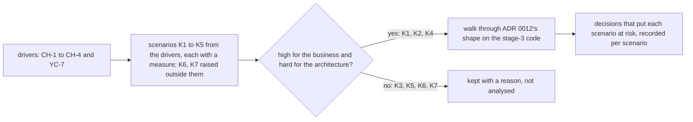

## Before you start

- [[design.l4.trade-off-points]] — you know that a sensitivity point is a decision one quality attribute depends on strongly, and a trade-off point is one that moves two attributes in opposite directions.
- [[design.l4.one-deployment-for-all-shops]] — you know that ADR `0012` serves every shop from one shared deployment, so isolation between shops must be built inside the system, and leaves the data layout to a later ADR.

## The situation

It is the end of Sprint 18. ADR `0012` has just been accepted: every shop will run on one shared deployment, and next sprint the team starts building on it. The product owner, the person who decides what matters most to the business, asks for one thing first: "Is this architecture good? Give it a mark out of ten." The team's chat already holds many worries, from one shop's busy sale day to a customer who shops in two places. Nobody has time to check them all, and a single mark would not tell anyone what to fix. How do you test a chosen architecture against the needs that matter most, before anything is built on it?

## Core concepts

- **ATAM (Architecture Tradeoff Analysis Method)** — a method that evaluates an architecture by walking its most important quality attribute scenarios through it and recording where its decisions put those scenarios at risk.
- reduced form — Đơn Hàng's own shorter way of running it: one session of the team and the product owner, instead of many stakeholders over several sessions.
- ranking twice — giving each scenario two marks, one for how much it matters to the business and one for how hard the architecture makes it.
- walking a scenario through — following one scenario across the parts and decisions it touches and asking whether its measure can still be met.

## How it works



In the situation above, the evaluation does not start from the architecture. It starts from the drivers: the four multi-shop requirements CH-1 to CH-4, plus YC-7 from the refund requirements, because refunds must keep working for every shop. Each requirement becomes one or more quality attribute scenarios with a trigger, a condition, a response and a measure. CH-3, a busy shop must not slow the others, becomes K1: one shop's sale takes 10% of the day's orders, and the other shops must still be served as on a normal day.

Next, every scenario is ranked twice. The product owner marks how much it matters to the business; the team marks how hard the architecture makes it. Only the scenarios high on both enter the session. That lets one session be enough: three scenarios (K1, K2, K4) are walked through, and the other four (K3, K5, K6, K7) are kept with a reason.

Walking a scenario through means holding it against ADR `0012`'s shape and the stage-3 code it will be built on. For each scenario the team asks which decisions it touches and whether its measure can still be met, and writes those decisions down next to it. For K1, the walk reaches the load limits in `DonHang.Api/Program.cs`: they count requests per process or per customer, never per shop, so one shop's sale can use them up for every shop. The full findings are the next lesson's subject.

The output is a record per scenario, not one mark: a mark out of ten would not say which need is at risk, or which decision to look at again.

## In the Đơn Hàng system

The scope of the session, in `docs/design/multi-shop-architecture-review.md`:

```markdown file=docs/design/multi-shop-architecture-review.md tag=stage-4 lines=9-24
### Phạm vi

- Cách làm: ATAM rút gọn. Một buổi, với cả đội và product owner, thay vì nhiều
  buổi với nhiều bên liên quan như phương pháp đầy đủ.
- Đánh giá gì: hình dạng ADR 0012 chọn (một bản triển khai chung cho mọi cửa
  hàng) trên code stage-3: `DonHang.Api` với hai module Ordering và Catalog,
  Notifications và Payments là service riêng, các giới hạn tải trong
  `DonHang.Api/Program.cs`.
- Khi nào: cuối Sprint 18 (giả định), khi ADR 0012 vừa được chấp nhận, trước
  khi xây theo nó và trước ADR chọn cách lưu dữ liệu của từng cửa hàng.
- Không làm: không quyết lại ADR 0012, không chọn cách lưu dữ liệu, không sửa
  giới hạn tải trong buổi.

Driver lấy từ `docs/team/multi-shop-requirements.md` (CH-1 tới CH-4) và
`docs/team/refund-requirements.md` (YC-7). Mỗi yêu cầu được viết thành một
hay nhiều kịch bản có thước đo.
```

Lines 11–12 name the reduced form: one session with the whole team and the product owner, instead of many sessions with many stakeholders as in the full method. Lines 13–16 say what is evaluated: ADR `0012`'s shape on the stage-3 code. Lines 17–18 say when: right after ADR `0012` was accepted, before anything was built on it and before the data layout ADR. Lines 19–20 say what the session will not do: decide ADR `0012` again, choose the data layout, or change load limits. Lines 22–24 are the diagram's starting point.

The scenarios and their two marks:

```markdown file=docs/design/multi-shop-architecture-review.md tag=stage-4 lines=26-45
### Kịch bản

Mỗi kịch bản xếp hạng hai lần: quan trọng thế nào với kinh doanh (do product
owner chấm) và kiến trúc làm nó khó thế nào (do đội chấm). Chỉ kịch bản Cao ở
cả hai được phân tích trong buổi.

| Số | Từ yêu cầu | Kích hoạt | Điều kiện | Phản hồi | Thước đo (giả định) | Quan trọng | Khó |
|---|---|---|---|---|---|---|---|
| K1 | CH-3 | Một cửa hàng chạy khuyến mãi, chiếm 10% tổng số đơn trong ngày | Giờ đông nhất của cửa hàng đó; các cửa hàng khác tải như ngày thường | Đọc sản phẩm và đặt đơn của các cửa hàng khác vẫn được phục vụ | Các cửa hàng khác: dưới 0,5% đọc sản phẩm lỗi, 99% đơn trả lời trong 0,512 giây, như SLO ngày thường | Cao | Cao |
| K2 | CH-1 | Nhân viên cửa hàng A mở danh sách đơn | Vận hành bình thường, kể cả khi một truy vấn quên lọc theo cửa hàng | Chỉ thấy đơn của cửa hàng A | 0 dòng của cửa hàng khác | Cao | Cao |
| K3 | CH-2 | Cửa hàng mới ký hợp đồng | Ngày làm việc bình thường | Cửa hàng mở được mà không deploy, không migration | Mở trong ngày ký; 0 deploy | Cao | Trung bình |
| K4 | YC-7 | Khách của một cửa hàng bất kỳ gửi yêu cầu hoàn tiền | Cổng thanh toán không trả lời hoặc báo lỗi | Yêu cầu được nhận và trả lời | Trong 2 giây | Cao | Cao |
| K5 | CH-4 | Nhân viên cửa hàng A đổi tên và thương hiệu trên app | Vận hành bình thường | Cửa hàng A thấy cấu hình mới; cửa hàng khác không đổi gì | Không deploy; 0 cửa hàng khác bị đổi | Trung bình | Trung bình |
| K6 | Ngoài phạm vi | Một khách mua ở hai cửa hàng bằng một tài khoản | Hai cửa hàng cùng chạy | Khách đăng nhập một lần | Không đặt | Thấp | Trung bình |
| K7 | Câu hỏi mở | Một cửa hàng muốn khôi phục dữ liệu của riêng mình về một thời điểm | Các cửa hàng khác vẫn chạy | Chỉ dữ liệu cửa hàng đó quay lại | Chờ product owner trả lời | Trung bình | Cao |

K3 và K5 không được phân tích: hình dạng ADR 0012 chọn làm chúng dễ (cửa hàng
và cấu hình là dữ liệu), nên đội ghi chúng là bằng chứng cho điểm đánh đổi bên
dưới. K6 nằm ngoài phạm vi của `multi-shop-requirements.md`; K7 chờ câu hỏi mở
ở đó.
```

Lines 28–30 set the rule: the product owner marks importance, the team marks difficulty, and only scenarios marked "Cao" (high) on both are analysed. The last two columns of the table hold those marks: "Cao" is high, "Trung bình" medium, "Thấp" low. That selects K1, K2 and K4. K1's measure keeps the other shops at their normal-day targets: under 0.5% failed product reads, and 99% of orders answered within 0.512 seconds. Lines 42–45 give a reason for every scenario left out: K3 and K5 are easy because, in ADR `0012`'s shape, a shop and its configuration are data, so they are kept as evidence for a trade-off point; K6 is outside the requirements' scope; K7 waits on an open question, which is also why it has no measure yet.

The section after this excerpt compares the session with a scoring table that weights each criterion and adds the scores into one total per option. The review keeps every scenario separate, so K1, which fails badly with today's load limits, cannot hide behind the good marks of K3 and K5. The same section says when the scoring table fits instead: choosing among several comparable options, such as the team's later choice among external email services that all meet the needs.

## Trade-offs

| How the team evaluates a chosen architecture | Cost | What it gives | What goes wrong |
|---|---|---|---|
| Not at all: build and see | nothing now | the fastest start | a scenario at risk is found after code is built on the decision, when reversing it costs most |
| Reduced form: one session, team and product owner, ranked scenarios | writing the scenarios, ranking them, one session | the decisions that put the most important scenarios at risk | fewer viewpoints: a need nobody in the room holds is missed; lower-ranked scenarios get no analysis |
| Full method: many stakeholders over several sessions | many people's time across several sessions | more viewpoints and more scenarios analysed | more than a decision that affects one team needs |
| A scoring table: weighted criteria, one total per option | a table and agreement on the weights | a choice among comparable options | one total lets a scenario that fails badly hide behind good scores elsewhere |

The reduced form is worth its cost when the decision is expensive to reverse and nothing has been built on it yet, as with ADR `0012`. It does not replace testing what is built later: a session reasons about decisions, and only checks on running code show that a measure such as K1's actually holds.

## What would you choose if…

…the team wants to replace a library used inside one module, behind its own interface? That decision is cheap to reverse and touches one module, so a session costs more than it saves. A pull request, or an ADR with its options, is enough.

…the team must pick one of several external email services that all meet the needs? That is a choice among comparable options, not a test of a shape already chosen. The scoring table fits, and the review document itself names this case.

…Đơn Hàng has grown to three or four teams, and a decision will change how all of them work? One room with one team now misses viewpoints that matter. Bring someone from each affected team, and accept more than one session if the scenarios do not fit into one; the ranking still decides which scenarios get analysed.

## Seniors often assume…

- **"Evaluating an architecture means giving it a score out of ten."** → Actually the result is a record per scenario: which decisions put which important scenario at risk. A score cannot say what to fix, and it averages a scenario that fails badly with ones that pass easily. You notice this belief when a review ends with a number, and nobody can say which decision to look at next.
- **"An architecture can only be evaluated after it has been built and is running."** → Actually Đơn Hàng's session ran right after ADR `0012` was accepted, on the decision and the stage-3 code it would be built on, and it still found that K1 fails badly with today's load limits. Running code is still needed later to confirm that measures hold; finding where a decision is weak does not have to wait for it. You notice this belief when the first evaluation of a shape happens after many sprints of building on it, and every finding is costly to act on.
- **"Every scenario anyone raises must be analysed in the session."** → Actually ranking twice decides what gets the session's time: in Đơn Hàng three of seven scenarios were walked through, and each of the others was kept with a reason. You notice this belief when a session runs out of time on easy or out-of-scope scenarios before it reaches the one that matters.

## Try it (3 minutes)

Use the scenario table above, lines 32–40, and the rule on lines 28–30.

1. Suppose the product owner raises K5's importance from "Trung bình" to "Cao". Would K5 now be walked through in the session?
2. Suppose a new contract makes K7 matter most to the business. What must happen to K7 before it can be walked through?

Expected result: a yes or no for step 1 with the column that decides it, and for step 2 the thing K7's row still lacks.

<details><summary>Suggested answer</summary>

1. No. K5 is still "Trung bình" for difficulty, and only scenarios high on both marks are analysed. Its difficulty is medium because, in ADR `0012`'s shape, a shop's configuration is data.
2. K7 is already "Cao" for difficulty, so a high importance mark would select it. But its measure reads "Chờ product owner trả lời", waiting for the product owner's answer. The open question must be answered and a measure written first, because a scenario without a measure cannot be checked against the architecture.

</details>

## Connections

- [[design.l4.trade-off-points]] — prerequisite: sensitivity points and trade-off points are what a walk-through records next to each scenario.
- [[design.l4.one-deployment-for-all-shops]] — the decision this session evaluates, without deciding it again.
- [[design.l4.quality-attribute-scenarios]] — the shape every scenario in the session takes: trigger, condition, response, measure.
- [[management.l3.weighing-options-in-an-adr]] — the step before: an ADR weighs options and picks one; this session tests the one picked.
- [[design.l4.a-thousand-shops]] — where the drivers CH-1 to CH-4 come from, the input the session starts from.
- [[design.l4.architecture-review-findings]] — next in this module: what Đơn Hàng's walk-through found and what the team does with it.

## Five-line summary

1. ATAM evaluates an architecture by walking its most important quality attribute scenarios through it and recording where its decisions put them at risk.
2. Đơn Hàng's reduced form is one session of the team and the product owner, instead of many stakeholders over several sessions.
3. The session turns the drivers into scenarios with a measure, ranks each by business importance and by difficulty, and analyses only those high on both.
4. Each scenario stays separate, unlike a weighted total per option, so one that fails badly cannot hide behind good scores elsewhere.
5. It is worth its cost before building on a decision that is expensive to reverse, and it does not replace testing what is built.
