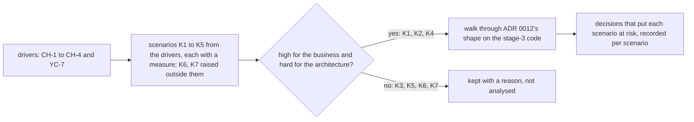

## Bạn cần biết trước

- [[design.l4.trade-off-points]] — bạn biết điểm nhạy là một quyết định mà một thuộc tính chất lượng phụ thuộc mạnh vào, còn điểm đánh đổi là quyết định kéo hai thuộc tính theo hai hướng ngược nhau.
- [[design.l4.one-deployment-for-all-shops]] — bạn biết ADR `0012` phục vụ mọi cửa hàng từ một bản triển khai chung, nên sự tách biệt giữa các cửa hàng phải được xây bên trong hệ thống, và cách bố trí dữ liệu để lại cho một ADR sau.

## Tình huống

Cuối Sprint 18. ADR `0012` vừa được chấp nhận: mọi cửa hàng sẽ chạy trên một bản triển khai chung, và sprint tới nhóm bắt đầu xây theo nó. Product owner, người quyết định điều gì quan trọng nhất với kinh doanh, muốn có một thứ trước: "Kiến trúc này có tốt không? Chấm nó trên thang mười đi." Chat của nhóm đã đầy lo lắng, từ ngày khuyến mãi đông khách của một cửa hàng tới một khách mua ở hai nơi. Không ai có thời gian kiểm hết, và một điểm số duy nhất cũng không cho ai biết phải sửa gì. Làm sao kiểm một kiến trúc đã chọn với những nhu cầu quan trọng nhất, trước khi có gì được xây lên nó?

## Khái niệm cốt lõi

- **ATAM (Architecture Tradeoff Analysis Method)** (phương pháp đánh giá kiến trúc bằng cách đưa các kịch bản quan trọng nhất đi qua kiến trúc và ghi rủi ro) — đánh giá một kiến trúc bằng cách đưa các kịch bản thuộc tính chất lượng quan trọng nhất đi qua nó, và ghi lại những chỗ các quyết định của nó đặt các kịch bản đó vào rủi ro.
- dạng rút gọn — cách làm ngắn hơn của riêng Đơn Hàng: một buổi gồm nhóm và product owner, thay vì nhiều bên liên quan qua nhiều buổi.
- xếp hạng hai lần — cho mỗi kịch bản hai mức: một mức cho độ quan trọng với kinh doanh, một mức cho độ khó mà kiến trúc gây ra cho nó.
- đưa một kịch bản đi qua — lần theo một kịch bản qua các phần và các quyết định nó chạm tới, và hỏi thước đo của nó còn đạt được không.

## Cơ chế hoạt động



Trong tình huống trên, buổi đánh giá không bắt đầu từ kiến trúc. Nó bắt đầu từ các yếu tố định hình kiến trúc: bốn yêu cầu đa cửa hàng CH-1 tới CH-4, cộng YC-7 trong yêu cầu hoàn tiền, vì hoàn tiền phải chạy được cho mọi cửa hàng. Mỗi yêu cầu thành một hay nhiều kịch bản thuộc tính chất lượng, có điều kích hoạt, điều kiện, phản hồi và thước đo. CH-3, một cửa hàng đông khách không được làm chậm các cửa hàng khác, trở thành K1: đợt khuyến mãi của một cửa hàng chiếm 10% số đơn trong ngày, và các cửa hàng khác vẫn phải được phục vụ như ngày thường.

Tiếp theo, mỗi kịch bản được xếp hạng hai lần. Product owner chấm nó quan trọng thế nào với kinh doanh. Nhóm chấm kiến trúc làm nó khó thế nào. Chỉ kịch bản cao ở cả hai mới vào buổi. Nhờ vậy một buổi là đủ: ba kịch bản (K1, K2, K4) được đưa đi qua, bốn kịch bản còn lại (K3, K5, K6, K7) được giữ kèm lý do.

Đưa một kịch bản đi qua là đặt nó cạnh hình dạng ADR `0012` chọn và code stage-3 mà nó sẽ được xây lên. Với mỗi kịch bản, nhóm hỏi nó chạm tới những quyết định nào và thước đo còn đạt được không, rồi ghi các quyết định đó cạnh kịch bản. Với K1, đường đi chạm tới các giới hạn tải trong `DonHang.Api/Program.cs`: chúng đếm request theo process hay theo khách, không bao giờ theo cửa hàng, nên đợt khuyến mãi của một cửa hàng có thể dùng hết giới hạn của mọi cửa hàng. Toàn bộ kết quả là chủ đề của bài sau.

Đầu ra là một bản ghi cho từng kịch bản, không phải một điểm số: điểm trên thang mười không nói nhu cầu nào đang gặp rủi ro, hay cần xem lại quyết định nào.

## Trong hệ thống Đơn Hàng

Phạm vi của buổi, trong `docs/design/multi-shop-architecture-review.md`:

```markdown file=docs/design/multi-shop-architecture-review.md tag=stage-4 lines=9-24
### Phạm vi

- Cách làm: ATAM rút gọn. Một buổi, với cả đội và product owner, thay vì nhiều
  buổi với nhiều bên liên quan như phương pháp đầy đủ.
- Đánh giá gì: hình dạng ADR 0012 chọn (một bản triển khai chung cho mọi cửa
  hàng) trên code stage-3: `DonHang.Api` với hai module Ordering và Catalog,
  Notifications và Payments là service riêng, các giới hạn tải trong
  `DonHang.Api/Program.cs`.
- Khi nào: cuối Sprint 18 (giả định), khi ADR 0012 vừa được chấp nhận, trước
  khi xây theo nó và trước ADR chọn cách lưu dữ liệu của từng cửa hàng.
- Không làm: không quyết lại ADR 0012, không chọn cách lưu dữ liệu, không sửa
  giới hạn tải trong buổi.

Driver lấy từ `docs/team/multi-shop-requirements.md` (CH-1 tới CH-4) và
`docs/team/refund-requirements.md` (YC-7). Mỗi yêu cầu được viết thành một
hay nhiều kịch bản có thước đo.
```

Dòng 11–12 gọi tên dạng rút gọn: một buổi với cả nhóm và product owner, thay vì nhiều buổi với nhiều bên liên quan như phương pháp đầy đủ. Dòng 13–16 nói đánh giá cái gì: hình dạng ADR `0012` chọn, trên code stage-3. Dòng 17–18 nói khi nào: ngay sau khi ADR `0012` được chấp nhận, trước khi có gì được xây theo nó và trước ADR về cách bố trí dữ liệu. Dòng 19–20 nói buổi sẽ không làm gì: quyết lại ADR `0012`, chọn cách bố trí dữ liệu, hay đổi giới hạn tải. Dòng 22–24 là điểm xuất phát của sơ đồ.

Các kịch bản và hai mức của chúng:

```markdown file=docs/design/multi-shop-architecture-review.md tag=stage-4 lines=26-45
### Kịch bản

Mỗi kịch bản xếp hạng hai lần: quan trọng thế nào với kinh doanh (do product
owner chấm) và kiến trúc làm nó khó thế nào (do đội chấm). Chỉ kịch bản Cao ở
cả hai được phân tích trong buổi.

| Số | Từ yêu cầu | Kích hoạt | Điều kiện | Phản hồi | Thước đo (giả định) | Quan trọng | Khó |
|---|---|---|---|---|---|---|---|
| K1 | CH-3 | Một cửa hàng chạy khuyến mãi, chiếm 10% tổng số đơn trong ngày | Giờ đông nhất của cửa hàng đó; các cửa hàng khác tải như ngày thường | Đọc sản phẩm và đặt đơn của các cửa hàng khác vẫn được phục vụ | Các cửa hàng khác: dưới 0,5% đọc sản phẩm lỗi, 99% đơn trả lời trong 0,512 giây, như SLO ngày thường | Cao | Cao |
| K2 | CH-1 | Nhân viên cửa hàng A mở danh sách đơn | Vận hành bình thường, kể cả khi một truy vấn quên lọc theo cửa hàng | Chỉ thấy đơn của cửa hàng A | 0 dòng của cửa hàng khác | Cao | Cao |
| K3 | CH-2 | Cửa hàng mới ký hợp đồng | Ngày làm việc bình thường | Cửa hàng mở được mà không deploy, không migration | Mở trong ngày ký; 0 deploy | Cao | Trung bình |
| K4 | YC-7 | Khách của một cửa hàng bất kỳ gửi yêu cầu hoàn tiền | Cổng thanh toán không trả lời hoặc báo lỗi | Yêu cầu được nhận và trả lời | Trong 2 giây | Cao | Cao |
| K5 | CH-4 | Nhân viên cửa hàng A đổi tên và thương hiệu trên app | Vận hành bình thường | Cửa hàng A thấy cấu hình mới; cửa hàng khác không đổi gì | Không deploy; 0 cửa hàng khác bị đổi | Trung bình | Trung bình |
| K6 | Ngoài phạm vi | Một khách mua ở hai cửa hàng bằng một tài khoản | Hai cửa hàng cùng chạy | Khách đăng nhập một lần | Không đặt | Thấp | Trung bình |
| K7 | Câu hỏi mở | Một cửa hàng muốn khôi phục dữ liệu của riêng mình về một thời điểm | Các cửa hàng khác vẫn chạy | Chỉ dữ liệu cửa hàng đó quay lại | Chờ product owner trả lời | Trung bình | Cao |

K3 và K5 không được phân tích: hình dạng ADR 0012 chọn làm chúng dễ (cửa hàng
và cấu hình là dữ liệu), nên đội ghi chúng là bằng chứng cho điểm đánh đổi bên
dưới. K6 nằm ngoài phạm vi của `multi-shop-requirements.md`; K7 chờ câu hỏi mở
ở đó.
```

Dòng 28–30 đặt quy tắc: product owner chấm độ quan trọng, nhóm chấm độ khó, và chỉ kịch bản "Cao" ở cả hai mới được phân tích. Hai cột cuối bảng chứa hai mức đó: "Cao", "Trung bình", "Thấp". Quy tắc chọn ra K1, K2 và K4. Thước đo của K1 giữ các cửa hàng khác ở mục tiêu ngày thường: dưới 0,5% lần đọc sản phẩm lỗi, và 99% đơn được trả lời trong 0,512 giây. Dòng 42–45 nêu lý do cho từng kịch bản bị để ngoài. K3 và K5 dễ vì trong hình dạng ADR `0012` chọn, một cửa hàng và cấu hình của nó là dữ liệu, nên chúng được giữ làm bằng chứng cho một điểm đánh đổi. K6 nằm ngoài phạm vi của các yêu cầu. K7 chờ một câu hỏi mở, cũng là lý do nó chưa có thước đo.

Phần ngay sau đoạn trích so sánh buổi này với một bảng chấm điểm, loại bảng gán trọng số cho từng tiêu chí và cộng điểm thành một tổng cho mỗi phương án. Buổi review giữ từng kịch bản riêng, nên K1, kịch bản hỏng nặng với giới hạn tải hiện tại, không thể núp sau điểm tốt của K3 và K5. Cùng phần đó cũng nói khi nào bảng chấm điểm hợp hơn: khi chọn giữa nhiều phương án tương đương nhau, như lần nhóm chọn giữa các dịch vụ email bên ngoài mà dịch vụ nào cũng đáp ứng nhu cầu.

## Đánh đổi

| Nhóm đánh giá một kiến trúc đã chọn thế nào | Chi phí | Được gì | Hỏng ở đâu |
|---|---|---|---|
| Không đánh giá: cứ xây rồi xem | không gì lúc này | bắt đầu nhanh nhất | một kịch bản gặp rủi ro chỉ lộ ra sau khi code đã xây lên quyết định, lúc đảo ngược tốn nhất |
| Dạng rút gọn: một buổi, nhóm và product owner, kịch bản đã xếp hạng | viết kịch bản, xếp hạng, một buổi | những quyết định đặt các kịch bản quan trọng nhất vào rủi ro | ít góc nhìn hơn: nhu cầu mà không ai trong phòng nắm sẽ bị sót, kịch bản hạng thấp không được phân tích |
| Phương pháp đầy đủ: nhiều bên liên quan qua nhiều buổi | thời gian của nhiều người qua nhiều buổi | nhiều góc nhìn hơn, nhiều kịch bản được phân tích hơn | nhiều hơn mức một quyết định chỉ ảnh hưởng một nhóm cần |
| Bảng chấm điểm: tiêu chí có trọng số, một tổng cho mỗi phương án | một bảng và sự đồng thuận về trọng số | chọn được giữa các phương án tương đương | một con số tổng để kịch bản hỏng nặng núp sau điểm tốt ở chỗ khác |

Dạng rút gọn đáng công khi quyết định tốn kém để đảo ngược và chưa có gì được xây lên nó, như ADR `0012`. Nó không thay được phép kiểm trên thứ được xây sau này: một buổi chỉ lập luận về quyết định, và chỉ phép kiểm trên code đang chạy mới cho thấy một thước đo như của K1 có thật sự đạt.

## Bạn sẽ chọn gì nếu…

…nhóm muốn thay một thư viện dùng bên trong một module, nằm sau interface riêng của module đó? Quyết định này đảo ngược dễ và chỉ chạm một module, nên một buổi đánh giá tốn hơn cái nó mang lại. Một pull request, hay một ADR kèm các phương án, là đủ.

…nhóm phải chọn một trong nhiều dịch vụ email bên ngoài mà dịch vụ nào cũng đáp ứng nhu cầu? Đó là chọn giữa các phương án tương đương, không phải kiểm một hình dạng đã chọn. Bảng chấm điểm hợp ở đây, và chính tài liệu review cũng nêu trường hợp này.

…Đơn Hàng đã lớn thành ba bốn nhóm, và một quyết định sẽ đổi cách làm việc của tất cả? Lúc này một phòng với một nhóm sẽ sót những góc nhìn quan trọng. Mời người từ mỗi nhóm bị ảnh hưởng, và chấp nhận nhiều hơn một buổi nếu các kịch bản không gói gọn trong một buổi. Xếp hạng vẫn quyết định kịch bản nào được phân tích.

## Senior hay nhầm rằng…

- **"Đánh giá kiến trúc nghĩa là chấm cho nó một điểm trên thang mười."** → Thực ra kết quả là một bản ghi cho từng kịch bản: quyết định nào đặt kịch bản quan trọng nào vào rủi ro. Một điểm số không nói được phải sửa gì, và nó lấy trung bình một kịch bản hỏng nặng với những kịch bản qua dễ dàng. Bạn sẽ nhận ra niềm tin này khi một buổi review kết thúc bằng một con số, và không ai nói được cần xem lại quyết định nào tiếp theo.
- **"Chỉ đánh giá được kiến trúc sau khi nó đã được xây và đang chạy."** → Thực ra buổi của Đơn Hàng diễn ra ngay sau khi ADR `0012` được chấp nhận, trên quyết định đó và code stage-3 mà nó sẽ được xây lên, và vẫn phát hiện K1 hỏng nặng với giới hạn tải hiện tại. Code đang chạy vẫn cần về sau để xác nhận các thước đo đạt, nhưng tìm chỗ một quyết định yếu thì không phải chờ nó. Bạn sẽ nhận ra niềm tin này khi lần đánh giá đầu tiên của một hình dạng diễn ra sau nhiều sprint xây lên nó, và phát hiện nào cũng tốn kém để xử lý.
- **"Kịch bản nào được ai nêu ra cũng phải phân tích trong buổi."** → Thực ra xếp hạng hai lần quyết định cái gì được dùng thời gian của buổi: ở Đơn Hàng, ba trên bảy kịch bản được đưa đi qua, mỗi kịch bản còn lại được giữ kèm một lý do. Bạn sẽ nhận ra niềm tin này khi một buổi hết giờ vì những kịch bản dễ hay ngoài phạm vi, trước khi tới được kịch bản quan trọng.

## Thử ngay (3 phút)

Dùng bảng kịch bản ở trên, dòng 32–40, và quy tắc ở dòng 28–30.

1. Giả sử product owner nâng độ quan trọng của K5 từ "Trung bình" lên "Cao". K5 giờ có được đưa đi qua trong buổi không?
2. Giả sử một hợp đồng mới làm K7 thành điều quan trọng nhất với kinh doanh. K7 cần gì trước khi được đưa đi qua?

Kết quả mong đợi: có hoặc không cho bước 1, kèm cột quyết định điều đó, và với bước 2 là thứ dòng K7 còn thiếu.

<details><summary>Gợi ý đáp án</summary>

1. Không. K5 vẫn "Trung bình" ở độ khó, và chỉ kịch bản cao ở cả hai mức mới được phân tích. Độ khó của nó trung bình vì trong hình dạng ADR `0012` chọn, cấu hình của một cửa hàng là dữ liệu.
2. K7 đã "Cao" ở độ khó, nên một mức quan trọng cao sẽ chọn nó. Nhưng thước đo của nó ghi "Chờ product owner trả lời". Câu hỏi mở phải được trả lời và thước đo phải được viết trước, vì kịch bản không có thước đo thì không đối chiếu được với kiến trúc.

</details>

## Liên hệ

- [[design.l4.trade-off-points]] — bài cần học trước: điểm nhạy và điểm đánh đổi là những gì một lần đưa kịch bản đi qua ghi lại cạnh mỗi kịch bản.
- [[design.l4.one-deployment-for-all-shops]] — quyết định mà buổi này đánh giá, không quyết lại.
- [[design.l4.quality-attribute-scenarios]] — hình dạng của mọi kịch bản trong buổi: điều kích hoạt, điều kiện, phản hồi, thước đo.
- [[management.l3.weighing-options-in-an-adr]] — bước trước đó: một ADR cân các phương án và chọn một. Buổi này kiểm phương án đã chọn.
- [[design.l4.a-thousand-shops]] — nơi các yếu tố định hình CH-1 tới CH-4 ra đời, đầu vào mà buổi bắt đầu từ đó.
- [[design.l4.architecture-review-findings]] — tiếp theo trong module: lần đưa kịch bản đi qua của Đơn Hàng tìm ra gì, và nhóm làm gì với kết quả đó.

## Tóm tắt 5 dòng

1. ATAM đánh giá một kiến trúc bằng cách đưa các kịch bản thuộc tính chất lượng quan trọng nhất đi qua nó, và ghi lại chỗ các quyết định của nó đặt chúng vào rủi ro.
2. Dạng rút gọn của Đơn Hàng là một buổi gồm nhóm và product owner, thay vì nhiều bên liên quan qua nhiều buổi.
3. Buổi đó biến các yếu tố định hình thành kịch bản có thước đo, xếp hạng mỗi kịch bản theo độ quan trọng với kinh doanh và theo độ khó, và chỉ phân tích những kịch bản cao ở cả hai.
4. Mỗi kịch bản được giữ riêng, khác với một tổng có trọng số cho mỗi phương án, nên kịch bản hỏng nặng không thể núp sau điểm tốt ở chỗ khác.
5. Nó đáng công trước khi xây lên một quyết định tốn kém để đảo ngược, và không thay được phép kiểm trên thứ được xây.
