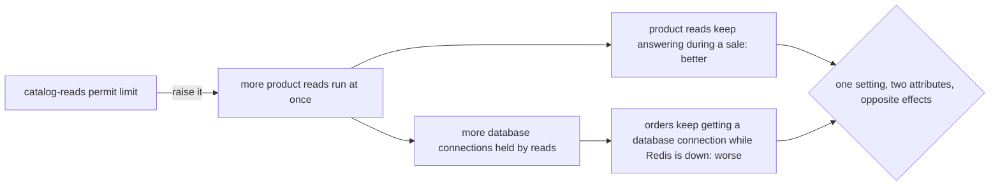

## Before you start

- [[design.l4.quality-attribute-scenarios]] — you know that a quality attribute scenario states one quality need with a trigger, conditions, a response and a measure, as YC-7 does for refunds.
- [[backend.l3.bulkhead]] — you know that the `catalog-reads` limit lets 20 product reads run and 5 wait, so that with Redis down product reads cannot take every database connection orders need.
- [[management.l3.weighing-options-in-an-adr]] — you know that ADR `0003` chose a Payments service joined by a saga, and lists that choice's costs among its consequences.

## The situation

It is stage-3 and a sale is on. Redis has stopped, and the api's count of `503` answers climbs, all of them on product reads. A teammate opens a pull request that raises the `catalog-reads` permit limit in configuration: "Fewer customers will get an error." It is one number, and the tests pass. A second teammate asks one thing before approving: "What else does that number decide?" Nobody in the thread can answer, because nobody has written down which quality attributes depend on it. How do you find the decisions in Đơn Hàng that help one quality attribute only by hurting another, before someone moves them?

## Core concepts

- **sensitivity point** — a decision or setting that one quality attribute depends on strongly, so that moving it changes how well a scenario for that attribute is met.
- **trade-off point** — a sensitivity point for two or more quality attributes at once: moving it one way improves one of them and worsens another.
- direction — which way you move a decision or setting, such as raising a limit or lowering it; at a trade-off point each direction has an attribute that gains and one that loses.

## How it works



In the situation above, the permit limit is first a sensitivity point for one quality attribute: product reads keep answering during a sale. Raise it and more product reads run at once, so fewer are refused; lower it and more are refused.

Now follow the lower arrow. With Redis down, each running product read holds one of the api's database connections for its query. The api can keep only a limited number of them open, and `POST /api/v1/orders` needs them too. So the same number is a sensitivity point for a second attribute: orders keep getting a database connection while Redis is down. Raise it, and reads can hold more connections while orders wait. Two attributes depend on it, in opposite directions, which makes it a trade-off point.

This is what the second teammate was asking. In Đơn Hàng, a pull request that moves a trade-off point should not be approved on passing tests alone; it should say which attribute it favours and what the other one loses.

The same shape appears at the scale of the whole architecture. ADR `0003` moves the payment gateway's key and the money rows out of `DonHang.Api` into `DonHang.Payments`, joined to the api by a saga. That helps one attribute: the most sensitive parts of the system sit in one service, deployed and granted access on its own. In exchange, the order and the refund agree only after a while. Here the point is the shape of two services, so moving it back would cost far more than editing a value.

## In the Đơn Hàng system

The setting from the situation, in `DonHang.Api/Program.cs`:

```csharp file=DonHang.Api/Program.cs tag=stage-3 lines=143-148
// lesson: backend.l3.bulkhead
// "catalog-reads": at most PermitLimit product reads run at once and QueueLimit
// more wait for a turn; any read beyond that is refused at once. With Redis
// down every product read needs a database connection, and orders need them too.
var catalogReads = new ConcurrencyLimiterOptions { PermitLimit = 20, QueueLimit = 5 };
builder.Configuration.GetSection("RateLimiting:CatalogReads").Bind(catalogReads);
```

Line 147 holds the trade-off point, `PermitLimit`; `QueueLimit` on the same line decides how many more wait instead of being refused. The comment on lines 145–146 already names both sides, product reads that need a database connection when Redis is down, and orders that need them too. Line 148 lets configuration replace both numbers without touching this file. A pull request that changes only configuration does not show these lines, so the comment is easy to miss at the moment it matters.

The decision from ADR `0003`, and what it costs:

```markdown file=docs/adr/0003-tach-payments-thanh-service.md tag=stage-3 lines=38-43
### Hệ quả

- Đơn và yêu cầu hoàn tiền chỉ khớp nhau sau một lúc: trong khoảng đó đơn ở
  `refunding` còn dòng bên Payments đang `pending`.
- Thêm một service phải chạy, với database, image và dashboard của nó.
- Mỗi bước phải lặp lại được an toàn, vì message có thể đến hai lần.
```

Lines 40–41 are the side that loses: for a while the order says `refunding` while the refund row in Payments is still `pending`. Lines 42–43 are further costs of the same decision, not a third side: one more service to run, and every step safe to repeat because a message can arrive twice. The side that gains is in the ADR's context and decision, outside this excerpt: the gateway's key and the money rows live in one service of their own, deployed and granted access separately. YC-7's 2-second answer comes from replying before the gateway is called, which the design already did when everything was in `DonHang.Api`.

Naming both points does two jobs. When a driver changes, such as sales growing or Redis failing more often, the list says which decisions to revisit. For each one, the losing side says in advance what the change will cost elsewhere.

## Trade-offs

| How the team treats a decision | Cost now | What it gives | What goes wrong |
|---|---|---|---|
| Not named: "it is just a setting" | nothing | fast, small changes | a change that fixes one attribute quietly hurts another, found during the next outage |
| Named next to the decision, in a comment or an ADR's consequences | a sentence or two when the decision is made | the next person sees both sides before moving it | the note goes stale when a driver changes and nobody updates it |
| Named, with a scenario or a check for each side | writing and keeping one scenario or check per attribute | a change that hurts the losing side shows up before release | more to keep current; some sides cannot be checked automatically |

Naming costs little, so it is worth doing for every decision where you can already see two attributes pulling on it. A scenario or a check for each side is worth its upkeep when both sides matter to the business and the point is likely to move, as a limit tuned during sales is.

## What would you choose if…

…product reads are refused in every sale, and the business now says product reads matter more than before? A driver changed, so this trade-off point is the place to revisit. Move it only with a sentence on what orders lose while Redis is down, and with someone agreeing to that loss. Ask too whether the point can matter less, for example by making Redis outages rarer, so the limit is reached less often.

…the person who decides what the product must do asks that an order show as refunded the moment the customer asks? That moves a different point from ADR `0003`'s: the refund design's choice to answer before the gateway is called. For the order to show as refunded at once, the customer's request would have to wait for the gateway to return the money, which is the option the refund design rejected because YC-7 would fail whenever the gateway does. Keep answering with `refunding` unless that person accepts losing YC-7 and writes that down.

…you join a team and are asked where the architecture is fragile? Start a list of trade-off points. Read the consequences of each ADR and the comments on limits and timeouts, and for each, write which attributes pull on it and in which direction.

## Seniors often assume…

- **"With enough effort, one design can be the best at every quality attribute at once."** → Actually at a trade-off point the attributes pull on the same thing: with Redis down, a database connection held by a product read is one an order cannot use. Effort can make a point matter less, but while the connections are shared, the limit decides who gets them. You notice this belief when a design document lists only gains, and its costs turn up first in an outage.
- **"Settings such as limits are implementation details, not architecture decisions."** → Actually line 147 decides how product reads and orders share the api's database connections while Redis is down, which is a property of the whole system, not of one class. A value is an architecture decision when quality attributes depend on it strongly. You notice this belief when a one-line configuration change is approved because the tests pass, and the next outage traces back to it.
- **"A trade-off is made once at the start and never needs revisiting."** → Actually a trade-off point is right only for the drivers it was set under. If sales grow or Redis fails more often, numbers that suited stage-3 may stop suiting it, and ADR `0003`'s separate service is right only while keeping the gateway's key apart matters more than instant agreement. You notice this belief when an old limit or ADR is defended with "that is how it was designed", and nobody can say which driver it was designed for.

## Try it (3 minutes)

Open `DonHang.Api/Program.cs` in the `don-hang` repository at tag `stage-3` and read lines 135–141, the `orders` limit. Each customer may place `PermitLimit` orders per fixed `Window`, 10 per minute unless configured, counted by the `sub` of the access token, the field that names which user the token was issued for.

1. Name one quality attribute this setting is a sensitivity point for.
2. Decide whether it is also a trade-off point: if you raise the limit, does it help another attribute while hurting the one from step 1?

Expected result: one attribute for step 1, and for step 2 a yes or no, with the second attribute named or a reason why there is none.

<details><summary>Suggested answer</summary>

1. How well the api is protected from one customer, or a script holding that customer's token, placing orders too fast. A lower limit protects more; a higher one protects less.
2. Yes. Raising it helps a second attribute, real customers who order often are refused with `429` less often, and hurts the protection from step 1, because one caller can place more orders per minute. Lowering it does the reverse.

</details>

## Connections

- [[design.l4.quality-attribute-scenarios]] — prerequisite: a sensitivity point is judged by how well a scenario is met, so the scenario has to exist first.
- [[backend.l3.bulkhead]] — the same `catalog-reads` limit as a mechanism; here it is read as a decision with two sides.
- [[management.l3.weighing-options-in-an-adr]] — where ADR `0003`'s costs were written down; this lesson names them as the losing side of a trade-off point.
- [[backend.l3.graceful-degradation]] — the fallback that creates the first trade-off point: with Redis down, product reads move onto the database connections orders use.
- [[backend.l3.saga]] — the mechanism behind ADR `0003`'s trade-off point at the scale of the architecture.
- [[design.l4.reduced-atam]] — next in this module: a review that walks the key scenarios through a design and records its sensitivity points and trade-off points.

## Five-line summary

1. At a trade-off point, one decision or setting moves two quality attributes in opposite directions, so improving one costs the other.
2. A sensitivity point is a decision or setting that one quality attribute depends on strongly; a trade-off point is one for several.
3. The `catalog-reads` limit is one: more product reads at once means fewer refused, and fewer database connections left for orders while Redis is down.
4. ADR `0003`'s saga is one at architecture scale: the gateway's key and money rows get their own service, but order and refund agree later.
5. Naming trade-off points tells the team which decisions to revisit when a driver changes, and what each change costs elsewhere.
