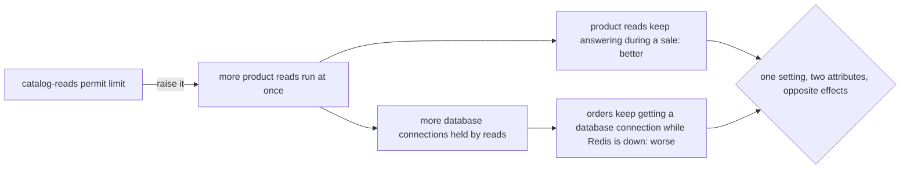

## Bạn cần biết trước

- [[design.l4.quality-attribute-scenarios]] — bạn biết một kịch bản thuộc tính chất lượng phát biểu một nhu cầu chất lượng bằng điều kích hoạt, điều kiện, phản hồi và số đo, như YC-7 làm với hoàn tiền.
- [[backend.l3.bulkhead]] — bạn biết giới hạn `catalog-reads` cho 20 lần đọc sản phẩm chạy cùng lúc và 5 lần chờ, để khi Redis sập, đọc sản phẩm không chiếm hết các kết nối database mà đơn hàng cần.
- [[management.l3.weighing-options-in-an-adr]] — bạn biết ADR `0003` chọn một service Payments nối với api bằng saga, và ghi chi phí của lựa chọn đó trong phần hệ quả.

## Tình huống

Đơn Hàng đang ở stage-3 và có đợt giảm giá. Redis ngừng chạy, số câu trả lời `503` của api tăng dần, tất cả đều ở các lần đọc sản phẩm. Một đồng đội mở pull request nâng giới hạn permit của `catalog-reads` trong cấu hình: "Sẽ ít khách bị lỗi hơn." Chỉ là một con số, và test đều pass. Một đồng đội khác hỏi đúng một câu trước khi duyệt: "Con số đó còn quyết định gì nữa?" Không ai trong thread trả lời được, vì chưa ai ghi lại những thuộc tính chất lượng nào phụ thuộc vào nó. Làm sao tìm ra những quyết định trong Đơn Hàng mà giúp thuộc tính chất lượng này chỉ bằng cách làm hại thuộc tính khác, trước khi có người xê dịch chúng?

## Khái niệm cốt lõi

- **điểm nhạy** (sensitivity point) — một quyết định hay thiết lập mà một thuộc tính chất lượng phụ thuộc mạnh vào, nên xê dịch nó thì một kịch bản của thuộc tính đó được đáp ứng tốt hơn hoặc kém đi.
- **điểm đánh đổi** (trade-off point) — một điểm nhạy của hai thuộc tính chất lượng trở lên cùng lúc: xê dịch nó theo một hướng thì thuộc tính này tốt lên, thuộc tính kia kém đi.
- hướng — chiều bạn xê dịch một quyết định hay thiết lập, như nâng một giới hạn hay hạ nó xuống. Ở một điểm đánh đổi, mỗi hướng đều có một thuộc tính được lợi và một thuộc tính chịu thiệt.

## Cơ chế hoạt động



Trong tình huống trên, giới hạn permit trước hết là điểm nhạy của một thuộc tính chất lượng: đọc sản phẩm vẫn được trả lời trong đợt giảm giá. Nâng nó lên thì nhiều lần đọc sản phẩm chạy cùng lúc hơn, nên ít lần bị từ chối hơn. Hạ xuống thì nhiều lần bị từ chối hơn.

Giờ đi theo mũi tên phía dưới. Khi Redis sập, mỗi lần đọc sản phẩm đang chạy giữ một kết nối database của api cho truy vấn của nó. Api chỉ mở được một số kết nối có hạn, và `POST /api/v1/orders` cũng cần chúng. Vì vậy cùng con số đó là điểm nhạy của thuộc tính thứ hai: đơn hàng vẫn lấy được kết nối database khi Redis sập. Nâng nó lên thì các lần đọc giữ được nhiều kết nối hơn, còn đơn hàng phải chờ. Hai thuộc tính phụ thuộc vào nó theo hai hướng ngược nhau, nên nó là một điểm đánh đổi.

Đây chính là điều đồng đội thứ hai muốn hỏi. Ở Đơn Hàng, một pull request xê dịch điểm đánh đổi không nên được duyệt chỉ vì test pass. Nó nên nói rõ mình ưu tiên thuộc tính nào và thuộc tính kia mất gì.

Cùng hình dạng này xuất hiện ở tầm cả kiến trúc. ADR `0003` chuyển khóa của cổng thanh toán và các dòng tiền ra khỏi `DonHang.Api`, sang `DonHang.Payments`, nối với api bằng một saga. Điều đó giúp một thuộc tính: những phần nhạy cảm nhất của hệ thống nằm trong một service, được triển khai và cấp quyền riêng. Đổi lại, đơn và yêu cầu hoàn tiền chỉ khớp nhau sau một lúc. Ở đây điểm đánh đổi là hình dạng hai service, nên dời nó về chỗ cũ tốn hơn nhiều so với sửa một giá trị.

## Trong hệ thống Đơn Hàng

Thiết lập trong tình huống, ở `DonHang.Api/Program.cs`:

```csharp file=DonHang.Api/Program.cs tag=stage-3 lines=143-148
// lesson: backend.l3.bulkhead
// "catalog-reads": at most PermitLimit product reads run at once and QueueLimit
// more wait for a turn; any read beyond that is refused at once. With Redis
// down every product read needs a database connection, and orders need them too.
var catalogReads = new ConcurrencyLimiterOptions { PermitLimit = 20, QueueLimit = 5 };
builder.Configuration.GetSection("RateLimiting:CatalogReads").Bind(catalogReads);
```

Dòng 147 giữ điểm đánh đổi, `PermitLimit`. `QueueLimit` cùng dòng quyết định thêm bao nhiêu lần đọc được chờ thay vì bị từ chối. Comment ở dòng 145–146 đã nêu cả hai phía: các lần đọc sản phẩm cần kết nối database khi Redis sập, và đơn hàng cũng cần chúng. Dòng 148 cho cấu hình thay cả hai con số mà không phải sửa file này. Một pull request chỉ đổi cấu hình sẽ không hiện những dòng này, nên comment rất dễ bị bỏ qua đúng lúc nó quan trọng.

Quyết định trong ADR `0003`, và cái giá của nó:

```markdown file=docs/adr/0003-tach-payments-thanh-service.md tag=stage-3 lines=38-43
### Hệ quả

- Đơn và yêu cầu hoàn tiền chỉ khớp nhau sau một lúc: trong khoảng đó đơn ở
  `refunding` còn dòng bên Payments đang `pending`.
- Thêm một service phải chạy, với database, image và dashboard của nó.
- Mỗi bước phải lặp lại được an toàn, vì message có thể đến hai lần.
```

Dòng 40–41 là phía chịu thiệt: trong một lúc, đơn ghi `refunding` trong khi dòng hoàn tiền bên Payments vẫn `pending`. Dòng 42–43 là các chi phí khác của cùng quyết định, không phải phía thứ ba: thêm một service phải chạy, và bước nào cũng phải lặp lại được an toàn vì message có thể đến hai lần. Phía được lợi nằm ở phần bối cảnh và quyết định của ADR, ngoài đoạn trích này: khóa của cổng thanh toán và các dòng tiền nằm trong một service riêng, được triển khai và cấp quyền tách biệt. Câu trả lời trong 2 giây của YC-7 có được nhờ api trả lời trước khi gọi cổng thanh toán, điều thiết kế đã làm từ khi mọi thứ còn nằm trong `DonHang.Api`.

Gọi tên cả hai điểm làm được hai việc. Khi một yếu tố định hình kiến trúc thay đổi, như doanh số tăng hay Redis sập thường hơn, danh sách cho biết cần xem lại những quyết định nào. Với mỗi quyết định, phía chịu thiệt nói trước thay đổi sẽ tốn gì ở chỗ khác.

## Đánh đổi

| Nhóm đối xử với một quyết định thế nào | Chi phí bây giờ | Được gì | Hỏng ở đâu |
|---|---|---|---|
| Không gọi tên: "chỉ là một thiết lập" | không gì | thay đổi nhanh, nhỏ | một thay đổi sửa được thuộc tính này lặng lẽ làm hại thuộc tính khác, lộ ra ở sự cố kế tiếp |
| Gọi tên ngay cạnh quyết định, trong comment hay phần hệ quả của ADR | một hai câu lúc ra quyết định | người sau thấy cả hai phía trước khi xê dịch nó | ghi chú lỗi thời khi một yếu tố định hình thay đổi mà không ai cập nhật |
| Gọi tên, kèm một kịch bản hay phép kiểm cho mỗi phía | viết và giữ một kịch bản hay phép kiểm cho mỗi thuộc tính | thay đổi nào làm hại phía chịu thiệt sẽ lộ ra trước khi phát hành | thêm thứ phải giữ cho đúng, và có phía không kiểm tự động được |

Gọi tên tốn rất ít, nên đáng làm với mọi quyết định mà bạn đã thấy có hai thuộc tính cùng kéo. Một kịch bản hay phép kiểm cho mỗi phía đáng công duy trì khi cả hai phía đều quan trọng với kinh doanh và điểm đó dễ bị xê dịch, như một giới hạn được chỉnh trong các đợt giảm giá.

## Bạn sẽ chọn gì nếu…

…đợt giảm giá nào đọc sản phẩm cũng bị từ chối, và giờ phía kinh doanh nói đọc sản phẩm quan trọng hơn trước? Một yếu tố định hình đã đổi, nên điểm đánh đổi này là chỗ cần xem lại. Chỉ xê dịch nó khi kèm một câu nói đơn hàng mất gì lúc Redis sập, và có người đồng ý chịu mất mát đó. Hỏi thêm liệu có làm điểm này bớt quan trọng được không, ví dụ làm Redis ít sập hơn, để giới hạn ít khi bị chạm tới.

…người quyết định sản phẩm phải làm gì yêu cầu đơn hiện là đã hoàn tiền ngay khi khách gửi yêu cầu? Điều đó xê dịch một điểm khác với điểm của ADR `0003`: lựa chọn của thiết kế hoàn tiền là trả lời trước khi gọi cổng thanh toán. Muốn đơn hiện là đã hoàn tiền ngay, yêu cầu của khách phải chờ cổng thanh toán trả tiền xong, và đó là phương án thiết kế hoàn tiền đã loại, vì YC-7 sẽ hỏng mỗi khi cổng lỗi. Cứ trả lời bằng `refunding`, trừ khi người đó chấp nhận mất YC-7 và ghi điều đó ra.

…bạn vào một nhóm mới và được hỏi kiến trúc dễ vỡ ở đâu? Hãy bắt đầu một danh sách điểm đánh đổi. Đọc phần hệ quả của từng ADR và các comment về giới hạn và timeout, rồi với mỗi chỗ, ghi những thuộc tính nào cùng kéo nó và kéo theo hướng nào.

## Senior hay nhầm rằng…

- **"Đủ công sức thì một thiết kế có thể tốt nhất ở mọi thuộc tính chất lượng cùng lúc."** → Thực ra ở một điểm đánh đổi, các thuộc tính cùng kéo một thứ: khi Redis sập, kết nối database đang bị một lần đọc sản phẩm giữ là kết nối đơn hàng không dùng được. Công sức có thể làm điểm đó bớt quan trọng, nhưng chừng nào kết nối còn dùng chung, giới hạn vẫn quyết định ai được dùng. Bạn sẽ nhận ra niềm tin này khi một tài liệu thiết kế chỉ liệt kê cái được, còn cái giá lộ ra lần đầu trong một sự cố.
- **"Thiết lập như giới hạn là chi tiết cài đặt, không phải quyết định kiến trúc."** → Thực ra dòng 147 quyết định đọc sản phẩm và đơn hàng chia nhau kết nối database của api thế nào khi Redis sập, và đó là tính chất của cả hệ thống, không của riêng một class. Một giá trị là quyết định kiến trúc khi các thuộc tính chất lượng phụ thuộc mạnh vào nó. Bạn sẽ nhận ra niềm tin này khi một thay đổi cấu hình một dòng được duyệt vì test pass, và sự cố kế tiếp truy ngược về đúng dòng đó.
- **"Đánh đổi chỉ làm một lần lúc đầu, không bao giờ phải xem lại."** → Thực ra một điểm đánh đổi chỉ đúng với những yếu tố định hình lúc nó được đặt. Nếu doanh số tăng hay Redis sập thường hơn, những con số hợp với stage-3 có thể không còn hợp, và service riêng của ADR `0003` chỉ đúng chừng nào giữ khóa cổng thanh toán tách riêng còn quan trọng hơn chuyện đơn và yêu cầu hoàn tiền khớp nhau ngay. Bạn sẽ nhận ra niềm tin này khi một giới hạn hay ADR cũ được bênh bằng câu "thiết kế vốn vậy", mà không ai nói được nó được thiết kế cho yếu tố định hình nào.

## Thử ngay (3 phút)

Mở `DonHang.Api/Program.cs` trong repo `don-hang` ở tag `stage-3` và đọc dòng 135–141, giới hạn `orders`. Mỗi khách được đặt `PermitLimit` đơn trong mỗi `Window` cố định, mặc định 10 đơn mỗi phút nếu không cấu hình, đếm theo `sub` của access token, trường cho biết token được cấp cho người dùng nào.

1. Nêu một thuộc tính chất lượng mà thiết lập này là điểm nhạy của nó.
2. Quyết định xem nó có đồng thời là điểm đánh đổi không: nếu nâng giới hạn, nó có giúp một thuộc tính khác trong khi làm hại thuộc tính ở bước 1 không?

Kết quả mong đợi: một thuộc tính cho bước 1, và với bước 2 là có hoặc không, kèm tên thuộc tính thứ hai hoặc lý do không có.

<details><summary>Gợi ý đáp án</summary>

1. Api được bảo vệ tốt đến đâu trước một khách, hay một script cầm token của khách đó, đặt đơn quá nhanh. Giới hạn thấp hơn bảo vệ nhiều hơn, giới hạn cao hơn bảo vệ ít hơn.
2. Có. Nâng giới hạn giúp một thuộc tính thứ hai, khách thật hay đặt đơn ít bị từ chối với `429` hơn, và làm hại sự bảo vệ ở bước 1, vì một bên gọi đặt được nhiều đơn hơn mỗi phút. Hạ giới hạn thì ngược lại.

</details>

## Liên hệ

- [[design.l4.quality-attribute-scenarios]] — bài cần học trước: điểm nhạy được đánh giá theo mức một kịch bản được đáp ứng, nên kịch bản phải có trước.
- [[backend.l3.bulkhead]] — cùng giới hạn `catalog-reads`, nhìn như một cơ chế. Ở bài này nó được đọc như một quyết định có hai phía.
- [[management.l3.weighing-options-in-an-adr]] — nơi chi phí của ADR `0003` được ghi lại. Bài này gọi tên chúng là phía chịu thiệt của một điểm đánh đổi.
- [[backend.l3.graceful-degradation]] — phương án dự phòng tạo ra điểm đánh đổi đầu tiên: khi Redis sập, đọc sản phẩm chuyển sang dùng các kết nối database mà đơn hàng cũng dùng.
- [[backend.l3.saga]] — cơ chế đứng sau điểm đánh đổi của ADR `0003` ở tầm kiến trúc.
- [[design.l4.reduced-atam]] — tiếp theo trong module: một buổi review đưa các kịch bản quan trọng đi qua thiết kế và ghi lại các điểm nhạy, điểm đánh đổi của nó.

## Tóm tắt 5 dòng

1. Ở một điểm đánh đổi, một quyết định hay thiết lập kéo hai thuộc tính chất lượng theo hai hướng ngược nhau, nên cải thiện cái này thì cái kia trả giá.
2. Điểm nhạy là quyết định hay thiết lập mà một thuộc tính chất lượng phụ thuộc mạnh vào. Điểm đánh đổi là điểm nhạy của nhiều thuộc tính.
3. Giới hạn `catalog-reads` là một điểm như vậy: nhiều lần đọc sản phẩm cùng lúc hơn thì ít bị từ chối hơn, nhưng khi Redis sập, đơn hàng còn ít kết nối database hơn.
4. Saga của ADR `0003` là một điểm như vậy ở tầm kiến trúc: khóa cổng thanh toán và các dòng tiền có service riêng, nhưng đơn và yêu cầu hoàn tiền khớp nhau muộn hơn.
5. Gọi tên các điểm đánh đổi cho nhóm biết cần xem lại quyết định nào khi một yếu tố định hình thay đổi, và mỗi thay đổi tốn gì ở chỗ khác.
