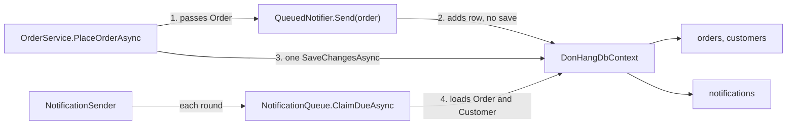

## Before you start

- [[design.l3.module-owns-its-tables]] — you know that a module owns its tables when only its own code reads and writes them.
- [[backend.l2.database-job-queue]] — you know that at stage-2 an order's email job is a `notifications` row saved by the same `SaveChangesAsync` as the order.
- [[design.l3.context-map]] — you know that inside one process notifications is downstream of ordering, because `NotificationSender` reads `Order` and `Customer` directly.

## The situation

It is stage-2, and the email job already looks separate. `NotificationSender` is its own class, `QueuedNotifier` hides behind `INotifier`, and the emails go out a few seconds after each order. A teammate proposes the obvious next step: move the notification classes into a new project, build an image for it, and run it as its own service, so it can be released without the API.

You open `QueuedNotifier` to see what would move. It sends nothing. It adds a row to the DbContext that the order is in.

What has to change before the email job can run in a process of its own?

## Core concepts

- **microservice** — a service deployed and run on its own, owning one bounded context's data, which other parts reach only over the network, never by a method call or a shared table. A "service" here is a program run as its own process, not a service-layer class like `OrderService`.
- network call — a call from one process to another over the network; it can be slow, it can fail, and a caller that gets no answer cannot tell whether the work was done.
- shared transaction — one save that writes several tables together or not at all, such as the `SaveChangesAsync` that writes an order and its email job.
- shared object — an object of one module's model passed to or loaded by another module, such as the `Order` that the notification code receives and reads.

## How it works



The teammate's plan moves classes, but a microservice is defined by what it does not share. The diagram shows what the notification code shares with ordering inside the one `api` process: `NotificationSender` calls `ClaimDueAsync` each round, and the one `DonHangDbContext` maps Ordering's tables and `notifications` alike.

The first tie is a shared object. `OrderService` hands `QueuedNotifier` the `Order` itself. Between two processes no object travels, only data, and every method call between the two sides becomes a network call that can be slow or fail.

The second is a shared transaction. `QueuedNotifier` only adds a `notifications` row to `DonHangDbContext`, and `PlaceOrderAsync` saves the order and that row with one `SaveChangesAsync`. Both are written, or neither is. After the split, `notifications` belongs to the notification service, so only its code writes it, through its own connection. Unless something outside both processes coordinates them, placing an order becomes two separate saves, and one can fail alone.

The third is shared data. Each round, `NotificationQueue` loads every due row it takes with its `Order` and that order's `Customer`, because the email address and name live in Ordering's tables. A microservice cannot query those tables.

Each tie must become data the notification side receives and keeps; how Đơn Hàng does that comes in a later module. This lesson adds when to cut the ties: before the split, with the module boundary drawn inside one process, where they show up as calls and queries crossing it. There, the change is a refactoring: one build, one release, and when a signature or type changes, the compiler points at every caller that no longer compiles. After the split, the compiler sees one side only, and each side must work with the other's old and new version until both are released.

## In the Đơn Hàng system

The shared object and the shared transaction, in one class:

```csharp file=DonHang.Infrastructure/QueuedNotifier.cs tag=stage-2 lines=5-24
// lesson: backend.l2.database-job-queue
// Sends nothing itself: it adds a pending notifications row to the same
// DbContext the order is in and leaves the saving to OrderService.
// NotificationSender (DonHang.Api/Jobs) picks the row up a few seconds later.
public sealed class QueuedNotifier(DonHangDbContext db) : INotifier
{
    public void Send(Order order, string subject)
    {
        var now = DateTimeOffset.UtcNow;
        db.Notifications.Add(new Notification
        {
            Order = order, // EF Core fills in order_id when it saves both
            Channel = "email",
            Subject = subject,
            Status = "pending",
            CreatedAt = now,
            NextAttemptAt = now,
        });
    }
}
```

`Send(Order order, string subject)` is the signature of `INotifier`, so the interface itself takes Ordering's `Order`. The class receives `DonHangDbContext`, only calls `Add`, and leaves the saving to `OrderService`. In `DonHang.Domain/OrderService.cs`, outside this excerpt, `PlaceOrderAsync` calls `notifier.Send` and then one `SaveChangesAsync`, and cancelling and shipping do the same. Line 16, `Order = order`, links the row to the `Order` object, not to an id: EF Core fills in `order_id` when it saves both. In another process there is no `Order` object to link to. A migration outside these files also gives `notifications.order_id` a foreign key to `orders`, so the shared data reaches into the schema too; the order id itself can stay as a plain value.

The shared data, where each round of the sender starts:

```csharp file=DonHang.Infrastructure/NotificationQueue.cs tag=stage-2 lines=16-30
    public async Task<List<Notification>> ClaimDueAsync(int batchSize, CancellationToken cancellationToken)
    {
        await db.Database.BeginTransactionAsync(cancellationToken);
        var now = DateTimeOffset.UtcNow;
        return await db.Notifications
            .FromSql($"""
                SELECT * FROM notifications
                WHERE status = 'pending' AND next_attempt_at <= {now}
                ORDER BY next_attempt_at, id
                LIMIT {batchSize}
                FOR UPDATE SKIP LOCKED
                """)
            .Include(n => n.Order!).ThenInclude(o => o.Customer)
            .ToListAsync(cancellationToken);
    }
```

Line 28, `.Include(n => n.Order!).ThenInclude(o => o.Customer)`, is the tie: it loads each row's `Order` and that order's `Customer` in the same query. `NotificationSender` then takes the email address and full name from that `Customer`; a notification service would have to hold those two values itself. The transaction and `FOR UPDATE SKIP LOCKED` above it lock only `notifications` rows for this round, so they are not a tie and move with the notification side unchanged.

## Seniors often assume…

- **"Extracting a service means moving its classes into a new project and deploying that project on its own."** → Actually moving classes changes where code lives, not what it shares. Moved as they are, `QueuedNotifier` and `NotificationQueue` would still need `DonHangDbContext`, so the new service would still read Ordering's tables and still depend on Ordering's model. You notice this when the "separate" service cannot be released without a matching release of the API, because both change when `Order` changes.
- **"Once the email job runs in another process, an order and its email job can still be saved in one transaction."** → Actually one `SaveChangesAsync` saves through one DbContext on one connection, and each process has its own. Unless something outside both processes coordinates them, the order's save and the email job's save become two, and either can fail alone. You notice this when an order exists with no email ever sent, or an email arrives for an order whose save failed.
- **"A microservice is defined by being small, measured in lines of code."** → Actually what makes a service a microservice is that it is deployed on its own and owns its data, reached only over the network. A small service that reads another's tables is not independent. Size can still matter when one team must understand and own the whole service. You notice this when two small services cannot be changed or released apart, while a larger one with its own data can.

## Try it (3 minutes)

In the root folder of the example repository, in a terminal:

1. Run `git show stage-2:DonHang.Api/Jobs/NotificationSender.cs` and find the method `SendOneAsync`.
2. List every value the email uses, and note which table each one comes from.

Expected result: four values. `customer.Email` and `customer.FullName` come from `customers`, reached through the row's `Order`. `notification.OrderId` and `notification.Subject` come from the `notifications` row itself.

<details><summary>Suggested answer</summary>

Only two of the four values belong to the notification side today; `OrderId` can stay as a plain value. The email address and the full name live in Ordering's `customers` table, so a notification service with its own data would have to receive them with each job and keep them, instead of loading them when it sends.

</details>

## Connections

- [[design.l3.module-owns-its-tables]] — the same rule one step earlier, inside one database.
- [[design.l3.context-map]] — the dependency whose cost this lesson lists if notifications leaves the process.
- [[backend.l3.outbox-pattern]] — the fix for the problem in this lesson's second tie.
- [[backend.l2.at-least-once-jobs]] — the guarantee the email job keeps inside one process, which a split must not lose.
- [[design.l3.when-to-extract-a-service]] — what comes next: whether a module should be extracted at all.

## Five-line summary

1. Before a module can run as a separate service, every object, transaction and table it shares must become data it receives and keeps.
2. A microservice is deployed and run on its own, owns its data, and is reached only over the network.
3. At stage-2 `QueuedNotifier` adds the email job to the order's DbContext, so one `SaveChangesAsync` saves both.
4. `INotifier.Send` takes the `Order` itself, and `NotificationQueue` loads each row's `Order` and `Customer` to find the email address.
5. Cutting these ties inside one process is a refactoring; after the split, the same change spans two systems.
