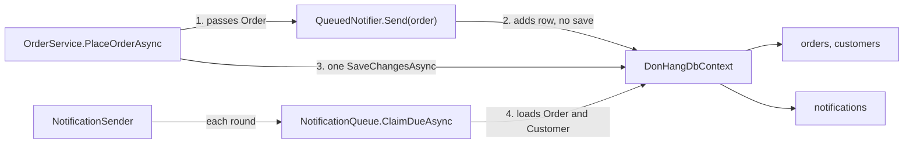

## Bạn cần biết trước

- [[design.l3.module-owns-its-tables]] — bạn biết một module sở hữu các bảng của nó khi chỉ code của chính nó đọc và ghi chúng.
- [[backend.l2.database-job-queue]] — bạn biết ở stage-2, job gửi email của một đơn hàng là một dòng `notifications`, được lưu bằng cùng lần `SaveChangesAsync` với đơn hàng.
- [[design.l3.context-map]] — bạn biết trong cùng một process, notifications là downstream của ordering, vì `NotificationSender` đọc thẳng `Order` và `Customer`.

## Tình huống

Đang ở stage-2, và job gửi email trông đã tách riêng. `NotificationSender` là một class riêng, `QueuedNotifier` nấp sau `INotifier`, còn email được gửi đi vài giây sau mỗi đơn hàng. Một đồng nghiệp đề xuất bước tiếp theo có vẻ hiển nhiên: chuyển các class gửi thông báo sang một project mới, build image cho nó, rồi chạy nó thành service riêng, để release được mà không cần đụng tới API.

Bạn mở `QueuedNotifier` xem thứ gì sẽ được chuyển đi. Class này không gửi gì cả. Nó chỉ thêm một dòng vào đúng DbContext đang chứa đơn hàng.

Cần thay đổi những gì thì job gửi email mới chạy được trong một process riêng?

## Khái niệm cốt lõi

- **microservice** (service được deploy và chạy riêng, sở hữu dữ liệu của một bounded context, chỉ được gọi qua mạng) — phần còn lại của hệ thống không bao giờ với tới nó bằng một lời gọi method hay một bảng dùng chung. "Service" ở đây là một chương trình chạy thành process riêng, không phải một class ở tầng service như `OrderService`.
- lời gọi qua mạng — một process gọi sang process khác qua mạng. Lời gọi có thể chậm, có thể thất bại, và bên gọi không nhận được trả lời thì không biết bên kia đã làm xong hay chưa.
- giao dịch dùng chung — một lần lưu ghi nhiều bảng cùng lúc, hoặc ghi tất cả, hoặc không ghi gì, như lần `SaveChangesAsync` ghi một đơn hàng cùng job gửi email của nó.
- object dùng chung — một object thuộc model của module này được truyền cho, hoặc được nạp bởi, module khác, như `Order` mà code gửi thông báo nhận vào và đọc.

## Cơ chế hoạt động



Kế hoạch của đồng nghiệp di chuyển các class, nhưng một microservice được định nghĩa bằng những gì nó không dùng chung. Sơ đồ cho thấy code gửi thông báo đang dùng chung những gì với ordering bên trong process `api` duy nhất: mỗi vòng, `NotificationSender` gọi `ClaimDueAsync`, và cùng một `DonHangDbContext` map cả các bảng của Ordering lẫn `notifications`.

Mối nối thứ nhất là object dùng chung. `OrderService` đưa thẳng `Order` cho `QueuedNotifier`. Giữa hai process không có object nào đi qua được, chỉ có dữ liệu. Mọi lời gọi method giữa hai bên đều thành lời gọi qua mạng, có thể chậm hoặc thất bại.

Mối nối thứ hai là giao dịch dùng chung. `QueuedNotifier` chỉ thêm một dòng `notifications` vào `DonHangDbContext`, rồi `PlaceOrderAsync` lưu đơn hàng và dòng đó bằng một lần `SaveChangesAsync`. Cả hai cùng được ghi, hoặc không cái nào được ghi. Sau khi tách, `notifications` thuộc về service gửi thông báo, nên chỉ code của nó ghi bảng này, qua kết nối riêng của nó. Nếu không có thứ gì nằm ngoài cả hai process điều phối chúng, đặt một đơn hàng sẽ thành hai lần lưu tách biệt, và một lần có thể thất bại một mình.

Mối nối thứ ba là dữ liệu dùng chung. Mỗi vòng, `NotificationQueue` nạp từng dòng đến hạn mà nó nhận, kèm `Order` của dòng đó và `Customer` của đơn hàng, vì địa chỉ email và tên nằm trong các bảng của Ordering. Một microservice không được truy vấn những bảng đó.

Mỗi mối nối phải trở thành dữ liệu mà phía gửi thông báo nhận vào và tự giữ. Đơn Hàng làm điều đó ra sao sẽ có ở một module sau. Bài này nói thêm về thời điểm cắt các mối nối: trước khi tách, khi ranh giới module đã được vạch trong một process, nơi chúng hiện ra dưới dạng các lời gọi và câu truy vấn đi xuyên qua ranh giới. Ở đó, thay đổi này là một refactoring: một lần build, một lần release, và khi một signature hay một kiểu thay đổi, compiler chỉ ra mọi chỗ gọi không còn compile được. Sau khi tách, compiler chỉ thấy một bên, và mỗi bên phải chạy được với cả phiên bản cũ lẫn mới của bên kia cho tới khi cả hai cùng được release.

## Trong hệ thống Đơn Hàng

Object dùng chung và giao dịch dùng chung, gói trong một class:

```csharp file=DonHang.Infrastructure/QueuedNotifier.cs tag=stage-2 lines=5-24
// lesson: backend.l2.database-job-queue
// Sends nothing itself: it adds a pending notifications row to the same
// DbContext the order is in and leaves the saving to OrderService.
// NotificationSender (DonHang.Api/Jobs) picks the row up a few seconds later.
public sealed class QueuedNotifier(DonHangDbContext db) : INotifier
{
    public void Send(Order order, string subject)
    {
        var now = DateTimeOffset.UtcNow;
        db.Notifications.Add(new Notification
        {
            Order = order, // EF Core fills in order_id when it saves both
            Channel = "email",
            Subject = subject,
            Status = "pending",
            CreatedAt = now,
            NextAttemptAt = now,
        });
    }
}
```

`Send(Order order, string subject)` là signature của `INotifier`, nên chính interface đã nhận `Order` của Ordering. Class này nhận `DonHangDbContext`, chỉ gọi `Add`, và để phần lưu cho `OrderService`. Trong `DonHang.Domain/OrderService.cs`, ngoài đoạn trích này, `PlaceOrderAsync` gọi `notifier.Send` rồi gọi một lần `SaveChangesAsync`, và hủy đơn hay giao hàng cũng làm y như vậy. Dòng 16, `Order = order`, nối dòng mới với object `Order` chứ không phải với một id: EF Core điền `order_id` khi lưu cả hai. Ở một process khác thì không có object `Order` nào để nối vào. Một migration nằm ngoài các file này còn cho `notifications.order_id` một khóa ngoại tới `orders`, nên dữ liệu dùng chung ăn sâu vào cả schema. Riêng id của đơn hàng thì vẫn giữ được dưới dạng một giá trị bình thường.

Dữ liệu dùng chung, ở chỗ mỗi vòng của bên gửi bắt đầu:

```csharp file=DonHang.Infrastructure/NotificationQueue.cs tag=stage-2 lines=16-30
    public async Task<List<Notification>> ClaimDueAsync(int batchSize, CancellationToken cancellationToken)
    {
        await db.Database.BeginTransactionAsync(cancellationToken);
        var now = DateTimeOffset.UtcNow;
        return await db.Notifications
            .FromSql($"""
                SELECT * FROM notifications
                WHERE status = 'pending' AND next_attempt_at <= {now}
                ORDER BY next_attempt_at, id
                LIMIT {batchSize}
                FOR UPDATE SKIP LOCKED
                """)
            .Include(n => n.Order!).ThenInclude(o => o.Customer)
            .ToListAsync(cancellationToken);
    }
```

Dòng 28, `.Include(n => n.Order!).ThenInclude(o => o.Customer)`, chính là mối nối: nó nạp `Order` của từng dòng và `Customer` của đơn hàng đó trong cùng một câu truy vấn. Sau đó `NotificationSender` lấy địa chỉ email và họ tên từ `Customer` ấy. Một service gửi thông báo sẽ phải tự giữ hai giá trị này. Giao dịch và `FOR UPDATE SKIP LOCKED` phía trên chỉ khóa các dòng `notifications` của vòng này, nên chúng không phải mối nối và đi theo phía gửi thông báo mà không cần sửa gì.

## Senior hay nhầm rằng…

- **"Tách một service nghĩa là chuyển các class của nó sang project mới rồi deploy project đó riêng."** → Thực ra chuyển class chỉ đổi chỗ code nằm, không đổi thứ nó dùng chung. Nếu chuyển nguyên trạng, `QueuedNotifier` và `NotificationQueue` vẫn cần `DonHangDbContext`, nên service mới vẫn đọc bảng của Ordering và vẫn phụ thuộc vào model của Ordering. Bạn sẽ nhận ra khi service "riêng" đó không release được nếu API không release kèm, vì cả hai cùng phải đổi mỗi khi `Order` đổi.
- **"Khi job gửi email chạy ở process khác, đơn hàng và job gửi email của nó vẫn lưu được trong một giao dịch."** → Thực ra một lần `SaveChangesAsync` lưu qua một DbContext trên một kết nối, và mỗi process có kết nối riêng. Nếu không có thứ gì nằm ngoài cả hai process điều phối chúng, lần lưu đơn hàng và lần lưu job gửi email thành hai lần, và lần nào cũng có thể thất bại một mình. Bạn sẽ nhận ra khi có một đơn hàng mà email không bao giờ được gửi, hoặc có email gửi tới cho một đơn hàng đã lưu thất bại.
- **"Microservice được định nghĩa bằng sự nhỏ gọn, đo bằng số dòng code."** → Thực ra thứ làm một service thành microservice là nó được deploy riêng và sở hữu dữ liệu của mình, chỉ được gọi qua mạng. Một service nhỏ mà đọc bảng của service khác thì không độc lập. Kích thước vẫn có thể quan trọng khi một team phải hiểu và sở hữu toàn bộ service. Bạn sẽ nhận ra khi hai service nhỏ không thể sửa hay release tách rời nhau, trong khi một service lớn hơn có dữ liệu riêng thì làm được.

## Thử ngay (3 phút)

Trong thư mục gốc của repo ví dụ, mở terminal:

1. Chạy `git show stage-2:DonHang.Api/Jobs/NotificationSender.cs` và tìm method `SendOneAsync`.
2. Liệt kê mọi giá trị mà email dùng, và ghi lại mỗi giá trị lấy từ bảng nào.

Kết quả mong đợi: bốn giá trị. `customer.Email` và `customer.FullName` lấy từ `customers`, đi qua `Order` của dòng đó. `notification.OrderId` và `notification.Subject` lấy từ chính dòng `notifications`.

<details><summary>Gợi ý đáp án</summary>

Hiện chỉ hai trong bốn giá trị thuộc về phía gửi thông báo. `OrderId` vẫn giữ được dưới dạng một giá trị bình thường. Địa chỉ email và họ tên nằm trong bảng `customers` của Ordering, nên một service gửi thông báo có dữ liệu riêng sẽ phải nhận chúng kèm mỗi job và tự giữ lại, thay vì nạp chúng lúc gửi.

</details>

## Liên hệ

- [[design.l3.module-owns-its-tables]] — cùng quy tắc đó ở một bước sớm hơn, bên trong một database.
- [[design.l3.context-map]] — mối phụ thuộc mà bài này liệt kê cái giá của nó nếu notifications rời khỏi process.
- [[backend.l3.outbox-pattern]] — cách giải quyết vấn đề ở mối nối thứ hai của bài này.
- [[backend.l2.at-least-once-jobs]] — bảo đảm mà job gửi email giữ được trong một process, và khi tách không được làm mất nó.
- [[design.l3.when-to-extract-a-service]] — bài tiếp theo: có nên tách một module ra hay không.

## Tóm tắt 5 dòng

1. Trước khi một module chạy được thành service riêng, mọi object, giao dịch và bảng nó dùng chung phải trở thành dữ liệu nó nhận vào và tự giữ.
2. Một microservice được deploy và chạy riêng, sở hữu dữ liệu của mình, và chỉ được gọi qua mạng.
3. Ở stage-2, `QueuedNotifier` thêm job gửi email vào DbContext của đơn hàng, nên một lần `SaveChangesAsync` lưu cả hai.
4. `INotifier.Send` nhận thẳng `Order`, còn `NotificationQueue` nạp `Order` và `Customer` của từng dòng để tìm địa chỉ email.
5. Cắt các mối nối này trong một process là một refactoring. Sau khi tách, cùng thay đổi đó trải ra trên hai hệ thống.
