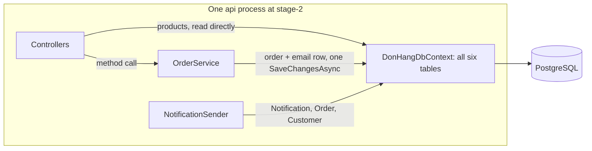

## Bạn cần biết trước

- [[design.l3.contexts-inside-don-hang]] — bạn biết nếu đọc stage-2 theo một hướng hợp lý thì sẽ thấy ba bounded context, đặt hàng, danh mục sản phẩm và thông báo, với ranh giới chỉ tồn tại trên lời nói.
- [[design.l2.clean-architecture]] — bạn biết Clean Architecture tách HTTP, quy tắc và truy cập dữ liệu, và giữ mọi phụ thuộc hướng về phía quy tắc nghiệp vụ.
- [[backend.l2.hosted-services]] — bạn biết `NotificationSender` là một hosted service: host khởi động nó cùng app và chạy nó trong cùng process, bên cạnh các request.

## Tình huống

Job gửi email cứ lớn dần: retry, backoff, một hàng đợi trong bảng `notifications`. Trong buổi họp kế hoạch, một đồng nghiệp nói: "Thông báo nên là một service riêng. Monolith của mình mới là vấn đề."

Bạn mở code xem chuyển job đi thì phải chạm vào những gì. `Program.cs` khởi động `NotificationSender` trong cùng process với mọi endpoint. Khi một đơn hàng được đặt, dòng email của nó được lưu bằng chính lần `SaveChangesAsync` lưu đơn hàng. Còn job thì tìm địa chỉ của khách bằng cách đi từ `Notification` sang `Order` rồi sang `Customer`.

Rắc rối nằm ở chỗ Đơn Hàng chạy thành một process, hay ở chỗ khác?

## Khái niệm cốt lõi

- **monolith** (ứng dụng được build và deploy thành một khối, mọi phần chạy trong cùng một process) — ứng dụng được build và deploy thành một khối, mọi phần của nó chạy trong cùng một process. API của Đơn Hàng ở stage-2 là một monolith.
- **modular monolith** (monolith mà code chia thành các module, mỗi module sở hữu mô hình và dữ liệu riêng, chỉ được gọi qua hợp đồng) — một monolith có code chia thành các module, mỗi module sở hữu mô hình và dữ liệu của một bounded context, và chỉ cho các module khác dùng một hợp đồng public nhỏ.
- module — phần code giữ một bounded context: các class, các bảng và vài kiểu public mà phần khác được gọi tới.
- một mô hình dùng chung — các class và một `DbContext` mà phần code nào cũng đọc và sửa được, như `Entities.cs` và `DonHangDbContext` ở stage-2.
- service, theo nghĩa của đồng nghiệp — một phần được tách ra thành chương trình riêng, deploy riêng và được gọi tới qua mạng.

## Cơ chế hoạt động



Trong tình huống trên, cái hộp, tức process `api`, chính là monolith. `Program.cs` đăng ký các controller, `OrderService`, và dùng `AddHostedService` để đăng ký `NotificationSender`. Một lần `app.Run()` phục vụ tất cả. Có hai thứ chạy ngoài hộp: app Flutter, một client, và container `migrate`, một bước chạy một lần trước khi `api` khởi động.

Bên trong hộp, các phần gọi nhau bằng lời gọi method bình thường. `OrderService` đưa đơn hàng cho repository và đưa email cho notifier, và cả hai cùng rơi vào một `DonHangDbContext`. Sau đó một lần `SaveChangesAsync` ghi đơn hàng và dòng email của nó cùng lúc, trong một giao dịch. Đó là thứ một process và một database mang lại, và nó đáng giữ chừng nào các phần chưa có lý do để deploy riêng.

Các mũi tên đi vào `DonHangDbContext` cho thấy cái giá. Controller sản phẩm đọc `Products` thẳng từ đó, không qua class service nào, và context đó ghi vào database PostgreSQL duy nhất. Phần nào cũng tới được cùng một context, nên phần nào cũng đọc được mọi bảng. Job email đi vào `Order` của phần đặt hàng để lấy địa chỉ, và không gì trong build ngăn class thông báo tiếp theo đọc luôn `orders`.

Modular monolith giữ nguyên một process và vạch ranh giới bên trong nó. Mỗi module sở hữu mô hình và các bảng của một bounded context. Module khác chỉ được dùng phần public nhỏ mà nó đưa ra, không bao giờ dùng các class khác hay các dòng dữ liệu của nó. Lời gọi giữa các module vẫn là lời gọi method bình thường. Cái đổi là code cho phép những lời gọi nào.

Vậy rắc rối trong tình huống không nằm ở chuyện chỉ có một process. Nó nằm ở chỗ ba context dùng chung một mô hình và một `DbContext`, và tự một process thứ hai không gỡ được chuyện đó.

## Trong hệ thống Đơn Hàng

Mô hình dùng chung, gói trong một class:

```csharp file=DonHang.Infrastructure/DonHangDbContext.cs tag=stage-2 lines=6-14
// lesson: backend.l1.efcore-mapping
public sealed class DonHangDbContext(DbContextOptions<DonHangDbContext> options) : DbContext(options)
{
    public DbSet<Customer> Customers => Set<Customer>();
    public DbSet<Product> Products => Set<Product>();
    public DbSet<Order> Orders => Set<Order>();
    public DbSet<OrderItem> OrderItems => Set<OrderItem>();
    public DbSet<Payment> Payments => Set<Payment>();
    public DbSet<Notification> Notifications => Set<Notification>();
```

Một class, sáu property `DbSet`: `Customer`, `Order` và `OrderItem` của phần đặt hàng, `Product` của danh mục, `Notification` của phần thông báo, và `Payment`, thứ chưa service, controller hay job nào dùng. Class nào nhận một `DonHangDbContext` cũng thấy đủ cả sáu. Ba project `DonHang.Api`, `DonHang.Domain` và `DonHang.Infrastructure` chia HTTP, quy tắc và lưu trữ, nên mỗi project giữ một lát của mọi context. Trong một modular monolith, mỗi nhóm bảng sẽ thuộc về một module và không module nào khác tới được.

Thứ một process mang lại, trong `PlaceOrderAsync`:

```csharp file=DonHang.Domain/OrderService.cs tag=stage-2 lines=25-33
        var order = new Order(customerId, items, DateTimeOffset.UtcNow) { IdempotencyKey = idempotencyKey };
        await repository.AddAsync(order);

        // lesson: backend.l2.database-job-queue
        // The notifier only adds a pending email job next to the order; this one
        // SaveChangesAsync then writes both in one transaction, or neither.
        notifier.Send(order, "order placed");
        await repository.SaveChangesAsync();
        return (order, Created: true);
```

`notifier.Send` là một lời gọi method bình thường: không qua mạng, không chờ chương trình khác trả lời. Comment nói ra lợi ích thứ hai: đơn hàng và job email đang chờ của nó được ghi "in one transaction, or neither", tức cả hai trong một giao dịch, hoặc không cái nào. Không bao giờ có đơn hàng được lưu mà thiếu dòng email, và không có dòng email nào trỏ tới một đơn hàng lưu thất bại. Modular monolith giữ lại lời gọi method. Còn hai module có nên chung một giao dịch hay không là câu hỏi cho các bài sau bài này.

## Senior hay nhầm rằng…

- **"Monolith là thiết kế lỗi thời mà hệ thống nào lớn lên cũng phải thoát ra bằng cách tách thành các service."** → Thực ra monolith là một lựa chọn về deploy: một khối để build, đưa đi và chạy. Nó cho lời gọi method thay vì lời gọi qua mạng, và một giao dịch trên nhiều bảng, như trong `PlaceOrderAsync`. Khi các phần của hệ thống tự do đọc dữ liệu của nhau, thêm process không ngăn được chuyện đó. Nếu phần thông báo chuyển sang process và database riêng, dòng email của nó không còn đi chung lần `SaveChangesAsync` của đơn hàng được nữa: hai lần lưu riêng sẽ ghi chúng. Bạn sẽ nhận ra khi một lần tách để đơn hàng và dòng email của nó ở hai nơi, và phải viết code mới để giữ hai bên khớp nhau.
- **"Đơn Hàng đã có ba project, nên nó đã là modular monolith rồi."** → Thực ra `DonHang.Api`, `DonHang.Domain` và `DonHang.Infrastructure` là các tầng: mỗi project giữ một phần của mọi context. `Entities.cs` khai báo class của cả ba context, và `DonHangDbContext` map mọi bảng của chúng. Bạn sẽ nhận ra khi một thay đổi về retry email, như thêm một property cho `Notification`, phải sửa `Entities.cs`, và cả `DonHangDbContext.cs` vì mọi cột của `Notification` ở đó đều được đặt tên bằng `HasColumnName`: chính những file đang giữ các class của phần đặt hàng.
- **"Các module trong cùng một process không thể thật sự tách nhau, nên ranh giới chỉ có ý nghĩa khi các phần chạy thành service riêng."** → Thực ra build và test kiểm tra được một ranh giới bên trong một process, như test dependency rule đã fail nếu `DonHang.Domain` tham chiếu tới `DonHang.Infrastructure` hay `DonHang.Api`. Chiều ngược lại cũng đúng: hai service đọc cùng các bảng vẫn dính vào nhau, chỉ là giờ qua mạng. Bạn sẽ nhận ra khi hai chương trình cùng hỏng sau một thay đổi ở một bảng dùng chung.

## Thử ngay (3 phút)

Trong thư mục gốc của repo ví dụ, mở terminal:

1. Chạy `git show stage-2:DonHang.Infrastructure/DonHangDbContext.cs`.
2. Với mỗi property `DbSet`, ghi ra nó thuộc context nào: đặt hàng, danh mục sản phẩm hay thông báo.
3. Trong khối `modelBuilder.Entity<Notification>`, tìm dòng trỏ tới một class của context khác.

Kết quả mong đợi: sáu property `DbSet`. `Customers`, `Orders` và `OrderItems` thuộc phần đặt hàng, `Products` thuộc danh mục, `Notifications` thuộc phần thông báo, còn `Payments` chưa thuộc context nào. Trong khối `Notification`, dòng `e.HasOne(n => n.Order).WithMany().HasForeignKey(n => n.OrderId);` nối mỗi thông báo với `Order` của phần đặt hàng.

<details><summary>Gợi ý đáp án</summary>

File này giữ bảng của mọi context trong một class, nên nó chính là mô hình dùng chung gom vào một chỗ. Dòng `HasOne(n => n.Order)` là phần map của thông báo gọi tên class của phần đặt hàng: đúng chỗ vượt ranh giới cho phép `NotificationSender` đi từ `Notification` sang `Order` rồi sang `Customer`. Trong một modular monolith, phần thông báo hoàn toàn không map class của phần đặt hàng. Thay dòng này là loại thay đổi mà các bài tiếp theo sẽ làm. Không chỗ nào ở đây cần tới process thứ hai.

</details>

## Liên hệ

- [[design.l3.bounded-context]] — ý tưởng cần trước: mỗi module được vạch quanh một bounded context.
- [[devops.l1.what-is-deploy]] — nửa còn lại của chữ "monolith": từ này nói về cách một ứng dụng được deploy.
- [[design.l3.contexts-inside-don-hang]] — các context tìm thấy ở đó chính là các module được gọi tên ở đây. Ở đó ranh giới chỉ tồn tại trên lời nói.
- [[design.l2.clean-architecture]] — một hướng cắt khác: vòng và tầng chia code theo loại việc, còn module chia theo context.
- [[design.l3.modules-cut-through-layers]] — bài tiếp theo: một module giữ mọi tầng của một context.

## Tóm tắt 5 dòng

1. Modular monolith được deploy thành một khối như mọi monolith, nhưng code chia thành các module, mỗi module sở hữu mô hình và dữ liệu của một context.
2. Ở stage-2, mọi endpoint và `NotificationSender` chạy trong một process duy nhất do `Program.cs` khởi động: API của Đơn Hàng là một monolith.
3. Một process cho lời gọi method bình thường và một giao dịch: `PlaceOrderAsync` lưu đơn hàng và dòng email của nó bằng một lần `SaveChangesAsync`.
4. Stage-2 chưa chia module: ba project của nó là các tầng, còn `Entities.cs` và `DonHangDbContext` giữ class và bảng của mọi context.
5. Là monolith là một lựa chọn về deploy. Module giải quyết chuyện các phần tự do thò vào dữ liệu của nhau, dù trong một process hay nhiều process.
