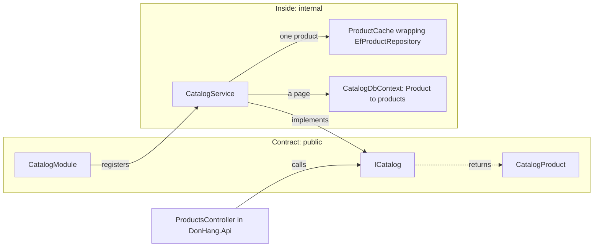

## Before you start

- [[design.l3.modules-cut-through-layers]] — you know that at stage-3 the Catalog module is the project `DonHang.Catalog`, holding the product class, its table mapping, its cache and `CatalogModule`.
- [[design.l2.composition-root]] — you know that at stage-2 `ProductsController.List` read `DonHangDbContext` directly, skipping the core.
- [[design.l2.ports-and-adapters]] — you know that an interface can stand between code and the technology behind it, as `IOrderRepository` does for ordering.

## The situation

At stage-2 you plan a change to how products are stored. You search for who uses that code and find more than product code. `ProductsController` takes `DonHangDbContext` in its constructor, and its `List` filters `db.Products` by price and sorts by `Id` itself. `Product` and `DonHangDbContext` are both `public`, so any project that references theirs can do the same.

So your change is not only yours. Every class that names `Product` or the DbContext depends on how products are stored today, and a search may not show you all of them; the build of the next change may be what does.

How can product code let other code use products without letting it depend on how products are stored?

## Core concepts

- **module contract** — the small set of public types that other modules may use; every other type in the module is `internal`.
- `internal` — the C# access level that lets a type be used only by code in the same assembly, the DLL its project builds; code in another project that names it does not compile. For the same reason a `public` method may not return or take an `internal` type: callers outside could not name it, so the compiler refuses the method.
- the inside of a module — every type that is not in the contract: at stage-3 in Catalog, `Product`, `CatalogDbContext`, the repository, `ProductCache` and `CatalogService`.
- caller — code outside a module that uses its contract, such as `ProductsController` in `DonHang.Api`.

## How it works



In the situation above, the trouble is that everything was public. Any type a caller can name is a type its owner can no longer change alone.

At stage-3 Catalog draws a line. Three types are `public`: `ICatalog`, the interface callers call; `CatalogProduct`, the record its methods return; and `CatalogModule`, whose `AddCatalogModule` registers Catalog with the app. Together they are Catalog's module contract. Everything else is `internal`: `Product`, `CatalogDbContext`, `IProductRepository` and `EfProductRepository`, which implements it, `ProductCache` and `CatalogService`, the class that implements `ICatalog`. `CatalogService` reads a page of products straight from `CatalogDbContext`, and gets one product at a time through `ProductCache`, which wraps `EfProductRepository`.

The compiler keeps that line. `DonHang.Api` references `DonHang.Catalog`, yet a class in `DonHang.Api` that names `Product` or `CatalogDbContext` does not compile. The boundary is checked before any test runs, on every build.

So at stage-3 `ProductsController` cannot query `products` as it did at stage-2. It asks `ICatalog` to list, find or reprice a product and gets `CatalogProduct` values back. `CatalogProduct` is a copy of a product's id, name and price, not the `Product` Catalog stores and changes.

That is what buys Catalog its freedom. It can change its table mapping or its cache, and no caller notices, as long as its three public types stay the same. A change to the contract is the only kind that reaches callers, and it is the kind you plan with them.

## In the Đơn Hàng system

The contract's main type:

```csharp file=DonHang.Catalog/ICatalog.cs tag=stage-3 lines=3-19
// lesson: design.l3.module-contracts
// The Catalog module's contract: the only way other modules reach products.
// Everything behind it (Product, CatalogDbContext, the repository, the Redis
// cache) is `internal` and can change without any caller noticing.
public interface ICatalog
{
    // One page of products in id order, only those costing at most
    // maxPriceVnd when it is given.
    Task<List<CatalogProduct>> ListAsync(int limit, int offset, int? maxPriceVnd);

    // The product, or null when no product has this id.
    Task<CatalogProduct?> FindAsync(int id);

    // Saves the new price and returns the changed product, or null when no
    // product has this id.
    Task<CatalogProduct?> ChangePriceAsync(int id, int priceVnd);
}
```

Look at what the three methods speak in: ids, limits, prices and `CatalogProduct`. No method mentions a DbContext, a table, Redis or `Product`. The comments say what each call does, not how: "in id order", "null when no product has this id". That is the whole surface a caller can depend on.

The caller, at stage-3:

```csharp file=DonHang.Api/Controllers/ProductsController.cs tag=stage-3 lines=10-32
// lesson: design.l3.module-contracts
// From stage-3 every product request goes through ICatalog, the Catalog
// module's contract: this controller cannot see Product, Catalog's DbContext
// or its cache, so it cannot query `products` directly as it did at stage-2.
[ApiController]
[Route("api/v1/products")]
public sealed class ProductsController(ICatalog catalog) : ControllerBase
{
    private const int MaxPageSize = 100;

    // lesson: backend.l2.offset-pagination
    // GET /api/v1/products?limit=20&offset=40. A `limit` outside 1..100 is
    // refused with 400, so no request can ask for the whole table at once.
    [HttpGet]
    [EnableRateLimiting("catalog-reads")]
    public async Task<ActionResult<List<ProductDto>>> List(
        [FromQuery, Range(1, MaxPageSize)] int limit = 20,
        [FromQuery, Range(0, int.MaxValue)] int offset = 0,
        [FromQuery] int? maxPriceVnd = null)
    {
        var page = await catalog.ListAsync(limit, offset, maxPriceVnd);
        return Ok(page.Select(ToDto).ToList());
    }
```

The constructor takes `ICatalog` and nothing else. The filtering and sorting that `List` did itself at stage-2 now happen inside Catalog; the controller passes the three values on and turns the result into `ProductDto`. The other two actions in this file, outside the excerpt, call `FindAsync` and `ChangePriceAsync` the same way. The `EnableRateLimiting` and `Range` attributes belong to other lessons and play no part in the contract.

## Seniors often assume…

- **"Making every class `public` is harmless, because other modules will simply not use what they do not need."** → Actually a public type can be used by any project that references its own, and nothing records who started using it. Stage-2's `ProductsController.List` is that case: it was easier to query `DonHangDbContext` than to go through product code. You notice this when a storage change inside one module breaks the build of another.
- **"A module contract has to be an HTTP API, even between modules of one process."** → Actually between modules of one process the contract is C# types, called with an ordinary method call: `ProductsController` calls `ICatalog` directly. An HTTP contract fits when the other side runs in another process. Inside one process it would add turning the call's values into JSON and back, and network failures, to a call that has neither. You notice this when a call between two parts of the same app needs retries and a limit on how long to wait for an answer.
- **"Returning `Product` itself from `ICatalog` is fine, because callers only read its properties."** → Actually `ICatalog` is public and `Product` is `internal`, so a public method that returns `Product` does not compile. Making `Product` public to fix that hands callers its setters and its exact shape, so Catalog's model becomes part of the contract. You notice this when renaming a property of the stored class breaks code in another module.

## Try it (3 minutes)

In the root folder of the example repository, in a terminal:

1. Run `git grep -n -E "^(public|internal)" stage-3 -- DonHang.Catalog` to list the access level of every type Catalog declares.
2. Sort the lines into two groups: `public` and `internal`.

Expected result: nine lines. Three are `public`: `CatalogModule`, `CatalogProduct` and `ICatalog`. Six are `internal`: `CatalogDbContext`, `CatalogService`, `EfProductRepository`, `IProductRepository`, `Product` and `ProductCache`.

<details><summary>Suggested answer</summary>

The `public` group is Catalog's module contract: the types code in `DonHang.Api` can name. The `internal` group is the inside, which Catalog can rename, split or replace without any caller changing. Only the three public types need a conversation with callers before they change.

</details>

## Connections

- [[foundation.l1.oop-encapsulation]] — the same idea one level up: a class hides its fields behind methods; a module hides its types behind a contract.
- [[backend.l2.openapi-contract]] — the contract between processes: an HTTP API described for clients, where a module contract is C# types inside one process.
- [[design.l3.modules-cut-through-layers]] — prerequisite: there Catalog got its own project; here that project decides what others may see.
- [[design.l3.module-owns-its-tables]] — what comes next: with `CatalogDbContext` internal, which tables belong to which module.
- [[design.l3.testing-module-boundaries]] — where the list of public types gets a test of its own.

## Five-line summary

1. Other modules reach a module only through its contract: a few public types, while every other type is `internal`.
2. At stage-3 Catalog's contract is `ICatalog`, `CatalogProduct` and `CatalogModule`; `Product`, its DbContext and `ProductCache` are `internal`.
3. Code in `DonHang.Api` that names an `internal` Catalog type does not compile, so the compiler checks the boundary first.
4. `ProductsController` lists, reads and reprices products through `ICatalog` instead of querying a DbContext as at stage-2.
5. Catalog can change its table mapping or cache freely while its three public types stay the same.
