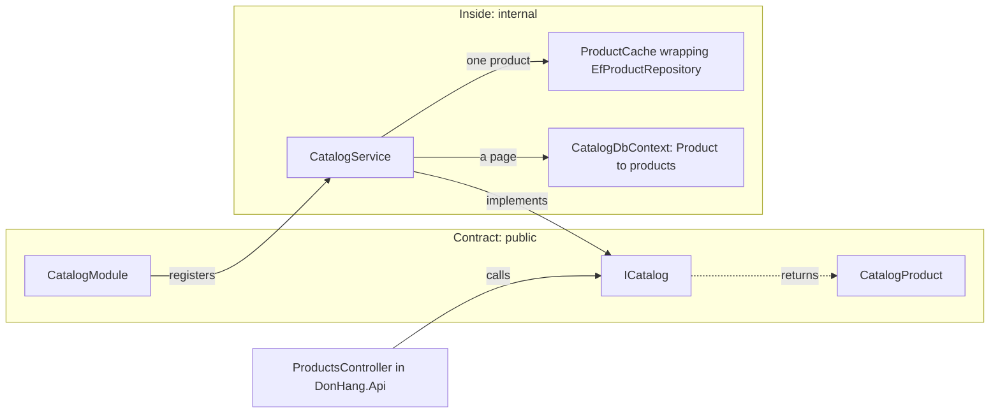

## Bạn cần biết trước

- [[design.l3.modules-cut-through-layers]] — bạn biết ở stage-3, module Catalog là project `DonHang.Catalog`, chứa class sản phẩm, phần map bảng của nó, cache của nó và `CatalogModule`.
- [[design.l2.composition-root]] — bạn biết ở stage-2, `ProductsController.List` đọc thẳng `DonHangDbContext`, bỏ qua phần lõi.
- [[design.l2.ports-and-adapters]] — bạn biết một interface có thể đứng giữa code và công nghệ phía sau nó, như `IOrderRepository` làm cho phần đặt hàng.

## Tình huống

Ở stage-2, bạn định đổi cách lưu sản phẩm. Bạn tìm xem ai đang dùng phần code đó và thấy không chỉ có code sản phẩm. `ProductsController` nhận `DonHangDbContext` trong constructor, còn `List` của nó tự lọc `db.Products` theo giá và tự sắp xếp theo `Id`. `Product` và `DonHangDbContext` đều `public`, nên project nào tham chiếu tới project chứa chúng cũng làm được y như vậy.

Vậy thay đổi này không còn là chuyện riêng của bạn. Class nào gọi tên `Product` hay DbContext đều phụ thuộc vào cách sản phẩm đang được lưu hôm nay, và tìm kiếm chưa chắc cho bạn thấy hết. Có khi phải tới lúc build thay đổi tiếp theo, bạn mới thấy.

Code sản phẩm làm sao cho code khác dùng sản phẩm mà không để code đó phụ thuộc vào cách sản phẩm được lưu?

## Khái niệm cốt lõi

- **hợp đồng của module** (module contract) — tập nhỏ các kiểu `public` mà module khác được dùng. Mọi kiểu khác trong module là `internal`.
- `internal` — mức truy cập của C# chỉ cho code trong cùng assembly, tức file DLL mà project build ra, dùng một kiểu. Code ở project khác gọi tên kiểu đó sẽ không compile. Cũng vì vậy, một method `public` không được trả về hay nhận vào một kiểu `internal`: code gọi từ bên ngoài không gọi tên được kiểu đó, nên compiler từ chối method.
- bên trong một module — mọi kiểu không thuộc hợp đồng. Ở stage-3, trong Catalog đó là `Product`, `CatalogDbContext`, repository, `ProductCache` và `CatalogService`.
- bên gọi — code bên ngoài một module dùng hợp đồng của nó, như `ProductsController` trong `DonHang.Api`.

## Cơ chế hoạt động



Trong tình huống trên, rắc rối là mọi thứ đều public. Kiểu nào bên gọi gọi tên được thì chủ của nó không còn tự mình đổi được nữa.

Ở stage-3, Catalog vạch một đường ranh. Ba kiểu là `public`: `ICatalog`, interface mà bên gọi gọi tới, `CatalogProduct`, record mà các method của nó trả về, và `CatalogModule`, nơi `AddCatalogModule` đăng ký Catalog với app. Ba kiểu này gộp lại là hợp đồng của module Catalog. Mọi thứ còn lại là `internal`: `Product`, `CatalogDbContext`, `IProductRepository` cùng `EfProductRepository` hiện thực nó, `ProductCache`, và `CatalogService`, class hiện thực `ICatalog`. `CatalogService` đọc một trang sản phẩm thẳng từ `CatalogDbContext`, còn khi lấy từng sản phẩm thì đi qua `ProductCache`, thứ bọc `EfProductRepository`.

Compiler giữ đường ranh đó. `DonHang.Api` tham chiếu tới `DonHang.Catalog`, vậy mà một class trong `DonHang.Api` gọi tên `Product` hay `CatalogDbContext` sẽ không compile. Ranh giới được kiểm tra trước cả khi test nào chạy, ở mọi lần build.

Nên ở stage-3, `ProductsController` không truy vấn `products` được như ở stage-2. Nó nhờ `ICatalog` liệt kê, tìm hoặc đổi giá một sản phẩm, và nhận lại các giá trị `CatalogProduct`. `CatalogProduct` là bản sao id, tên và giá của một sản phẩm, không phải `Product` mà Catalog lưu và sửa.

Chính điều đó cho Catalog sự tự do. Nó đổi được phần map bảng hay cache mà không bên gọi nào hay biết, miễn ba kiểu public của nó giữ nguyên. Chỉ thay đổi trên hợp đồng mới chạm tới bên gọi, và đó là loại thay đổi bạn lên kế hoạch cùng họ.

## Trong hệ thống Đơn Hàng

Kiểu chính của hợp đồng:

```csharp file=DonHang.Catalog/ICatalog.cs tag=stage-3 lines=3-19
// lesson: design.l3.module-contracts
// The Catalog module's contract: the only way other modules reach products.
// Everything behind it (Product, CatalogDbContext, the repository, the Redis
// cache) is `internal` and can change without any caller noticing.
public interface ICatalog
{
    // One page of products in id order, only those costing at most
    // maxPriceVnd when it is given.
    Task<List<CatalogProduct>> ListAsync(int limit, int offset, int? maxPriceVnd);

    // The product, or null when no product has this id.
    Task<CatalogProduct?> FindAsync(int id);

    // Saves the new price and returns the changed product, or null when no
    // product has this id.
    Task<CatalogProduct?> ChangePriceAsync(int id, int priceVnd);
}
```

Hãy để ý ba method này nói bằng gì: id, giới hạn, giá và `CatalogProduct`. Không method nào nhắc tới DbContext, bảng, Redis hay `Product`. Comment nói mỗi lời gọi làm gì chứ không nói làm thế nào: "in id order", "null when no product has this id". Đó là toàn bộ bề mặt mà bên gọi có thể phụ thuộc vào.

Bên gọi, ở stage-3:

```csharp file=DonHang.Api/Controllers/ProductsController.cs tag=stage-3 lines=10-32
// lesson: design.l3.module-contracts
// From stage-3 every product request goes through ICatalog, the Catalog
// module's contract: this controller cannot see Product, Catalog's DbContext
// or its cache, so it cannot query `products` directly as it did at stage-2.
[ApiController]
[Route("api/v1/products")]
public sealed class ProductsController(ICatalog catalog) : ControllerBase
{
    private const int MaxPageSize = 100;

    // lesson: backend.l2.offset-pagination
    // GET /api/v1/products?limit=20&offset=40. A `limit` outside 1..100 is
    // refused with 400, so no request can ask for the whole table at once.
    [HttpGet]
    [EnableRateLimiting("catalog-reads")]
    public async Task<ActionResult<List<ProductDto>>> List(
        [FromQuery, Range(1, MaxPageSize)] int limit = 20,
        [FromQuery, Range(0, int.MaxValue)] int offset = 0,
        [FromQuery] int? maxPriceVnd = null)
    {
        var page = await catalog.ListAsync(limit, offset, maxPriceVnd);
        return Ok(page.Select(ToDto).ToList());
    }
```

Constructor chỉ nhận `ICatalog`, không gì khác. Phần lọc và sắp xếp mà `List` tự làm ở stage-2 giờ diễn ra bên trong Catalog. Controller chỉ chuyển tiếp ba giá trị và đổi kết quả thành `ProductDto`. Hai action còn lại trong file này, ngoài đoạn trích, gọi `FindAsync` và `ChangePriceAsync` theo cùng cách. Hai attribute `EnableRateLimiting` và `Range` thuộc về bài khác, không dính gì tới hợp đồng.

## Senior hay nhầm rằng…

- **"Để mọi class `public` cũng chẳng hại gì, vì module khác sẽ tự không dùng thứ chúng không cần."** → Thực ra một kiểu public dùng được từ mọi project tham chiếu tới project chứa nó, và không có gì ghi lại ai đã bắt đầu dùng nó. `ProductsController.List` ở stage-2 chính là trường hợp đó: truy vấn `DonHangDbContext` dễ hơn đi qua code sản phẩm. Bạn sẽ nhận ra khi một thay đổi về lưu trữ bên trong một module làm hỏng build của module khác.
- **"Hợp đồng của module phải là một HTTP API, kể cả giữa các module trong cùng một process."** → Thực ra giữa các module trong cùng một process, hợp đồng là các kiểu C#, gọi bằng một lời gọi method bình thường: `ProductsController` gọi thẳng `ICatalog`. Hợp đồng HTTP hợp khi bên kia chạy ở process khác. Trong cùng một process, nó sẽ thêm khâu đổi các giá trị của lời gọi sang JSON rồi đổi ngược lại, cùng các lỗi mạng, vào một lời gọi vốn không có hai thứ đó. Bạn sẽ nhận ra khi một lời gọi giữa hai phần của cùng một app lại cần thử lại và cần giới hạn thời gian chờ câu trả lời.
- **"Cho `ICatalog` trả về chính `Product` cũng ổn, vì bên gọi chỉ đọc property của nó."** → Thực ra `ICatalog` là public còn `Product` là `internal`, nên một method public trả về `Product` sẽ không compile. Đổi `Product` thành public để sửa thì lại trao cho bên gọi các setter và đúng hình dạng của nó, khiến model của Catalog thành một phần của hợp đồng. Bạn sẽ nhận ra khi đổi tên một property của class được lưu làm hỏng code ở module khác.

## Thử ngay (3 phút)

Trong thư mục gốc của repo ví dụ, mở terminal:

1. Chạy `git grep -n -E "^(public|internal)" stage-3 -- DonHang.Catalog` để liệt kê mức truy cập của mọi kiểu mà Catalog khai báo.
2. Chia các dòng thành hai nhóm: `public` và `internal`.

Kết quả mong đợi: chín dòng. Ba dòng là `public`: `CatalogModule`, `CatalogProduct` và `ICatalog`. Sáu dòng là `internal`: `CatalogDbContext`, `CatalogService`, `EfProductRepository`, `IProductRepository`, `Product` và `ProductCache`.

<details><summary>Gợi ý đáp án</summary>

Nhóm `public` là hợp đồng của module Catalog: các kiểu mà code trong `DonHang.Api` gọi tên được. Nhóm `internal` là phần bên trong, thứ Catalog có thể đổi tên, tách ra hay thay thế mà không bên gọi nào phải sửa. Chỉ ba kiểu public mới cần bàn với bên gọi trước khi đổi.

</details>

## Liên hệ

- [[foundation.l1.oop-encapsulation]] — cùng ý tưởng đó ở một bậc cao hơn: class giấu field sau các method, còn module giấu các kiểu của nó sau một hợp đồng.
- [[backend.l2.openapi-contract]] — hợp đồng giữa các process: một HTTP API được mô tả cho client, còn hợp đồng của module là các kiểu C# trong cùng một process.
- [[design.l3.modules-cut-through-layers]] — bài cần trước: ở đó Catalog có project riêng, ở đây project đó quyết định bên ngoài được thấy gì.
- [[design.l3.module-owns-its-tables]] — bài tiếp theo: khi `CatalogDbContext` đã là internal, bảng nào thuộc về module nào.
- [[design.l3.testing-module-boundaries]] — nơi danh sách các kiểu public có một test riêng.

## Tóm tắt 5 dòng

1. Module khác chỉ chạm tới một module qua hợp đồng của nó: vài kiểu public, còn mọi kiểu khác là `internal`.
2. Ở stage-3, hợp đồng của Catalog là `ICatalog`, `CatalogProduct` và `CatalogModule`, còn `Product`, DbContext của nó và `ProductCache` là `internal`.
3. Code trong `DonHang.Api` gọi tên một kiểu `internal` của Catalog sẽ không compile, nên compiler kiểm tra ranh giới trước tiên.
4. `ProductsController` liệt kê, đọc và đổi giá sản phẩm qua `ICatalog`, thay vì truy vấn DbContext như ở stage-2.
5. Catalog tự do đổi phần map bảng hay cache, miễn ba kiểu public của nó giữ nguyên.
