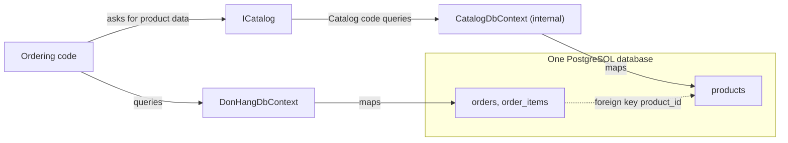

## Before you start

- [[design.l3.module-contracts]] — you know that at stage-3 other code reaches Catalog only through `ICatalog`, and that `CatalogDbContext` is `internal`.
- [[design.l2.unit-of-work]] — you know that a `DbContext` tracks what one operation changes and saves it in one transaction.
- [[backend.l1.efcore-relationships-and-keys]] — you know how a foreign key column such as `product_id` ties `order_items` to another table.

## The situation

At stage-3 you are adding product names to an order's details. Orders belong to Ordering, the module whose code is `DonHang.Domain` and `DonHang.Infrastructure`, with `DonHangDbContext` as its DbContext. The names sit in `products`. You open `DonHangDbContext` and find no `Products` property, so `db.Products` does not compile.

Yet `products` lives in the same PostgreSQL database as `order_items`, one `JOIN` away. A teammate suggests sending that `JOIN` as a SQL string through `DonHangDbContext`. It would run, and the names would show up within the hour.

If the database lets Ordering read `products`, what makes that table Catalog's alone?

## Core concepts

- owning a table — a module owns a table when only its own code reads and writes it; other modules get that data through the module's contract, never by querying the table.
- the mapping — the `DbContext` that maps a table is the only one whose code can query that table as C# objects; at stage-3 only `CatalogDbContext` maps `products`.
- one shared database — the single PostgreSQL database both modules' DbContexts connect to; it holds both modules' tables and knows nothing about modules.
- coupling in the database — anything in the database that ties one module's tables to another's, such as a foreign key or a query that joins them.

## How it works



In the situation above, what stops `db.Products` is the mapping. At stage-3 `CatalogDbContext` maps `products` and `DonHangDbContext` does not. Ordering's code has only `DonHangDbContext`, and `CatalogDbContext` is `internal` to `DonHang.Catalog`, so no Ordering class can write a C# query over products, even by accident. When Ordering needs product data, it asks Catalog through its contract, and Catalog's own code reads `products` through `CatalogDbContext`.

Notice what did not change. Both DbContexts are configured with the same database address and login, so both reach the same PostgreSQL database, and `products` is the same table with the same rows as at stage-2. Owning a table is a rule about which code touches it. It needed no separate database and no change to the schema.

The database still knows nothing about modules. `order_items.product_id` keeps its foreign key to `products`, so PostgreSQL refuses an order item whose product does not exist and refuses to delete a product an order item still points to. That is coupling in the database: it ties Ordering's table to Catalog's where no compiler sees it. PostgreSQL cannot point a foreign key into another database, so this tie must go before the two modules could use separate ones.

The SQL string from the situation is the other way back in. The database lets any code that can log in read any table it can reach. Ordering would then depend on the table `products` and its column `name` by name. If Catalog renamed that column, every project would still compile and Ordering's query would fail when it runs. The compiler cannot see inside a SQL string, so this part of the rule is kept by people, for example in code review.

## In the Đơn Hàng system

Where `products` is mapped at stage-3:

```csharp file=DonHang.Catalog/CatalogDbContext.cs tag=stage-3 lines=5-24
// lesson: design.l3.module-owns-its-tables
// From stage-3 `products` is mapped here and nowhere else: DonHangDbContext
// no longer has a Products set, so Ordering's code cannot query this table.
// Both DbContexts still connect to the same database, and this one has no
// migrations of its own: the table was created long before (InitialCreate).
internal sealed class CatalogDbContext(DbContextOptions<CatalogDbContext> options) : DbContext(options)
{
    public DbSet<Product> Products => Set<Product>();

    protected override void OnModelCreating(ModelBuilder modelBuilder)
    {
        modelBuilder.Entity<Product>(e =>
        {
            e.ToTable("products");
            e.Property(p => p.Id).HasColumnName("id");
            e.Property(p => p.Name).HasColumnName("name");
            e.Property(p => p.PriceVnd).HasColumnName("price_vnd");
        });
    }
}
```

The class is `internal`, so only code in `DonHang.Catalog` can use it, and `ToTable("products")` with the three column names points Catalog's `Product` at the table that already existed. The comment says the rest: this context has no migrations of its own, because the table was there long before Catalog was. `InitialCreate` is the first migration of `DonHangDbContext`, from when Ordering still mapped `products`. Taking ownership created nothing in the database. Removing `Product` from `DonHangDbContext` meant the next migration, which the tool writes from the change in what that DbContext maps, came out with a line dropping `products`; that line was deleted by hand, so the migration that records the change, `ProductsBelongToCatalog`, does nothing in the database.

Outside the excerpt, `DonHangDbContext` declares properties for `Customers`, `Orders`, `OrderItems` and a few others, and none for products. A comment where `Product`'s mapping used to be says the table and its foreign key stay as they were.

What the database still says:

```sql file=db/schema.sql tag=stage-3 lines=26-32
CREATE TABLE order_items (
    order_id       integer NOT NULL REFERENCES orders (id),
    product_id     integer NOT NULL REFERENCES products (id),
    quantity       integer NOT NULL CHECK (quantity > 0),
    unit_price_vnd integer NOT NULL CHECK (unit_price_vnd > 0),
    PRIMARY KEY (order_id, product_id)
);
```

`db/schema.sql` creates the tables when a fresh database container starts; it creates what `InitialCreate` creates, so there that migration is only recorded as applied. Line 28 is the tie: `REFERENCES products (id)` makes an Ordering table depend on a Catalog table. Stage-3 split the code and left this line alone, so the boundary is complete in C# and still open in the database.

## Seniors often assume…

- **"A module needs its own database server before its tables can count as its own."** → Actually ownership is decided by which code maps and queries a table, not by where the table lives. At stage-3 `products` became Catalog's with no new database and an unchanged schema. A separate database is a later decision with costs of its own. You notice this when a plan to make modules independent starts with new servers and leaves every query across modules in place.
- **"Since both modules use the same database, Ordering may read `products` directly when it only needs a price."** → Actually the shared database says where the table lives, not who may use it. A direct read makes Ordering depend on Catalog's table and column names, which the contract exists to hide, and skips what Catalog does on the way, such as reading through `ProductCache`. You notice this when a change Catalog made behind `ICatalog` breaks Ordering at run time with no compile error.
- **"A foreign key between two modules' tables must be dropped as soon as the code is split into modules."** → Actually while both modules share one database the key still does its job: PostgreSQL rejects an order item for a product that does not exist. Stage-3 split the code and kept the key. It becomes a problem only when the tables must move into different databases, and that is the time to remove it. You notice this when deleting a product fails with a foreign key error: the key is telling you Ordering still depends on that row.

## Try it (3 minutes)

In the root folder of the example repository, in a terminal:

1. Run `git grep -n -e 'ToTable("products")' -e 'REFERENCES products' stage-3 -- '*.cs' db` to find every place, in C# or in the database scripts, that names `products` as a mapped or referenced table.
2. For each line, note whether it belongs to Catalog, to Ordering, or to the database.

Expected result: two lines. `DonHang.Catalog/CatalogDbContext.cs` line 18 maps the table, and `db/schema.sql` line 28 references it from `order_items`.

<details><summary>Suggested answer</summary>

Only Catalog's code maps `products`, so only Catalog can query it as C# objects; no Ordering file appears. The second line is not code but the database itself: the foreign key from `order_items`. It is the one tie between the two modules that the stage-3 split left in place.

</details>

## Connections

- [[design.l3.module-contracts]] — prerequisite: the contract is how other modules get product data once they cannot query the table.
- [[design.l3.reference-other-aggregates-by-id]] — the same idea one level down: an order item holds a `ProductId`, not a product, so Ordering keeps only an id of Catalog's data.
- [[backend.l2.projection-queries]] — the `JOIN` EF Core writes for you inside one module's mapping; across modules, that join is the leak this lesson warns about.
- [[design.l3.one-way-module-dependencies]] — what comes next: how Ordering gets prices from Catalog without reading its table.

## Five-line summary

1. A module owns its tables when only its own code reads and writes them; other modules get that data through its contract.
2. At stage-3 `CatalogDbContext` maps `products` and `DonHangDbContext` does not, so Ordering's code cannot query products.
3. Both DbContexts still connect to the same PostgreSQL database; owning tables needed no separate database and no schema change.
4. `order_items.product_id` keeps its foreign key to `products`, a database tie to remove before the modules could use separate databases.
5. A query that joins another module's tables leaks the boundary, because the module sending it then depends on that module's table and column names.
