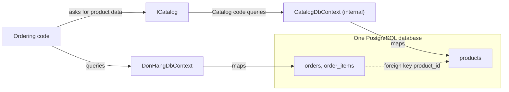

## Bạn cần biết trước

- [[design.l3.module-contracts]] — bạn biết ở stage-3, code khác chỉ chạm tới Catalog qua `ICatalog`, và `CatalogDbContext` là `internal`.
- [[design.l2.unit-of-work]] — bạn biết một `DbContext` theo dõi những gì một thao tác thay đổi và lưu chúng trong một giao dịch.
- [[backend.l1.efcore-relationships-and-keys]] — bạn biết một cột khóa ngoại như `product_id` nối `order_items` với một bảng khác ra sao.

## Tình huống

Ở stage-3, bạn đang thêm tên sản phẩm vào phần chi tiết đơn hàng. Đơn hàng thuộc về Ordering, module có code nằm trong `DonHang.Domain` và `DonHang.Infrastructure`, với DbContext là `DonHangDbContext`. Tên sản phẩm nằm trong `products`. Bạn mở `DonHangDbContext` và không thấy property `Products` nào, nên `db.Products` không compile.

Vậy mà `products` nằm chung một database PostgreSQL với `order_items`, chỉ cách một câu `JOIN`. Một đồng nghiệp gợi ý gửi câu `JOIN` đó dưới dạng chuỗi SQL qua `DonHangDbContext`. Nó sẽ chạy, và tên sản phẩm sẽ hiện ra trong vòng một giờ.

Nếu database cho Ordering đọc `products`, thì điều gì khiến bảng đó chỉ thuộc về Catalog?

## Khái niệm cốt lõi

- sở hữu một bảng — một module sở hữu một bảng khi chỉ code của chính nó đọc và ghi bảng đó. Module khác lấy dữ liệu ấy qua hợp đồng của module, không bao giờ bằng cách truy vấn bảng.
- phần map bảng — `DbContext` nào map một bảng thì chỉ code dùng DbContext đó mới truy vấn được bảng ấy dưới dạng object C#. Ở stage-3, chỉ `CatalogDbContext` map `products`.
- một database dùng chung — database PostgreSQL duy nhất mà DbContext của cả hai module kết nối tới. Nó chứa bảng của cả hai module và không biết gì về module.
- coupling trong database — bất cứ thứ gì trong database nối bảng của module này với bảng của module khác, như một khóa ngoại hay một câu truy vấn JOIN chúng lại.

## Cơ chế hoạt động



Trong tình huống trên, thứ chặn `db.Products` là phần map bảng. Ở stage-3, `CatalogDbContext` map `products` còn `DonHangDbContext` thì không. Code của Ordering chỉ có `DonHangDbContext`, và `CatalogDbContext` là `internal` trong `DonHang.Catalog`, nên không class nào của Ordering viết được một câu truy vấn C# trên sản phẩm, kể cả vô tình. Khi cần dữ liệu sản phẩm, Ordering hỏi Catalog qua hợp đồng của nó, và chính code của Catalog đọc `products` qua `CatalogDbContext`.

Hãy để ý điều không thay đổi. Hai DbContext được cấu hình cùng địa chỉ database và cùng thông tin đăng nhập, nên cả hai tới cùng một database PostgreSQL, và `products` vẫn là bảng đó với đúng các dòng như ở stage-2. Sở hữu một bảng là quy tắc về code nào được chạm vào nó. Nó không cần database riêng, cũng không cần đổi schema.

Database vẫn không biết gì về module. `order_items.product_id` vẫn giữ khóa ngoại tới `products`, nên PostgreSQL từ chối một order item có sản phẩm không tồn tại, và từ chối xóa một sản phẩm mà order item vẫn đang trỏ tới. Đó là coupling trong database: nó nối bảng của Ordering với bảng của Catalog ở chỗ compiler không nhìn thấy. PostgreSQL không cho khóa ngoại trỏ sang một database khác, nên mối nối này phải bỏ đi trước khi hai module có thể dùng hai database riêng.

Chuỗi SQL trong tình huống là con đường còn lại để quay về chỗ cũ. Database cho mọi code đăng nhập được đọc mọi bảng nó với tới. Khi đó Ordering sẽ phụ thuộc vào bảng `products` và cột `name` của nó qua tên. Nếu Catalog đổi tên cột đó, mọi project vẫn compile, còn câu truy vấn của Ordering hỏng lúc chạy. Compiler không nhìn được vào trong một chuỗi SQL, nên phần này của quy tắc do con người giữ, chẳng hạn trong code review.

## Trong hệ thống Đơn Hàng

Nơi `products` được map ở stage-3:

```csharp file=DonHang.Catalog/CatalogDbContext.cs tag=stage-3 lines=5-24
// lesson: design.l3.module-owns-its-tables
// From stage-3 `products` is mapped here and nowhere else: DonHangDbContext
// no longer has a Products set, so Ordering's code cannot query this table.
// Both DbContexts still connect to the same database, and this one has no
// migrations of its own: the table was created long before (InitialCreate).
internal sealed class CatalogDbContext(DbContextOptions<CatalogDbContext> options) : DbContext(options)
{
    public DbSet<Product> Products => Set<Product>();

    protected override void OnModelCreating(ModelBuilder modelBuilder)
    {
        modelBuilder.Entity<Product>(e =>
        {
            e.ToTable("products");
            e.Property(p => p.Id).HasColumnName("id");
            e.Property(p => p.Name).HasColumnName("name");
            e.Property(p => p.PriceVnd).HasColumnName("price_vnd");
        });
    }
}
```

Class này là `internal`, nên chỉ code trong `DonHang.Catalog` dùng được nó. `ToTable("products")` cùng ba tên cột trỏ `Product` của Catalog vào bảng đã có sẵn. Comment nói nốt phần còn lại: context này không có migration riêng, vì bảng đã có từ lâu trước khi có Catalog. `InitialCreate` là migration đầu tiên của `DonHangDbContext`, từ hồi Ordering còn map `products`. Nhận quyền sở hữu không tạo ra gì trong database. Bỏ `Product` khỏi `DonHangDbContext` khiến migration kế tiếp, thứ công cụ sinh ra từ thay đổi trong những gì DbContext đó map, có thêm một dòng xóa `products`. Dòng đó đã được xóa tay, nên migration ghi lại thay đổi này, `ProductsBelongToCatalog`, không làm gì trong database.

Ngoài đoạn trích, `DonHangDbContext` khai báo property cho `Customers`, `Orders`, `OrderItems` và vài thứ khác, không có cái nào cho sản phẩm. Một comment ở chỗ trước đây là phần map của `Product` ghi rằng bảng và khóa ngoại của nó giữ nguyên.

Điều database vẫn nói:

```sql file=db/schema.sql tag=stage-3 lines=26-32
CREATE TABLE order_items (
    order_id       integer NOT NULL REFERENCES orders (id),
    product_id     integer NOT NULL REFERENCES products (id),
    quantity       integer NOT NULL CHECK (quantity > 0),
    unit_price_vnd integer NOT NULL CHECK (unit_price_vnd > 0),
    PRIMARY KEY (order_id, product_id)
);
```

`db/schema.sql` tạo các bảng khi một container database mới khởi động. Nó tạo đúng những gì `InitialCreate` tạo, nên ở đó migration này chỉ được ghi nhận là đã áp dụng. Dòng 28 là mối nối: `REFERENCES products (id)` khiến một bảng của Ordering phụ thuộc vào một bảng của Catalog. Stage-3 tách code và để nguyên dòng này, nên ranh giới đã khép kín trong C# nhưng vẫn còn hở trong database.

## Senior hay nhầm rằng…

- **"Module phải có database server riêng thì bảng của nó mới tính là của nó."** → Thực ra quyền sở hữu do code nào map và truy vấn bảng quyết định, không phải bảng nằm ở đâu. Ở stage-3, `products` thành của Catalog mà không cần database mới và schema không đổi. Database riêng là một quyết định về sau, với cái giá riêng của nó. Bạn sẽ nhận ra khi một kế hoạch tách các module ra độc lập bắt đầu bằng server mới mà vẫn để nguyên mọi câu truy vấn xuyên module.
- **"Hai module dùng chung database, nên Ordering cứ đọc thẳng `products` khi chỉ cần giá."** → Thực ra database dùng chung chỉ nói bảng nằm ở đâu, không nói ai được dùng nó. Đọc thẳng khiến Ordering phụ thuộc vào tên bảng và tên cột của Catalog, đúng thứ mà hợp đồng sinh ra để giấu, và bỏ qua những gì Catalog làm trên đường đi, như đọc qua `ProductCache`. Bạn sẽ nhận ra khi một thay đổi Catalog làm phía sau `ICatalog` làm Ordering hỏng lúc chạy mà không có lỗi compile nào.
- **"Khóa ngoại giữa bảng của hai module phải bỏ ngay khi code được tách thành module."** → Thực ra khi hai module còn chung một database, khóa này vẫn làm đúng việc của nó: PostgreSQL từ chối một order item cho sản phẩm không tồn tại. Stage-3 tách code và giữ khóa. Nó chỉ thành vấn đề khi các bảng phải chuyển sang những database khác nhau, và đó mới là lúc bỏ nó. Bạn sẽ nhận ra khi xóa một sản phẩm thất bại với lỗi khóa ngoại: khóa đang báo cho bạn biết Ordering vẫn phụ thuộc vào dòng đó.

## Thử ngay (3 phút)

Trong thư mục gốc của repo ví dụ, mở terminal:

1. Chạy `git grep -n -e 'ToTable("products")' -e 'REFERENCES products' stage-3 -- '*.cs' db` để tìm mọi chỗ, trong C# hay trong script database, gọi tên `products` như một bảng được map hoặc được tham chiếu.
2. Với mỗi dòng, ghi lại nó thuộc về Catalog, Ordering hay database.

Kết quả mong đợi: hai dòng. `DonHang.Catalog/CatalogDbContext.cs` dòng 18 map bảng, còn `db/schema.sql` dòng 28 tham chiếu tới nó từ `order_items`.

<details><summary>Gợi ý đáp án</summary>

Chỉ code của Catalog map `products`, nên chỉ Catalog truy vấn được nó dưới dạng object C#. Không có file nào của Ordering xuất hiện. Dòng thứ hai không phải code mà là chính database: khóa ngoại từ `order_items`. Đó là mối nối duy nhất giữa hai module mà lần tách ở stage-3 còn để lại.

</details>

## Liên hệ

- [[design.l3.module-contracts]] — bài cần trước: hợp đồng là cách module khác lấy dữ liệu sản phẩm khi không còn truy vấn được bảng.
- [[design.l3.reference-other-aggregates-by-id]] — cùng ý tưởng đó ở một bậc thấp hơn: một order item giữ `ProductId` chứ không giữ sản phẩm, nên Ordering chỉ giữ id của dữ liệu thuộc Catalog.
- [[backend.l2.projection-queries]] — câu `JOIN` mà EF Core viết giúp bạn bên trong phần map của một module. Xuyên qua các module, câu JOIN đó chính là chỗ rò mà bài này cảnh báo.
- [[design.l3.one-way-module-dependencies]] — bài tiếp theo: Ordering lấy giá từ Catalog thế nào mà không đọc bảng của nó.

## Tóm tắt 5 dòng

1. Một module sở hữu các bảng của nó khi chỉ code của chính nó đọc và ghi chúng. Module khác lấy dữ liệu đó qua hợp đồng của nó.
2. Ở stage-3, `CatalogDbContext` map `products` còn `DonHangDbContext` thì không, nên code của Ordering không truy vấn được sản phẩm.
3. Hai DbContext vẫn kết nối tới cùng một database PostgreSQL. Sở hữu bảng không cần database riêng, cũng không cần đổi schema.
4. `order_items.product_id` vẫn giữ khóa ngoại tới `products`, một mối nối trong database phải bỏ đi trước khi các module dùng được database riêng.
5. Câu truy vấn JOIN bảng của module khác làm rò ranh giới, vì module gửi nó khi đó phụ thuộc vào tên bảng và tên cột của module kia.
