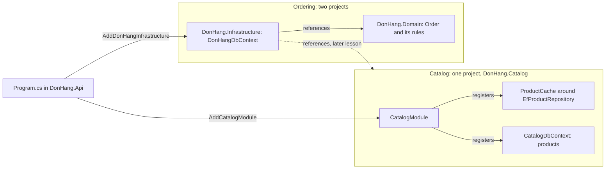

## Before you start

- [[design.l3.modular-monolith]] — you know that a modular monolith runs as one process but splits its code into modules, each holding one bounded context, and that stage-2's three projects are layers, not modules.
- [[design.l3.subdomains]] — you know that ordering is Đơn Hàng's core domain and the product list a supporting subdomain, which gets something simpler than a domain model.
- [[design.l2.decorator-pattern]] — you know that `ProductCache` wraps `EfProductRepository` behind `IProductRepository`, and that one registration puts it there.

## The situation

At stage-2 you are asked to change how products are stored and cached. Products have nothing to do with the order rules, so you expect a small change in one place.

Then you list the files. The `Product` class is in `Entities.cs`, in `DonHang.Domain`, next to `Order`. Its table mapping is in `DonHangDbContext`, next to the orders mapping. `EfProductRepository` and `ProductCache` sit in `DonHang.Infrastructure`, and `ServiceCollectionExtensions` registers the cache in the same method as the order repository. In `DonHang.Domain` and `DonHang.Infrastructure` alone that is five files, and both projects also hold ordering.

Where should product code live, so that a change to products stays among products?

## Core concepts

- layer — a part of the code grouped by kind of work, such as HTTP, rules or storage; at stage-2 `DonHang.Api`, `DonHang.Domain` and `DonHang.Infrastructure` are Đơn Hàng's layers.
- module — the part of a modular monolith that holds one bounded context, with the layers that context needs below HTTP kept inside it.
- the inside of a module — how one module arranges its own code: one project or several, a domain model or plain queries.
- cutting through the layers — splitting code by context first and by kind of work second, so one module holds a little of each layer but only one context.

## How it works



In the situation above, the trouble is the direction of the cut. Layers split code by kind of work: HTTP in `DonHang.Api`, rules in `DonHang.Domain`, storage in `DonHang.Infrastructure`. That split puts a slice of every context into every project, so a product change lands next to order code in each one.

A module cuts the other way first, by bounded context, and the layers come back inside it. At stage-3 Catalog, the products context, still has a product class, a table mapping, a repository and a Redis cache. What changed is where they live: all are now in the project `DonHang.Catalog`, as `Product`, `CatalogDbContext` with the `products` mapping, `EfProductRepository` and `ProductCache`. `CatalogModule` registers them, and `Program.cs` calls `AddCatalogModule` once.

Ordering's code stayed in its two projects: model and rules in `DonHang.Domain`, storage in `DonHang.Infrastructure`. With product code gone, both projects hold Ordering's code. Both modules' endpoints, `ProductsController` and `OrdersController`, stay in `DonHang.Api`, the project that runs the app; module code starts below HTTP. So a module is not a project: Catalog is one project, Ordering spans two. Each is a module because its code holds one context.

The two modules differ inside, too. Catalog is a supporting subdomain: its `Product` has an id, a name and a price, and no methods that guard rules. Ordering is the core domain: `Order` keeps the methods that guard its status. `DonHang.Infrastructure` references `DonHang.Domain`, never the other way round, so the dependency rule holds inside that module. `DonHang.Infrastructure` also references `DonHang.Catalog`, the dotted arrow; what Ordering may use from Catalog is the next lesson. Each module picks the inside its subdomain needs.

## In the Đơn Hàng system

The Catalog project file:

```xml file=DonHang.Catalog/DonHang.Catalog.csproj tag=stage-3 lines=12-19
  <!-- The Catalog module: products, their table and their Redis cache, all in
       one project. No ProjectReference: Catalog needs nothing from Ordering,
       and ModuleBoundaryTests fails if it ever refers to DonHang.Domain,
       DonHang.Infrastructure or DonHang.Api. -->
  <ItemGroup>
    <PackageReference Include="Npgsql.EntityFrameworkCore.PostgreSQL" />
    <PackageReference Include="StackExchange.Redis" />
  </ItemGroup>
```

The comment names what the project holds: products, their table and their Redis cache. The two `PackageReference` lines are storage libraries: the package that lets EF Core talk to PostgreSQL, Đơn Hàng's database, and the Redis client. At stage-2 both lines were in `DonHang.Infrastructure.csproj`, which keeps the EF Core package for Ordering; now Catalog lists both itself, and the Redis client is Catalog's alone. The comment also says Catalog refers to no other Đơn Hàng project; the test it names belongs to a later lesson.

How `Program.cs` wires the two modules:

```csharp file=DonHang.Api/Program.cs tag=stage-3 lines=33-39
// lesson: design.l3.modules-cut-through-layers
// Two modules in one process. Catalog registers everything it has itself;
// Ordering is still DonHang.Domain plus DonHang.Infrastructure. Both get the
// same connection string: they share one database, not one another's tables.
builder.Services.AddCatalogModule(connectionString, redisConfiguration);
builder.Services.AddDonHangInfrastructure(connectionString);
builder.Services.AddScoped<OrderService>();
```

One call wires Catalog: its DbContext, repository, cache and Redis connection are registered inside `AddCatalogModule`, in `CatalogModule.cs`, outside this excerpt. Ordering takes two lines, one per project: `AddDonHangInfrastructure` for its storage and `OrderService` from `DonHang.Domain`. Both receive `connectionString`, the text that tells the app which database to connect to; only Catalog receives `redisConfiguration`, because the Redis cache is Catalog's alone. Which tables each module may touch is a later lesson.

## Seniors often assume…

- **"A modular monolith adds one more layer, called modules, on top of controllers, services and repositories."** → Actually modules are a different cut, not another level of the stack. Each module holds its own layers, as `DonHang.Catalog` holds a model, a table mapping, a repository and a cache. A "modules" level on top would still leave every context spread across the same shared projects below it. You notice this when a change to one context still edits files that also hold the other contexts' code.
- **"Every module must have the same inside structure, with the same projects and the same patterns."** → Actually at stage-3 Catalog is one project with no domain model, while Ordering is two projects with `Order` guarding its status rules. A domain project for Catalog would hold a class with no rules to guard, because products have none. Squeezing Ordering into one plain project would drop the dependency rule that keeps its rules apart from storage. You notice this when a module has a rules project whose classes have no rules to guard.
- **"Moving files into a folder named after a context is enough to make that context a module."** → Actually C# limits access by type and by project, not by folder, so ordering code in the same project can still use every product class. At stage-2 a `Products` folder inside `DonHang.Infrastructure` would still sit in a project ordering uses and register its cache in the same method. Catalog became a module when it got its own project, its own DbContext and its own registrations. You notice this when classes from a "module" folder keep appearing in another context's constructors.

## Try it (3 minutes)

In the root folder of the example repository, in a terminal:

1. Run `git show stage-2:DonHang.Infrastructure/ServiceCollectionExtensions.cs` and find the lines that register the order repository, the Redis connection and the product cache.
2. Run `git show stage-3:DonHang.Infrastructure/ServiceCollectionExtensions.cs` and look for the same lines.

Expected result: at stage-2, `AddDonHangInfrastructure` takes a `redisConfiguration` parameter and registers `IOrderRepository`, `IConnectionMultiplexer` (the Redis connection), `EfProductRepository` and `IProductRepository` with a `ProductCache` in one method. At stage-3 the method takes only `connectionString`, still registers `IOrderRepository`, and registers no Redis connection and no product repository. Its comment says products, Redis and their cache are the Catalog module's own registrations.

<details><summary>Suggested answer</summary>

At stage-2 one method in the storage layer wired the storage of two contexts, so a cache change edited the file that also wires ordering. At stage-3 that method wires ordering alone, and Catalog's registrations moved into `CatalogModule`, inside `DonHang.Catalog`. Nothing about how products are stored or cached changed; only which project holds that code.

</details>

## Connections

- [[design.l1.why-layers]] — the cut this lesson turns sideways: layers split by kind of work, and each module keeps its own layers inside.
- [[backend.l2.cache-aside]] — the cache that moved: the same Redis logic, now registered by `CatalogModule` instead of the shared storage layer.
- [[design.l3.modular-monolith]] — prerequisite: there the modules were named; here they get a place in the code.
- [[design.l3.subdomains]] — why the two modules differ inside: a supporting subdomain gets something simpler than the core domain.
- [[design.l3.module-contracts]] — what comes next: how code outside `DonHang.Catalog` is allowed to reach it.

## Five-line summary

1. Layers split code by kind of work; modules split it by bounded context, and each module keeps its own layers inside.
2. At stage-2 a product storage change touched at least five files in `DonHang.Domain` and `DonHang.Infrastructure`, both shared with ordering.
3. At stage-3 `DonHang.Catalog` holds the product class, its table mapping, the Redis cache and `CatalogModule`, which registers them.
4. Below HTTP, Catalog takes one project and Ordering two: a module is one context, whether it takes one project or several.
5. Each module picks its own inside: Catalog has no rules or domain model, while Ordering keeps `Order` and its dependency rule.
