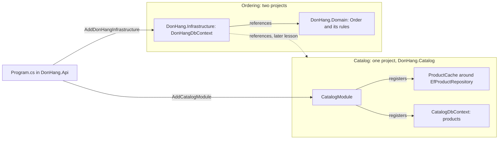

## Bạn cần biết trước

- [[design.l3.modular-monolith]] — bạn biết modular monolith chạy thành một process nhưng chia code thành các module, mỗi module giữ một bounded context, và ba project của stage-2 là các tầng, không phải module.
- [[design.l3.subdomains]] — bạn biết đặt hàng là core domain của Đơn Hàng, còn danh sách sản phẩm là một supporting subdomain, nên nhận thứ đơn giản hơn một domain model.
- [[design.l2.decorator-pattern]] — bạn biết `ProductCache` bọc `EfProductRepository` sau `IProductRepository`, và chỉ một lần đăng ký là đặt nó vào đó.

## Tình huống

Ở stage-2, bạn được giao đổi cách lưu và cache sản phẩm. Sản phẩm chẳng liên quan gì tới các quy tắc của đơn hàng, nên bạn chờ một thay đổi nhỏ, ở một chỗ.

Rồi bạn liệt kê các file. Class `Product` nằm trong `Entities.cs`, thuộc `DonHang.Domain`, ngay cạnh `Order`. Phần map bảng của nó nằm trong `DonHangDbContext`, cạnh phần map của đơn hàng. `EfProductRepository` và `ProductCache` nằm trong `DonHang.Infrastructure`, còn `ServiceCollectionExtensions` đăng ký cache trong cùng method với repository của đơn hàng. Chỉ tính `DonHang.Domain` và `DonHang.Infrastructure` đã là năm file, và cả hai project đều chứa luôn phần đặt hàng.

Code sản phẩm nên nằm ở đâu, để một thay đổi về sản phẩm chỉ quanh quẩn trong phần sản phẩm?

## Khái niệm cốt lõi

- tầng — một phần code gom theo loại việc, như HTTP, quy tắc hay lưu trữ. Ở stage-2, `DonHang.Api`, `DonHang.Domain` và `DonHang.Infrastructure` là các tầng của Đơn Hàng.
- module — phần của một modular monolith giữ một bounded context, cùng các tầng mà context đó cần ở dưới HTTP nằm gọn bên trong.
- bên trong một module — cách một module tự sắp xếp code của mình: một project hay nhiều project, một domain model hay chỉ các truy vấn đơn giản.
- cắt xuyên qua các tầng — chia code theo context trước, theo loại việc sau, để mỗi module giữ một ít của từng tầng nhưng chỉ một context.

## Cơ chế hoạt động



Trong tình huống trên, rắc rối nằm ở hướng cắt. Các tầng chia code theo loại việc: HTTP trong `DonHang.Api`, quy tắc trong `DonHang.Domain`, lưu trữ trong `DonHang.Infrastructure`. Cách chia này rải một lát của mọi context vào mọi project, nên một thay đổi về sản phẩm rơi xuống cạnh code đơn hàng ở từng project.

Module cắt theo chiều kia trước, theo bounded context, rồi các tầng quay lại bên trong nó. Ở stage-3, Catalog, context của sản phẩm, vẫn có class sản phẩm, phần map bảng, repository và cache Redis. Cái đổi là chỗ chúng nằm: tất cả giờ ở trong project `DonHang.Catalog`, dưới dạng `Product`, `CatalogDbContext` với phần map `products`, `EfProductRepository` và `ProductCache`. `CatalogModule` đăng ký chúng, và `Program.cs` gọi `AddCatalogModule` một lần.

Code của Ordering vẫn ở trong hai project cũ: model và quy tắc trong `DonHang.Domain`, lưu trữ trong `DonHang.Infrastructure`. Khi code sản phẩm đã đi, cả hai project chỉ còn giữ code của Ordering. Endpoint của cả hai module, `ProductsController` và `OrdersController`, vẫn ở trong `DonHang.Api`, project chạy app. Code của module bắt đầu từ dưới HTTP. Vậy module không phải là project: Catalog là một project, Ordering trải trên hai. Mỗi cái là một module vì code của nó giữ một context.

Hai module còn khác nhau ở bên trong. Catalog là một supporting subdomain: `Product` của nó có id, tên và giá, không có method nào canh giữ quy tắc. Ordering là core domain: `Order` giữ các method canh giữ trạng thái của nó. `DonHang.Infrastructure` tham chiếu tới `DonHang.Domain`, không bao giờ theo chiều ngược lại, nên dependency rule vẫn đúng bên trong module đó. `DonHang.Infrastructure` cũng tham chiếu tới `DonHang.Catalog`, chính là mũi tên nét đứt. Ordering được dùng gì từ Catalog là chuyện của bài sau. Mỗi module chọn phần bên trong mà subdomain của nó cần.

## Trong hệ thống Đơn Hàng

File project của Catalog:

```xml file=DonHang.Catalog/DonHang.Catalog.csproj tag=stage-3 lines=12-19
  <!-- The Catalog module: products, their table and their Redis cache, all in
       one project. No ProjectReference: Catalog needs nothing from Ordering,
       and ModuleBoundaryTests fails if it ever refers to DonHang.Domain,
       DonHang.Infrastructure or DonHang.Api. -->
  <ItemGroup>
    <PackageReference Include="Npgsql.EntityFrameworkCore.PostgreSQL" />
    <PackageReference Include="StackExchange.Redis" />
  </ItemGroup>
```

Comment nói rõ project này chứa gì: sản phẩm, bảng của chúng và cache Redis của chúng. Hai dòng `PackageReference` là các thư viện lưu trữ: package cho EF Core nói chuyện với PostgreSQL, database của Đơn Hàng, và client Redis. Ở stage-2, cả hai dòng nằm trong `DonHang.Infrastructure.csproj`, file vẫn giữ package EF Core cho Ordering. Giờ Catalog tự khai cả hai, và client Redis chỉ thuộc về Catalog. Comment cũng nói Catalog không tham chiếu tới project nào khác của Đơn Hàng. Test mà nó nhắc tới thuộc về một bài sau.

`Program.cs` nối hai module như sau:

```csharp file=DonHang.Api/Program.cs tag=stage-3 lines=33-39
// lesson: design.l3.modules-cut-through-layers
// Two modules in one process. Catalog registers everything it has itself;
// Ordering is still DonHang.Domain plus DonHang.Infrastructure. Both get the
// same connection string: they share one database, not one another's tables.
builder.Services.AddCatalogModule(connectionString, redisConfiguration);
builder.Services.AddDonHangInfrastructure(connectionString);
builder.Services.AddScoped<OrderService>();
```

Một lời gọi nối xong Catalog: DbContext, repository, cache và kết nối Redis của nó được đăng ký bên trong `AddCatalogModule`, trong `CatalogModule.cs`, ngoài đoạn trích này. Ordering cần hai dòng, mỗi project một dòng: `AddDonHangInfrastructure` cho phần lưu trữ, và `OrderService` từ `DonHang.Domain`. Cả hai cùng nhận `connectionString`, chuỗi chỉ cho app biết kết nối tới database nào. Chỉ Catalog nhận `redisConfiguration`, vì cache Redis chỉ thuộc về Catalog. Mỗi module được chạm vào bảng nào là chuyện của một bài sau.

## Senior hay nhầm rằng…

- **"Modular monolith thêm một tầng nữa, gọi là module, nằm trên controller, service và repository."** → Thực ra module cắt code theo hướng khác, không phải thêm một bậc vào chồng tầng, vì mỗi module giữ các tầng riêng của nó, như `DonHang.Catalog` giữ một model, một phần map bảng, một repository và một cache. Một bậc "module" đặt lên trên vẫn để mọi context rải khắp các project dùng chung bên dưới. Bạn sẽ nhận ra khi đổi một context mà vẫn phải sửa những file đang chứa cả code của các context khác.
- **"Module nào cũng phải có cấu trúc bên trong giống nhau, cùng các project và cùng các pattern."** → Thực ra ở stage-3, Catalog là một project không có domain model, còn Ordering là hai project với `Order` canh giữ các quy tắc trạng thái, vì một project domain cho Catalog sẽ chứa một class chẳng có quy tắc nào để canh, sản phẩm vốn không có. Ép Ordering vào một project đơn giản sẽ làm mất dependency rule, thứ giữ quy tắc của nó tách khỏi lưu trữ. Bạn sẽ nhận ra khi một module có project quy tắc mà các class trong đó chẳng có quy tắc nào để canh.
- **"Chuyển file vào một thư mục mang tên context là đủ để context đó thành module."** → Thực ra C# giới hạn truy cập theo kiểu và theo project, không theo thư mục, nên code đặt hàng trong cùng project vẫn dùng được mọi class sản phẩm. Ở stage-2, một thư mục `Products` trong `DonHang.Infrastructure` vẫn nằm trong project mà phần đặt hàng dùng, và vẫn đăng ký cache trong cùng method. Catalog thành module khi nó có project riêng, DbContext riêng và phần đăng ký riêng. Bạn sẽ nhận ra khi các class từ một thư mục "module" cứ xuất hiện trong constructor của một context khác.

## Thử ngay (3 phút)

Trong thư mục gốc của repo ví dụ, mở terminal:

1. Chạy `git show stage-2:DonHang.Infrastructure/ServiceCollectionExtensions.cs` rồi tìm các dòng đăng ký repository của đơn hàng, kết nối Redis và cache sản phẩm.
2. Chạy `git show stage-3:DonHang.Infrastructure/ServiceCollectionExtensions.cs` rồi tìm lại đúng những dòng đó.

Kết quả mong đợi: ở stage-2, `AddDonHangInfrastructure` nhận tham số `redisConfiguration` và trong cùng một method đăng ký `IOrderRepository`, `IConnectionMultiplexer` (kết nối Redis), `EfProductRepository` và `IProductRepository` với một `ProductCache`. Ở stage-3, method chỉ nhận `connectionString`, vẫn đăng ký `IOrderRepository`, và không đăng ký kết nối Redis hay repository sản phẩm nào. Comment của nó nói sản phẩm, Redis và cache của chúng là phần đăng ký riêng của module Catalog.

<details><summary>Gợi ý đáp án</summary>

Ở stage-2, một method trong tầng lưu trữ nối phần lưu trữ của hai context, nên một thay đổi về cache phải sửa đúng file đang nối cả phần đặt hàng. Ở stage-3, method đó chỉ nối phần đặt hàng, còn các đăng ký của Catalog đã chuyển vào `CatalogModule`, bên trong `DonHang.Catalog`. Cách lưu và cache sản phẩm không đổi gì. Chỉ project chứa code đó là đổi.

</details>

## Liên hệ

- [[design.l1.why-layers]] — cách cắt mà bài này xoay ngang: các tầng chia theo loại việc, và mỗi module giữ các tầng riêng bên trong nó.
- [[backend.l2.cache-aside]] — cái cache đã dời chỗ: vẫn logic Redis đó, giờ do `CatalogModule` đăng ký thay vì tầng lưu trữ dùng chung.
- [[design.l3.modular-monolith]] — bài cần trước: ở đó các module được đặt tên, ở đây chúng có chỗ trong code.
- [[design.l3.subdomains]] — vì sao hai module khác nhau ở bên trong: một supporting subdomain nhận thứ đơn giản hơn core domain.
- [[design.l3.module-contracts]] — bài tiếp theo: code bên ngoài `DonHang.Catalog` được phép tới nó bằng cách nào.

## Tóm tắt 5 dòng

1. Các tầng chia code theo loại việc, còn module chia theo bounded context, và mỗi module giữ các tầng riêng bên trong nó.
2. Ở stage-2, một thay đổi về lưu trữ sản phẩm chạm ít nhất năm file trong `DonHang.Domain` và `DonHang.Infrastructure`, cả hai đều dùng chung với phần đặt hàng.
3. Ở stage-3, `DonHang.Catalog` giữ class sản phẩm, phần map bảng của nó, cache Redis và `CatalogModule`, nơi đăng ký chúng.
4. Ở dưới HTTP, Catalog cần một project, Ordering cần hai: một module là một context, dù nó chiếm một project hay nhiều.
5. Mỗi module tự chọn phần bên trong: Catalog không có quy tắc hay domain model, còn Ordering giữ `Order` và dependency rule của nó.
