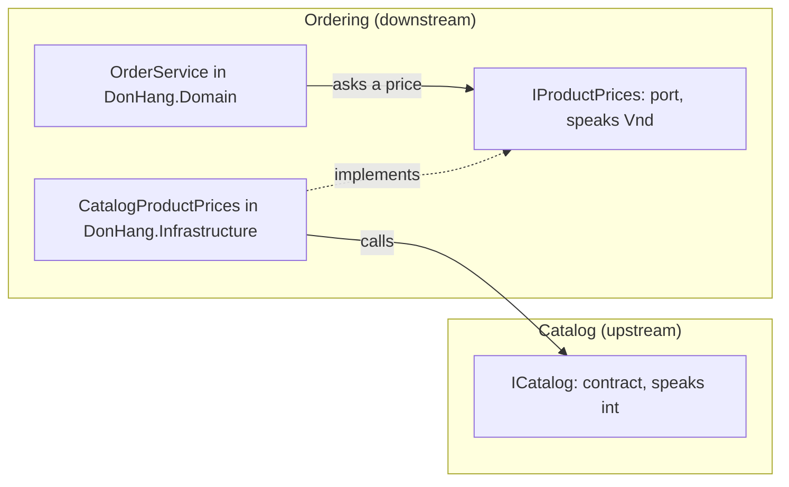

## Before you start

- [[design.l3.module-owns-its-tables]] — you know that at stage-3 only Catalog's code reads `products`, so other modules get product data through `ICatalog`.
- [[design.l3.anti-corruption-layer]] — you know that a downstream context can translate the upstream model at its edge, so upstream words stay out.
- [[design.l3.value-objects]] — you know that at stage-3 money inside Ordering is a `Vnd`, not a bare `int`.
- [[design.l2.ports-and-adapters]] — you know that the core declares a port in its own words and an adapter outside the core implements it.

## The situation

At stage-3 Catalog is a module of its own, and placing an order must charge each item what Catalog says the product costs now. The quickest change looks harmless: add a reference from `DonHang.Domain` to `DonHang.Catalog` and give `OrderService` an `ICatalog`. A week later someone asks Catalog to show how often each product was ordered, which means Catalog asking Ordering. Each request sounds reasonable alone. Together they tie the two modules to each other.

Which way may the dependency between two modules point, and where should Catalog's answer turn into Ordering's words?

## Core concepts

- dependency between modules — module A depends on module B when A's code names B's types, so a change to B's contract can force a change to A. A project's code can name another project's types only when its `.csproj` file references that project, directly or through a project it references, so the `ProjectReference` lines show where arrows can start.
- upstream and downstream — treating each module as its own bounded context, Catalog is the upstream context and Ordering the downstream one: when Catalog's contract changes, Ordering is the side that adapts; Catalog does not adapt to Ordering.
- port between modules — an interface in Ordering's core, `IProductPrices`, that says what Ordering needs from Catalog in Ordering's words.
- adapter between modules — a class outside Ordering's core, `CatalogProductPrices`, that answers the port by calling Catalog's contract.
- cycle — two modules that each depend on the other, directly or through a third.

## How it works



In the situation above, the need runs one way. Placing an order takes each item's current price from Catalog; Catalog needs nothing from Ordering to store or price a product. So at stage-3 only one arrow crosses between the modules, and it points from Ordering to Catalog.

The arrow does not start in the core: `DonHang.Domain` references no project at all. When `OrderService` needs a price, it asks `IProductPrices`, a port that lives in `DonHang.Domain` and returns a `Vnd`, the money type Ordering already uses.

`CatalogProductPrices`, in `DonHang.Infrastructure` (Ordering's outer project, outside the core), implements that port. It calls `ICatalog`, gets a `CatalogProduct` whose price is a plain `int`, and returns a new `Vnd` instead. `CatalogProduct` never reaches `OrderService`; Catalog's types stop at this one class.

So `CatalogProductPrices` is a small anti-corruption layer on the downstream side, between two modules of one process rather than two systems.

Now add the second request. If Catalog also called Ordering, each module would name the other's types, a change to either contract could break the other, and neither could be moved out of the process alone. When two modules need each other like that, the line between them is probably in the wrong place: some of what one does belongs to the other. Here, counting orders per product is about orders, which Ordering owns, so that count belongs in Ordering, which already depends on Catalog, and the single arrow stays.

## In the Đơn Hàng system

Ordering's port, in the core:

```csharp file=DonHang.Domain/IProductPrices.cs tag=stage-3 lines=3-11
// lesson: design.l3.one-way-module-dependencies
// What Ordering needs from the Catalog module, said in Ordering's own words:
// what one product costs now, or null when there is no such product.
// DonHang.Domain still references no project. CatalogProductPrices, in
// DonHang.Infrastructure, answers it by asking Catalog's ICatalog.
public interface IProductPrices
{
    Task<Vnd?> CurrentPriceAsync(int productId);
}
```

One method, one answer: a `Vnd`, or `null` when the product does not exist. Nothing here names Catalog's types. In `OrderService.cs`, outside this excerpt, a `null` answer stops the order with an error before anything is saved.

The adapter between the two modules:

```csharp file=DonHang.Infrastructure/CatalogProductPrices.cs tag=stage-3 lines=6-20
// lesson: design.l3.one-way-module-dependencies
// The adapter between the two modules: Ordering's port IProductPrices,
// answered through Catalog's contract ICatalog. The price arrives as a plain
// int and leaves as a Vnd, so no Catalog type gets past this class into
// DonHang.Domain. Ordering depends on Catalog; Catalog knows nothing of this.
public sealed class CatalogProductPrices(ICatalog catalog) : IProductPrices
{
    public async Task<Vnd?> CurrentPriceAsync(int productId)
    {
        var product = await catalog.FindAsync(productId);
        if (product is null) return null;

        return new Vnd(product.PriceVnd);
    }
}
```

Look at the return line: `product.PriceVnd` is Catalog's `int`, and `new Vnd(...)` is where it becomes Ordering's money. This is the only class in Ordering that uses `ICatalog`. The project files match the code: `DonHang.Infrastructure.csproj` references `DonHang.Domain` and `DonHang.Catalog` (and `DonHang.Messaging`, which another lesson covers), while `DonHang.Catalog.csproj` has no project reference at all.

## Seniors often assume…

- **"Modules in one process may call each other in both directions, since it is all one application."** → Actually one process hides the cost but does not remove it. Two modules that call each other must change together, and neither can be moved into a process of its own without the other. You notice this when a change that only one module needed has to touch both in the same pull request.
- **"Ordering's core should use `ICatalog` directly, because the contract is already public."** → Actually that adds a reference from `DonHang.Domain` to `DonHang.Catalog`, so the core depends on a project again. Catalog's `int` price and `CatalogProduct` would then spread through `OrderService`, and a test of the core would need a stand-in for all three of `ICatalog`'s methods, not just `FindAsync`. With the port, the tests use `FakeProductPrices`, which implements one method. You notice this when a change to `ICatalog` for a reason Ordering does not care about still breaks Ordering's core.
- **"A port and an adapter between two modules of one process are extra layers that buy nothing."** → Actually they buy one place where Catalog meets Ordering. If Catalog's contract changes, or Catalog later runs in another process, `CatalogProductPrices` is the class that changes and `OrderService` is not. This holds when the two models differ, as `int` and `Vnd` do; if Ordering used Catalog's types unchanged, the adapter would translate nothing. You notice the missing adapter when a rename in Catalog shows up in a dozen Ordering files.

## Try it (3 minutes)

In the root folder of the example repository, in a terminal:

1. Run `git grep -n "ProjectReference Include" stage-3 -- DonHang.Domain DonHang.Catalog DonHang.Infrastructure` to list every project reference of the three projects.
2. Note which project each line belongs to, and which project it points at.

Expected result: three lines, all in `DonHang.Infrastructure/DonHang.Infrastructure.csproj`, pointing at `DonHang.Domain`, `DonHang.Catalog` and `DonHang.Messaging`. No line comes from `DonHang.Domain` or `DonHang.Catalog`. (`DonHang.Messaging` belongs to a later lesson; ignore it here.)

<details><summary>Suggested answer</summary>

The only arrow between the two modules starts in `DonHang.Infrastructure`, Ordering's outer project, and points at Catalog. Ordering's core references nothing, and Catalog references nothing, so Catalog could be changed or moved without asking Ordering.

</details>

## Connections

- [[design.l3.context-map]] — the same relation named: Catalog is upstream, Ordering downstream, here between modules of one process.
- [[design.l2.dependency-rule]] — the same idea one level up: inside Ordering, dependencies point toward the core; between modules, they point one way too.
- [[design.l3.anti-corruption-layer]] — prerequisite: `CatalogProductPrices` is a small layer of that kind.
- [[design.l3.testing-module-boundaries]] — what comes next: a test that fails if Catalog ever references Ordering.

## Five-line summary

1. Dependencies between modules point one way: Ordering depends on Catalog for prices, and Catalog depends on nothing in Ordering.
2. `DonHang.Domain` references no project; `OrderService` asks for prices through `IProductPrices`, a port returning `Vnd`.
3. `CatalogProductPrices` in `DonHang.Infrastructure` calls `ICatalog` and turns its `int` price into a `Vnd`, so Catalog's types stop there.
4. Catalog is upstream and Ordering downstream; `CatalogProductPrices` is a small anti-corruption layer between two modules of one process.
5. A cycle between modules means neither can change or move alone, a sign the boundary between them is in the wrong place.
