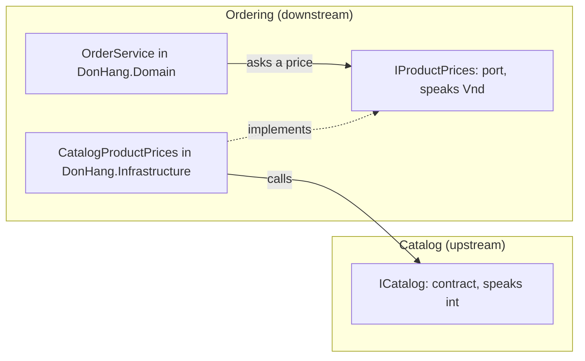

## Bạn cần biết trước

- [[design.l3.module-owns-its-tables]] — bạn biết ở stage-3 chỉ code của Catalog đọc `products`, nên module khác lấy dữ liệu sản phẩm qua `ICatalog`.
- [[design.l3.anti-corruption-layer]] — bạn biết một downstream context có thể dịch model của upstream ngay ở rìa của nó, để từ ngữ của upstream không lọt vào trong.
- [[design.l3.value-objects]] — bạn biết ở stage-3, tiền bên trong Ordering là một `Vnd`, không phải một `int` trần.
- [[design.l2.ports-and-adapters]] — bạn biết lõi khai báo port bằng từ ngữ của chính nó, còn một adapter bên ngoài lõi cài đặt port đó.

## Tình huống

Ở stage-3, Catalog đã thành một module riêng, và khi đặt hàng, mỗi món phải tính đúng giá hiện tại mà Catalog đưa ra. Cách sửa nhanh nhất trông vô hại: thêm reference từ `DonHang.Domain` tới `DonHang.Catalog` rồi đưa cho `OrderService` một `ICatalog`. Một tuần sau, có người nhờ Catalog hiển thị mỗi sản phẩm được đặt bao nhiêu lần, tức là Catalog phải hỏi Ordering. Từng yêu cầu riêng lẻ nghe đều hợp lý. Gộp lại, chúng buộc hai module vào nhau.

Phụ thuộc giữa hai module được phép đi theo chiều nào, và câu trả lời của Catalog nên được đổi sang từ ngữ của Ordering ở đâu?

## Khái niệm cốt lõi

- phụ thuộc giữa các module — module A phụ thuộc vào module B khi code của A gọi tên các kiểu của B, nên một thay đổi trong hợp đồng của B có thể buộc A phải đổi theo. Code của một project chỉ gọi tên được kiểu của project khác khi file `.csproj` của nó reference project đó, trực tiếp hoặc qua một project mà nó reference, nên các dòng `ProjectReference` cho thấy mũi tên có thể bắt đầu từ đâu.
- upstream và downstream — coi mỗi module là một bounded context riêng, thì Catalog là upstream context còn Ordering là downstream context: khi hợp đồng của Catalog thay đổi, Ordering là bên phải thích nghi, còn Catalog không thích nghi theo Ordering.
- port giữa các module — một interface trong lõi của Ordering, `IProductPrices`, nói Ordering cần gì từ Catalog bằng từ ngữ của Ordering.
- adapter giữa các module — một class bên ngoài lõi của Ordering, `CatalogProductPrices`, trả lời port đó bằng cách gọi hợp đồng của Catalog.
- vòng phụ thuộc — hai module phụ thuộc lẫn nhau, trực tiếp hoặc qua một module thứ ba.

## Cơ chế hoạt động



Trong tình huống trên, nhu cầu chỉ đi một chiều. Khi đặt hàng, Ordering lấy giá hiện tại của từng món từ Catalog. Catalog không cần gì từ Ordering để lưu hay định giá một sản phẩm. Vì vậy ở stage-3 chỉ có một mũi tên đi qua ranh giới giữa hai module, và nó chỉ từ Ordering sang Catalog.

Mũi tên đó không bắt đầu từ lõi: `DonHang.Domain` không reference project nào cả. Khi `OrderService` cần giá, nó hỏi `IProductPrices`, một port nằm trong `DonHang.Domain` và trả về `Vnd`, kiểu tiền mà Ordering vốn đang dùng.

`CatalogProductPrices`, nằm trong `DonHang.Infrastructure` (project bên ngoài của Ordering, ngoài lõi), cài đặt port đó. Class này gọi `ICatalog`, nhận về một `CatalogProduct` có giá là một `int` trần, rồi trả ra một `Vnd` mới. `CatalogProduct` không bao giờ tới được `OrderService`. Các kiểu của Catalog dừng lại ở đúng class này.

Như vậy `CatalogProductPrices` là một anti-corruption layer nhỏ ở phía downstream, nằm giữa hai module trong cùng một process chứ không phải giữa hai hệ thống.

Giờ thêm yêu cầu thứ hai vào. Nếu Catalog cũng gọi Ordering, mỗi module sẽ gọi tên kiểu của module kia, thay đổi hợp đồng của bên nào cũng có thể làm hỏng bên còn lại, và không module nào tách được ra khỏi process một mình. Khi hai module cần nhau như thế, nhiều khả năng ranh giới giữa chúng đặt sai chỗ: một phần việc của module này thực ra thuộc về module kia. Ở đây, đếm số đơn theo từng sản phẩm là chuyện của đơn hàng, thứ Ordering sở hữu. Vậy phép đếm đó thuộc về Ordering, module vốn đã phụ thuộc vào Catalog, và mũi tên duy nhất vẫn giữ nguyên.

## Trong hệ thống Đơn Hàng

Port của Ordering, trong lõi:

```csharp file=DonHang.Domain/IProductPrices.cs tag=stage-3 lines=3-11
// lesson: design.l3.one-way-module-dependencies
// What Ordering needs from the Catalog module, said in Ordering's own words:
// what one product costs now, or null when there is no such product.
// DonHang.Domain still references no project. CatalogProductPrices, in
// DonHang.Infrastructure, answers it by asking Catalog's ICatalog.
public interface IProductPrices
{
    Task<Vnd?> CurrentPriceAsync(int productId);
}
```

Một method, một câu trả lời: một `Vnd`, hoặc `null` khi sản phẩm không tồn tại. Không chỗ nào ở đây gọi tên kiểu của Catalog. Trong `OrderService.cs`, ngoài đoạn trích này, câu trả lời `null` dừng đơn hàng bằng một lỗi trước khi bất cứ thứ gì được lưu.

Adapter giữa hai module:

```csharp file=DonHang.Infrastructure/CatalogProductPrices.cs tag=stage-3 lines=6-20
// lesson: design.l3.one-way-module-dependencies
// The adapter between the two modules: Ordering's port IProductPrices,
// answered through Catalog's contract ICatalog. The price arrives as a plain
// int and leaves as a Vnd, so no Catalog type gets past this class into
// DonHang.Domain. Ordering depends on Catalog; Catalog knows nothing of this.
public sealed class CatalogProductPrices(ICatalog catalog) : IProductPrices
{
    public async Task<Vnd?> CurrentPriceAsync(int productId)
    {
        var product = await catalog.FindAsync(productId);
        if (product is null) return null;

        return new Vnd(product.PriceVnd);
    }
}
```

Hãy nhìn dòng return: `product.PriceVnd` là `int` của Catalog, còn `new Vnd(...)` là chỗ nó trở thành tiền của Ordering. Đây là class duy nhất trong Ordering dùng `ICatalog`. Các file project khớp với code: `DonHang.Infrastructure.csproj` reference `DonHang.Domain` và `DonHang.Catalog` (cùng `DonHang.Messaging`, thứ một bài khác sẽ nói tới), còn `DonHang.Catalog.csproj` không có project reference nào.

## Senior hay nhầm rằng…

- **"Các module trong cùng một process cứ gọi nhau theo cả hai chiều, vì tất cả vẫn là một ứng dụng."** → Thực ra một process chỉ giấu cái giá đi chứ không xóa nó. Hai module gọi lẫn nhau thì phải thay đổi cùng nhau, và không module nào chuyển sang process riêng được nếu thiếu module kia. Bạn sẽ nhận ra khi một thay đổi chỉ một module cần lại phải sửa cả hai trong cùng một pull request.
- **"Lõi của Ordering nên dùng thẳng `ICatalog`, vì hợp đồng đó đã public sẵn."** → Thực ra làm vậy là thêm reference từ `DonHang.Domain` tới `DonHang.Catalog`, nên lõi lại phụ thuộc vào một project. Giá `int` và `CatalogProduct` của Catalog khi đó sẽ lan khắp `OrderService`, và test của lõi sẽ cần một bản thay thế cho cả ba method của `ICatalog`, chứ không chỉ `FindAsync`. Có port thì test dùng `FakeProductPrices`, chỉ cài đặt một method. Bạn sẽ nhận ra khi `ICatalog` đổi vì một lý do Ordering không hề quan tâm mà lõi của Ordering vẫn hỏng.
- **"Port và adapter giữa hai module trong một process là thêm lớp mà chẳng được gì."** → Thực ra chúng cho bạn đúng một chỗ nơi Catalog gặp Ordering. Nếu hợp đồng của Catalog đổi, hoặc sau này Catalog chạy ở process khác, thì `CatalogProductPrices` là class phải sửa còn `OrderService` thì không. Điều này đúng khi hai model khác nhau, như `int` và `Vnd`. Nếu Ordering dùng nguyên các kiểu của Catalog, adapter sẽ chẳng có gì để dịch. Bạn sẽ nhận ra mình thiếu adapter khi một lần đổi tên trong Catalog kéo theo cả chục file của Ordering.

## Thử ngay (3 phút)

Trong thư mục gốc của repo ví dụ, mở terminal:

1. Chạy `git grep -n "ProjectReference Include" stage-3 -- DonHang.Domain DonHang.Catalog DonHang.Infrastructure` để liệt kê mọi project reference của ba project.
2. Ghi lại mỗi dòng thuộc project nào và trỏ tới project nào.

Kết quả mong đợi: ba dòng, đều nằm trong `DonHang.Infrastructure/DonHang.Infrastructure.csproj`, trỏ tới `DonHang.Domain`, `DonHang.Catalog` và `DonHang.Messaging`. Không dòng nào đến từ `DonHang.Domain` hay `DonHang.Catalog`. (`DonHang.Messaging` thuộc một bài sau, ở đây bạn bỏ qua.)

<details><summary>Gợi ý đáp án</summary>

Mũi tên duy nhất giữa hai module bắt đầu từ `DonHang.Infrastructure`, project bên ngoài của Ordering, và trỏ tới Catalog. Lõi của Ordering không reference gì, Catalog cũng không reference gì, nên Catalog có thể được sửa hay chuyển đi mà không cần hỏi Ordering.

</details>

## Liên hệ

- [[design.l3.context-map]] — cùng mối quan hệ đó, có tên gọi: Catalog là upstream, Ordering là downstream, ở đây là giữa các module trong một process.
- [[design.l2.dependency-rule]] — cùng ý tưởng ở một bậc cao hơn: bên trong Ordering, phụ thuộc hướng về lõi, còn giữa các module, phụ thuộc cũng chỉ đi một chiều.
- [[design.l3.anti-corruption-layer]] — bài cần trước: `CatalogProductPrices` là một lớp nhỏ thuộc loại đó.
- [[design.l3.testing-module-boundaries]] — bài tiếp theo: một test sẽ fail nếu có lúc Catalog reference Ordering.

## Tóm tắt 5 dòng

1. Phụ thuộc giữa các module chỉ đi một chiều: Ordering phụ thuộc vào Catalog để lấy giá, còn Catalog không phụ thuộc gì vào Ordering.
2. `DonHang.Domain` không reference project nào. `OrderService` hỏi giá qua `IProductPrices`, một port trả về `Vnd`.
3. `CatalogProductPrices` trong `DonHang.Infrastructure` gọi `ICatalog` và đổi giá `int` của nó thành `Vnd`, nên các kiểu của Catalog dừng ở đó.
4. Catalog là upstream, Ordering là downstream. `CatalogProductPrices` là một anti-corruption layer nhỏ giữa hai module trong một process.
5. Vòng phụ thuộc giữa các module nghĩa là không module nào thay đổi hay tách ra được một mình, dấu hiệu ranh giới giữa chúng đặt sai chỗ.
