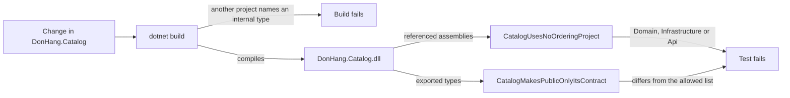

## Before you start

- [[design.l3.one-way-module-dependencies]] — you know that at stage-3 Ordering depends on Catalog, while `DonHang.Catalog.csproj` references no project at all.
- [[design.l2.testing-the-dependency-rule]] — you know `DependencyRuleTests` reads the referenced assemblies of `DonHang.Domain.dll` and fails when one has a forbidden name.

## The situation

At stage-3 a teammate builds an admin screen that renames products. `ICatalog` can list, find and reprice a product, but not rename one. `DonHang.Api` cannot name `Product`, the class that holds a row of Catalog's `products` table, because it is `internal`. The teammate changes `internal` to `public` in `DonHang.Catalog/Product.cs`, the solution builds, and in review the diff is one word in a file few people read. Catalog's contract has just grown by one type. The same review would also miss a new reference from Catalog to `DonHang.Domain`, Ordering's core.

What in the repository notices either change before reviewers have to?

## Core concepts

- `internal` check — the compiler rejects code in another project that names an `internal` type, but it says nothing about which types a project declares `public`.
- referenced assemblies — as in `DependencyRuleTests`, the names of the other assemblies that a compiled assembly's code uses.
- exported types — the public types of an assembly, the ones code in other assemblies can name; the .NET method `GetExportedTypes` lists them.
- allowed list — Catalog's contract written down as data inside the test, so the test can compare it with the exported types.

## How it works



Three checks stand between a change and a wider boundary. The first is the build: code in `DonHang.Api` that names `Product` while it is `internal` does not compile. But the build checks uses, not declarations. In the situation above, `public` on `Product` compiled, and so would a new `ProjectReference` (the line in a `.csproj` file that lets one project use another project's types) from `DonHang.Catalog.csproj` to `DonHang.Domain`.

The other two checks are tests in `ModuleBoundaryTests`, architecture tests like `DependencyRuleTests`. Both start from `typeof(ICatalog).Assembly`, the compiled `DonHang.Catalog.dll`. `CatalogUsesNoOrderingProject` reads its referenced assemblies and fails if one of them is `DonHang.Domain`, `DonHang.Infrastructure` or `DonHang.Api`. As with the dependency rule, the compiler records a project's name there only once Catalog's code uses a type from it, so the test fails at the first such line, not at the `.csproj` edit.

`CatalogMakesPublicOnlyItsContract` reads the exported types, sorts their names and compares them with an allowed list of three: `CatalogModule`, `CatalogProduct` and `ICatalog`. In the situation above, the exported types now include `Product`, so the test fails. To make it pass, the teammate either adds `Product` to the list or makes it `internal` again and asks for a rename method on `ICatalog`.

The list lives in a test file, so a pull request that widens Catalog's contract also changes `ModuleBoundaryTests.cs`. Reviewers see a line saying a new type joined the contract, not one word in a file they may skip.

Neither test looks at what the code does. A controller could call `ICatalog`'s `ChangePriceAsync` where no price should change, and both tests would still pass.

## In the Đơn Hàng system

The two lists, at the top of the test class:

```csharp file=DonHang.Tests/Architecture/ModuleBoundaryTests.cs tag=stage-3 lines=16-31
    private static readonly string[] ProjectsCatalogMustNotUse =
    [
        "DonHang.Domain",
        "DonHang.Infrastructure",
        "DonHang.Api",
    ];

    // Catalog's whole contract. Making another type public fails the test
    // below until this list changes too, so the pull request that widens the
    // contract shows it to its reviewers as an edit to this file.
    private static readonly string[] CatalogPublicTypes =
    [
        "CatalogModule",
        "CatalogProduct",
        "ICatalog",
    ];
```

`ProjectsCatalogMustNotUse` names Ordering's two projects and `DonHang.Api`, which already uses Catalog, so a reference back would run the wrong way too. `CatalogPublicTypes` is the allowed list: Catalog's whole contract, in alphabetical order, the order the test sorts the exported names into. `CatalogModule` registers Catalog's services at startup; `CatalogProduct` is the copy of a product's values that `ICatalog` returns.

The class runs five tests; the other three keep Notifications, Payments and `DonHang.Messaging` apart from the rest. The two that guard Catalog:

```csharp file=DonHang.Tests/Architecture/ModuleBoundaryTests.cs tag=stage-3 lines=33-53
    [Fact]
    public void CatalogUsesNoOrderingProject()
    {
        var referenced = typeof(ICatalog).Assembly.GetReferencedAssemblies()
            .Select(assembly => assembly.Name!)
            .Where(name => ProjectsCatalogMustNotUse.Contains(name))
            .ToList();

        Assert.Empty(referenced);
    }

    [Fact]
    public void CatalogMakesPublicOnlyItsContract()
    {
        var exported = typeof(ICatalog).Assembly.GetExportedTypes()
            .Select(type => type.Name)
            .Order()
            .ToList();

        Assert.Equal(CatalogPublicTypes, exported);
    }
```

Both read data about `DonHang.Catalog.dll`; neither calls `ICatalog`. `GetExportedTypes` returns only types that code outside the assembly can see, so `Product` stays out while it is `internal`. `Assert.Equal` compares the two lists item by item, so a contract type that turns `internal` fails the test as surely as an extra public one. The other side is covered elsewhere: at stage-3 `DependencyRuleTests` also forbids `DonHang.Catalog`, so a test fails if Ordering's core starts using Catalog's types.

## Seniors often assume…

- **"Making types `internal` is enough; a module boundary needs no test."** → Actually `internal` protects a type only while it stays `internal`, and changing that is one word in Catalog's own project, which the compiler accepts. A new reference from Catalog to `DonHang.Domain` compiles too. The test turns both changes into failures. You notice the gap when a Catalog type shows up in `DonHang.Api` code and the diff that made it public was approved weeks earlier without a comment.
- **"A test that lists public types is busywork, because the list has to be updated anyway."** → Actually the update is what the test is for: widening the contract becomes a deliberate edit that a reviewer reads and can question, not a side effect. This pays when a module's contract is small and changes rarely, as Catalog's three types do. If a module's public types change in most pull requests, the list turns into noise, and checking references alone may serve better. You notice the value when a reviewer asks why `Product` joined the list, and the answer becomes a new method on `ICatalog` instead.
- **"Checking module boundaries needs a dedicated architecture-testing library."** → Actually `ModuleBoundaryTests` uses two methods .NET already has, `GetReferencedAssemblies` and `GetExportedTypes`, inside ordinary test methods marked `[Fact]`; Đơn Hàng adds no package for them. A dedicated library can be worth it when the rules grow beyond what a few assertions express. You notice the belief when guarding a boundary waits on choosing a tool, while the check fits in two methods.

## Try it (3 minutes)

In the root folder of the example repository, checked out at `stage-3`, with the .NET SDK installed (these tests need no database):

1. In `DonHang.Catalog/Product.cs`, change `internal sealed class Product` to `public sealed class Product`.
2. Run `dotnet test DonHang.Tests --filter ModuleBoundaryTests`, then undo the change.

Expected result: the build succeeds, and the run ends with a line starting `Failed!` that reports `Failed: 1, Passed: 4`. The failing test is `CatalogMakesPublicOnlyItsContract`, with `Assert.Equal() Failure: Collections differ`; its `Actual` line lists the three contract types followed by `"Product"`. The four passing results come from the other tests in the same class.

## Connections

- [[design.l2.testing-the-dependency-rule]] — the same technique one level up: there it guards the core's references, here a module's references and its public types.
- [[design.l3.module-contracts]] — the contract this test writes down as a list, so it can only grow on purpose.
- [[design.l3.one-way-module-dependencies]] — the direction between Ordering and Catalog that `CatalogUsesNoOrderingProject` keeps.
- [[management.l1.reviewing-for-tests]] — the reviewer's side: an edit to the allowed list is a change a reviewer should ask about.

## Five-line summary

1. A module boundary test fails when a module widens its contract or depends on the wrong module, two changes the compiler accepts.
2. The compiler stops other projects from naming Catalog's `internal` types, but not a type made `public` or a new reference from Catalog to `DonHang.Domain`.
3. `CatalogUsesNoOrderingProject` fails if `DonHang.Catalog.dll` references `DonHang.Domain`, `DonHang.Infrastructure` or `DonHang.Api`.
4. `CatalogMakesPublicOnlyItsContract` compares Catalog's public types with a list in the test, so widening the contract means editing that list.
5. Like `DependencyRuleTests`, these tests check structure only, not whether a call made through the contract is a sensible one.
