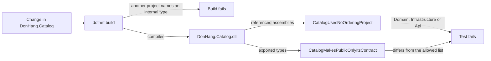

## Bạn cần biết trước

- [[design.l3.one-way-module-dependencies]] — bạn biết ở stage-3, Ordering phụ thuộc vào Catalog, còn `DonHang.Catalog.csproj` không reference project nào.
- [[design.l2.testing-the-dependency-rule]] — bạn biết `DependencyRuleTests` đọc các referenced assembly của `DonHang.Domain.dll` và fail khi gặp một tên bị cấm.

## Tình huống

Ở stage-3, một đồng đội làm màn hình quản trị để đổi tên sản phẩm. `ICatalog` liệt kê, tìm và đổi giá được một sản phẩm, nhưng không đổi tên được. `DonHang.Api` không gọi tên được `Product`, class giữ một dòng của bảng `products` thuộc Catalog, vì nó là `internal`. Đồng đội sửa `internal` thành `public` trong `DonHang.Catalog/Product.cs`, solution build được, và lúc review, diff chỉ là một từ trong một file ít ai đọc. Hợp đồng của Catalog vừa rộng thêm một kiểu. Cũng buổi review đó sẽ bỏ sót cả một reference mới từ Catalog tới `DonHang.Domain`, phần lõi của Ordering.

Thứ gì trong repo phát hiện ra một trong hai thay đổi này trước khi người review phải tự thấy?

## Khái niệm cốt lõi

- kiểm tra `internal` — compiler từ chối code ở project khác gọi tên một kiểu `internal`, nhưng không quan tâm một project khai báo những kiểu nào là `public`.
- referenced assembly — giống trong `DependencyRuleTests`, đó là tên các assembly khác mà code của một assembly đã biên dịch dùng tới.
- exported type — các kiểu public của một assembly, tức những kiểu mà code ở assembly khác gọi tên được. Phương thức .NET `GetExportedTypes` liệt kê chúng.
- danh sách cho phép — hợp đồng của Catalog được ghi thành dữ liệu ngay trong test, để test so nó với các exported type.

## Cơ chế hoạt động



Có ba lớp kiểm tra đứng giữa một thay đổi và một ranh giới bị nới rộng. Lớp đầu là build: code trong `DonHang.Api` gọi tên `Product` khi nó còn là `internal` thì không biên dịch được. Nhưng build kiểm tra chỗ dùng, không kiểm tra chỗ khai báo. Trong tình huống trên, `public` trên `Product` vẫn biên dịch được, và một `ProjectReference` mới (dòng trong file `.csproj` cho phép project này dùng các kiểu của project kia) từ `DonHang.Catalog.csproj` tới `DonHang.Domain` cũng vậy.

Hai lớp còn lại là hai test trong `ModuleBoundaryTests`, những architecture test giống `DependencyRuleTests`. Cả hai bắt đầu từ `typeof(ICatalog).Assembly`, tức `DonHang.Catalog.dll` đã biên dịch. `CatalogUsesNoOrderingProject` đọc các referenced assembly của nó và fail nếu trong đó có `DonHang.Domain`, `DonHang.Infrastructure` hay `DonHang.Api`. Giống với dependency rule, compiler chỉ ghi tên một project vào đó khi code của Catalog dùng một kiểu từ project ấy. Vì vậy test fail ở dòng code đầu tiên như thế, không phải ở lúc sửa `.csproj`.

`CatalogMakesPublicOnlyItsContract` đọc các exported type, sắp xếp tên của chúng rồi so với danh sách cho phép gồm ba tên: `CatalogModule`, `CatalogProduct` và `ICatalog`. Trong tình huống trên, các exported type giờ có thêm `Product`, nên test fail. Muốn test pass, đồng đội hoặc thêm `Product` vào danh sách, hoặc đưa nó về `internal` rồi đề nghị thêm một phương thức đổi tên vào `ICatalog`.

Danh sách nằm trong một file test, nên pull request nào nới rộng hợp đồng của Catalog cũng phải sửa `ModuleBoundaryTests.cs`. Người review thấy một dòng nói rằng có kiểu mới vừa vào hợp đồng, chứ không phải một từ trong một file họ có thể lướt qua.

Không test nào xem code làm gì. Một controller có thể gọi `ChangePriceAsync` của `ICatalog` ở chỗ đáng lẽ không được đổi giá, và cả hai test vẫn pass.

## Trong hệ thống Đơn Hàng

Hai danh sách, ở đầu class test:

```csharp file=DonHang.Tests/Architecture/ModuleBoundaryTests.cs tag=stage-3 lines=16-31
    private static readonly string[] ProjectsCatalogMustNotUse =
    [
        "DonHang.Domain",
        "DonHang.Infrastructure",
        "DonHang.Api",
    ];

    // Catalog's whole contract. Making another type public fails the test
    // below until this list changes too, so the pull request that widens the
    // contract shows it to its reviewers as an edit to this file.
    private static readonly string[] CatalogPublicTypes =
    [
        "CatalogModule",
        "CatalogProduct",
        "ICatalog",
    ];
```

`ProjectsCatalogMustNotUse` liệt kê hai project của Ordering và `DonHang.Api`. `DonHang.Api` vốn đã dùng Catalog, nên một reference ngược lại cũng đi sai chiều. `CatalogPublicTypes` là danh sách cho phép: toàn bộ hợp đồng của Catalog, theo thứ tự bảng chữ cái, đúng thứ tự test sắp xếp các tên exported. `CatalogModule` đăng ký các service của Catalog lúc khởi động. `CatalogProduct` là bản sao các giá trị của một sản phẩm mà `ICatalog` trả về.

Class này chạy năm test. Ba test kia giữ Notifications, Payments và `DonHang.Messaging` tách khỏi phần còn lại. Hai test canh giữ Catalog:

```csharp file=DonHang.Tests/Architecture/ModuleBoundaryTests.cs tag=stage-3 lines=33-53
    [Fact]
    public void CatalogUsesNoOrderingProject()
    {
        var referenced = typeof(ICatalog).Assembly.GetReferencedAssemblies()
            .Select(assembly => assembly.Name!)
            .Where(name => ProjectsCatalogMustNotUse.Contains(name))
            .ToList();

        Assert.Empty(referenced);
    }

    [Fact]
    public void CatalogMakesPublicOnlyItsContract()
    {
        var exported = typeof(ICatalog).Assembly.GetExportedTypes()
            .Select(type => type.Name)
            .Order()
            .ToList();

        Assert.Equal(CatalogPublicTypes, exported);
    }
```

Cả hai chỉ đọc thông tin về `DonHang.Catalog.dll`, không test nào gọi `ICatalog`. `GetExportedTypes` chỉ trả về những kiểu mà code bên ngoài assembly nhìn thấy, nên `Product` không có mặt khi còn là `internal`. `Assert.Equal` so hai danh sách từng phần tử một, nên một kiểu của hợp đồng bị chuyển sang `internal` cũng làm test fail chắc chắn như một kiểu public thừa. Chiều ngược lại được canh ở chỗ khác: ở stage-3, `DependencyRuleTests` cũng cấm `DonHang.Catalog`, nên sẽ có test fail nếu lõi của Ordering bắt đầu dùng các kiểu của Catalog.

## Senior hay nhầm rằng…

- **"Để các kiểu là `internal` là đủ, ranh giới module không cần test."** → Thực ra `internal` chỉ bảo vệ một kiểu khi nó còn là `internal`, mà đổi điều đó chỉ tốn một từ trong chính project của Catalog, và compiler chấp nhận. Một reference mới từ Catalog tới `DonHang.Domain` cũng biên dịch được. Test biến cả hai thay đổi thành test fail. Bạn sẽ nhận ra lỗ hổng khi một kiểu của Catalog xuất hiện trong code của `DonHang.Api`, còn diff biến nó thành public đã được duyệt từ vài tuần trước mà không ai bình luận.
- **"Một test liệt kê các kiểu public chỉ là việc vặt, vì đằng nào cũng phải cập nhật danh sách."** → Thực ra chính lần cập nhật đó là lý do test tồn tại: nới rộng hợp đồng trở thành một chỉnh sửa có chủ ý mà người review đọc và có thể chất vấn, không còn là tác dụng phụ. Cách này đáng giá khi hợp đồng của module nhỏ và ít đổi, như ba kiểu của Catalog. Nếu các kiểu public của một module đổi trong hầu hết pull request, danh sách thành nhiễu, và chỉ kiểm tra reference có thể hợp hơn. Bạn sẽ thấy giá trị của nó khi người review hỏi vì sao `Product` vào danh sách, và câu trả lời cuối cùng là một phương thức mới trên `ICatalog`.
- **"Kiểm tra ranh giới module cần một thư viện architecture test chuyên dụng."** → Thực ra `ModuleBoundaryTests` dùng hai phương thức .NET có sẵn, `GetReferencedAssemblies` và `GetExportedTypes`, bên trong những phương thức test bình thường gắn `[Fact]`. Đơn Hàng không thêm package nào cho chúng. Một thư viện chuyên dụng có thể đáng dùng khi các quy tắc vượt quá những gì vài câu assert diễn đạt được. Bạn sẽ nhận ra niềm tin này khi canh giữ một ranh giới phải chờ chọn xong công cụ, trong khi phép kiểm tra chỉ gói trong hai phương thức.

## Thử ngay (3 phút)

Ở thư mục gốc của repo ví dụ, đã checkout tại `stage-3`, có cài .NET SDK (các test này không cần database):

1. Trong `DonHang.Catalog/Product.cs`, đổi `internal sealed class Product` thành `public sealed class Product`.
2. Chạy `dotnet test DonHang.Tests --filter ModuleBoundaryTests`, rồi hoàn tác thay đổi.

Kết quả mong đợi: build thành công, và lần chạy kết thúc bằng một dòng bắt đầu bằng `Failed!` báo `Failed: 1, Passed: 4`. Test fail là `CatalogMakesPublicOnlyItsContract`, kèm `Assert.Equal() Failure: Collections differ`. Dòng `Actual` của nó liệt kê ba kiểu của hợp đồng, theo sau là `"Product"`. Bốn kết quả pass đến từ các test còn lại trong cùng class.

## Liên hệ

- [[design.l2.testing-the-dependency-rule]] — cùng kỹ thuật đó ở một tầng cao hơn: ở đó nó canh các reference của lõi, ở đây là các reference và các kiểu public của một module.
- [[design.l3.module-contracts]] — hợp đồng mà test này ghi thành một danh sách, để nó chỉ rộng ra khi có chủ ý.
- [[design.l3.one-way-module-dependencies]] — chiều phụ thuộc giữa Ordering và Catalog mà `CatalogUsesNoOrderingProject` giữ nguyên.
- [[management.l1.reviewing-for-tests]] — phía người review: một chỉnh sửa vào danh sách cho phép là thay đổi mà người review nên hỏi.

## Tóm tắt 5 dòng

1. Test ranh giới module fail khi một module nới rộng hợp đồng hoặc phụ thuộc sai module, hai thay đổi mà compiler đều chấp nhận.
2. Compiler chặn project khác gọi tên các kiểu `internal` của Catalog, nhưng không chặn một kiểu bị đổi thành `public` hay một reference mới từ Catalog tới `DonHang.Domain`.
3. `CatalogUsesNoOrderingProject` fail nếu `DonHang.Catalog.dll` reference `DonHang.Domain`, `DonHang.Infrastructure` hay `DonHang.Api`.
4. `CatalogMakesPublicOnlyItsContract` so các kiểu public của Catalog với một danh sách trong test, nên nới rộng hợp đồng nghĩa là phải sửa danh sách đó.
5. Giống `DependencyRuleTests`, các test này chỉ kiểm tra cấu trúc, không kiểm tra một lời gọi qua hợp đồng có hợp lý hay không.
