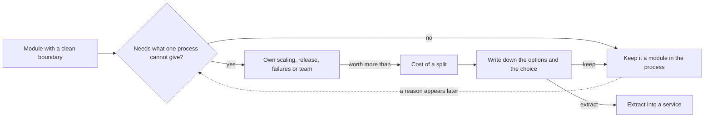

## Before you start

- [[design.l3.before-extracting-a-module]] — you know what must change before the email job can run in a process of its own; this lesson asks whether it should.
- [[k8s.l1.deploying-don-hang]] — you know that at stage-2 the `api` Deployment runs two replicas on the cluster.
- [[backend.l2.skip-locked-claiming]] — you know that `FOR UPDATE SKIP LOCKED` lets several copies of the sender share one queue without taking the same row.

## The situation

It is stage-2, and you now know what ties the email job to ordering. A teammate wants to cut them and make the job a microservice. Their argument comes from `deploy/k8s/api.yaml`: the api runs as two replicas, each replica starts its own `NotificationSender`, so the email job runs twice. "Two copies of a background job is waste," they say. "As its own service it could run once, and scale on its own."

You check the logs. No email has ever gone out twice. The plan still means a new image, a new pipeline and every tie from the last lesson to cut.

When does a module earn a service of its own?

## Core concepts

- own scaling — running a different number of copies of one part than of the rest, because its load differs.
- own release — shipping a new version of one part without building and deploying the rest.
- own failures — keeping one part's crashes or slowness from using up what the rest needs to keep working.
- own team — letting one team change, release and run a part without waiting for another team.
- cost of a split — what a separate service adds: network calls that can fail, separate saves instead of one transaction, and one more image, pipeline and dashboard to run.

## How it works



The question at the start is not whether the module could run alone, but whether it needs something one process cannot give it. Four needs can justify a separate service: its own scaling, its own release, its own failures, or its own team.

In the situation above, only scaling is in play. Each `api` replica runs one `NotificationSender`, so the job has as many copies as the API, and `FOR UPDATE SKIP LOCKED` keeps two copies from claiming the same row at the same time. So the two senders share the due emails between them instead of both sending each one; the extra cost is a second copy of the loop. Sharing the API's count costs something only when the job needs a different number of copies. While it does not, the second sender is not waste. That is the "no" branch: keep the module.

On the "yes" branch, the cost of a split comes next. Method calls become network calls that can be slow or fail. What one transaction saved becomes separate saves. And the team runs one more image, pipeline and dashboard. A reason must be worth more than all of that.

After weighing the reason against the cost, write down the options and the choice: extract, or keep the module. The choice has trade-offs either way, so the record is part of making it, for example in a design doc.

The dashed arrow is what a modular monolith buys. A module with a clean boundary can still be extracted when a reason appears, and the ties to cut are already known, so the team can estimate the cost first. Not extracting now still leaves extraction open for later, as long as the boundary stays clean.

## In the Đơn Hàng system

Where the number of copies is set:

```yaml file=deploy/k8s/api.yaml tag=stage-2 lines=5-24
apiVersion: apps/v1
kind: Deployment
metadata:
  name: api
  namespace: donhang
spec:
  replicas: 2
  selector:
    matchLabels:
      app: api
  template:
    metadata:
      labels:
        app: api
    spec:
      containers:
        - name: api
          image: ghcr.io/duyan11110/donhang-api:1.0.0
          ports:
            - containerPort: 8080
```

Line 11, `replicas: 2`, is the only number in this Deployment that says how many copies run. Every Pod made from the template runs the same `api` container from the same image, and the api container runs the app as one process, so each copy is one api process. Nothing here can say "two copies of the API, three of the email job".

Why the email job comes along with each copy:

```csharp file=DonHang.Api/Program.cs tag=stage-2 lines=29-32
// lesson: backend.l2.hosted-services
// The host starts NotificationSender when the app starts and stops it when
// the app stops; it runs in this same process, beside the requests.
builder.Services.AddHostedService<NotificationSender>();
```

Line 32 registers `NotificationSender` as a hosted service, and the comment above it says the host starts it with the app, in the same process. Two replicas therefore mean two senders. That they never claim the same row at the same time is the work of `ClaimDueAsync` in `DonHang.Infrastructure/NotificationQueue.cs`, outside this excerpt. To give the sender a count of its own, it would have to run in a different process under a different Deployment.

## Seniors often assume…

- **"A system with several modules should become several services, one per module, as soon as it can."** → Actually every split pays the cost above, and a module boundary already gives much of what a split promises: one owner per table and calls only through a contract. Extract a module when it has one of the four needs, not because it has a boundary. When several teams already own separate modules and each must release on its own schedule, more services can be the right answer. You notice the mistake when a release of one "independent" service still needs a matching release of another, so the split gave no release of its own, only the cost.
- **"Extracting a service always makes the system faster, since each part gets its own process."** → Actually every call that crosses the new boundary now pays for a trip over the network and can fail. It can make the rest faster only when the moved part was competing with it for the same process's CPU and memory. You notice this when a request that used to make one method call now waits on a second service, and its response time grows.
- **"If a module is not extracted now, splitting it out later will be impossible."** → Actually what makes a later split hard is the ties, not the waiting. A module that owns its tables and is reached only through its contract can be extracted when a reason appears, and the list of ties tells you the cost before you start. You notice this when the work to extract a module turns out to be exactly the ties you had already listed.

## Try it (3 minutes)

In the root folder of the example repository, in a terminal:

1. Run `git show stage-2:deploy/k8s/api.yaml` and find `replicas`.
2. Run `git show stage-2:DonHang.Api/Program.cs` and find `AddHostedService`.
3. Answer: how many copies of `NotificationSender` run on the cluster? What would you have to change to run two copies of the API but three of the email job?

Expected result: `replicas: 2` and `builder.Services.AddHostedService<NotificationSender>();`, so two senders run, one in each api process.

<details><summary>Suggested answer</summary>

Nothing in `api.yaml` sets the sender's count apart from the API's; `replicas` sets both. Three senders and two APIs need the sender in a process of its own, under its own Deployment, and to make that process a service of its own, cutting the ties from the previous lesson. That is worth doing only if the job really needs a different count, for example if emails pile up while the API copies have nothing to do. Today there is no such sign, so scaling alone is no reason to extract. A reason of another kind could be: if a slow mail server used up CPU and memory that order requests also need, or if another part of the system had to send emails too.

</details>

## Connections

- [[design.l3.before-extracting-a-module]] — the same decision from the other side: that lesson lists what a split must change, this one asks whether to make it.
- [[k8s.l1.deploying-don-hang]] — where the two `api` replicas that carry the email job come from.
- [[backend.l2.skip-locked-claiming]] — why two copies of the sender are safe, which removes one reason to extract.
- [[management.l2.design-doc]] — where the options and the choice of an extraction can be written down.
- [[design.l3.subdomains]] — the same kind of judgment one level up: spend effort where it pays, not everywhere it is possible.

## Five-line summary

1. Extract a module into its own service only when it needs something one process cannot give it, and that need outweighs a split's costs.
2. Reasons include scaling it on its own, releasing it on its own schedule, keeping its failures from the rest, or letting another team own it.
3. At stage-2 each of the two `api` replicas runs a `NotificationSender`, and `SKIP LOCKED` keeps them from claiming the same row at the same time.
4. A split adds network calls that can fail, separate saves instead of one transaction, and one more image, pipeline and dashboard.
5. A clean module boundary keeps extraction open for later, and writing down the options and the choice is part of deciding.
