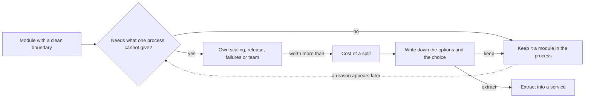

## Bạn cần biết trước

- [[design.l3.before-extracting-a-module]] — bạn biết cần thay đổi những gì thì job gửi email mới chạy được trong process riêng. Bài này hỏi có nên làm thế hay không.
- [[k8s.l1.deploying-don-hang]] — bạn biết ở stage-2, Deployment `api` chạy hai replica trên cluster.
- [[backend.l2.skip-locked-claiming]] — bạn biết `FOR UPDATE SKIP LOCKED` cho phép nhiều bản sao của bên gửi cùng dùng một hàng đợi mà không nhận trùng một dòng.

## Tình huống

Đang ở stage-2, và bạn đã biết những gì buộc job gửi email vào ordering. Một đồng nghiệp muốn cắt hết các mối nối đó và biến job thành một microservice. Lý lẽ của họ đến từ `deploy/k8s/api.yaml`: api chạy hai replica, mỗi replica tự khởi động một `NotificationSender`, nên job gửi email chạy hai lần. "Hai bản sao của một job nền là lãng phí," họ nói. "Thành service riêng thì nó chỉ cần chạy một bản, và scale theo cách của riêng nó."

Bạn xem log. Chưa từng có email nào bị gửi hai lần. Vậy mà kế hoạch này vẫn kéo theo một image mới, một pipeline mới, và phải cắt mọi mối nối đã liệt kê ở bài trước.

Khi nào một module đáng được thành service riêng?

## Khái niệm cốt lõi

- scale riêng — chạy một phần với số bản sao khác phần còn lại, vì tải của phần đó khác.
- release riêng — đưa ra phiên bản mới của một phần mà không phải build và deploy phần còn lại.
- lỗi riêng — không để một phần bị crash hay chạy chậm mà dùng hết thứ phần còn lại cần để tiếp tục hoạt động.
- team riêng — cho một team sửa, release và vận hành một phần mà không phải chờ team khác.
- cái giá khi tách — những gì một service riêng thêm vào: lời gọi qua mạng có thể thất bại, nhiều lần lưu tách biệt thay cho một giao dịch, và thêm một image, một pipeline, một dashboard phải vận hành.

## Cơ chế hoạt động



Câu hỏi đầu tiên không phải là module có chạy riêng được không, mà là nó có cần thứ gì một process không đáp ứng được hay không. Có bốn nhu cầu có thể biện minh cho một service riêng: scale riêng, release riêng, lỗi riêng, hoặc team riêng.

Trong tình huống trên, chỉ có chuyện scale. Mỗi replica `api` chạy một `NotificationSender`, nên job có bao nhiêu bản sao thì API có bấy nhiêu, và `FOR UPDATE SKIP LOCKED` giữ cho hai bản sao không cùng lúc nhận một dòng. Vì vậy hai bên gửi chia nhau các email đến hạn, chứ không phải cả hai cùng gửi từng email. Cái giá thêm vào chỉ là bản sao thứ hai của vòng lặp. Dùng chung số bản sao với API chỉ tốn kém khi job cần một số bản sao khác. Chừng nào chưa cần, bên gửi thứ hai không phải lãng phí. Đó là nhánh "no": giữ nguyên module.

Ở nhánh "yes", tiếp theo là cái giá khi tách. Lời gọi method thành lời gọi qua mạng, có thể chậm hoặc thất bại. Những gì một giao dịch từng lưu cùng lúc thành nhiều lần lưu tách biệt. Còn team phải vận hành thêm một image, một pipeline và một dashboard. Lý do phải đáng giá hơn tất cả những thứ đó.

Sau khi cân lý do với cái giá, hãy ghi lại các lựa chọn và quyết định: tách, hay giữ nguyên module. Lựa chọn nào cũng có đánh đổi, nên ghi lại cũng là một phần của quyết định, chẳng hạn trong một design doc.

Mũi tên nét đứt là thứ modular monolith mang lại. Một module có ranh giới rõ ràng vẫn tách ra được khi có lý do, và các mối nối cần cắt đã được biết trước, nên team có thể ước lượng cái giá trước. Không tách bây giờ vẫn để ngỏ chuyện tách sau này, miễn là ranh giới vẫn rõ ràng.

## Trong hệ thống Đơn Hàng

Nơi đặt số bản sao:

```yaml file=deploy/k8s/api.yaml tag=stage-2 lines=5-24
apiVersion: apps/v1
kind: Deployment
metadata:
  name: api
  namespace: donhang
spec:
  replicas: 2
  selector:
    matchLabels:
      app: api
  template:
    metadata:
      labels:
        app: api
    spec:
      containers:
        - name: api
          image: ghcr.io/duyan11110/donhang-api:1.0.0
          ports:
            - containerPort: 8080
```

Dòng 11, `replicas: 2`, là con số duy nhất trong Deployment này quyết định có bao nhiêu bản sao chạy. Mọi Pod tạo từ template đều chạy cùng container `api` từ cùng một image, và container api chạy app thành một process, nên mỗi bản sao là một process api. Không chỗ nào ở đây nói được "hai bản sao API, ba bản sao job gửi email".

Vì sao job gửi email đi theo mỗi bản sao:

```csharp file=DonHang.Api/Program.cs tag=stage-2 lines=29-32
// lesson: backend.l2.hosted-services
// The host starts NotificationSender when the app starts and stops it when
// the app stops; it runs in this same process, beside the requests.
builder.Services.AddHostedService<NotificationSender>();
```

Dòng 32 đăng ký `NotificationSender` thành hosted service, và comment phía trên nói host khởi động nó cùng app, trong cùng process. Vì thế hai replica nghĩa là hai bên gửi. Hai bên không cùng lúc nhận một dòng là nhờ `ClaimDueAsync` trong `DonHang.Infrastructure/NotificationQueue.cs`, nằm ngoài đoạn trích này. Muốn bên gửi có số bản sao riêng, nó phải chạy trong một process khác, thuộc một Deployment khác.

## Senior hay nhầm rằng…

- **"Hệ thống có nhiều module thì nên thành nhiều service, mỗi module một service, càng sớm càng tốt."** → Thực ra lần tách nào cũng phải trả cái giá ở trên, và ranh giới module đã cho phần lớn những gì một lần tách hứa hẹn: mỗi bảng một chủ, và chỉ gọi nhau qua hợp đồng. Hãy tách một module khi nó có một trong bốn nhu cầu, không phải vì nó có ranh giới. Khi nhiều team đã sở hữu các module riêng và mỗi team phải release theo lịch của mình, nhiều service hơn có thể là câu trả lời đúng. Bạn sẽ nhận ra khi release một service "độc lập" vẫn cần release kèm một service khác, tức là tách ra chẳng cho release riêng nào, chỉ thêm cái giá.
- **"Tách service luôn làm hệ thống nhanh hơn, vì mỗi phần có process riêng."** → Thực ra mọi lời gọi đi qua ranh giới mới giờ phải trả giá một chuyến qua mạng và có thể thất bại. Nó chỉ làm phần còn lại nhanh hơn khi phần bị chuyển đi từng tranh CPU và bộ nhớ của cùng process với phần còn lại. Bạn sẽ nhận ra khi một request trước đây chỉ gọi một method giờ phải chờ một service thứ hai, và thời gian response tăng lên.
- **"Không tách module ngay bây giờ thì sau này sẽ không tách được nữa."** → Thực ra thứ khiến tách sau này khó là các mối nối, không phải thời gian chờ. Một module sở hữu các bảng của nó và chỉ được gọi qua hợp đồng thì tách ra được khi có lý do, và danh sách mối nối cho bạn biết cái giá trước khi bắt đầu. Bạn sẽ nhận ra khi khối lượng công việc để tách một module hóa ra đúng bằng các mối nối bạn đã liệt kê từ trước.

## Thử ngay (3 phút)

Trong thư mục gốc của repo ví dụ, mở terminal:

1. Chạy `git show stage-2:deploy/k8s/api.yaml` và tìm `replicas`.
2. Chạy `git show stage-2:DonHang.Api/Program.cs` và tìm `AddHostedService`.
3. Trả lời: trên cluster có bao nhiêu bản sao `NotificationSender` đang chạy? Bạn phải thay đổi gì để chạy hai bản sao API nhưng ba bản sao job gửi email?

Kết quả mong đợi: `replicas: 2` và `builder.Services.AddHostedService<NotificationSender>();`, nên có hai bên gửi đang chạy, mỗi process api một bên.

<details><summary>Gợi ý đáp án</summary>

Trong `api.yaml` không có gì đặt số bản sao của bên gửi tách khỏi số bản sao của API: `replicas` quyết định cả hai. Muốn ba bên gửi và hai API, bên gửi phải nằm trong process riêng, thuộc Deployment riêng, và muốn process đó thành service riêng thì phải cắt các mối nối của bài trước. Chỉ đáng làm vậy nếu job thật sự cần số bản sao khác, chẳng hạn email dồn ứ trong khi các bản sao API không có việc gì làm. Hiện chưa có dấu hiệu đó, nên riêng chuyện scale chưa phải lý do để tách. Một lý do thuộc loại khác thì có thể: nếu một mail server chậm dùng hết CPU và bộ nhớ mà request đặt hàng cũng cần, hoặc nếu một phần khác của hệ thống cũng phải gửi email.

</details>

## Liên hệ

- [[design.l3.before-extracting-a-module]] — cùng quyết định nhìn từ phía bên kia: bài đó liệt kê những gì phải thay đổi khi tách, bài này hỏi có nên tách không.
- [[k8s.l1.deploying-don-hang]] — nơi hai replica `api` mang theo job gửi email được tạo ra.
- [[backend.l2.skip-locked-claiming]] — vì sao hai bản sao của bên gửi vẫn an toàn, nhờ đó bớt đi một lý do để tách.
- [[management.l2.design-doc]] — nơi có thể ghi lại các lựa chọn và quyết định khi tách một service.
- [[design.l3.subdomains]] — cùng kiểu phán đoán ở một tầng cao hơn: bỏ công sức vào chỗ đáng, không phải mọi chỗ có thể.

## Tóm tắt 5 dòng

1. Chỉ tách một module thành service riêng khi nó cần thứ một process không đáp ứng được, và nhu cầu đó nặng hơn cái giá khi tách.
2. Các lý do gồm scale riêng, release theo lịch riêng, giữ lỗi của nó không lan sang phần còn lại, hoặc giao cho team khác sở hữu.
3. Ở stage-2, mỗi replica trong hai replica `api` chạy một `NotificationSender`, và `SKIP LOCKED` giữ cho chúng không cùng lúc nhận một dòng.
4. Tách ra sẽ thêm lời gọi qua mạng có thể thất bại, nhiều lần lưu tách biệt thay cho một giao dịch, và thêm một image, một pipeline, một dashboard.
5. Ranh giới module rõ ràng để ngỏ chuyện tách sau này, và ghi lại các lựa chọn cùng quyết định là một phần của quyết định.
