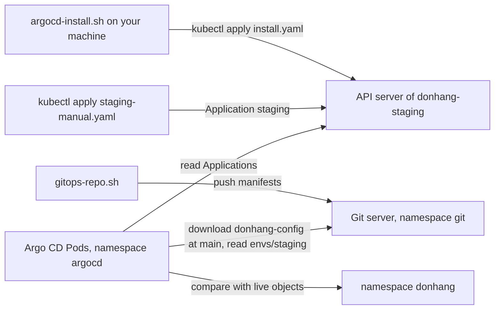

## Bạn cần biết trước

- [[devops.l3.pull-based-deployment]] — bạn biết GitOps chạy một agent bên trong cluster, agent này kéo trạng thái mong muốn từ Git về rồi apply.
- [[devops.l3.one-state-per-environment]] — bạn biết `tofu-environments.sh` tạo cluster `donhang-staging` cùng namespace `donhang` của nó, còn production mới chỉ nằm trong kế hoạch.
- [[k8s.l1.namespaces]] — bạn biết namespace gom các object bên trong một cluster, và kubectl chọn namespace bằng `-n`.

## Tình huống

Ở stage-3, cluster `donhang-staging` đã tồn tại: OpenTofu tạo ra nó cùng namespace `donhang`. Các manifest mà staging cần chạy nằm trong `deploy/gitops/config-repo/envs/staging`, cạnh một thư mục cho production. Bạn đã chọn kiểu kéo, nên một agent bên trong cluster sẽ đọc chúng từ Git.

Còn thiếu hai thứ. Bên trong `donhang-staging` chưa có gì chạy để kéo. Và kể cả khi có một agent làm được, nó vẫn cần biết đọc repository nào, thư mục nào trong đó, và các file ấy thuộc namespace nào. Nếu trỏ vào cả repository, agent không phân biệt được file của staging với file của production. Agent vào cluster bằng cách nào, và bạn ghi lại thư mục nào đi vào đâu ở chỗ nào?

## Khái niệm cốt lõi

- **Argo CD** (công cụ GitOps chạy trong cluster Kubernetes: so manifest trong Git với object đang chạy và sync chúng) — một agent GitOps chạy dưới dạng các Pod bên trong cluster, so các manifest trong một repository Git với các object đang chạy, rồi apply chúng. Đơn Hàng chạy phiên bản 3.1 trong namespace `argocd` của `donhang-staging`.
- **Application (Argo CD)** (object của Argo CD nối một nguồn gồm repo, revision, thư mục với một đích gồm cluster, namespace) — một object thuộc loại mà Argo CD thêm vào API server. Nó ghi một nguồn (URL của repository, một revision như branch `main` hay một commit, và một thư mục) và một đích (một cluster và một namespace).
- **repo cấu hình** (config repository) — một repository Git chỉ chứa các manifest nói mỗi môi trường chạy gì, tách khỏi mã nguồn của ứng dụng. Repo cấu hình của Đơn Hàng là `donhang-config`.

## Cơ chế hoạt động



Bắt đầu từ `argocd-install.sh`. Argo CD không thể tự cài chính nó: trước khi nó chạy, không thứ gì trong cluster apply được nó. Vì vậy script làm bước đầu tiên đó từ máy bạn, giống cách `deploy.sh` đã làm, bằng `kubectl apply` trên `deploy/argocd/install.yaml`. File này là bản sao của install manifest mà dự án Argo CD công bố: một file YAML chứa mọi object của Argo CD, ghim ở 3.1.16. Muốn nâng cấp, bạn thay bản sao rồi chạy lại script.

Install manifest tạo các Pod của Argo CD trong `argocd`. Nó còn thêm các loại object mới vào API server: `Application` trở thành một loại được lưu giống `Deployment`, nên bạn viết một Application bằng YAML rồi `kubectl apply` nó. Một loại mới được thêm vào như thế nào thuộc về một module sau.

Tiếp theo, `gitops-repo.sh` khởi động một máy chủ Git trong namespace `git` và push nội dung của `deploy/gitops/config-repo` lên đó thành một repository mới, `donhang-config`, tách khỏi mã nguồn `don-hang`. Nhờ vậy bài lab không cần tài khoản trên dịch vụ bên ngoài nào.

Trong tình huống trên, "thư mục nào đi vào đâu" được ghi trong Application `staging`, thứ bạn tạo bằng `kubectl apply` trên `staging-manual.yaml`. Nguồn của nó là `envs/staging` của `donhang-config` trên branch `main`. Đích của nó là chính cluster Argo CD đang chạy, namespace `donhang`. Các Pod của Argo CD đọc Application từ API server, tải một bản sao của repository ở `main` từ máy chủ Git, đọc các manifest trong `envs/staging`, rồi so chúng với các object đang chạy trong `donhang`.

Argo CD có tự apply chúng hay không là do Application quy định. `staging-manual.yaml` bỏ phần đó, nên lúc này Argo CD chỉ so sánh. Thư mục production nằm cùng repository, nhưng không Application nào trỏ tới nó, nên không thứ gì trong staging bị đem ra so với nó.

## Trong hệ thống Đơn Hàng

Script đưa Argo CD vào `donhang-staging`:

```bash file=scripts/devops/argocd-install.sh tag=stage-3 lines=9-28
# lesson: devops.l3.argo-cd-applications
# Argo CD cannot install itself: this script applies it, from the copy of its
# install manifest in deploy/argocd/ (version 3.1.16). Running it again with a
# changed copy is how Argo CD is upgraded.
echo "== Argo CD into the namespace argocd"
kubectl create namespace argocd --dry-run=client -o yaml | kubectl apply -f - -o name
# One line per kind of object, with how many of that kind the manifest holds.
kubectl apply -n argocd -f deploy/argocd/install.yaml -o name | sed -E 's#/.*##' | sort | uniq -c
kubectl rollout status deployment --namespace argocd --timeout=600s >/dev/null
kubectl rollout status statefulset/argocd-application-controller -n argocd --timeout=600s >/dev/null
echo

echo "== what runs it"
kubectl get deployments,statefulsets -n argocd
echo

# Applying it added kinds of objects the API server did not know before;
# kubectl now reads and applies an Application like a Deployment.
echo "== the kinds of objects Argo CD added"
kubectl api-resources --api-group=argoproj.io
```

```text output=true
== Argo CD into the namespace argocd
namespace/argocd
...
      3 customresourcedefinition.apiextensions.k8s.io
      6 deployment.apps
...
== what runs it
NAME                                               READY   UP-TO-DATE   AVAILABLE   AGE
deployment.apps/argocd-applicationset-controller   1/1     1            1           ...
deployment.apps/argocd-dex-server                  1/1     1            1           ...
deployment.apps/argocd-notifications-controller    1/1     1            1           ...
deployment.apps/argocd-redis                       1/1     1            1           ...
deployment.apps/argocd-repo-server                 1/1     1            1           ...
deployment.apps/argocd-server                      1/1     1            1           ...

NAME                                             READY   AGE
statefulset.apps/argocd-application-controller   1/1     ...

== the kinds of objects Argo CD added
NAME              SHORTNAMES         APIVERSION             NAMESPACED   KIND
applications      app,apps           argoproj.io/v1alpha1   true         Application
applicationsets   appset,appsets     argoproj.io/v1alpha1   true         ApplicationSet
appprojects       appproj,appprojs   argoproj.io/v1alpha1   true         AppProject
```

Một dòng trước đoạn trích này (không hiện ở đây) khiến mọi lệnh `kubectl` trong script thêm `--context kind-donhang-staging`, nên lệnh luôn tới `donhang-staging` dù kubectl đang trỏ vào cluster nào. kind, công cụ OpenTofu dùng để tạo `donhang-staging` thành một cluster local, đặt tên context của mỗi cluster là `kind-` cộng tên cluster. Dòng `kubectl create namespace` tạo `argocd` theo cách vẫn thành công khi namespace đã có. Dòng `kubectl apply -n argocd` là toàn bộ phần cài đặt: một lần apply bản sao đã ghim vào `argocd`. Hai dòng `rollout status` chờ tới khi các Pod của nó sẵn sàng.

Phần giữa của output cho thấy Argo CD gồm những gì: sáu Deployment, cộng `argocd-application-controller`, thứ được một loại object khác (`statefulset`) giữ cho chạy giống như Deployment làm. Trong số đó, `argocd-repo-server` đọc repository, còn `argocd-application-controller` so chúng với các object đang chạy. Ba object `customresourcedefinition` thêm ba loại ở cuối output. Chúng thêm bằng cách nào thuộc về một module sau, và module này chỉ dùng `Application`. `argoproj.io` là tên nhóm mà các loại của Argo CD được liệt kê dưới đó, nên `apiVersion` của chúng bắt đầu bằng tên này.

Application mà bài này apply:

```yaml file=deploy/gitops/lessons/staging-manual.yaml tag=stage-3 lines=1-20
# lesson: devops.l3.argo-cd-applications
# An Argo CD Application: where to read manifests (source) and where to apply
# them (destination). The source is the folder envs/staging of the config
# repository on the Git server inside the cluster, at its newest commit on
# main; the destination is this same cluster, namespace donhang. No sync
# policy: Argo CD only compares, and syncs when someone asks.
apiVersion: argoproj.io/v1alpha1
kind: Application
metadata:
  name: staging
  namespace: argocd
spec:
  project: default
  source:
    repoURL: http://gitea.git.svc:3000/donhang/donhang-config.git
    targetRevision: main
    path: envs/staging
  destination:
    server: https://kubernetes.default.svc
    namespace: donhang
```

Dòng 5–6 nói không trường nào ở đây khiến Argo CD tự apply các manifest của thư mục: nó chỉ so sánh, và apply khi có người yêu cầu (comment gọi lần apply đó là "sync"). Cách yêu cầu sẽ có ở một bài sau. Dòng 10–11: bản thân Application nằm trong `argocd`, không phải `donhang`, vì mặc định Argo CD chỉ đọc Application từ namespace của chính nó. Dòng 13, `project`, ghi tên một project của Argo CD, tức một nhóm quy tắc cho Application, sẽ học sau. Bạn để nó là `default`, một project Argo CD tự tạo sẵn, không phải namespace `default`.

Dòng 15–17 là nguồn: repository ở `gitea.git.svc`, tức Service `gitea` của máy chủ Git trong namespace `git`, branch `main`, thư mục `envs/staging`. Dòng 19–20 là đích: `kubernetes.default.svc` là địa chỉ của API server khi nhìn từ bên trong cluster, nên Argo CD deploy vào chính cluster nó đang chạy, namespace `donhang`.

Ngoài các đoạn trích này, `deploy/gitops/git-server.yaml` chạy một Pod máy chủ Git, và các repository của nó bị xóa cùng Pod. `gitops-repo.sh` apply file đó, rồi push `envs/` và `apps/staging.yaml` (dùng ở một bài sau) từ `deploy/gitops/config-repo`, cùng vài file `sealed-*.yaml` được sinh ra mà một bài sau sẽ giải thích, thành commit đầu tiên của `donhang-config`. Repository này công khai, nên Argo CD đọc nó không cần thông tin đăng nhập. Danh sách file mà script in ra chỉ có file `.yaml`: không có `src/`, không có Dockerfile.

## Senior hay nhầm rằng…

- **"Argo CD build image từ mã nguồn của ứng dụng."** → Thực ra Argo CD chỉ đọc manifest rồi apply chúng. Image do CI build và push, và manifest gọi một image bằng tag của nó. Bạn sẽ nhận ra khi danh sách file mà `gitops-repo.sh` in ra cho `donhang-config` chỉ có file `.yaml`, với các dòng `image:` ghi tên những image đã có sẵn trong một registry, như image `donhang-api` mà CI đã push.
- **"Argo CD chạy trên máy của developer và kết nối tới cluster, giống kubectl."** → Thực ra nó chạy dưới dạng các Pod bên trong `donhang-staging`, máy bạn chỉ apply nó một lần. Bạn sẽ nhận ra khi đích của Application là `kubernetes.default.svc` và repository của nó là `gitea.git.svc`, những cái tên chỉ phân giải được từ bên trong cluster.
- **"Application là một chương trình đang chạy, giống các Pod của một Deployment."** → Thực ra nó là một bản ghi trong API server mà các Pod của chính Argo CD đọc, không có gì chạy riêng cho từng Application. Bạn sẽ nhận ra khi `kubectl get applications -n argocd` liệt kê `staging`, còn `kubectl get pods -n argocd` không có Pod nào mang tên nó.

## Thử ngay (3 phút)

Bài này cần cluster `donhang-staging` mà `tofu-environments.sh` đã tạo ở bài trước. Trong thư mục repository `don-hang`, nếu chưa làm, hãy chạy `scripts/devops/argocd-install.sh`, rồi `scripts/devops/gitops-repo.sh`. Lần đầu, phần chuẩn bị này có thể mất hơn ba phút. Cả hai script tự nhắm vào `donhang-staging`, nên bạn không cần chuyển context trước. Sau đó:

1. Chạy `kubectl --context kind-donhang-staging apply -f deploy/gitops/lessons/staging-manual.yaml -o name`.
2. Chạy `kubectl --context kind-donhang-staging get applications -n argocd`, rồi `kubectl --context kind-donhang-staging get pods -n argocd`.

Kết quả mong đợi: bước 1 in ra `application.argoproj.io/staging`. Ở bước 2, lệnh đầu liệt kê một dòng tên `staging`, các cột còn lại tạm bỏ qua tới bài sau. Lệnh thứ hai chỉ liệt kê các Pod có tên bắt đầu bằng `argocd-`, không Pod nào tên `staging`.

## Liên hệ

- [[devops.l3.pull-based-deployment]] — mô hình mà bài này cài đặt: Argo CD là agent bên trong cluster.
- [[devops.l3.remote-state-and-locking]] — nửa còn lại của cùng cluster: state dùng chung của OpenTofu lo thứ tạo ra `donhang-staging`, còn Argo CD lo thứ chạy bên trong nó.
- [[devops.l2.cutting-a-release]] — image đến từ đâu: một lần release build và push chúng, còn repo cấu hình chỉ ghi tên chúng.
- [[devops.l3.synced-versus-healthy]] — bài kế: đọc những gì Argo CD báo về Application `staging`.

## Tóm tắt 5 dòng

1. Argo CD chạy bên trong cluster, và một Application, apply bằng kubectl, cho nó biết thư mục nào của repository đi vào namespace nào.
2. Argo CD không tự cài được: `argocd-install.sh` apply một bản sao đã ghim của install manifest, và nâng cấp nghĩa là thay bản sao đó.
3. Cài Argo CD thêm các loại object mới, như `Application`, mà kubectl đọc và apply giống một Deployment.
4. `staging-manual.yaml` nối `envs/staging` của repo cấu hình, branch `main`, với namespace `donhang` của cùng cluster.
5. Repo cấu hình chỉ chứa manifest và nằm trên một máy chủ Git bên trong `donhang-staging`, nên bài lab không cần tài khoản bên ngoài.
