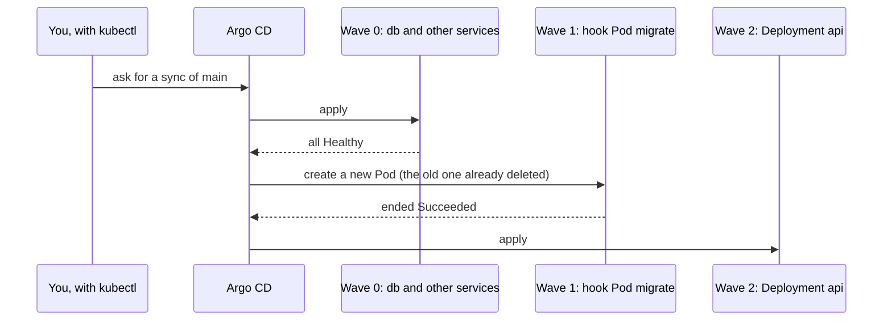

## Bạn cần biết trước

- [[devops.l3.synced-versus-healthy]] — bạn biết một lần sync apply `envs/staging` vào namespace `donhang`, rằng `kubectl patch` có thể yêu cầu Argo CD chạy một lần sync, và một Deployment chỉ `Healthy` khi các Pod của nó đã sẵn sàng.
- [[devops.l2.migrations-in-the-pipeline]] — bạn biết migration bundle chỉ apply những migration mà database còn thiếu, và `Program.cs` không còn migrate lúc khởi động nữa.
- [[k8s.l1.deploying-don-hang]] — bạn biết `deploy.sh` chạy một Pod `migrate` với `restartPolicy: Never` và chỉ apply api sau khi Pod đó thành công.

## Tình huống

Ở track k8s, `deploy.sh` dựng backend lên theo đúng thứ tự. Script apply database, chờ tới khi `deployment/db` available, chạy Pod `migrate`, chờ Pod kết thúc, và chỉ apply api nếu Pod kết thúc ở `Succeeded`. Thứ tự nằm ở những lần chờ giữa các lệnh kubectl.

Ở staging, không có script nào chạy cả. Một lần sync apply cả thư mục `envs/staging`, mà xếp theo tên thì `api.yaml` đứng trước `db.yaml` và `migrate-hook.yaml`. Api được apply trước migration sẽ chạy code mới trên các bảng cũ. Vậy điều gì khiến Argo CD dựng database lên, chạy migration, rồi mới apply api?

## Khái niệm cốt lõi

Annotation là một cặp khóa và giá trị nằm dưới `metadata.annotations` của object. Khác với label, annotation không dùng để chọn object nào, và các công cụ như Argo CD đọc nó như một chỉ dẫn.

- **sync wave (Argo CD)** (số thứ tự gắn vào object, Argo CD áp wave nhỏ trước và chờ wave đó healthy rồi mới sang wave sau) — một con số ghi trên object bằng annotation `argocd.argoproj.io/sync-wave`. Trong một lần sync, Argo CD apply wave nhỏ trước và chỉ chuyển sang wave kế khi wave hiện tại đã healthy. Object không có annotation này thuộc wave 0.
- **hook (Argo CD)** (object Argo CD tạo trong lúc sync để chạy một việc, vd Pod migration, thay vì giữ nó chạy mãi) — một object mang annotation `argocd.argoproj.io/hook`, được Argo CD tạo ra trong lúc sync để chạy một việc, thay vì giữ nguyên tại chỗ như các object khác. Giá trị của annotation là phase của hook, cho biết hook chạy trước, cùng lúc hay sau các object khác. `Sync` nghĩa là chạy cùng chúng. Hook có thể thuộc loại object bất kỳ, và trong Đơn Hàng thì đó là Pod migration.
- Hook deletion policy — annotation `argocd.argoproj.io/hook-delete-policy`, cho biết khi nào Argo CD xóa hook. `BeforeHookCreation` xóa hook cũ ngay trước khi lần sync tiếp theo tạo lại nó.

## Cơ chế hoạt động



Như ở bài trước, `kubectl patch` yêu cầu Argo CD sync, và Argo CD sync branch `main` của repo cấu hình. Argo CD sắp xếp mọi object theo phase, rồi theo sync wave từ nhỏ tới lớn, rồi theo loại, rồi theo tên. Object đến từ file nào không ảnh hưởng gì.

Hook của Đơn Hàng dùng `Sync`, cũng là phase mà mọi object không có annotation hook được apply, nên sync wave quyết định thứ tự giữa chúng.

Trong `envs/staging`, Deployment `db` được đánh dấu wave 0, và mọi object không có annotation, như Redis, Keycloak, Mailpit, các Service của chúng và các ConfigMap, cũng thuộc wave 0. Migration hook ở wave 1, còn Deployment `api` ở wave 2. Argo CD không chờ giữa các object trong cùng một wave. Ở đó, loại và tên chỉ quyết định thứ tự apply. Argo CD chờ tới khi tất cả đều healthy rồi mới bắt đầu wave kế. Vì vậy hook cần một wave riêng sau database, vì readiness probe của database phải đạt trước đã.

Ở wave 1, Argo CD không so hook với một bản đang chạy. `BeforeHookCreation` xóa Pod `migrate` cũ, vì hai Pod trong cùng namespace không thể trùng tên, rồi Argo CD tạo Pod mới. Argo CD chờ Pod đó kết thúc, chứ không chờ nó sẵn sàng: với hook, kết thúc ở `Succeeded` là điều hoàn tất wave của nó, và sau đó Argo CD apply wave 2. Kết thúc ở `Failed` làm lần sync thất bại ngay tại đó, và Deployment `api` giữ nguyên như cũ.

Mỗi lần sync cả thư mục đều chạy lại hook, bất kể thứ gì thay đổi. Trường hợp chỉ sync vài object được chọn không bàn ở đây. Một lần sync mà thay đổi duy nhất là số replica của api vẫn tạo một Pod `migrate` mới. Điều đó an toàn vì bundle bỏ qua những migration mà database đã ghi nhận.

## Trong hệ thống Đơn Hàng

Migration ở dạng hook, lấy từ thư mục staging:

```yaml file=deploy/gitops/config-repo/envs/staging/migrate-hook.yaml tag=stage-3 lines=7-22
apiVersion: v1
kind: Pod
metadata:
  name: migrate
  namespace: donhang
  annotations:
    argocd.argoproj.io/hook: Sync
    argocd.argoproj.io/sync-wave: "1"
    argocd.argoproj.io/hook-delete-policy: BeforeHookCreation
spec:
  restartPolicy: Never
  containers:
    - name: migrate
      # Always the same tag as the api in api.yaml.
      image: ghcr.io/duyan11110/donhang-migrate:sha-bb184243e4cafed6ae833ca61710608366214aa5
      args: ["--connection", "$(ConnectionStrings__Default)"]
```

Ba annotation này chứa toàn bộ thứ tự. `argocd.argoproj.io/hook: Sync` biến Pod thành một hook ở phase `Sync`, `sync-wave: "1"` đặt nó vào wave 1, còn `hook-delete-policy: BeforeHookCreation` xóa Pod `migrate` cũ trước khi tạo Pod mới. `restartPolicy: Never` không cho migration thất bại khởi động lại, nên Pod kết thúc ở `Failed` và lần sync dừng lại. Dòng `args` đưa cho bundle connection string của database, lấy từ một biến được khai báo ở phía dưới trong cùng file, nằm ngoài đoạn trích. Dòng này không liên quan gì tới thứ tự.

Phần cuối của script cho thấy thứ tự:

```bash file=scripts/devops/gitops-order.sh tag=stage-3 lines=41-62
# When each step happened, read back from the objects themselves, then put
# in the order it happened (the times sort as text).
when() { kubectl get "$1" -n donhang -o jsonpath="$2"; }
{
  echo "$(when deployment/db '{.status.conditions[?(@.type=="Available")].lastTransitionTime}') wave 0: Deployment db available"
  echo "$(when deployment/keycloak '{.status.conditions[?(@.type=="Available")].lastTransitionTime}') wave 0: Deployment keycloak available"
  echo "$(when pod/migrate '{.status.containerStatuses[0].state.terminated.startedAt}') wave 1: hook Pod migrate started"
  echo "$(when pod/migrate '{.status.containerStatuses[0].state.terminated.finishedAt}') wave 1: hook Pod migrate ended $(when pod/migrate '{.status.phase}')"
  echo "$(when deployment/api '{.metadata.creationTimestamp}') wave 2: Deployment api created"
} | sort -s -k1,1 | cut -d' ' -f2- | nl -w1 -s'. '
echo

# lesson: devops.l3.ordering-a-sync
# The hook runs on every sync, also when nothing changed: a new migrate Pod
# (BeforeHookCreation deleted the old one), and a bundle that skips the
# migrations the database has recorded.
echo "== one more sync, with nothing changed"
before=$(when pod/migrate '{.metadata.uid}')
sync_now
after=$(when pod/migrate '{.metadata.uid}')
[ "$before" != "$after" ] && echo "a new Pod migrate ran: $(when pod/migrate '{.status.phase}')"
kubectl logs pod/migrate -n donhang | grep -v "^Acquiring"
```

```text output=true
== sync waves and hooks in envs/staging
envs/staging/api.yaml: argocd.argoproj.io/sync-wave: "2"
envs/staging/db.yaml: argocd.argoproj.io/sync-wave: "0"
envs/staging/migrate-hook.yaml: argocd.argoproj.io/hook: Sync
envs/staging/migrate-hook.yaml: argocd.argoproj.io/sync-wave: "1"
envs/staging/migrate-hook.yaml: argocd.argoproj.io/hook-delete-policy: BeforeHookCreation

== emptying donhang
No resources found in donhang namespace.

== sync
sync: Succeeded
staging: Synced, Healthy

1. wave 0: Deployment db available
2. wave 0: Deployment keycloak available
3. wave 1: hook Pod migrate started
4. wave 1: hook Pod migrate ended Succeeded
5. wave 2: Deployment api created

== one more sync, with nothing changed
sync: Succeeded
a new Pod migrate ran: Succeeded
No migrations were applied. The database is already up to date.
Done.
```

Đọc output từ trên xuống. Các dòng script phía trước, nằm ngoài đoạn trích, in mọi annotation wave và hook, với `api.yaml` đứng đầu, rồi làm trống `donhang` và sync lại từ đầu. Sau đó đoạn trích đọc thời điểm của từng bước, sắp các dòng theo thời gian, bỏ cột thời gian đi và đánh số phần còn lại. Nó chỉ đọc hai Deployment của wave 0 làm ví dụ là `db` và `keycloak`, phần còn lại của wave 0 không được in ra. Deployment `api` xuất hiện sau cùng.

Phần cuối sync thêm một lần trong khi không có gì thay đổi. `sync_now`, được định nghĩa ở phía trước trong script, yêu cầu Argo CD sync bằng `kubectl patch` và chờ tới khi lần sync báo kết quả. Dòng cuối in log của Pod, bỏ dòng bắt đầu bằng `Acquiring` của bundle. Định danh của Pod đã khác, tức là một Pod `migrate` mới đã chạy, và bundle không tìm thấy migration nào để apply.

## Senior hay nhầm rằng…

- **"Argo CD apply các file theo thứ tự chúng được liệt kê trong thư mục."** → Thực ra Argo CD sắp các object theo phase, sync wave, loại và tên, vì nó đọc thư mục như một tập manifest, chứ không phải một danh sách các bước. Bạn sẽ nhận ra khi `gitops-order.sh` liệt kê `api.yaml` đầu tiên trong các annotation, vậy mà Deployment `api` lại được tạo sau cùng.
- **"Hook chỉ chạy khi chính manifest của nó thay đổi."** → Thực ra Argo CD tạo lại hook trong mỗi lần sync cả thư mục, vì hook không được giữ nguyên tại chỗ và đem so như các object khác. Bạn sẽ nhận ra khi lần sync thứ hai trong `gitops-order.sh`, dù không có gì thay đổi, vẫn chạy một Pod `migrate` mới với log báo không có migration nào được apply.
- **"Giờ không còn script sắp thứ tự các bước, nên mỗi replica của api nên tự migrate lúc khởi động."** → Thực ra hook đã cho bạn thứ tự mà không cần script. Khi có nhiều hơn một replica, chạy một lần migration trước khi apply api thì an toàn hơn: tài liệu của EF Core khuyên dùng một bước migration riêng khi rollout cần được phối hợp, như ở đây, nơi mọi Pod api mới phải khởi động trên một database đã migrate xong, hoặc khi app phải luôn chạy, vì một app đang đọc database trong lúc app khác migrate nó có thể hỏng. Với một bản duy nhất của app khi phát triển trên máy, migrate lúc khởi động vẫn là lựa chọn đơn giản. Bạn sẽ nhận ra trong output của script: Pod hook đã kết thúc trước khi Deployment `api` được tạo, nên không Pod nào của api gặp database chưa migrate.

## Thử ngay (3 phút)

Nếu chưa làm phần Thử ngay của bài trước, hãy làm nó trước để staging đã có lần sync đầu tiên. Sau đó, trong thư mục repository `don-hang`:

1. Chạy `scripts/devops/gitops-order.sh`. Script xóa các object trong `donhang` rồi sync lại từ đầu, nên có thể mất vài phút, lâu hơn con số 3 ở tiêu đề.
2. Đọc danh sách đánh số và bốn dòng cuối. Danh sách chỉ hiện ra sau khi lần sync từ đầu xong, nên phải chờ lâu trước đó là bình thường, không phải bị treo.

Kết quả mong đợi: danh sách bắt đầu bằng hai dòng wave 0 của `db` và `keycloak`, thứ tự nào cũng được, rồi Pod hook `migrate` bắt đầu và kết thúc ở `Succeeded`, rồi Deployment `api` được tạo. Các dòng cuối hiện `sync: Succeeded`, `a new Pod migrate ran: Succeeded`, thông báo của bundle rằng không có migration nào được apply, và `Done.`

## Liên hệ

- [[devops.l3.synced-versus-healthy]] — bài cần học trước: health status mà mỗi sync wave chờ trước khi wave kế bắt đầu.
- [[k8s.l1.deploying-don-hang]] — cùng thứ tự đó, viết thành các lần chờ trong `deploy.sh`, còn ở đây annotation trong manifest mang thứ tự ấy.
- [[devops.l2.migrations-in-the-pipeline]] — cùng ý tưởng trong Compose: `api` chỉ khởi động sau khi `migrate` đã hoàn tất thành công.
- [[k8s.l1.health-endpoints]] — `/health/ready`, endpoint kiểm tra PostgreSQL, quyết định khi nào các Pod của api được tính là sẵn sàng sau khi wave 2 được apply.
- [[devops.l3.deploying-by-commit]] — bài kế: một commit đổi tag image dẫn tới lần sync mà bài này sắp thứ tự.
- [[devops.l3.rollback-by-revert]] — nơi revert một commit gặp một migration đã chạy rồi.

## Tóm tắt 5 dòng

1. Khi không còn script chờ giữa các bước, sync wave và hook ghi trong manifest sắp thứ tự cho database, migration và api.
2. Một lần sync sắp object theo phase, rồi sync wave (nhỏ trước, mặc định là 0), rồi loại và tên, không bao giờ theo thứ tự file.
3. Argo CD chỉ bắt đầu wave kế khi mọi object trong wave hiện tại đã healthy, và một hook thất bại sẽ dừng lần sync.
4. Staging của Đơn Hàng đặt database và các service khác ở wave 0, Pod hook migration ở wave 1 và api ở wave 2.
5. Hook chạy trong mỗi lần sync cả thư mục, sau khi `BeforeHookCreation` xóa Pod cũ, nên bundle phải bỏ qua những migration đã ghi nhận.
