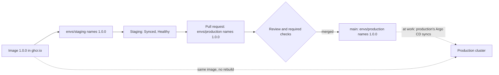

## Bạn cần biết trước

- [[devops.l3.rollback-by-revert]] — bạn biết mọi thay đổi ở staging, tiến lên hay lùi lại, đều là một commit vào `envs/staging` mà Argo CD sync.
- [[devops.l3.one-state-per-environment]] — bạn biết staging và production mỗi bên có thư mục OpenTofu riêng, khác nhau ở các giá trị truyền vào.
- [[devops.l2.cutting-a-release]] — bạn biết `1.0.0` là image `sha-` của một commit được push lại dưới một tag phiên bản, không build lại gì.

## Tình huống

Từ lần revert, staging chạy api `1.0.0`: Application ở trạng thái `Synced` và `Healthy`, và nhóm đã kiểm phiên bản đó trên staging. Repo cấu hình có thêm một thư mục thứ hai, `envs/production`, dành cho một cluster production. File `api.yaml` của nó vẫn ghi một tag `sha-…` cũ hơn và đòi 3 replica, trong khi staging đòi 2. Trưởng nhóm nhờ bạn đưa `1.0.0` lên production. Bạn có thể chạy lại workflow release, chép cả thư mục staging sang, hoặc sửa tag. Thay đổi nào cho production đúng thứ staging đã kiểm, vào đúng lúc cả nhóm đã đồng ý?

## Khái niệm cốt lõi

- **promotion (between environments)** (Đưa đúng phiên bản đã kiểm ở môi trường trước (vd staging) sang môi trường sau, không build lại) — chuyển đúng phiên bản một môi trường đã kiểm, ở đây là `1.0.0` của staging, sang môi trường kế tiếp bằng cách ghi cùng image đó, không build lại.
- Thư mục môi trường — `envs/staging` hoặc `envs/production` trong repo cấu hình: một bộ manifest đầy đủ cho một môi trường, do Application của môi trường đó đọc.
- Pull request promotion — commit promotion được mở ra để review thay vì push thẳng lên `main`, để lúc merge chính là lúc production thay đổi.
- Bản sao bị quên — một thay đổi làm ở thư mục của môi trường này mà không làm ở môi trường kia, khiến hai bên khác nhau mà không ai chọn như vậy.

## Cơ chế hoạt động



`envs/staging` và `envs/production` mỗi thư mục chứa một bộ manifest đầy đủ: api, migration hook của nó, database và các service còn lại. Chúng khác nhau ở giá trị, như số replica của api, 2 ở staging và 3 ở production, và tag image. Chỉ thư mục của staging chứa thêm các Secret của nó, được mã hóa bằng `scripts/devops/seal-secrets.sh`. Cách làm đó là chủ đề của module sau. Thư mục của production không có Secret nào.

Promotion là một commit vào `envs/production` đặt đúng tag mà staging đang chạy. Cả api lẫn migration hook đổi sang `1.0.0`, một image trên `ghcr.io`, container registry mà CI push lên. Không gì được build, nên production pull đúng image staging đã kiểm, miễn là không ai push một image khác dưới tag `1.0.0`.

Khi nhóm muốn production chỉ thay đổi sau khi có người thứ hai xem qua, bạn mở commit đó thành pull request thay vì push lên `main`. Lúc này review và các check bắt buộc quyết định khi nào production thay đổi. Trong CI, một quy tắc bảo vệ như bắt buộc có người duyệt chặn job tham chiếu tới một môi trường deploy. Với repo cấu hình, nơi một commit chính là lần deploy, pull request làm đúng vai trò đó. Khi pull request được merge, Argo CD của production sẽ sync `envs/production` từ `main`.

Một bản sao đầy đủ cho mỗi môi trường có cái giá của nó. Một thay đổi dành cho cả hai, chẳng hạn một probe mới, phải làm ở cả hai thư mục. Quên một bên, hai môi trường sẽ khác nhau mà không ai quyết định như vậy, và khi đó staging kiểm một thứ production không chạy.

Trong lab, không gì sync production. OpenTofu chỉ plan cluster đó, và không Application nào đọc `envs/production`. Vì thế ở đây commit và diff của nó là toàn bộ lần promotion.

## Trong hệ thống Đơn Hàng

`api.yaml` của production, ở chỗ số replica:

```yaml file=deploy/gitops/config-repo/envs/production/api.yaml tag=stage-3 lines=16-20
spec:
  # lesson: devops.l3.promoting-between-environments
  # What differs between envs/staging and envs/production: the number of
  # replicas here and the image tag below.
  replicas: 3
```

Dòng 18–19 là ghi chú của chính repository về chỗ khác nhau. `api.yaml` của staging có đúng những dòng này với `replicas: 2`. Phần còn lại của hai file giống nhau, trừ tag và dòng chú thích đầu file ghi tên môi trường.

Script promotion, từ dòng 9:

```bash file=scripts/devops/gitops-promote.sh tag=stage-3 lines=9-27
tag_in() { sed -nE 's#^ *image: ghcr.io/duyan11110/donhang-api:(.*)$#\1#p' "$config_repo/envs/$1/api.yaml"; }

# The two folders hold full sets of manifests that differ only in values.
echo "== envs/staging and envs/production differ in"
diff "$config_repo/envs/staging" "$config_repo/envs/production" | grep '^[<>]' | grep -v -e '^. # ' || true
echo

# lesson: devops.l3.promoting-between-environments
# Promotion: set production's tags to the ones staging runs and checked,
# the same images, not rebuilt. At work this commit would be a pull request,
# so review and required checks decide when production changes.
staging_tag=$(tag_in staging)
production_tag=$(tag_in production)
echo "== promote api $staging_tag (production runs $production_tag)"
perl -pi -e "s/:\Q$production_tag\E\$/:$staging_tag/" \
  "$config_repo/envs/production/api.yaml" "$config_repo/envs/production/migrate-hook.yaml"
config_commit gitops-promote.sh "Promote api $staging_tag to production"
git -C "$config_repo" show --stat --format='%h %an: %s' HEAD
git -C "$config_repo" show --format= HEAD
```

```text output=true
== envs/staging and envs/production differ in
<   replicas: 2
>   replicas: 3
<           image: ghcr.io/duyan11110/donhang-api:1.0.0
>           image: ghcr.io/duyan11110/donhang-api:sha-bb184243e4cafed6ae833ca61710608366214aa5
<       image: ghcr.io/duyan11110/donhang-migrate:1.0.0
>       image: ghcr.io/duyan11110/donhang-migrate:sha-bb184243e4cafed6ae833ca61710608366214aa5

== promote api 1.0.0 (production runs sha-bb184243e4cafed6ae833ca61710608366214aa5)
... gitops-promote.sh: Promote api 1.0.0 to production

 envs/production/api.yaml          | 2 +-
 envs/production/migrate-hook.yaml | 2 +-
 2 files changed, 2 insertions(+), 2 deletions(-)
diff --git a/envs/production/api.yaml b/envs/production/api.yaml
index f7e4225..56ab902 100644
--- a/envs/production/api.yaml
+++ b/envs/production/api.yaml
@@ -39,7 +39,7 @@ spec:
           # lesson: devops.l3.rollback-by-revert
           # A deploy is a commit that changes this tag, and the migration
           # hook's, to one CI has pushed to ghcr.io.
-          image: ghcr.io/duyan11110/donhang-api:sha-bb184243e4cafed6ae833ca61710608366214aa5
+          image: ghcr.io/duyan11110/donhang-api:1.0.0
           ports:
             - containerPort: 8080
           envFrom:
diff --git a/envs/production/migrate-hook.yaml b/envs/production/migrate-hook.yaml
index a810213..eac7065 100644
--- a/envs/production/migrate-hook.yaml
+++ b/envs/production/migrate-hook.yaml
@@ -18,7 +18,7 @@ spec:
   containers:
     - name: migrate
       # Always the same tag as the api in api.yaml.
-      image: ghcr.io/duyan11110/donhang-migrate:sha-bb184243e4cafed6ae833ca61710608366214aa5
+      image: ghcr.io/duyan11110/donhang-migrate:1.0.0
       args: ["--connection", "$(ConnectionStrings__Default)"]
       env:
         - name: ConnectionStrings__Default

== Applications that read envs/production
none
```

Dòng 9 (`tag_in`) đọc tag của api từ `api.yaml` trong một thư mục. Dòng 13 (`diff`) so hai thư mục và chỉ giữ những dòng khác nhau, bỏ qua các dòng chú thích ở đầu mỗi file. Dòng 20–21 (`staging_tag=`, `production_tag=`) đọc tag của cả hai bên, và dòng 23–24 (`perl`) thay tag của production bằng tag của staging trong `api.yaml` và `migrate-hook.yaml`. Dòng 25 (`config_commit`) commit qua một hàm hỗ trợ trong `scripts/lib/gitops.sh`, nằm ngoài đoạn trích. Dòng 26–27 (`git`) in danh sách file và diff của commit đó.

Trong output, khối đầu cho thấy ba dòng khác nhau: số replica và hai tag image. Commit đổi hai file, mỗi file một dòng. Output đã chụp hiện `...` ở chỗ id commit, vì id này khác nhau giữa các lần chạy. Khối cuối đến từ các dòng sau đoạn trích, những dòng hỏi cluster xem Application nào đọc `envs/production`: `none`.

## Senior hay nhầm rằng…

- **"Promote lên production nghĩa là build lại image từ commit đã gắn tag."** → Thực ra promotion ghi đúng tag staging đang chạy, nên production pull đúng image staging đã kiểm, miễn là không ai push một image khác dưới tag đó. Build lần hai cho ra một image mới mà staging chưa từng chạy. Kể cả từ cùng một commit, những thứ bản build kéo về lúc đó vẫn có thể khác, chẳng hạn một image mới hơn nằm sau tag trong `FROM`. Bạn sẽ nhận ra khi hai môi trường hiện cùng phiên bản nhưng image digest khác nhau, và một lỗi chỉ xuất hiện ở production.
- **"Mỗi môi trường cần một branch sống lâu riêng, và promote nghĩa là merge branch này vào branch kế tiếp."** → Thực ra một lần merge mang theo mọi thay đổi trên branch, kể cả những giá trị cần giữ khác nhau, như 2 replica của staging. Với mỗi môi trường một thư mục trên `main`, commit promotion chỉ chạm vào file của production. Branch theo môi trường dùng được khi các môi trường chỉ khác nhau ở chỗ bên này đi sau bên kia bao xa. Một khi chúng phải khác nhau lâu dài, lần merge nào cũng phải né những giá trị đó. Bạn sẽ nhận ra khi một lần merge từ branch staging đưa `replicas: 2` vào production.
- **"Staging và production dùng chung một thư mục cũng được, miễn là chạy trên hai cluster khác nhau."** → Thực ra khi đó Argo CD của cả hai cluster sẽ apply cùng một bộ manifest, nên commit nào cũng tới cả hai, và không còn chỗ cho số replica riêng hay tag cũ hơn của production. Promotion cần một thư mục có thể ghi một phiên bản mà staging đã qua. Bạn sẽ nhận ra khi một commit dành cho staging thay đổi production ở lần sync kế tiếp.

## Thử ngay (3 phút)

Khi staging đã quay về `1.0.0` sau `scripts/devops/gitops-revert.sh`, trong thư mục repository `don-hang`:

1. Chạy `scripts/devops/gitops-promote.sh`.
2. Đọc khối sau `== promote api`, rồi dòng cuối.

Kết quả mong đợi: `== promote api 1.0.0 (production runs sha-bb184243e4cafed6ae833ca61710608366214aa5)`, một commit `Promote api 1.0.0 to production` chỉ đổi `envs/production/api.yaml` và `envs/production/migrate-hook.yaml`, mỗi file một dòng, và `none` dưới `== Applications that read envs/production`. Lần chạy thứ hai thấy production đã ở `1.0.0`, in `== promote api 1.0.0 (production runs 1.0.0)` rồi dừng, vì không còn gì để commit.

## Liên hệ

- [[devops.l3.rollback-by-revert]] — cùng loại commit đó, ở môi trường trước một bậc: ở đó nó đưa staging lùi lại, ở đây nó đưa production tiến lên.
- [[devops.l2.cutting-a-release]] — nơi `1.0.0` ra đời mà không build lại. Promotion giữ lời hứa đó tới tận production.
- [[devops.l3.one-state-per-environment]] — cùng cách tách đó ở tầng dưới: mỗi môi trường một thư mục cho OpenTofu, còn ở đây là cho các manifest Argo CD apply.
- [[devops.l2.deployment-environments]] — nơi một quy tắc bảo vệ chặn job. Ở đây pull request trên repo cấu hình đóng vai trò đó.
- [[management.l1.code-review-basics]] — lần review mà giờ đây quyết định khi nào production thay đổi.

## Tóm tắt 5 dòng

1. Promote là một commit vào `envs/production` ghi tag của staging, nên production nhận đúng image staging đã kiểm, trừ khi ai đó push lại tag đó.
2. `envs/staging` và `envs/production` chứa bộ manifest đầy đủ, khác nhau ở các giá trị như số replica và tag. Chỉ thư mục của staging chứa Secret đã mã hóa.
3. Mở thành pull request, commit promotion để review và các check bắt buộc quyết định khi nào production thay đổi.
4. Với một bản sao đầy đủ cho mỗi môi trường, một thay đổi dùng chung như probe mới phải làm hai lần. Quên một bản là hai bên khác nhau ngoài ý muốn.
5. Trong lab, không Application nào đọc `envs/production`, nên `gitops-promote.sh` cho thấy commit và diff của nó, không phải một lần rollout.
