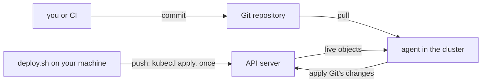

## Bạn cần biết trước

- [[devops.l3.configuration-drift]] — bạn biết drift là một thay đổi làm bên ngoài các file, và OpenTofu chỉ phát hiện nó khi có người chạy plan.
- [[k8s.l1.deploying-don-hang]] — bạn biết `scripts/k8s/deploy.sh` apply `deploy/k8s/` vào cluster theo thứ tự, migration trước api.
- [[k8s.l1.control-plane-components]] — bạn biết một vòng điều khiển so trạng thái mong muốn với thứ đang chạy rồi hành động trên phần khác nhau.
- [[devops.l2.deployment-environments]] — bạn biết job `staging` trong `ci.yml` chạy một bản sao dùng xong bỏ trên runner riêng của nó, không phải một cluster chạy lâu dài.

## Tình huống

Ở stage-2, bạn deploy Đơn Hàng bằng cách chạy `scripts/k8s/deploy.sh` trên máy mình, vào cluster local trên đó. Một đồng nghiệp muốn deploy diễn ra mà không cần tới bạn: thêm một job trong `ci.yml` chạy `deploy.sh` sau `publish`. Job đó sẽ cần một kubeconfig của cluster cất trên GitHub, mà runner của GitHub vốn cũng không với tới được cluster trên laptop. Trong lúc đó, ai đó đã chạy `kubectl scale` trên `api` để thử một thứ: `kubectl get deployment api -n donhang` hiện một replica, `deploy/k8s/api.yaml` trong Git vẫn ghi hai, và không ai được báo. Ai nên làm cluster khớp với `deploy/k8s/`, và khi nào?

## Khái niệm cốt lõi

- **GitOps** (giữ trạng thái mong muốn của hệ thống trong Git; một agent trong cluster liên tục kéo về và làm cluster khớp với nó) — giữ trạng thái mong muốn của một cluster trong một repository Git và để một agent kéo nó về rồi apply, nên deploy nghĩa là tạo một commit. Trong khóa học này, agent chạy bên trong chính cluster mà nó deploy vào.
- **deploy kiểu kéo (pull)** (pull-based deployment) — deploy bằng cách để agent đó đọc trạng thái mong muốn rồi tự thay đổi cluster của mình, lặp đi lặp lại, thay vì một công cụ bên ngoài cluster đẩy thay đổi vào.
- Deploy kiểu đẩy (push) — điều `deploy.sh` làm: một chương trình bên ngoài cluster gửi các manifest tới API server một lần, mỗi khi có người chạy nó.
- Agent — một chương trình chạy dưới dạng các Pod trong cluster, đọc repository và nói chuyện với API server của chính cluster đó.

## Cơ chế hoạt động



Ở nhánh trên, `kubectl` gửi từng manifest tới API server bằng thông tin đăng nhập trong kubeconfig. Ai chạy `deploy.sh` thì phải giữ thông tin đăng nhập đủ quyền tạo Secret và xóa Pod trong `donhang`: ở đoạn sau, script dựng các Secret từ `.env` và xóa Pod `migrate` cũ.

`kubectl scale` đã đổi trạng thái mong muốn mà cluster lưu giữ. Chỉ còn `api.yaml` trong Git vẫn ghi hai, và không thứ gì trong cluster đọc file đó.

Nhánh dưới là GitOps ở dạng thường gặp: một agent bên trong cluster đọc trạng thái mong muốn từ repository rồi apply. Để deploy, bạn hoặc một job CI đổi `image:` trong `api.yaml` rồi push commit. Agent nhận thay đổi đó từ Git. Khi được cấu hình để tự apply những gì nó thấy, không ai phải chạy lệnh nào vào cluster. Cấu hình đó sẽ học ở bài sau. Agent là một vòng điều khiển, giống kube-scheduler: nó so repository với các object đang chạy, lặp đi lặp lại. Lần `kubectl scale` làm bằng tay hiện ra thành một khác biệt mà không cần ai chạy plan, khác với drift của OpenTofu. Tối thiểu agent báo khác biệt đó, và báo đã là hành động trên nó. Đổi nó về lại là một cấu hình thứ hai, tách khỏi cấu hình apply commit mới.

Kéo chuyển thông tin đăng nhập sang agent: quyền đọc repository, và quyền thay đổi object trong cluster của chính nó. Agent là bên mở kết nối, từ trong cluster ra một repository bên ngoài, nên không thứ gì bên ngoài phải với tới cluster. CI cần quyền ghi vào repository, chứ không cần quyền truy cập cluster.

Cái giá là thêm một thành phần phải cài, nâng cấp và theo dõi. Với một cluster nhỏ do một người deploy, một script đẩy chạy từ CI có thể là đủ. Khi nhiều người cùng deploy, hoặc CI không với tới được cluster, kiểu kéo đáng cái giá đó.

## Trong hệ thống Đơn Hàng

Phần đầu của script bạn đang chạy:

```bash file=scripts/k8s/deploy.sh tag=stage-2 lines=1-11
#!/usr/bin/env bash
# Deploy the Đơn Hàng backend to the kind cluster, in order: namespace, Secrets, ConfigMaps, PostgreSQL, Redis, Keycloak, Mailpit, the migration, then the api.
# Runs on the host, like every script in scripts/k8s/: it reads .env and db/ here and kubectl talks to the kind cluster from here.
set -euo pipefail
cd "$(dirname "$0")/../.."

# lesson: k8s.l1.deploying-don-hang
# Every step can run again: apply leaves what is already there unchanged.
# -o name prints each object once, whether it was created or not.
echo "== namespace"
kubectl apply -f deploy/k8s/namespace.yaml -o name
```

Dòng 3 nói gọn mô hình đẩy trong một câu: script chạy trên máy host, và `kubectl` nói chuyện với cluster từ đó. Dòng 8 nói mọi bước đều chạy lại được, nên lặp lại là an toàn, nhưng chỉ khi có người lặp lại. Dòng 11 là lần đẩy đầu tiên: namespace tồn tại vì máy này đã gửi nó. Sau khi script kết thúc, không phần nào của nó tiếp tục so cluster với `deploy/k8s/`.

Thứ CI đang giữ, trong job publish image:

```yaml file=.github/workflows/ci.yml tag=stage-2 lines=130-152
  # lesson: devops.l2.pushing-images-from-ci
  # Only master's green commits reach the registry. The job logs in with the
  # GITHUB_TOKEN GitHub creates for this run, which may push packages only
  # because `permissions:` says so. It pushes the images the tests passed
  # with: loaded from the artifact, never rebuilt.
  publish:
    if: github.event_name == 'push' && github.ref == 'refs/heads/master'
    needs: [test, image]
    runs-on: ubuntu-24.04
    permissions:
      packages: write
    steps:
      - uses: actions/download-artifact@v4
        with:
          name: images

      - name: Load the images
        run: docker load --input images.tar

      - name: Log in to GitHub Container Registry
        env:
          GITHUB_TOKEN: ${{ secrets.GITHUB_TOKEN }}
        run: echo "$GITHUB_TOKEN" | docker login ghcr.io --username "$GITHUB_ACTOR" --password-stdin
```

`permissions: packages: write` là quyền duy nhất job này xin: nó được đưa image vào registry. Không job nào trong `ci.yml` deploy vào một cluster chạy lâu dài. Một job khác trong `ci.yml`, `k8s`, tự tạo một cluster dùng xong bỏ trên runner, và cluster đó biến mất khi job kết thúc.

Một bước deploy kiểu đẩy thêm sau `publish` sẽ cần một kubeconfig có quyền trên cluster thật, cất dưới dạng một secret của GitHub. Với kiểu kéo, bước thêm vào sẽ là một commit đổi `image:` trong `api.yaml` sang tag của image `publish` vừa push. CI sẽ cần quyền ghi vào repository, và CI không còn giữ thông tin đăng nhập của cluster.

## Senior hay nhầm rằng…

- **"GitOps chỉ là giữ manifest Kubernetes trong Git, điều Đơn Hàng đã làm rồi."** → Thực ra Git cho `deploy/k8s/` lịch sử và review, nhưng chỉ `deploy.sh` đọc các file đó, và chỉ trong lúc nó chạy. GitOps thêm một agent trong cluster liên tục so chúng với các object đang chạy. Bạn sẽ nhận ra khi `kubectl get deployment api -n donhang` hiện số replica khác với `api.yaml`, mà không công cụ nào từng báo.
- **"Một job CI chạy `kubectl apply` sau mỗi lần merge là GitOps."** → Thực ra đó vẫn là đẩy: nó chỉ hành động khi pipeline chạy, CI giữ thông tin đăng nhập của cluster, và cluster phải với tới được từ runner của CI. Giữa hai lần merge, không gì so sánh cả. Bạn sẽ nhận ra khi một thay đổi làm bằng tay nằm lại trong cluster cho tới khi lần merge kế tiếp tình cờ apply đè lên nó.
- **"'Kéo' là nói về các node kéo image từ registry."** → Thực ra kubelet kéo image trong cả hai mô hình: `deploy.sh` đẩy manifest, và mỗi node vẫn tự kéo `ghcr.io/duyan11110/donhang-api:1.0.0`. "Kéo" chỉ ai là bên lấy trạng thái mong muốn: một agent trong cluster, lấy từ Git. `Events` là bản ghi của Pod về những gì đã xảy ra với nó. Bạn sẽ nhận ra khi `kubectl describe pod`, chạy ngay sau một lần deploy bằng `deploy.sh`, hiện dưới `Events` lần kéo image cho một Pod `api` là Pod đầu tiên chạy image đó trên node của nó.

## Thử ngay (3 phút)

Với cluster đang chạy và `deploy.sh` đã chạy xong, trong thư mục repository `don-hang`, ở shell bạn dùng cho `kubectl`:

1. Chạy `kubectl scale deployment/api -n donhang --replicas=1`.
2. Đợi một phút, rồi chạy `kubectl get deployment api -n donhang` và `grep -n "replicas:" deploy/k8s/api.yaml`.
3. Chạy `kubectl apply -f deploy/k8s/api.yaml` để đặt lại giá trị trong file.

Kết quả mong đợi: ở bước 2, cột `READY` hiện `1/1`, và `grep` in ra `11:  replicas: 2`. Không thứ gì trong cluster hành động trên khác biệt đó. Chỉ lệnh `kubectl apply` của chính bạn ở bước 3 mới đưa `api` về lại hai replica.

## Liên hệ

- [[k8s.l1.manifests-and-kubectl-apply]] — chính bước đẩy: `kubectl apply` làm object khớp với một manifest một lần, khi có người chạy nó.
- [[devops.l3.infrastructure-as-code]] — cùng vấn đề ở tầng dưới: một file trong Git mà không gì so với thứ đang tồn tại.
- [[devops.l3.configuration-drift]] — thời điểm ngược lại: OpenTofu chỉ phát hiện drift khi có người chạy plan, còn agent kiểu kéo thì liên tục kiểm tra.
- [[k8s.l1.control-plane-components]] — cùng loại vòng điều khiển mà agent chạy, ở đó do kube-scheduler chạy.
- [[devops.l3.argo-cd-applications]] — bài kế: cài một agent như vậy vào `donhang-staging`, một cluster OpenTofu tạo ra ở stage-3 và chạy lâu dài, khác với bản sao dùng xong bỏ trên runner, rồi chỉ cho nó đọc thư mục nào của repository nào.

## Tóm tắt 5 dòng

1. GitOps giữ trạng thái mong muốn của cluster trong Git và để một agent bên trong cluster kéo về rồi apply, nên một lần deploy là một commit.
2. `deploy.sh` đẩy manifest bằng `kubectl` từ máy bạn, nên ai chạy nó thì giữ thông tin đăng nhập có quyền thay đổi cluster.
3. Manifest nằm trong Git chưa phải là GitOps: sau khi script kết thúc, không gì so cluster với `deploy/k8s/`.
4. Agent kiểu kéo là một vòng điều khiển, so Git với các object đang chạy hết lần này tới lần khác, nên drift hiện ra mà không cần plan.
5. Kiểu kéo cho CI quyền ghi vào repository thay vì vào cluster, đổi lại phải vận hành thêm một thành phần.
